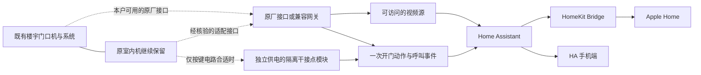

# 楼宇对讲接入 Home Assistant / Apple Home 调研

> 初始调研：2026-11-21；实物更新：2026-11-23。用户希望通过智能家居随时查看楼下门口画面、远程开楼道门。已确认Legrand／罗格朗，背标编号S6819161、简页LE13416AA A3；用户另补两组红黑线和一条RJ45，端子用途、电压及闲时功能未核实。详见[本机识别与手册调查](legrand-intercom-identification-and-manuals.md)。
>
> 本文保留通用可行性研究，**不是已确定的接线方案、采购单或部署记录**。实物编号与公开型号／专用手册尚未对应；已下载的凯蕴98页手册只适用其列明机型，不用于本机接线。全部现场验证均为 `not_run`。用户后续提到米家，需与原HA／Apple Home目标分别核兼容。楼下公共门禁与自家户门猫眼锁是两个系统；已取消的独立可视门铃不因此恢复采购。

## 1. 当前结论

2026-11-23新增[ESP旁路与网口监听专项研究](legrand-esp-intercom-bridge-research.md)：确认兼容总线上的ESP并联桥接有真实实现，区分控制消息、视频获取、米家接入；对本机仍先核RJ45线制与供电，以太网成立后优先只读镜像／TAP观察。没有因此确定采购或原机接线方案。

推荐按顺序确认：**原厂本地视频/开门接口或联网升级模块 → 精确型号兼容的转接器 → 室内机按键的隔离干接点改造**。远程开门通常比获取画面容易，视频和开门要分别选接入路径，不能只买一个智能继电器就承诺同时解决。

“随时看”和“随时开门”都必须在**没有来电、没有人按楼下门铃**时测试。有的系统只在通话期间提供视频或允许开锁；接上 HA、增加继电器或更换家庭控制屏，都不会自动消除这个限制。

| 目标 | 必要条件 | 当前状态 |
|---|---|---|
| 无人按铃时主动看楼下 | 原系统允许闲时监看，且有可接入的视频源或原厂远程监看接口 | 未知，不承诺 |
| 来电时看访客 | 能收到呼叫事件并获得该次通话的视频 | 未知；不等于闲时可看 |
| 一次性远程开门 | 原厂开门命令、兼容转接器，或可隔离模拟的开门按键；验证闲时是否允许 | 未知，优先研究 |
| 双向通话 | 视频之外还需音频、呼叫信令及客户端支持 | 单独验收，不由 RTSP 自动提供 |
| 手机/Apple Home 按铃通知 | 来电事件能进入 HA，并正确桥接或推送 | 未部署 |
| 录像与实际门状态 | 可用视频源/存储；门状态另需门口机反馈或门磁 | 不把命令成功当作门已打开 |

## 2. 接入路径比较

| 路径 | 画面 | 远程开门 | 对本项目的判断 |
|---|---|---|---|
| 原厂 IP 接口或联网升级模块 | 有授权 RTSP/ONVIF 等接口时可接 HA；闲时可用性须另验 | 原厂 API/SDK、官方模块或已支持集成 | **优先确认**，尽量本地运行；若只有原厂 App，不能直接推断支持 HA/Apple Home |
| Ring Intercom Video | 原厂确认可在 Ring App 看兼容视频对讲机的访客 | 原厂 App 支持远程开门 | 条件候选；型号、闲时监看、国内云服务、HA 视频均未确认，不先买 |
| Nuki Opener + Bridge | 不提供视频采集 | 兼容型号可开门、接收按铃事件 | 只补开门的备选；HA 动作语义须特别处理 |
| Aqara T2 / Shelly 干接点模拟室内机按键 | 无 | 仅在按键电路/外部接口合适时可行 | 原厂路径不通再评估；符合 Aqara 优先方向，但不能盲接总线 |
| 标准模拟视频输出 + 编码器 | 仅在明确视频制式、电气接口且原机能监看时可行 | 另用上述开门路径 | 工程备选，布线和维护成本较高；不先选采集盒 |

### 2.1 原厂 IP / 原厂升级路径

先向安装商或物业查询本户室内机能否增加联网模块、提供本户账号下的远程功能，以及是否提供本地视频和开门接口。视频可能来自楼下门口机，而不是室内屏本身；室内机有 RJ45 接口也不意味着它属于家庭以太网或使用标准 PoE。

- HA 的 [Generic Camera](https://www.home-assistant.io/integrations/generic/) 可以接入已知且可访问的 RTSP 流；[ONVIF](https://www.home-assistant.io/integrations/onvif/) 的视频/事件取决于设备支持，需核 H.264 等配置。ONVIF 可看视频不等于提供开门功能。
- SIP 支持主要描述呼叫/通话能力；不能据此推断有全天 RTSP、HA 开门实体或 Apple Home 双向音频。
- 海康部分型号有社区 [Hikvision-Addons](https://github.com/pergolafabio/Hikvision-Addons) 路径，利用 SDK/MQTT 提供呼叫、开门等功能；支持表同时列有不支持或只支持部分功能的型号。
- 大华部分型号有社区 [Dahua 集成](https://github.com/rroller/dahua)，使用本地 HTTP API/RTSP，支持部分对讲事件及开门功能。它不是所有 VTH/VTO 的兼容保证。
- 上述社区方案都要核完整型号、固件、本户可用账号、接口权限与网络可达性。不能因家中屏幕有同品牌标识，就认定能访问物业公共门口机。

家庭 Omada LAN 与楼宇专用网络保持各自边界。若原厂方案需要跨网络访问，按厂家给出的本户网关/接口方案落实，不直接把楼宇网线接进家庭交换机，也不对未知接口送 PoE。

### 2.2 兼容转接器：Ring 与 Nuki

**Ring Intercom Video 是真实存在的产品，与 Intercom Audio 区分。** [Video 官方页面](https://en-uk.ring.com/products/intercom-video)支持兼容视频室内机的访客画面、双向通话和远程开门，入口是 Ring App；[Audio 官方页面](https://en-uk.ring.com/products/intercom)明确不能因为连接视频室内机就获得视频串流或录像。两款都先用[官方兼容检查器](https://ring.com/intercom-compatibility-checker/)核型号，接线按该型号的原厂安装指引。

目前不能把 Video 当成本项目的确定答案：

1. 官方产品描述中的远程查看访客，不足以证明无人按铃时可随时主动监看。
2. [HA Ring 文档](https://www.home-assistant.io/integrations/ring/)列有 Intercom 开门按钮与事件，但未单独承诺 Intercom Video 的视频接入；该集成通过云服务通信，文档也列有双向音频限制。
3. 调研核对的 HA **2026.11.2** 使用 `ring-doorbell==0.9.14`。该版 HA 从 `video_devices` 创建 camera，而依赖的 `video_devices` 列表由 doorbots、authorized_doorbots、stickup_cams 构成，没有直接加入 intercoms。因此不能从“HA 支持 Ring”推导“新 Video 型号视频必定可用”；实际设备分类、后续版本与实机表现仍须验证，不能用开发分支能力当已发行能力。
4. 安装地为中国大陆，需要实测账号、云连接、呼叫推送和外网开门的可用性。未核国内购买渠道和保修，不给出本户可直接下单结论。

**[Nuki Opener](https://nuki.io/en/products/opener)** 适合给兼容对讲机补远程开门；Opener 本身不采集视频。其 BLE 链路通过独立 Nuki Bridge 接入网络，不能因为另有带 Wi-Fi 的 Nuki 门锁就省去 Bridge。[HA Nuki 集成](https://www.home-assistant.io/integrations/nuki/)可通过 Bridge 本地 HTTP API 工作，也支持按铃事件。

特别注意 HA 2026.11.2 的 [Nuki Opener 动作实现](https://github.com/home-assistant/core/blob/2026.11.2/homeassistant/components/nuki/lock.py)：

| HA 动作/状态 | Opener 实际含义 | 本项目处理 |
|---|---|---|
| `lock.open` | `electric_strike_actuation()`，一次电锁释放 | 这是一次性“楼道开门”应验证的动作 |
| `lock.unlock` | `activate_rto()`，开启 Ring to Open | **不是普通的一次性开门**，不要误映射到手机开门按钮 |
| `lock.lock` | `deactivate_rto()`，关闭 Ring to Open | 不是把楼下门扇实际锁上 |
| `is_locked` | 与 Ring to Open / continuous mode 是否启用有关 | 不能当作真实门磁/锁舌状态展示 |

因此不要未经处理就把 Nuki Opener 当成普通门锁桥接 Apple Home。先在 HA 验证独立的一次开门动作；按铃默认只通知，不启用持续放行或按铃自动开门。

### 2.3 隔离干接点：优先评估 Aqara，Shelly 备用

仅在原机具备**明确的外部无源触点输入，或经安装人员确认可并联模拟的低压机械开门按键**时采用。数字总线、触摸按键、矩阵键盘或带电控制端子不能凭外观直接短接。

| 条件候选 | 已核能力 | 选型前仍需确认 |
|---|---|---|
| [Aqara Dual Relay Module T2](https://www.aqara.com/en/product/dual-relay-module-t2/) | 官方支持 Dry Contact Mode，使用 Zigbee 网关，可通过兼容桥接路径进入生态 | 具体国行 SKU、M200/地区兼容、正确电源、设备端点动/自动断开、断电恢复状态、HA 实体暴露；不与原单 T2 灯带/T2 Pro 射灯混淆 |
| [Shelly 1 Gen4](https://kb.shelly.cloud/knowledge-base/shelly-1-gen4) | 明确 potential-free/dry contacts，可经 Wi-Fi 本地接 HA | 按实际供电版本/接线图选适配器，核自动关闭及恢复状态；不是直接接 PoE 的设备 |

干接点只模拟按键的接通/断开，不向室内机按键注入供电。模块独立供电，电源与触点用途分清；不能默认从对讲总线取电，也不能把普通照明继电器当成无源触点。

点动时长按原机要求测试，自动回弹尽量在设备端执行；不只依赖 HA 延时发送关闭命令。开机、重连和 HA 重启不得触发开门，重试也不得形成连续放行。保留原室内机实体按键和正常来电功能。

**如果原机只有接听后才接受开门键，模拟这个键仍受同样限制。** 这时应查原厂闲时开门接口，不把新增继电器写成“随时开门已解决”。

### 2.4 封闭总线的画面怎么处理

先查是否有原厂视频输出/分配器或联网升级模块。若确有 CVBS 等标准模拟视频输出，才进一步核电平、阻抗、缓冲/隔离和编码器，将其转换为 HA 可接入的 RTSP 流。普通 ESP32、USB 采集卡或网线转接头不是专用两线数字总线的通用解码器。

若需要按“监视”键才输出视频，可研究复用原机监视操作，但还须测试监看超时、占线、其他住户呼叫和释放行为；不能承诺持续 24 小时直播。原系统没有闲时画面或不给输出时，软件桥接不能凭空提供视频。

DoorBird/2N 等带开放接口的新门口机属于整套楼宇系统的选型范围，不是本户简单更换室内屏即可完成的改造；本次不列采购。自家猫眼锁看到的是自家户门外，也不能替代楼下门口机视角。

## 3. 与现有 HA、Apple Home 和网络的关系

以下是**条件路径图**，不是已接通的拓扑。视频、控制和事件接口可能分别来自室内机、原厂网关或门口机，须按型号落实。

- **服务器**：沿用J3455/Proxmox计划中的独立HAOS VM；按v1.6，宿主规划移至客厅箱外通风位、接ES206，迁移未实施，HA 尚未部署。门禁控制不依赖 Mac Studio 或大模型推理。视频尽量直接使用兼容编码流，需转码/录制时先实测 J3455 负载，不能挤占已有 NAS/代理服务。
- **Apple Home**：[HomeKit Bridge](https://www.home-assistant.io/integrations/homekit/)可桥接 camera；脚本/button 通常暴露为 Switch，不会自动变成有真实状态反馈的门锁。需要实测一次开门的按钮语义、复位与用户权限；没有反馈时明确显示“开门指令”，不伪造“已锁/已开”状态。铃声通知可使用 `linked_doorbell_sensor` 对接事件。
- **录像**：HomeKit Bridge 本身不支持 HomeKit Secure Video。若确需 HKSV，可评估 [Scrypted](https://docs.scrypted.app/homekit.html)，但它只能桥接已经获取到的视频，不能解析任意楼宇总线；额外服务、资源和家庭中枢条件另验。
- **远程访问**：HA 手机端可用 [HA Cloud 或 VPN](https://www.home-assistant.io/docs/configuration/remote/)；Apple Home 远程访问需实际配置并验证可用的 Apple 家庭中枢。不开公网裸露的开门 API 或 RTSP 端口。大厅屏幕的门禁显示/操作能力仍须单独测试。
- **故障行为**：家中 HA/互联网故障时保留原室内机功能；本地方案在断网时能否工作取决于接口与供电，现场验证。未来自家 UPS 也不覆盖公共门口机、楼栋交换设备或公共电锁供电。

### 对已购网络设备和装修的影响

1. 当前v1.6为9条在用远端铜缆＋中央—客厅10G光链路；已下单三台交换机、四台AP的型号数量不变。Fusion四个LAN全满；中央ES210的2.5G用7/8、独立10G RJ45空闲，SFP+接客厅。尚未给门禁设备分配端口。
2. 客厅ES206的五个铜口已分配电视、唯一Apple TV、Switch、PS、J3455，SFP+为中央光上联，**没有空闲口**。电竞房ES210余4个2.5G口，但不能据此推定楼宇对讲附近已有可用接口。适配器型号、线路路径和供电明确后再核端口；FP400接口未核实，也没有现行铜口预留。
3. Zigbee 或 Wi-Fi 模块本身不新增铜口。若选出两个独立有线盒，应重新分配端口并核供电，不能把“单盒够用”理解成所有组合都已核算。新增 PoE 负载须核型号、标准和实际功耗。
4. 建议在原室内机附近留可拆维护位置、合适独立电源和到大厅设备箱的可抽换弱电管；有线方案确定后可增 **1 条本地 Cat6A 支线**。这是条件预留，须另核接入端口与线路，不是已批准的点位/材料数量。既有楼宇线路保留、单独标识，不与家庭 LAN 线混接。

## 4. 采购状态

**本次门禁新增采购数量为 0。** 原厂升级模块待型号；Aqara T2、Shelly 1 Gen4、Nuki Opener + Bridge、Ring Intercom Video 都只是条件候选，彼此不叠加采购。标准视频编码器尚未选型。网络订单与绿米签字单金额不变。

型号确认后才选择一条控制路径和必要的视频路径；若原厂已同时满足两项，就不额外买干接点继电器或多套网关。

## 5. 现场最少收集什么

下次到现场先取得以下信息，无需为了本次调研立即拆机：

1. 室内机正面与能看到的品牌/型号标签，设置菜单“关于”页、原厂 App 名称（如有）；不把密码、住户编号或二维码凭据提交到仓库。
2. 无人按楼下门铃时：按“监视”能否看到楼下、按“开门”能否放行、是否必须先接听、画面多久自动关闭；确认控制的是单元门还是还有第二道门。
3. 由安装商核完整型号、固件、供电、线制和端子定义，查询原厂联网升级、闲时监看与本户授权接口。只有需要安装时再由师傅检查背面接线，不凭线色推断。

这些信息足以把本报告收敛为具体型号和接法；目前不知道不影响先记录以上研究结果。

## 6. 实施前与现场验收

| 项目 | 通过条件/应记录证据 | 状态 |
|---|---|---|
| 型号与权限 | 室内机/接口模块型号、固件、供电、厂家兼容说明、本户可用接口 | `not_run` |
| 原机基线 | 不改造时的来电、通话、监看、开门及超时行为已记录 | `not_run` |
| 闲时看视频 | 无人按铃时从 HA 主动打开楼下实时画面，记录等待/超时/占线限制 | `not_run` |
| 一次开门 | 闲时与通话中分别测试，实际电锁响应；动作不会开启 Ring to Open/连续放行 | `not_run` |
| 来电与对讲 | 来电通知、视频启动、原室内机正常接听；双向音频单独记录支持/不支持 | `not_run` |
| Apple Home | 视频与一次开门正确映射；没有传感器时不展示虚构门状态；按钮不会保持吸合 | `not_run` |
| 远程 | 手机切蜂窝网络测试视频和单次开门，记录时延/云依赖，不以家庭 Wi-Fi 测试替代 | `not_run` |
| 失败与恢复 | 断互联网、HA/网关重启、模块掉电恢复均不误开门；原室内机仍可正常使用 | `not_run` |
| 资源与端口 | 视频播放/必要转码时 J3455 负载、现有服务可用性、端口和供电均通过 | `not_run` |

## 7. 来源与证据边界

以下资料于 2026-11-21 查阅。原厂说明只能证明列示能力；HA 文档/固定版本代码证明该集成的能力边界；社区案例不构成本户型号的兼容承诺。

| 来源类型 | 资料 | 本文采用的证据 |
|---|---|---|
| HA 官方 | [Generic](https://www.home-assistant.io/integrations/generic/)、[ONVIF](https://www.home-assistant.io/integrations/onvif/) | 已可访问视频源的接入方式，不是总线解码器 |
| HA 官方 | [HomeKit Bridge](https://www.home-assistant.io/integrations/homekit/) | camera、开关形式的 script/button、门铃事件；不支持 HKSV |
| HA 官方 | [Nuki](https://www.home-assistant.io/integrations/nuki/)、[2026.11.2 Opener 实现](https://github.com/home-assistant/core/blob/2026.11.2/homeassistant/components/nuki/lock.py) | Bridge 本地 API；open/unlock/RTO 语义与状态限制 |
| 原厂 | [Nuki Opener](https://nuki.io/en/products/opener) | 兼容对讲机的开门与独立 Bridge 路径，不提供视频采集 |
| 原厂 | [Ring Video](https://en-uk.ring.com/products/intercom-video)、[Ring Audio](https://en-uk.ring.com/products/intercom)、[兼容检查](https://ring.com/intercom-compatibility-checker/)、[安装指引](https://ring.com/gb/en/support/articles/203hj/Setting-up-and-installing-Ring-Intercom) | 区分视频/音频款；按具体室内机配线 |
| HA 官方及依赖源码 | [Ring 文档](https://www.home-assistant.io/integrations/ring/)、[2026.11.2 manifest](https://github.com/home-assistant/core/blob/2026.11.2/homeassistant/components/ring/manifest.json)、[camera](https://github.com/home-assistant/core/blob/2026.11.2/homeassistant/components/ring/camera.py)、[ring-doorbell 0.9.14](https://github.com/python-ring-doorbell/python-ring-doorbell/blob/0.9.14/ring_doorbell/ring.py) | 云通信；Intercom 视频不能从品牌集成支持直接推断 |
| 原厂 | [Aqara T2](https://www.aqara.com/en/product/dual-relay-module-t2/) | 明确干接点模式；国行 SKU/供电/点动和本项目 M200 暴露路径未实测 |
| 原厂及 HA 官方 | [Shelly 1 Gen4](https://kb.shelly.cloud/knowledge-base/shelly-1-gen4)、[HA Shelly](https://www.home-assistant.io/integrations/shelly/) | 无源触点、本地接入；供电与接口需按具体接线图 |
| 社区 | [Hikvision-Addons](https://github.com/pergolafabio/Hikvision-Addons/blob/main/doorbell/README.md)、[Dahua](https://github.com/rroller/dahua) | 某些型号的本地 API/事件/开门实践，存在兼容差异 |
| 项目文档 | [Scrypted HomeKit](https://docs.scrypted.app/homekit.html) | 已接入摄像头可进一步桥接 HomeKit/HKSV，不解决原始视频访问 |
| HA 官方 | [远程访问](https://www.home-assistant.io/docs/configuration/remote/) | HA Cloud / VPN 作为手机远程入口 |

关联：[设备选型清单](device-selection-list.md)、[网络拓扑](network-topology.md)、[基础设施台账](home-infrastructure-register.md)、[施工预留](renovation-wiring-requirements.md)。
