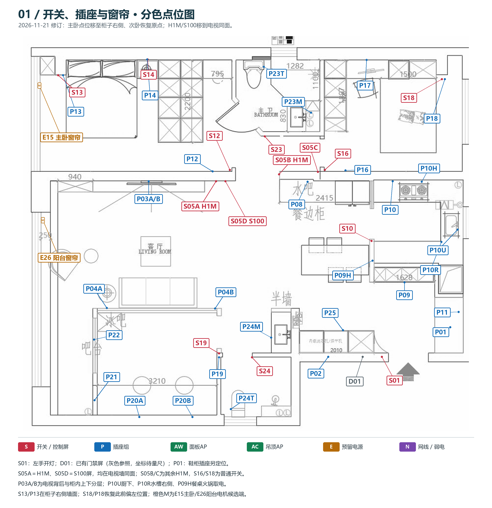
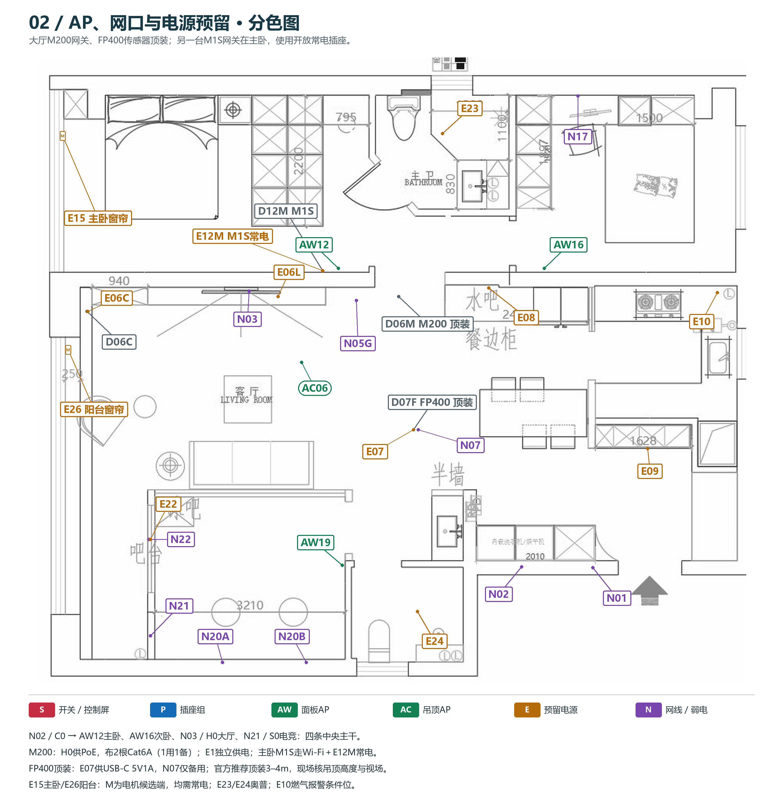
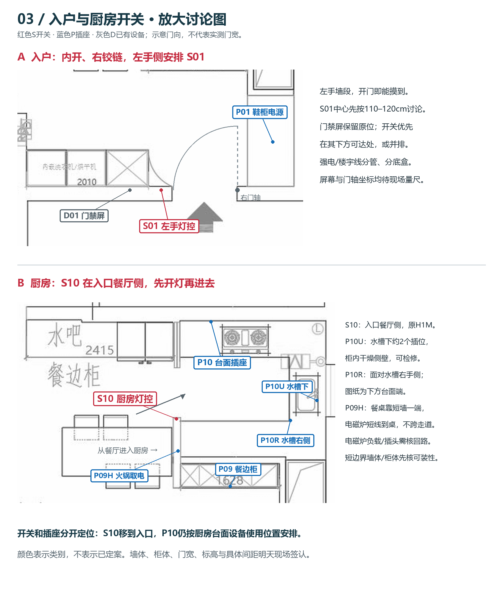
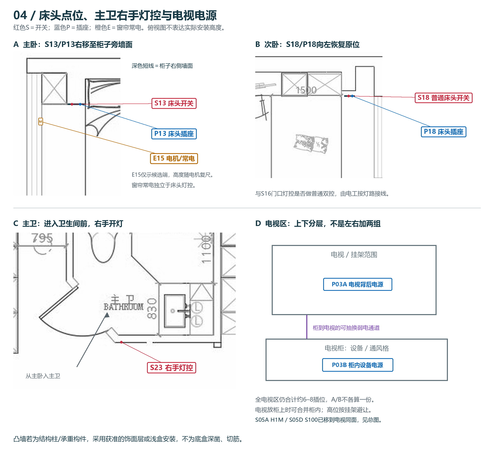
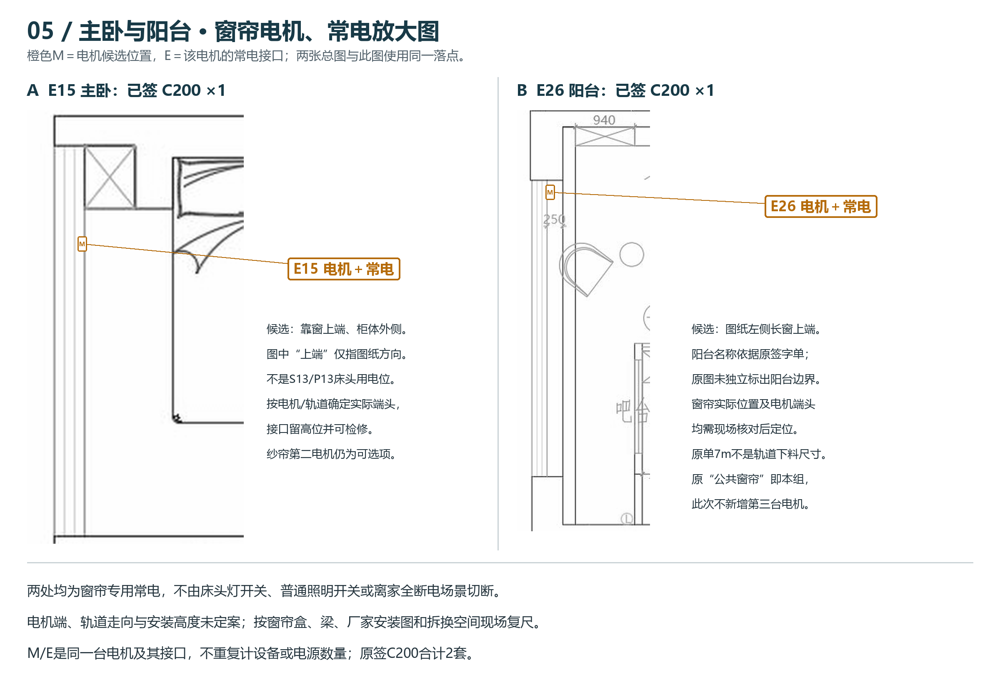

# 水电定位讨论稿：开关、插座与网线点位

> 整理：2026-11-21；供 **2026-11-22 水电定位**现场讨论。用户确认目前没有具体家具改动，暂沿用10月20日布置图。本文给出推荐位置和预留方式；墙上最终定位以家具轮廓、设备安装图、完成面和现场量尺为准，尚未签认、施工或改变采购数量。

**建议采用“门口实体控制＋使用位置就近插座＋设备区集中配线＋未定设备留可抽换管”的方案。** 少留插座会依赖外露接线板；全部按未来设备铺满又会增加无效开孔。这里按已知设备留足日常使用位置，投影、追加屏幕及未定家电先保留调整余地。

**入户修正（2026-11-21）**：用户确认入户门内开、门轴在进门方向右侧，左手墙上已有门禁系统屏幕。玄关开关明确放**进门左手侧墙段，与现有屏幕协调**；此前图中01靠右的落点作废。屏幕保留原位，不能从旧截图推定其精确坐标。

[可打印版](../outputs/electrical-positioning-20261121/水电定位讨论稿.html)。**红色S＝开关/控制面板，蓝色P＝插座组，绿色AW/AC＝面板AP/吊顶AP，橙色E＝预留电源线或供电接口，紫色N＝网线/弱电接口，灰色D＝设备参照**。色彩只区分用途，不能视为“已经定案”；所有位置仍待现场量尺。前缀后的两位数字对应下表26组，字母后缀区分同组多个位置；一个符号不等于一只面板或一个网口。同组图标为便于阅读错开，标高和间距以文字及现场为准。图纸方向不代表南北。

### 入户与厨房开关本次如何落位

- **S01 入户**：进门左手侧、现有门禁屏所在墙段，先以完成地面1100–1200mm讨论开关中心；门禁屏保持原有位置。优先让灯控在屏幕下方且可触达的独立位置，空间不合适时并排调整；不先写死两者距离。原楼宇线路与新增家庭强电分别走管/底盒，核心柜也不遮挡屏幕和开关。
- **S10 厨房**：从餐厅走向厨房，落在图上餐桌右侧、厨房入口下沿短边界的**餐厅侧**；手还在厨房外就能按到，避免让人走到灶台/水槽才开灯。原厨房H1M三键×1移到这里，不增加第二块。
- S10优先使用入口旁可安装的实体墙段；原图无法确认该短边界是墙还是柜侧板。如果现场只有柜板或高度不够，由电工/柜体方确定可检修的合规安装方法，或将**同一块S10**调整到入口上沿、水吧与厨房分界的可用实体墙端。图上标的是首选位置，不把未核柜体直接当强电底盒墙。
- P10仍是厨房台面/烟机附近的电源；S10移到入口后，不把厨房插座一起搬到入口。入户鞋柜插座P01也按实际柜体放，和左手灯控是不同点位。

### 床头、电视与厨房餐桌的追加修订

- **S13/P13**：按用户再次纠正，标点从柜体下沿**向右移到柜子右侧、靠床头的横向墙面**；此前落在柜体上的点位作废，不将柜体边线当作安装墙面。按床头柜高度安排开关和插座，窗侧另设E15窗帘常电，两种用途分开。
- **S18/P18**：向左恢复此前原点位，落在次卧床头凸出墙体朝床的一面；不沿用后来右移的落点。S18仍为普通床头灯控，不增加Aqara智能开关采购。与门口S16如需共控主灯，电工按普通双控方案留对应控制线；控制独立阅读灯则另标灯路。
- **E15主卧／E26阳台窗帘电机**：两张总图均补明电机与独立常电，另附放大图。主卧候选点位于靠窗上端、柜体外侧；阳台候选点放在图纸左侧长窗上端附近。**这两个点是讨论候选，不是用户已确认的电机端**；最终左右端、轨道走向、标高和安装空间由现场复尺与C200安装图确定。E26对应原签阳台C200×1，E15对应原签主卧C200×1，共2套；本次不新增第三台，主卧第二层电动纱帘仍为可选。窗帘常电不由床头灯或日常灯控切断。
- **S23**：从主卧进入主卫A时的**右手侧门边、卧室侧可达墙面**。旧图门左落点作废；开门前就可开灯，不被开启后的门扇遮挡。
- **P03A/B**：A是挂墙电视背后的电源，B是电视柜内网络/游戏设备电源，表示**上下分层**，不是要求电视左右各做一组。全区域仍共用约6–8插位建议；电视放柜上时可合并柜内。平面图合并标P03A/B，具体分层另画正立面。
- **S05A/B＝H1M实体三键；S05D＝S100触控场景屏**；S05C是过道H1M。按用户要求，电视旁的**S05A与S05D向图纸左下移到电视墙同一面**，各留独立底盒；其余H1M位置保持。H1M是墙面开关，不是网关；H1M保留日常灯控，S100用于场景与设备界面，逐键分工再定，不能给同一灯路并联两套继电器输出。
- **大厅M200与FP400顶装**：D06M为原签M200网关，按既定大厅顶装方案由H0供PoE；用户所说F400按已选FP400理解，D07F设备点、E07 USB-C 5V1A电源和N07备用线移到同一吊顶候选区。FP400位于顶面可见处，不能封入吊顶；[官方产品支持](https://www.aqara.cn/presence-detector-fp400_support)建议顶装高度3–4m，需结合完成吊顶高度与入户／沙发视场现场验证，不能保证隔墙或转角覆盖。具体型号和供电见[11月21日型号核验](aqara-model-verification-20261121.md)。
- **主卧M1S网关**：另一台原签网关明确为M1S×1，新增图示D12M设备参照与E12M开放常电插座，候选位置在主卧内门侧开放墙面。M1S通过Wi-Fi接入，不新增网线、不放吊顶；E12M计入第12组供电，只落实原有这台网关的1个插位，不与同一设备既有预留重复计数。P12清洁电器插位另行保留，不被网关长期占用。
- **P10U水槽下电源**：用户明确需要，先按2个可用插位讨论，供净水/垃圾处理器或备用；不代表这些机器已购。装在可达的柜内干燥侧壁或相邻柜格，避开水管接头、滴水路径与地面积水，器件/防护按环境和设备安装要求。
- **P10R水槽右侧电源**：以人面对水槽的右手为准；按当前图水槽朝图纸右侧，右手对应图纸下方台面端。先分配1–2个台面插位，计入原P10台面约4个的总建议，不额外重复叠加4个；与P10U不同标高、不同用途。
- **P09H餐桌火锅电源**：新增餐桌就近取电需求，先按1个电磁炉位＋1个备用位。优先餐桌靠厨房短墙/餐边柜端的餐厅侧，电线短距离到桌面，不横跨过道、热源或被桌椅夹住；插座/底盒安装条件同S10现场核。电工按电磁炉最大输入、插头和同时使用负载选择10A/16A及回路，不默认套10A智能插座；是否单独回路由负载计算决定。

床头安装面先区分实体墙与柜体；墙段若为结构柱/承重构件，不为安装底盒深凿或切筋，由施工方采用获准的饰面层、浅盒等做法，最终面板位置仍按用户要求。

### 橙色电源预留与紫色接口如何读

**橙色E不表示统一拉220V到设备接头。** 它表示需要提前安排供电路径，适配器输入、低压输出和硬接线由具体设备区分；与同组插座用途重复时只计一次。

| 编号 | 供电/接口含义 | 施工前核对 |
|---|---|---|
| E06C | E1摄像机适配器位＋到摄像机的匹配低压线 | 适配器可检修；设备不能直接接市电或PoE |
| E06L | 客餐厅灯带/灯具驱动检修位的电源输入及其输出线 | 驱动数量、输入/输出电压、分路与补电按灯具设计，不共用未知电压系统 |
| E07 | 吊顶FP400的USB-C 5V1A供电，与D07F设备点同一候选区 | 可维护适配器位置＋匹配低压线；同区N07只是备用网线，不代表可直接给FP400送PoE |
| E08 / E09 | 水吧/餐边柜各1个柜灯电源位 | 对应原计划的两只智能插座/原配灯具电源，与P08/P09文字中的柜灯位是同一批，不重复计数量 |
| E12M | 主卧M1S网关D12M的开放常电插座，位于主卧内门侧墙面候选区 | 计入第12组，为原签M1S落实1个插位，既有同一网关预留只算一次；P12清洁电器插位保留，按实物插头及夜灯／按键可达性定位 |
| E15 / E26 | 主卧／阳台C200窗帘电机及常电接口；两张总图均显示，同一编号只计一次 | 各对应原签1套；图示均为候选位置，最终电机左右端、轨道走向与供电接口按现场和C200安装图确定，不由日常灯控切断 |
| E22 | 电竞灯带原配电源/控制器位置 | 输入侧插接空间和低压输出路径分清，不将市电直接接灯带 |
| E23 / E24 | 两卫奥普主机供电/控制线预留 | 原厂安装图确定回路、线缆和控制器；不是给FP310供电 |
| E10 | 燃气报警器的条件电源位 | 先核气种、具体型号和额定电源；图示点不是已验收的报警器安装位置 |
| N02 / N03 / N21 | C0 / H0 / S0的网络汇聚或配线范围 | 每组含多条连接，不是一只RJ45；四主干关系见第5节 |
| N01 / N05G / N07 | 门禁可选管路、原G1备用口、FP400吊顶候选区备用线 | N01适配器未知时只留管；N07随D07F/E07移到同区，未跳接备用线不占交换机口 |
| N17 / N20A/B / N22 | 次卧桌位、电竞左右桌位、影音候选位 | 分别接卧室AP下联或电竞交换机；N22可能含多条数据/影音路径，两条AOC按源/显示端另核 |

绿色AW12/AW16/AW19分别是主卧/次卧/电竞房EAP775-Wall，绿色AC06是大厅EAP772。灰色D06M为M200、D06C为E1、D07F为FP400、D12M为主卧M1S，均为设备参照；M200仍需两根Cat6A到位（1用1备），M1S另用E12M常电和Wi-Fi，FP400另用E07 USB电源，不能仅凭设备图标替代供电预留。

## 1. 明天先确定这八件事

1. 用胶带在墙地面标出床、床头柜、双人电竞桌、电视柜、冰箱/高柜、洗衣机的实际外轮廓，再定位插座；记录完成地面、吊顶和台面的标高。
2. **11块已签 H1M＋1块大厅 S100**逐个落实底盒。每个智能开关盒留 L、N，负载回线按灯路；保护接地按电气图连续敷设。次卧保留普通照明并预留升级条件，本期不增智能开关采购。
3. 主卧三块 H1M 推荐“门口＋床左＋床右”；先让绿米与电工画控制关系，不能照普通双控/多控接法并联输出。
4. 核心 C0、大厅 H0、电竞房 S0 三处网络设备位都要独立市电、散热和维护空间；Mac/J3455/未来NAS在电竞房箱外。
5. **四条中央 Cat6A 主干不变**；大厅/电竞房 AP 从本地交换机接。两卧室 AP 若不在书桌旁，要留 AP 数据下联到书桌网口的本地管线。
6. 大厅吊顶留 AP 1条 Cat6A、M200 2条（1用1备）；E1 是 Wi-Fi 摄像机，另留适配器电源。FP400按用户要求顶装，D07F/E07/N07在同一候选区，电源为 **USB-C 5V1A**；M1S在主卧内门侧开放墙面，以E12M常电＋Wi-Fi接入。
7. 电竞双桌分左右两组电源；服务器/网络供电与桌面高负载、清洁家电分开评估回路。两条反向光纤 HDMI 留可抽换路径，投影位置未定先不锁天花孔位。
8. 两卫奥普、欧瑞博暖通、嵌入式家电需供应商安装/接线图；电工核回路、线径、保护、接地和卫浴分区。智能插座额定10A/2500W不能代替16A设备或大功率专用供电。

## 2. 图上26组点位怎么安排

下表“插座位”指**可同时供一个设备插头使用的位置**，不是五孔面板孔数，也不是最终86面板数量。一个五孔面板未必能同时插两个大电源头。桌面设备可用有额定保护、固定安装且便于维护的合规插排/PDU分配，电工按总负载确定墙面供电；不串接插排。所有数量为讨论建议，新增家电/设备均为条件预留，不能据此自动下单。

### 公共区与入户

| 图号 / 位置 | 开关与插座建议 | 网线/弱电 | 明天现场怎么定 |
|---|---|---|---|
| 01 入户门内左手墙段 | **S01玄关H1M三键×1放左手，右铰链内开门的右侧不放此开关**；D01现有门禁屏保留。P01鞋柜/临时充电约2个插位按柜体另定 | 对讲机到H0可留空管N01，选型后再穿线；楼宇线路与家庭强电分开，不接家庭LAN | 开门后左手能摸到；开关与屏幕上下或并排按墙面复尺，屏幕不迁移。旧01右侧落点作废；不新增独立门铃 |
| 02 C0：入户门左侧核心位 | 光猫、Fusion、中央ES206共3个设备电源；建议至少4个可用插位，适配器较大时留到6个的空间 | 四主干、入户光纤保护和柜内短跳线 | 核柜体净尺寸、供电与通风；图上只标候选范围，不认定原弱电箱放得下全部设备 |
| 03 电视墙＋H0 | **P03A电视背后、P03B电视柜内，是上下分层而非左右两组**。电视、交换机、两台游戏源及扩展总计仍建议6–8个插位，不重复增加 | H0主干1；电视1；游戏机2个数据连接；柜到电视背后可抽换影音管 | 高位按电视/挂架安装图，低位按柜体；电视放柜上可合并柜内。交换机放通风可维护格 |
| 04 沙发左右/边几 | 每侧约2个插位；若大厅Apple桌面终端放此处，再留1个常电位。落地灯、充电各自能用 | 不默认给沙发拉网线 | 侧墙/边几后方可伸手处；电动沙发另核电源。已有明确设备需求前，不建议地插作为默认方案 |
| 05 电视墙同面／大厅餐区控制面 | **S05A H1M与S05D S100向图纸左下移到电视墙同一面**；S05B大厅H1M、S05C过道H1M及其他H1M不挪。H1M是开关，S100是场景屏，均不是M200网关 | S100按确切型号留强电底盒；额外通用平板先不锁孔位 | S05A/D各留独立安装位，与电视／柜体避让；面板间距和标高看实物，控制同一灯路时不能并联输出 |
| 06 大厅顶面设备组 | E1另留可检修电源/适配器；射灯、灯带驱动、磁吸驱动分别留接线/检修位置 | H0→吊顶AP 1条；H0→M200 2条，1用1备 | AP、M200、E1是三个不同点；AP/无线网关在吊顶可见面或厂家允许的开放安装位，不封进金属腔。E1视场避开卧室/卫浴隐私区 |
| 07 FP400吊顶候选区 | **D07F设备点、E07 USB-C 5V1A电源同区顶装**；留可维护适配器和低压线通道，设备在顶面可见处、不封入吊顶 | N07备用Cat6A随设备移至同区，先不跳接；FP400不因此具备以太网或原生PoE | 官方建议顶装3–4m；按完成吊顶高度、朝向、遮挡实测入户／沙发视场，不能认为一台可隔墙或跨转角覆盖 |
| 26 阳台窗帘电机／常电E26 | **原签阳台C200×1**，独立常电；总图与放大图先标图纸左侧长窗上端附近的候选点，不增加第三台电机 | Zigbee，无需网线 | 最终电机左右端、轨道走向及阳台范围现场核定；原单“7m”不是现场轨道下料。核窗帘盒、梁、标高和电机拆换空间，电源不经普通照明开关断电 |

### 厨房、水吧与餐边柜

| 图号 / 位置 | 开关与插座建议 | 网线/弱电 | 明天现场怎么定 |
|---|---|---|---|
| 08 水吧 | 台面小家电建议3–4个插位；柜灯独立1个供电位，可用已计划智能插座控制 | 无必需网口 | 以咖啡机/热水壶等同时使用负载核回路；插座在台面上方或可维护侧面，避开水槽/蒸汽，不被高机器遮住 |
| 09 餐边柜＋餐桌用电 | P09柜台面约2–3位、柜灯独立1位；**另标P09H餐桌火锅电源，建议电磁炉1位＋备用1位**。Apple终端若放此处由04移来 | 不默认增加网口 | 火锅取电在餐桌靠厨房短墙/餐边柜一端的餐厅侧，短线到桌、不跨走道。电磁炉额定功率/插头及回路由电工核，不与柜灯智能插座混用 |
| 10 厨房入口开关＋台面/厨下电源 | S10原H1M×1仍在入口餐厅侧；**P10U水槽下约2个插位，P10R面对水槽右侧台面1–2位**，R计入原P10台面约4位总建议；P10H烟机1位 | 无必需网口；普通电池传感器不拉网线 | 厨下电源在可检修干燥侧壁/邻柜，避开接头滴水路径；台面右侧点远离直接水溅/热源。S10所在短边界核墙体/柜板及标高 |
| 11 嵌入式家电/冰箱（位置待核） | 冰箱、洗碗机各独立供电位；**水槽下净水/处理器等电源已归P10U，不重复加**；小厨宝/蒸烤箱等确认选用后按铭牌另核专用供电 | 不为未知家电预拉网络 | 图上11只是核对提醒，不认定冰箱在该处；嵌电插座优先相邻可达柜格，高负载按安装图确定插座/硬接线 |

水吧与餐边柜的照明插座共2个，与已有增补计划是同一批；洗碗机功率计量是条件项，先核10A/16A、额定负载、插接厚度和维护，不用转换头强行匹配。

### 主卧与次卧

| 图号 / 位置 | 开关与插座建议 | 网线/弱电 | 明天现场怎么定 |
|---|---|---|---|
| 12 主卧门口／AP／M1S网关 | 门口H1M三键×1；**P12保留1个清洁电器插位，E12M落实原签M1S网关D12M的1个常电插位**，同一网关既有预留不重复计数 | C0→主卧775主干1；AP到未来书桌留可抽换支线条件；M1S走Wi-Fi，不新增网线 | M1S候选位在主卧内门侧开放墙面，不放吊顶或封闭柜体，保持插头／按键可达；AP与灯开关不共用强电底盒，各设备避开门扇与家具遮挡 |
| 13 主卧柜子右侧、靠床头墙面 | **S13 H1M三键×1、P13约3插位向右移至柜子右侧、靠床头的横向墙面**；此前柜体下沿落点作废 | 不默认床头网口；窗帘E15单列 | 先核实体墙和柜体边界，实际孔位、间距和标高另复尺。床头柜台面上方可达，避免软包遮挡，窗帘电源不占床头这组空间 |
| 14 主卧床右 | H1M三键×1；约3–4个插位，覆盖HomePod mini、充电、桌面屏等实际组合 | Wi-Fi/Zigbee设备不必加网线 | 桌面屏/电源砖尺寸核过再定间距。床头旋钮若选电池H1无需电源；若改USB桌面V1须占一个插位 |
| 15 主卧窗帘电机／常电E15 | **原签主卧布帘C200×1**，独立常电；候选点位于靠窗上端、柜体外侧，与S13/P13床头墙面点位分开；第二层电动纱帘仍可选，另核接口 | 不要给窗帘默认加网线 | 图示不是已确认电机端；左右端、轨道走向、完成面标高与窗帘盒按安装图复尺。不接床头灯控断电输出；M1S供电单列第12组E12M |
| 16 次卧门口/AP | 保留普通主灯控制，底盒预留L/N及未来升级空间；门侧1个清洁插位 | C0→次卧775主干1；775下联→17书桌1条本地Cat6A | 次卧“不加智能照明”不等于没开关、没零线；AP不塞书桌挡板后 |
| 17 次卧图示书桌 | 建议4–6个插位，覆盖电脑、屏幕、台灯、充电和HomePod等实际组合 | 书桌至少1个可用网口，来自本房775的2.5G数据下联 | 图中书桌在上侧墙，若未来挪位，先留沿墙可抽换路径；不要误接AP PoE上联 |
| 18 次卧床头凸出墙面 | **P18约2–3插位＋S18普通床头开关**向左恢复此前原点位，仍在凸出墙体朝床的一面；后来右移的落点作废 | 无必需网口；若与S16共控主灯，按普通双控留控制线 | 坐起可达、避开软包/枕头遮挡；不新增智能开关采购，也不把床头点留在靠窗平墙上 |

主卧插电夜灯优先用已有可达低位插座，M1S夜灯能满足时不另占新孔；床头至少保留日常实体控制，不能全靠手机或语音。

### 电竞房、主机和投影

| 图号 / 位置 | 开关与插座建议 | 网线/弱电 | 明天现场怎么定 |
|---|---|---|---|
| 19 电竞房门口/AP | H1M三键×1；门侧1个清洁插位；HomePod在桌面/架上留电源 | S0→775 1条Cat6A/PoE | AP放完整开放墙面，不装玻璃、半墙或设备柜内；开关伸手即达 |
| 20 双人电竞桌 | 每人先按约8个可用插位考虑：电脑、1–2屏、充电、灯/音响等；实际设备少可减。升降桌如选用计入该组 | 每台PC独立Cat6A；Mac/Mini接口按其实际摆位由21分配，不能重复算设备 | 左右分组，墙插及理线槽可维护；桌面上方留便捷充电位，主机/显示器供电放侧下方。不是要求墙上密排16个86面板 |
| 21 S0＋主机开放架 | 交换机、Mac Studio、Mac mini、J3455、未来NAS共5台电源，另留约2个余量；UPS后置，先留体积/电源路径 | 主干1；Mac独占10G RJ45；NAS独占10G SFP+；Mini/J3455各独立数据口 | 分色图优先取双桌左侧完整干墙范围，避开右侧卫浴湿墙与玻璃；主机箱外通风。若Mac/Mini放20桌面，其电源和网线移过去，不在两处重复计数 |
| 22 投影/影音候选区 | 投影、Apple TV、Switch底座及扩展建议4–6个插位；T2电竞灯带电源另在可达处预留 | Apple TV/投影各有线；两条反向AOC分别到投影输入/电竞影音源，端点可能不同 | 投影型号/投射距离未定，保留墙边/顶面可抽换路径，先不打固定吊装孔。不要把双向AOC两头全落在投影机背后 |

电竞房还有独立工作照明需求，H1M控制的普通灯路与T2彩光灯带分开。无线旋钮、FP310为电池类候选，不因此新增墙面强电盒。图中20、21、22是设备分组，不意味着可在任一墙体随意开槽。

### 两卫、洗衣和清洁

| 图号 / 位置 | 开关与插座建议 | 网线/弱电 | 明天现场怎么定 |
|---|---|---|---|
| 23 主卫A | **S23 H1M三键×1移至从主卧入主卫时右手门边、卧室侧可达墙面**；原门左点取消。镜柜/马桶条件电源及奥普供电不变 | FP310电池供电，不需网线；原厂控制线按奥普图纸 | 开门前可摸到，门扇打开后也不遮挡；湿区插座、防护/漏保/等电位按设计核验 |
| 24 公卫B | H1M双键×1；镜柜约2个插位，马桶条件预留1个；奥普独立供电/原厂面板 | 同23 | 原图外置洗手区和公卫内部应分清；镜柜插座随实际镜柜走，不在两个位置重复做一组 |
| 25 洗衣/家政柜 | 洗衣机1个；独立烘干机仅选用时另1个；洗地机底座1个；清洁备用1个 | 通常无必需网口 | 机侧/相邻可达柜格优先，插头不能挤在机背；洗地机热风底座留散热、取放空间。扫地机器人若将来需要，空位/水路另确认，不当已有设备 |

两卫奥普按原厂控制模式正常停止，不用H1M或智能插座反复切断主机总电源。洗衣机/洗地机计量与既有计划是同一批，先核负载、插头和实际空间。水浸、门磁、FP310等电池设备不需布电源线。

## 3. 开关面板数量与控制关系

| 已签设备 | 推荐落点 | 数量 |
|---|---|---:|
| H1M三键：玄关、厨房 | S01进门左手墙段、S10厨房入口餐厅侧，各1 | 2 |
| H1M三键：大厅两块、过道一块 | 05范围按两个入口/动线分开，共3 | 3 |
| H1M三键：主卧 | 12门口、13床左、14床右 | 3 |
| H1M三键：电竞房、主卫 | 19、23各1 | 2 |
| H1M双键：公卫 | 24 | 1 |
| S100：大厅 | 05入口易观察墙面，另一个独立底盒 | 1 |

**合计H1M三键10块＋双键1块＋S100一块，与签字单一致。** 次卧S16门口普通灯控＋S18床头普通灯控共2个位置另计，不属于上述12块智能设备；奥普/欧瑞博原厂面板另核。S18并非新增Aqara采购。床头追加屏幕不自动替换原H1M。

控制方式明天务必让两家一起确认：

- 普通灯可由相应H1M负载通道控制。每个灯路只有明确设计的控制输出；多个H1M输出不能并到同一盏灯来模拟传统双控。
- 客餐厅T2Pro、智能灯带驱动及新增智能轨道灯需要常电时，墙面按键通过厂家支持的解耦/无线场景控制；**具体H1M硬件、固件能否按键解耦须演示**。不支持时先确定兼容控制办法，再定接线，不靠软件设想掩盖接线冲突。
- 主卧门口与床头分别控制哪些普通灯、哪些场景，画成“面板按键—灯路/动作表”。涉及网关联动的床头多控需说明网关离线行为，门口保留至少一条可直接本地操作的基本照明路径。
- 窗帘、网络、冰箱、NAS/HA、暖通及正在运行的洗烘/洗碗设备不接普通“离家全断电”输出。
- 不把三键面板理解成必须新增三条灯路；也不因有S100就把原两块大厅H1M随意减掉。

## 4. 高度与位置：明天可拿来比划的参考

以下均为**距完成地面到面板/盒中心的讨论值**，不是强制规范；最终以家具尺寸、人体触达、厂家图纸及电气设计为准。先统一完成面标高，不能直接从现在毛地面量。

| 点位 | 建议起点 | 现场修正依据 |
|---|---|---|
| 门口灯控 | 约1100–1200mm；入户S01明确在进门左手侧，其他门按把手/动线讨论 | 入户为右铰链内开，左侧已有门禁屏；先协调屏幕/开关、门套与柜体，不能机械套门套边距 |
| S100等站立控制屏 | 中心约1300–1400mm | 家人身高、屏幕视角、相邻面板和安装图 |
| 床头开关/插座 | 床头柜台面上方约150–200mm | 先定床宽/床头软包/床头柜高度；两侧按实际家具定位，不机械套统一距地值 |
| 普通干区低位插座 | 中心约300–350mm | 踢脚线、家具脚/背板、扫地与取插头；卫生间不套用此值 |
| 桌上/水吧台面插座 | 台面上方约150–200mm | 大适配器、挡水条、机器高度、桌子升降范围和水汽/热源 |
| 桌下插座与理线 | 桌侧或可达理线槽附近 | 不能被整块桌背挡死；升降桌线缆留活动余量 |
| 壁挂电视背后 | 先按电视/挂架背面图确定区域，不先锁一个通用高度 | 插头厚度、检修、屏幕下沿、柜到电视的管路入口 |
| Wall AP | 可先以1100–1300mm讨论 | 避开家具、门扇；美版设备实物底盒/孔距核验，不能直接套国产86盒 |
| 窗帘电源 | 按轨道电机端及吊顶完成面确定 | 电机可拆、插头可达、窗帘盒内部空间 |
| 卫浴、烟感/燃气、暖通 | 不用普通插座或通用传感器高度替代 | 厂家安装图、湿区电气分区、气种和风口/热源位置 |

## 5. 网线和影音线逐条交底

### 主干：仍然只有四条

| 编号 | 起点 → 终点 | 用途 |
|---|---|---|
| TRUNK-MASTER | 02 C0 → 12 主卧775 | Cat6A，2.5G＋匹配PoE；不经过大厅交换机 |
| TRUNK-SECOND | 02 C0 → 16 次卧775 | Cat6A，2.5G＋匹配PoE；不经过大厅交换机 |
| TRUNK-HALL | 02 C0 → 03 H0 | Cat6A，2.5G；大厅交换机自己用市电 |
| TRUNK-STUDIO | 02 C0 → 21 S0 | Cat6A，2.5G；电竞交换机自己用市电 |

路径原则：入户核心位上引→公共区可用吊顶→各房允许的入房路径→设备位下引。强弱电分管；不穿梁/切筋或为了直线距离破坏湿区防水。材料与管径按实际线径、线头、弯曲和拉线距离核，不照示意图按米下料。

### 房内支线：端口够，但要把线留到使用位置

| 来源 | 到哪里 | 本期讨论数量/性质 |
|---|---|---|
| 大厅H0 | 吊顶772、电视、两台游戏源 | 各1，共4条连接；同柜的可用短跳线 |
| 大厅H0 | M200吊顶 | 2条，1用1备；实际只占1个PoE口 |
| 大厅H0 | 原备用墙口G1、FP400候选位 | 各1条预留；未跳接不占端口，FP400仍用匹配USB电源 |
| 大厅H0 | 原室内对讲机附近 | 可选空管；选定适配器后再决定是否穿1条本地Cat6A |
| 电竞S0 | 775、PC1、PC2、Mac mini、J3455、Apple TV、投影 | 7条2.5G/终端实际速率连接；加中央上联，8个2.5G口占满 |
| 电竞S0 | Mac Studio | 独立1条Cat6A接10G RJ45；同桌用合格可维护短线 |
| 电竞S0 | 未来NAS | 10G SFP+介质后置；附近短DAC/光纤不暗埋，不增加中央主干 |
| 主卧775 | 未来书桌位置 | 若确认有桌且AP不在旁边，建议1条本地Cat6A/可抽换管；终点暂未固定 |
| 次卧775 | 17次卧书桌 | 建议1条本地Cat6A，使用AP的2.5G数据下联；不新增交换机 |
| 大厅影音源 → 电竞投影输入 | HDMI-A | 1条有方向AOC，线头标Source/Display；终点随投影摆位 |
| 电竞影音源 → 大厅电视输入 | HDMI-B | 另一条反向AOC；不是把A倒接使用 |

两卧室AP给书桌供数据时，可以在AP附近设**独立弱电端接/理线位置**，用短跳线连接AP下联再进入本地支线；不把交换机主干端与下联线混接，不能形成环路。电脑不需要PoE，AP PoE Out保持关闭。

**卧室如果希望AP故障时书桌网口仍工作，这是与当前“电脑走AP下联”不同的需求**，需要修改上游端口/接线方案；本稿不擅自加第五、第六主干。明天先确认你接受现有连接关系。

端口复核：中央铜口已满；电竞完整直连已满，Apple TV/投影改接本房AP的1G下联才可释放两个口；大厅按包含FP400的保守预留还余1个2.5G口，另有不带PoE的10G RJ45口。新增墙面备用口不等于所有口可以同时在线，不先买更多交换机。

Cat6A合格系统支持10G通常按100m完整通道/90m永久链路控制，本户不需要升级Cat7才能布10G。施工用纯铜实芯、匹配模块和可抽换路径，封板前逐条编号、拍照及做相应Cat6A链路认证，不只测8芯通断。两条AOC要用实际线头验证穿管能力和方向，不能给出一个未经核验的统一管径。

## 6. 电源、灯路与容易漏的设备

### 电工要核的回路分组

这里只给分组目标，**不指定断路器安培数或导线截面**：需结合入户容量、同时使用负载、敷设条件、线长及保护措施，由电气设计/电工计算。

| 分组目标 | 需要解决的问题 |
|---|---|
| 照明与普通插座区分 | 插座跳闸时保留必要照明；智能灯常电与物理控制关系明确 |
| 电竞桌面高负载与服务器/网络分开评估 | 两台PC、显示器、Mac等并发负载较高；尽量避免桌面设备故障影响HA/NAS。分回路不等于上级跳闸或停电时仍保活 |
| 核心网络常供电 | C0、H0、S0均不得被日常灯开关或离家场景断电；未来UPS按各位置另做供电，不擅自跨回路借电 |
| 厨房台面/嵌电、洗衣烘干、卫浴取暖 | 根据实际加热设备与同时使用工况核容量；不能用10A智能插座给所有家电套模板 |
| 空调、新风、地暖、热水器 | 欧瑞博四类逐设备取安装图，核主机电源、控制器位置和总线/通信线；不能默认一个普通插座解决全部 |

### 封板前特别检查

- **灯带与驱动**：原25m双色温灯带、300W驱动的实际输出策略/分区/补电仍待厂家核算，不能仅把“10+10W/m”机械相加当作实际同时功率。驱动放可维护位置，24V灯带与新磁吸轨道所需系统不得混用；电竞T2整套另供电。
- **M200、M1S与E1**：M200为大厅顶装网关，走PoE；M1S为主卧墙面网关，E12M常电＋Wi-Fi；E1走Wi-Fi且独立供电。H1M是墙面开关，不作为网关标在吊顶；M200与E1各自完成供电预留。
- **FP400**：本稿采用11月21日已核的KJCGQ11LM、USB-C 5V1A；按用户要求顶装。D07F/E07/N07移到同一吊顶候选区，核官方建议3–4m与实际完成吊顶高度、检测视场和检修条件。旧10月/11月18日文档写“供电未知”的部分不再作为本点电源依据；N07仅备用，不直接给FP400送PoE。
- **电池与常电区分**：FP310/门磁/水浸/无线H1旋钮不因“智能”就拉220V；HomePod、桌面屏、窗帘电机和控制器则不能漏电源。
- **主卧屏幕**：优先保留桌面供电/可改位置；墙装型号与供电未定，不先开特殊大孔。普通USB口不一定满足供电，保留可更换适配器的位置。
- **智能家电状态**：洗衣机、洗碗机、洗地机计量用于观察运行，默认不断电；插座厚度和柜体维护空间必须看实物。
- **清洁位置**：每个主要干区门侧或可达墙面保留可用清洁电源。吸尘器/熨斗/临时电暖器不得默认接网络设备PDU。
- **窗帘/外窗**：电动窗帘电源按电机端；外窗目前只做状态检测，不预购开窗器或增加其专用电源。

## 7. 现场签认表

用本图编号记录，同一组多个面板加A/B/C后缀。以下空白是现场填写栏，不是已测数据。

| 点位编号 | 对应墙段/距固定墙角 | 中心距完成地面mm | 插座/面板/网口数量 | 回路或网线编号 | 是否被柜/门/设备遮挡 | 业主/电工确认 |
|---|---|---|---|---|---|---|
| ______ | ______ | ______ | ______ | ______ | ______ | ______ |
| ______ | ______ | ______ | ______ | ______ | ______ | ______ |
| ______ | ______ | ______ | ______ | ______ | ______ | ______ |
| ______ | ______ | ______ | ______ | ______ | ______ | ______ |

- [ ] 右铰链内开门的S01在进门左手侧，现有门禁屏保留；开门后实际伸左手验证触达。
- [ ] S10在走入厨房前可达，入口墙体/柜体安装条件已核；厨房开关仍仅原单1块。
- [ ] S05A H1M与S05D S100已落在电视墙同一面，各自独立底盒，与电视／柜体避让；其余H1M位置保持。
- [ ] 大厅M200为顶装网关，PoE支线与检修空间已落实；FP400的D07F/E07/N07同区顶装，已按完成吊顶高度核3–4m建议与入户／沙发视场。
- [ ] 主卧M1S的D12M/E12M位于门侧开放墙面，不放吊顶，Wi-Fi覆盖与插头／按键可达；原签1台和1个供电插位不重复计数，P12清洁插位仍可用。
- [ ] S13/P13已从柜体下沿右移至柜子右侧、靠床头的墙面；S18/P18已向左恢复此前原点位，两处分别核实体墙、家具边界及可达性。S23在进主卫右手侧。
- [ ] E15主卧、E26阳台各1套原签C200已分别落实独立常电；两张总图与放大图一致且不重复计数量，第二层纱帘仍仅可选。
- [ ] 两处窗帘的最终电机左右端、轨道走向、标高、插头可达和拆换空间已现场签认；图中候选点不能直接作为施工孔位。
- [ ] P03A/B按电视背后/柜内分层，不按左右重复增加；P10U厨下、P10R水槽右侧、P09H餐桌火锅电源已分别定位并核负载。
- [ ] 家具外轮廓与完成面标高已标出，开关/插座不被床头、柜背、门扇遮挡。
- [ ] 11块H1M、S100、次卧普通开关、暖通/奥普面板分别点清，不重复/漏算。
- [ ] 智能灯常供电、普通灯回线、主卧多点控制已由绿米和电工共同确认。
- [ ] 四主干起终端、卧室AP→桌位、吊顶AP/M200/E1/FP400电源已分别标注。
- [ ] 电视挂架/机柜、双桌/主机架、投影候选区和两条AOC端点已复核。
- [ ] 厨房、卫浴、洗烘与暖通厂家安装图已拿到；没拿到的逐项写为待定，不凭想象锁孔位。
- [ ] 驱动、电源砖、接头与拉线盒可以检修，强弱电分管、无墙内不可达接头。
- [ ] 用固定墙角/完成地面测量并拍照，照片带卷尺；每条网线两端同号。

## 8. 依据与本次状态

依据：[原户型图](floorplan-and-network-locations.md)、[网络拓扑](network-topology.md)、[网络点位/埋线](network-placement-and-cabling-plan.md)、[绿米签字单](aqara-final-quote-20261026.md)、[11月21日型号核验](aqara-model-verification-20261121.md)、[FP400官方产品支持／安装高度](https://www.aqara.cn/presence-detector-fp400_support)、[增补计划](aqara-supplement-plan-20261118.md)、[影音规划](av-and-gaming-layout.md)、[楼宇对讲研究](building-intercom-integration-research.md)。最新用户确认：2026-11-21目前家具暂无具体改变，明天现场水电定位。

本次新增的是供业主比较、现场调整的点位草案与可打印文件；没有更改已签设备数量、已下单网络设备、施工状态或家庭配置。所有安装位置、回路容量、网线长度及验收仍未实测。
