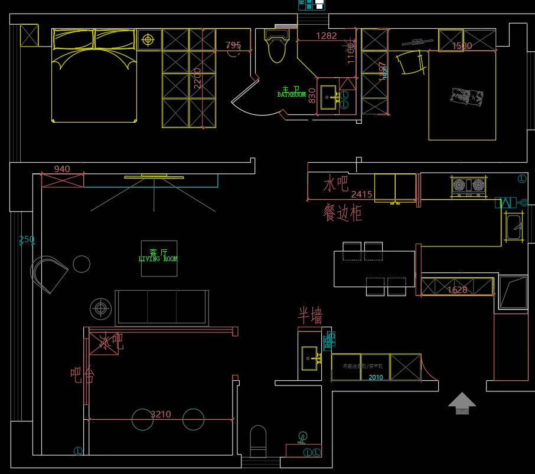
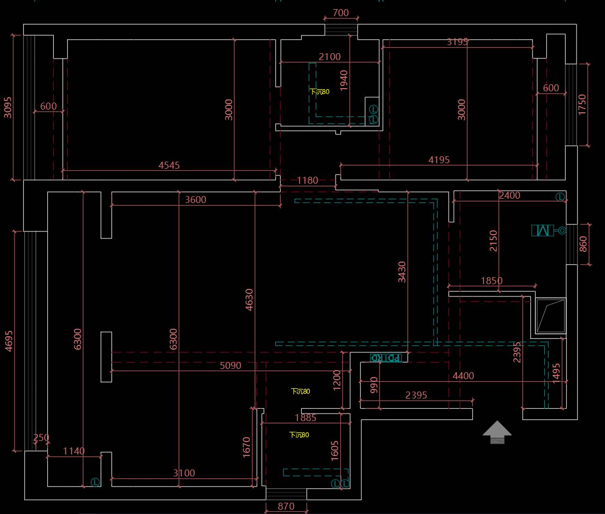

# 装修图纸与网络设备位置记录

> 更新日期：2026-10-20。来源为用户提供的装修布置图、尺寸标注图，以及用户明确说明的“弱电箱的位置在入户门左侧”。原图已归档；这些截图不是完整的强弱电施工图，不代表已施工或已验收。

## 1. 原始图纸

**吊顶条件已补充确认**：大厅与入户过道有吊顶或局部吊顶。新增[网络设备点位与吊顶埋线规划](network-placement-and-cabling-plan.md)，含原图标注的C0/H0/S0设备位、三台AP、次卧墙口、四条独立主干与房内支线表。具体位置与走向仍为建议，局部吊顶是否连续、穿墙点及长度待现场签认，不视为已批准施工图。

### 装修布置图

### 尺寸标注图

两张图分别记录家具/功能布置和尺寸信息，不能假定每处墙体、完成面及局部标注完全对应。当前没有可校核比例的 CAD、完整图签或完整电气点位图；不通过截图像素比例推算全屋尺寸、面积或线缆长度。

## 2. 已知空间关系与尺寸边界

“上/下/左/右”沿用用户此前的图纸方向，不推定南北。弱电箱“入户门左侧”按用户原话登记，具体墙段、标高及箱体位置仍需在现场点位图上标明。

| 区域 | 当前记录 | 依据与边界 |
|---|---|---|
| 主卧 | 图纸左上，大厅上方 | 尺寸图局部标注横向4545、纵向3000；不能据此保证完成面净尺寸 |
| 次卧/儿童房 | 图纸右上；与主卧之间有卫生间 | 尺寸图局部标注横向4195、纵向3000；另有3195分段标注，不能相互替代 |
| 卫生间 A | 两卧室之间，门朝主卧 | 尺寸图局部标注2100、1940；管井、墙厚与门洞以完整设计图核对 |
| 大厅 | 主卧下方、电竞房上方 | 主卧/大厅承重墙、大厅/电竞房横梁与隔断关系沿用用户说明，墙体做法和厚度待设计方核验 |
| 工作室/电竞房 | 图纸左下 | 大厅侧上方横梁、下方半墙、中部大玻璃；布置图有3210、尺寸图相邻局部有3100等标注，未经设计方核对不合并为同一净宽 |
| 公共卫生间 B | 电竞房右侧、大厅下方，门朝上 | 卫浴与洗衣/洗手等相邻功能区的准确边界待完整设计图确认 |
| 入户门与弱电箱 | 入户门在右下；弱电箱在入户门左侧 | 位置由用户确认；未从截图识别出可据以施工的弱电箱符号或精确坐标 |
| 右侧功能区 | 布置图可见水吧、餐边柜、灶台及水槽等 | 记录图示功能，不据此增加厨房AP、设备箱或网络回线 |

以上数字按常见装修图习惯暂按 **mm** 理解；截图未见明确单位/尺寸基准，施工前由设计方确认。约100㎡仍是此前用户提供的面积范围，不是本次按截图重新测算的结果。未列出的尺寸请查原图，不做不可靠转录。

## 3. 弱电箱与核心网络位置

- **已确认位置**：弱电箱在入户门左侧。
- **规划设备位**：光猫/ONT、Fusion 2.5G普通版、中央ES206XPP-M2在该弱电箱或其附近通风核心柜汇聚。现有箱体是否能容纳这些设备尚未确认，不默认全部塞入原箱。
- **现场核验**：箱内净宽/高/深、门板开合、插座/接地、适配器与插头、Cat6A弯曲与检修空间、发热和通风、入户光纤保护，以及强弱电分隔。附近柜体位置不得妨碍入户通行和检修。
- **不变的位置**：大厅/电竞房各一房间设备箱与本地交换机；两卧室不设设备箱或独立交换机。Mac、J3455、未来高速NAS在电竞房箱外通风位置，NAS靠近ES210XPP-M2。
- AP和Zigbee/Thread无线网关均放箱外；弱电箱在入户处不意味着无线网关也必须放在入户处。

## 4. 从入户核心位出发的四条主干

| 线缆编号 | 起点 | 终点 | 当前用途 |
|---|---|---|---|
| `TRUNK-MASTER` | 入户门左侧核心设备位，中央ES206XPP-M2 | 主卧EAP775-Wall安装位 | 一条Cat6A，2.5G数据及匹配PoE；面板AP箱外墙装 |
| `TRUNK-SECOND` | 同上 | 次卧RJ45墙面信息口 | 一条Cat6A，预留2.5G，默认关闭PoE；暂不买AP，可选已有TL-7DR3630有线复用及独立市电 |
| `TRUNK-STUDIO` | 同上 | 电竞房设备箱ES210XPP-M2 | 一条Cat6A，2.5G主干；房内交换机分接AP和终端，Mac/未来NAS本地10G |
| `TRUNK-HALL` | 同上 | 大厅设备箱ES206XPP-M2 | 一条Cat6A，2.5G主干；本地分接吊顶AP、电视和网关/协调器预留位 |

保持四条中央星型主干，不改成大厅交换机汇聚两卧室。房内分支仍需分别布线，不因“一房一条主干”而省略AP/电视/电脑等本地支线。当前不增加每房光纤；保留可抽换管路和牵引线。

**线缆采购与下料长度待现场确定**：施工方需从入户门左侧核心位，按实际走顶/走墙管路、转弯、上下引入、端接和检修余量逐条量取、编号，不能把房间横纵尺寸或截图直线距离当成网线长度。封墙前留路径照片，并按[施工需求](renovation-wiring-requirements.md)完成Cat6A永久链路认证。

## 5. 对现行方案的影响

此次确认的是图纸来源、核心设备起点及公共区有吊顶/局部吊顶，**不改变3A三频暂定定稿的设备型号、数量或预算**：主卧/电竞房EAP775-Wall各一、大厅EAP772吊顶一台；次卧仍不买AP。三台AP位置、高度及功率需结合家具、横梁、玻璃、承重墙和装修后覆盖测试确定；不把本图视为实测信号分布图，不保证大厅穿墙覆盖次卧或大陆6GHz可用。

现有采购Excel的硬件选型仍适用；本次图纸和弱电箱位置先更新到本文及关联Markdown，**未写回Excel，也未据图补填材料米数、箱体尺寸或施工数量**。对外施工交底请附本文两张原图；待设计方给出完整电气点位/管线路径及复尺后，再同步Excel材料与逐线长度。

关联文档：[设备点位与吊顶埋线草案](network-placement-and-cabling-plan.md)、[基础设施台账](home-infrastructure-register.md)、[全屋网络拓扑](network-topology.md)、[智能家居拓扑](smart-home-topology.md)、[装修布线需求](renovation-wiring-requirements.md)、[当前BOM](purchase-bom.md)。
