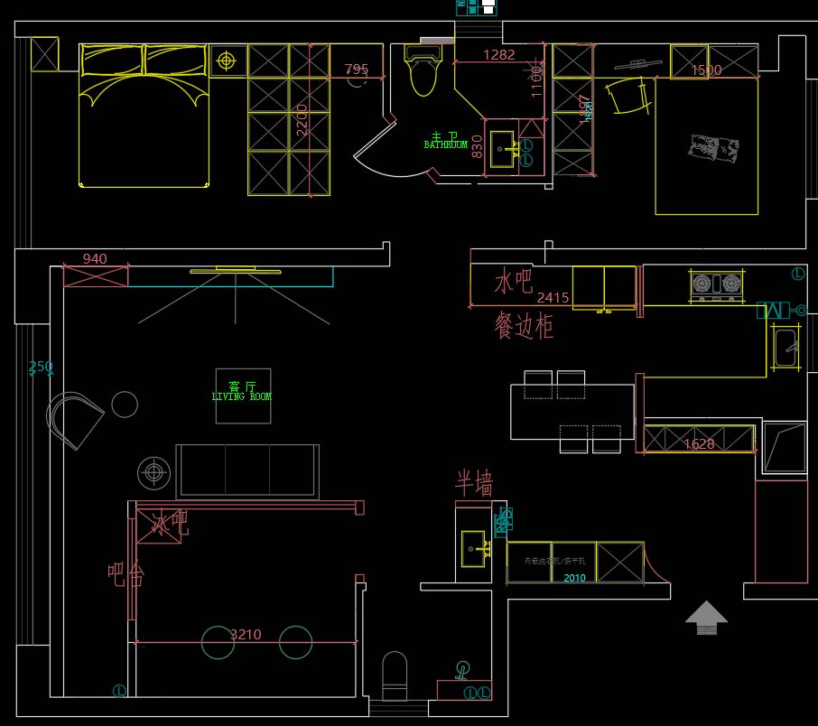
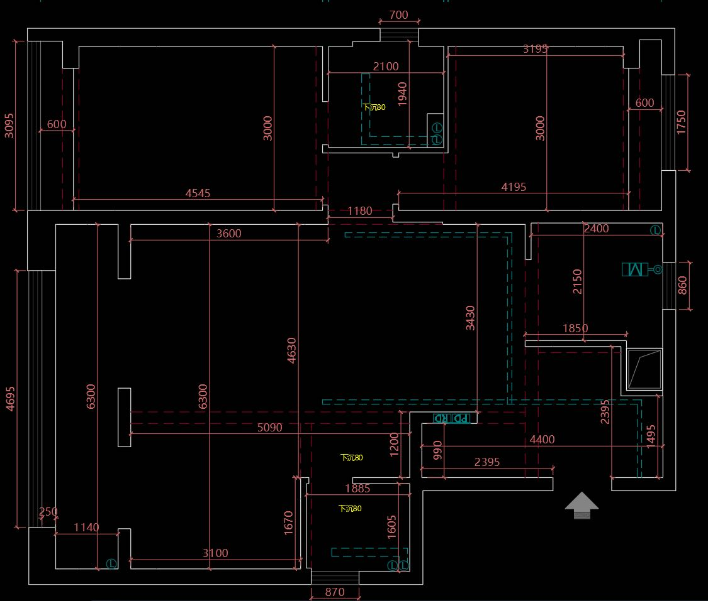

# 装修图纸与网络设备位置记录

> 更新日期：2026-10-20。来源为用户提供的装修布置图、尺寸标注图，以及用户明确说明的“弱电箱的位置在入户门左侧”。原图已归档；这些截图不是完整的强弱电施工图，不代表已施工或已验收。

> **网络记录清理：2026-11-27，按 v1.6 及11月26日影音更正。** 原图继续作为家具、尺寸与位置参考；网络标注图中的旧四主干、M1S及本地AP供电接法已被下文覆盖，不能直接用于接线。当前为中央/电竞房ES210、客厅ES206，四台AP及两台M200独立回中央PoE，J3455在客厅；以[现行拓扑](network-topology.md)与[逐线表](network-placement-and-cabling-plan.md)施工核对。

## 1. 原始图纸

**吊顶条件已补充确认**：大厅与入户过道有吊顶或局部吊顶。[网络设备点位与吊顶埋线规划](network-placement-and-cabling-plan.md)沿用C0/H0/S0设备位，按v1.6列9条在用远端铜缆及中央—客厅10G光链路，房内支线另计。具体位置与走向仍为建议，局部吊顶是否连续、穿墙点及长度待现场签认，不视为已批准施工图。

**2026-11-21水电点位修订**：见[水电定位讨论稿](electrical-network-positioning-draft-20261121.md)。按用户再次纠正，S13/P13从柜体下沿向右移至主卧柜子右侧、靠床头的墙面，S18/P18向左恢复此前原点位；两处分别核对实体墙与柜体边界。主卧E15、阳台E26窗帘电机与常电已同时纳入两张总图，并新增窗帘放大图。两处各对应原签C200×1；图中电机点是候选，最终左右端、轨道走向和安装高度仍待现场核定。

**控制面板、网关与传感器位置**：电视旁S05A H1M和S05D S100向图纸左下移至电视墙同一面，其余H1M不挪；H1M是墙面开关。大厅M200仍规划顶装，并独立回中央ES210供PoE。FP400的D07F/E07/N07设备、电源和备用线在同一吊顶候选区，安装高度、视场及具体版本按实物核定。次网关已由原签M1S改为第二台M200，独立Cat6A回中央PoE；原D12M/E12M只保留为旧位置参照，第二台M200最终点位、安装方式及升级采购待核，不沿用M1S插墙方式。P12清洁插位保留，原常电预留是否保留由现场用途确认，不重复计入网关数量或必需供电。

### 装修布置图

### 尺寸标注图

两张图分别记录家具/功能布置和尺寸信息，不能假定每处墙体、完成面及局部标注完全对应。当前没有可校核比例的 CAD、完整图签或完整电气点位图；不通过截图像素比例推算全屋尺寸、面积或线缆长度。

## 2. 已知空间关系与尺寸边界

“上/下/左/右”沿用用户此前的图纸方向，不推定南北。弱电箱“入户门左侧”按用户原话登记，具体墙段、标高及箱体位置仍需在现场点位图上标明。

| 区域 | 当前记录 | 依据与边界 |
|---|---|---|
| 主卧 | 图纸左上，大厅上方 | 尺寸图局部标注横向4545、纵向3000；不能据此保证完成面净尺寸 |
| 次卧/儿童房 | 图纸右上；与主卧之间有卫生间 | 尺寸图局部标注横向4195、纵向3000；另有3195分段标注，不能相互替代 |
| 卫生间 A | 两卧室之间，门朝主卧 | 尺寸图局部标注2100、1940；管井、墙厚与门洞以完整设计图核对 |
| 大厅 | 主卧下方、电竞房上方 | 主卧/大厅承重墙、大厅/电竞房横梁与隔断关系沿用用户说明，墙体做法和厚度待设计方核验 |
| 工作室/电竞房 | 图纸左下 | 大厅侧上方横梁、下方半墙、中部大玻璃；布置图有3210、尺寸图相邻局部有3100等标注，未经设计方核对不合并为同一净宽 |
| 公共卫生间 B | 电竞房右侧、大厅下方，门朝上 | 卫浴与洗衣/洗手等相邻功能区的准确边界待完整设计图确认 |
| 入户门与弱电箱 | 入户门在右下；弱电箱在入户门左侧。2026-11-21用户补充：门内开、门轴在进门方向右侧，左手墙段已有门禁屏 | 玄关灯控按进门左手触达安排，见[水电定位修正版](electrical-network-positioning-draft-20261121.md)；屏幕保留。未从截图识别出可据以施工的弱电箱/屏幕精确坐标 |
| 右侧功能区 | 布置图可见水吧、餐边柜、灶台及水槽等 | 记录图示功能，不据此增加厨房AP、设备箱或网络回线 |

以上数字按常见装修图习惯暂按 **mm** 理解；截图未见明确单位/尺寸基准，施工前由设计方确认。约100㎡仍是此前用户提供的面积范围，不是本次按截图重新测算的结果。未列出的尺寸请查原图，不做不可靠转录。

## 3. 弱电箱与核心网络位置

- **已确认位置**：弱电箱在入户门左侧。
- **规划设备位**：光猫/ONT、Fusion 2.5G普通版、中央ES210XPP-M2在该弱电箱或其附近通风核心柜汇聚。现有箱体是否能容纳这些设备尚未确认，不默认全部塞入原箱。
- **现场核验**：箱内净宽/高/深、门板开合、插座/接地、适配器与插头、Cat6A弯曲与检修空间、发热和通风、入户光纤保护，以及强弱电分隔。附近柜体位置不得妨碍入户通行和检修。
- **房间设备位**：大厅ES206、电竞房ES210各一房间设备箱与本地交换机；两卧室不设设备箱或独立交换机。Mac、未来高速NAS在电竞房箱外通风位置，NAS靠近ES210；J3455改放客厅ES206附近的箱外通风位，尚未执行搬迁。
- AP和Zigbee/Thread无线网关均放箱外；弱电箱在入户处不意味着无线网关也必须放在入户处。

## 4. 从入户核心位出发的现行线路

| 线缆编号 | 起点 | 终点 | 当前用途 |
|---|---|---|---|
| 四台AP独立回线 | 入户门左侧核心设备位，中央ES210XPP-M2 | 主卧/次卧/电竞房775、大厅772 | 4条Cat6A，2.5G数据＋匹配PoE；AP均箱外安装，不经房间交换机 |
| 两台M200独立回线 | 中央ES210 | 大厅M200、第二台M200 | 2条在用Cat6A，匹配PoE；网关备用线另计，最终点位待核 |
| 普通电脑墙口A/B | 核心位Fusion | 两个独立普通电脑墙口 | 2条Cat6A，各2.5G；不使用AP下联 |
| `TRUNK-STUDIO` | 核心位Fusion | 电竞房设备箱ES210XPP-M2 | 1条Cat6A，2.5G上联；Mac/未来NAS仍在本交换机本地10G |
| 中央—客厅光链路 | 中央ES210的SFP+ | 客厅ES206的SFP+ | 1条10G光链路；光纤/端面/模块型号待核、配件采购未确认 |
| 原 `TRUNK-HALL` 铜线 | 核心位 | 客厅设备位 | 端接备用、不跳接；不得与光上联同时连通形成环路 |

以上合计9条在用远端铜缆＋1条在用光链路；Fusion—中央本地短跳线、终端支线和备用线另计。中央给全部四台AP、两台M200供电，客厅与电竞房交换机本地PoE关闭。普通电脑墙口的位置与标高须现场签认，线路独立回核心位。保留可抽换管路和牵引线，不按旧图“一房一条主干”省略实际支线。

**线缆采购与下料长度待现场确定**：施工方需从入户门左侧核心位，按实际走顶/走墙管路、转弯、上下引入、端接和检修余量逐条量取、编号，不能把房间横纵尺寸或截图直线距离当成网线长度。封墙前留路径照片，并按[施工需求](renovation-wiring-requirements.md)完成Cat6A永久链路认证。

## 5. 对现行方案的影响

图纸来源与核心起点确认仍按2026-10-20记录；当前设备及接线按v1.6：中央/电竞房ES210、客厅ES206，主卧/次卧/电竞房各一台775、大厅一台772，见[订单记录](network-order-20261118.md)。四台AP仅承担无线接入，不使用数据下联、关闭PoE Out；底盒、遮挡及信道/功率须按实物与装修后测试确认。Apple TV仅一台，在大厅有线接ES206；投影仪主卧为主、移动Wi-Fi，不预留固定网线或吊装孔。

原装修图片不改动；10-20网络标注图与旧采购Excel保留历史，未写入新订单，不再按其旧硬件数量施工。最新连接关系和逐线表在[点位与埋线规划](network-placement-and-cabling-plan.md)及[网络拓扑](network-topology.md)；实际材料米数、箱体尺寸、坐标/标高仍待设计方现场签认。

关联文档：[设备点位与吊顶埋线草案](network-placement-and-cabling-plan.md)、[基础设施台账](home-infrastructure-register.md)、[全屋网络拓扑](network-topology.md)、[智能家居拓扑](smart-home-topology.md)、[装修布线需求](renovation-wiring-requirements.md)、[当前BOM](purchase-bom.md)。
