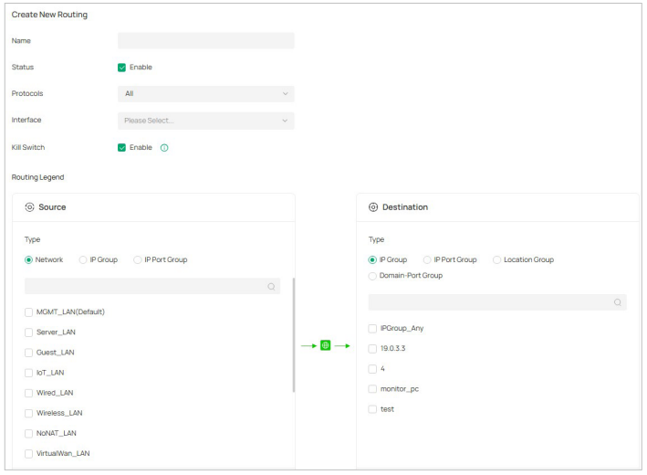
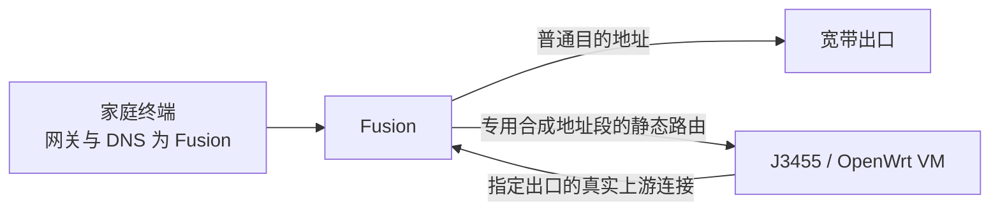

# Fusion 按网站交给 J3455：官方功能核验

核验日期：2026-11-05。对象：暂定的 **Omada Fusion 2.5G 普通版**。本文依据公开手册与发行说明；未连接、配置或测试家庭设备。

## 1. 结论

**Fusion 确实能写域名规则；但当前官方手册没有提供“域名规则 → 任意 LAN 下一跳 IP”这一直接配置。**

- **策略路由**可以用 `Domain-Port Group` 匹配域名与端口；`Interface` 字段说明选择 WAN 出口，没有填写同 LAN 内 J3455 地址的 `Next Hop` 字段。
- **静态路由**可以填写 `Next Hop` IP；匹配条件是目的 IP/网段，不是域名。
- 因此，不能仅凭“支持域名规则”和“支持下一跳”就认定二者能在同一条规则里组合。这是所查版本的文档与界面结论，不是对所有未来固件的断言。
- 另外确认了 **Local DNS 的 FORWARD 功能**。它与静态路由、OpenWrt 规则引擎的合成地址模式可以构成一个值得验证的方案：**普通流量始终经过 Fusion，指定网站才交给 J3455**。各组件有官方依据，整套组合尚未实测。

这修正了此前“域名匹配尚未确认”的表述：**域名匹配已确认，直接指定 LAN 下一跳的组合未在原厂界面中提供。**

| 用户关心的功能 | 文档核验结果 | 对本项目的意义 |
|---|---|---|
| 按网站域名写规则 | 支持 `Domain-Port Group` | 域名及端口级规则；不是按完整网页路径匹配 |
| 域名组通配符 | 支持；每组最多 16 个域名 | 不等于全机只能配置 16 个域名；总组数仍须核对 |
| 在域名策略中直接填写 J3455 的 LAN IP | 所查表单未提供此选项 | 不能按“加一条网站下一跳规则”直接实施 |
| 指定目的 IP/网段经某个下一跳 | 静态路由支持 | 可作为专用地址段送往 J3455 的基础 |
| 只把指定域名的 DNS 查询交给 J3455 | Local DNS / FORWARD 支持 | 普通域名可继续由 Fusion 独立解析 |
| J3455 停机后普通网站不受影响 | 组合方案的验收目标 | 尚无实机证据，不能写成产品保证 |
| 全屋所有设备、所有应用自动覆盖 | 尚未验证 | 自带 DNS、硬编码地址和 IPv6 等须逐类核验 |

## 2. 主要证据：Fusion 专用手册

已读取 [Fusion Gateway User Guide 官方页面](https://support.omadanetworks.com/us/document/123305/)及其 [PDF 原文](https://static.tp-link.com/upload/manual/2026/202605/20260514/1900002697_Fusion%20Gateway_V1.0_User%20Guide.pdf)。

官方页面标注更新于 **2026-10-19**；PDF 实际封面为 **1900004991 / REV1.0.1**，共 **576 页**。下载文件名仍带 V1.0，不应据文件名推定正文版本。下表“印刷页”指页内编号，“PDF 页”指阅读器从封面开始的页数。

| 证据 | 印刷页 | PDF 页 | 原文要点 |
|---|---:|---:|---|
| 静态路由匹配 | 219 | 254 | `Destination IP/Subnet` |
| 静态路由下一跳 | 220 | 255 | `Next Hop`，填写对应 IP；也可选择 Interface |
| 策略路由出口 | 221 | 256 | `Interface: Select the WAN port` |
| 策略路由目的匹配 | 222 | 257 | `Domain-Port Group` 可作为目的条件 |
| 域名组定义 | 272 | 307 | 每组最多 16 个域名，支持完整域名与通配符；端口留空表示任意端口 |
| Local DNS 类型 | 118 | 153 | `IP`、`CNAME`、`FORWARD` 三类 |
| 定向 DNS 上游与缓存 | 119 | 154 | FORWARD 最多两个指定 DNS 服务器；支持 DNS 缓存 |

策略路由菜单：`Network Config > Traffic Management > Routing > Policy Routing`。

以下为官方手册 PDF 第 256 页的表单裁剪，展示 `Interface` 与目的 `Domain-Port Group`；图中没有任意下一跳 IP 输入框。裁剪未改动字段内容。

静态路由的 `Next Hop` 在另一个配置页。手册还明确静态路由优先于策略路由，但**优先级关系不会把静态路由变成域名规则**。将某网站当前查询到的真实 IP 永久写入静态路由，也不能解决 CDN 地址变化或多个网站共用地址的问题。

`Domain-Port Group` 的通配符说明仅适用于该组功能。不能据此推定 Local DNS 的 FORWARD 也支持相同的通配、根域与子域匹配行为。

## 3. 硬件与软件版本边界

本轮读取的公开发行说明如下；它们是核验依据，**不是家中设备的实装版本，也不是升级操作建议**。

| 官方发行说明 | 适用硬件 | 固件 | 内置控制器 |
|---|---|---|---|
| [V1 发行说明](https://support.omadanetworks.com/us/document/135987/) | Fusion 2.5G(UN) v1.0 / v1.6 | 1.0.40 Build 20260918 Rel.22682 | 6.3.14 |
| [V2 发行说明](https://support.omadanetworks.com/us/document/135984/) | Fusion 2.5G(UN) v2.0 / v2.6 | 1.0.20 Build 20260918 Rel.17128 | 6.3.14.2 |

两份说明均记载启动时蓝牙设置偶发超时的修复，没有列出新增“域名匹配 + LAN 下一跳”。没有写入更新说明本身不能证明功能不存在；本报告的限制结论主要来自完整手册的字段定义。

[Fusion 软件架构说明](https://support.omadanetworks.com/us/document/137773/)区分 Omada OS 与 Network Application。到货后需同时记录地区、硬件版、OS 与应用版本，核对实际表单。

[Omada Controller V6.3 通用手册](https://support.omadanetworks.com/us/document/131915/)的印刷页 269–272 / PDF 页 280–283 也将静态下一跳与策略出口分开。其域名条件写作 `Domain Group`；本项目优先采用 Fusion 专用手册的 `Domain-Port Group` 表述，不能将通用控制器版本号或界面逐项当作 Fusion 实装事实。

## 4. 优先试验方向：定向 DNS + 合成地址段静态路由

### 4.1 为什么这条路线更贴合需求

用户已允许依赖指定出口的网站在 J3455 停机时暂时不可用。这样可以把目标设为：**普通上网从一开始就不经过 J3455，故障时无需切换普通路径**。

Fusion 保留默认网关、DHCP 和普通 DNS。J3455 上的 OpenWrt 完整 VM 只处理指定域名的解析与对应连接；沿用电竞房交换机既有接入口，不要求增加大厅回线或树莓派。

这里的“合成地址”是规则引擎为指定域名分配的内部标记地址。Fusion 不必维护网站不断变化的真实 IP；它只需把这一专用地址段交给 J3455，由规则引擎将地址对应回域名并建立指定出口连接。

### 4.2 解析与连接流程

| 步骤 | 普通网站 | 指定网站 |
|---|---|---|
| 终端网关 / DNS | Fusion / Fusion | Fusion / Fusion |
| Fusion 收到 DNS 查询 | 使用独立普通上游，返回真实地址 | Local DNS FORWARD 交给 J3455 上的规则 DNS |
| DNS 返回 | 普通真实地址 | 规则引擎返回专用地址段中的合成地址 |
| 终端发起连接 | Fusion 按普通路由走宽带 | Fusion 依据该专用地址段的静态路由交给 J3455 |
| J3455 的职责 | 无 | 解释域名映射，建立指定出口连接；实际上游经 Fusion 出网 |
| J3455 停机的目标表现 | 解析、已有会话、新连接保持可用 | 解析或连接可以失败，符合已确认要求 |

图示为数据连接；DNS 的分工见上表。J3455 上游连接必须使用正常可路由地址，不能再次落入交给自身的合成地址段。

地址示例：引擎文档使用 `198.18.0.1/16` 作为合成地址配置，其对应静态路由网段是 `198.18.0.0/16`，下一跳为 OpenWrt VM 的实际 LAN IP。这是示意，不是可直接套用的家庭参数；需先确认地址段未被现有服务使用。它也不是普通公网网站的真实地址。

**不要将网站的 DNS 地址直接写成 J3455 的管理 IP。** 那会把网站连接发给该主机地址，不能代替带有域名映射的规则引擎处理。

### 4.3 组件能力的依据与限制

1. **Fusion 定向查询**：专用手册印刷页 118–119 说明 FORWARD 把特定域名查询送给指定 DNS，优先于 WAN 等普通 DNS 设置。菜单是 `Network Config > Network Settings > LAN > Local DNS`。
2. **Fusion 静态下一跳**：专用手册印刷页 219–220 提供目的网段和下一跳 IP。实际 LAN 转发、回包及设备过滤行为仍须验证。
3. **引擎合成地址**：[Mihomo 官方 DNS 文档](https://wiki.metacubex.one/config/dns/)说明 `enhanced-mode: fake-ip`、`fake-ip-range`，以及 `fake-ip-filter-mode: whitelist`：仅匹配的域名返回合成地址。需要核对实际安装版本与管理界面生成结果。
4. **终端解析前提**：[Omada LAN DNS 官方配置说明](https://support.omadanetworks.com/us/document/40077/)明确终端必须以网关 LAN IP 为 DNS；自行使用其他 DNS 的应用不会自动遵守这些规则。

这是一项工程组合推导，**官方资料没有直接认证“Fusion + J3455 + 该引擎”整套方案**。它也不等于 Fusion 能自动接收、同步或维护完整的网站规则订阅。Fusion 域名转发清单与引擎清单需要保持一致，较大规则集的容量和维护方式仍待评估。

## 5. 上线前必须解决的问题

| 核验项 | 通过条件 |
|---|---|
| FORWARD 匹配和作用范围 | 分别验证完整域名、子域、别名、CNAME 链与相关资源域名；不假定添加主站就覆盖整站 |
| LAN 范围差异 | Fusion 手册仅为 IP/CNAME 说明 `Apply To LAN`；通用 FAQ 在 FORWARD 步骤也提到该选项。需看实机，不宣称试点规则天然只影响一台终端或一个 LAN |
| DNS 服务接入 | Fusion 能向 VM 的可达 DNS 服务查询；若引擎只监听非标准端口，由 VM 内服务承接，不能假定 Fusion 支持自定义端口 |
| 合成地址响应 | Fusion 不拦截、改写或丢弃所选合成网段的 DNS 响应；普通域名不获得该类地址 |
| 转发与回包 | VM 能处理来自 Fusion 路由转交的连接；响应正常，无转发回环；记录同 LAN 转发及 ICMP redirect 行为 |
| DNS 启动依赖 | 引擎上游解析不将同一指定域名送回 Fusion 的 FORWARD 形成递归；节点启动解析不依赖尚未启动的规则服务 |
| 缓存与重启 | 测试 Fusion、终端和引擎缓存；重启后的地址映射一致或能按计划恢复，不出现旧地址对应错误域名 |
| IPv6 与新 DNS 记录 | 单独验证 AAAA、HTTPS/SVCB 等记录及实际连接路径；不能仅验证 IPv4 就宣布双栈覆盖；保留本地 IPv6/Thread |
| 应用自身解析 | 识别系统外 DNS、加密解析、硬编码 IP 等；登记覆盖差异，不把 DHCP 下发 DNS 等同全应用覆盖 |
| 故障影响范围 | 指定查询超时不拖累 Fusion 的普通 DNS 服务；普通新域名、已有会话和新连接在 J3455 故障时均正常 |
| 规则维护 | Fusion 与引擎的域名范围一致；容量、更新与回退方式明确，规则外网站保持普通路径 |

特别注意：不能把所有域名都 FORWARD 给 J3455，也不能把 J3455 配成 Fusion 的唯一普通 DNS 上游，否则普通解析仍会依赖它。随意配置两个终端 DNS 地址也不能保证严格的主备顺序。

## 6. 小范围试验与退出条件

本轮只完成资料核验。以下是后续普通功能验证的顺序，均为 `not_run`，不涉及修改现网。

1. **核对实装版本与界面**：记录 Fusion 型号、地区、硬件版、OS/应用版，确认 Local DNS、静态路由和实际作用范围。
2. **隔离准备 VM**：保留现有 PVE、存储及桥；新建 OpenWrt 完整 VM，关闭其 DHCP/RA，不让它成为全屋默认网关。
3. **限定试验范围**：优先隔离测试网络。若只能在现网验证，先确认 FORWARD 的作用范围并选取不影响家庭使用的受控测试域名；不能把修改一条全局 DNS 规则称作“只测试一台设备”。
4. **验证两条路径**：指定域名返回专用合成地址并经 VM；普通域名保持真实地址和 Fusion 路径。记录 DNS 与路由证据，而不只看网页是否打开。
5. **验证故障隔离**：依次停规则服务、正常关闭 VM、正常关闭宿主及断开 J3455 数据线；每次同时验证普通 DNS 的缓存命中与未命中、已有连接和新连接。指定网站允许失败。
6. **验证恢复与覆盖**：恢复映射与服务，测子域、缓存、IPv6、各类终端和应用。结果写入[验收单](validation/home-rule-routing.md)。
7. **通过后再编写全屋推广步骤**：Fusion 继续提供 DHCP/普通 DNS；不恢复旧的全屋 DHCP 迁移计划。任一关键项失败，则停止扩大规则范围并保留普通网络。

试验退出时，先停用试验域名的定向解析，再按所记录的缓存及映射情况清理试验状态；最后撤销专用静态路由。对指定网站是否可访问单独记录，不要求普通出口替代其指定出口能力。

## 7. 对现有设备与布线的决定

- Fusion 仍放弱电箱或附近通风核心柜，负责主网关及控制器；三台 AP 的接法不变。
- J3455 仍放电竞房箱外通风位，接既有 ES210 端口；计划新增 OpenWrt 完整 VM，不重装宿主。
- 此候选组合不要求增加回线、独立备用设备或迁移全屋 DHCP。
- 如果关键功能实测不通过，再比较独立规则网关或其他传输接口方案；本轮没有据此新增采购。

当前状态：**官方组件能力已核验；直接域名到任意 LAN 下一跳不在所查界面中；组合功能、故障隔离、全屋覆盖与性能均未实测。**

配套：[故障隔离设计](superpowers/specs/2026-11-05-home-rule-routing-availability.md)、[原实施计划及暂停范围](superpowers/plans/2026-11-05-home-rule-routing.md)、[验收与应急单](validation/home-rule-routing.md)。
