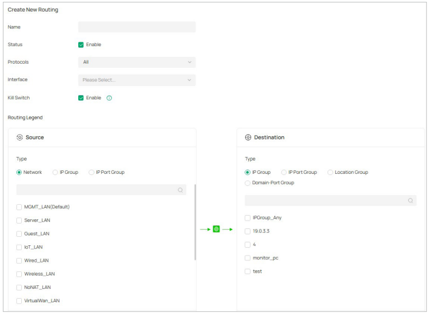

# Fusion 路由与 DNS：官方功能核验

核验日期：2026-11-05。对象：暂定的 **Omada Fusion 2.5G 普通版**。本文依据公开手册与发行说明；未连接、配置或测试家庭设备。本次整理保留原核验日期，不代表重新核验固件。

现行采用[同一LAN按设备选用OpenWrt](superpowers/specs/2026-11-05-home-device-rule-routing-design.md)：Fusion保留唯一DHCP和独立普通DNS，少数终端手动选择OpenWrt，故障时手动切回。执行见[现行计划](superpowers/plans/2026-11-05-home-device-rule-routing.md)与[验收单](validation/home-device-rule-routing.md)。本文只记录产品功能证据，不作为全屋DNS或路由变更计划。

## 1. 结论

**Fusion能写域名规则；所查官方手册没有提供“域名规则 → 任意 LAN 下一跳 IP”这一直接配置。**

- **策略路由**使用`Domain-Port Group`匹配域名与端口；`Interface`选择WAN出口，表单没有填写同LAN内J3455地址的`Next Hop`字段。
- **静态路由**可填写`Next Hop` IP，匹配条件为目的IP/网段，不是域名。
- **Local DNS / FORWARD**可把指定域名查询转交给指定DNS；该能力不等于融合了域名策略与LAN下一跳，也不证明整套规则服务已经可用。
- 这些结论限于下列手册和界面版本。实际发货的硬件、OS及应用版本仍须登记核验，不推断所有未来固件。

| 功能 | 文档核验结果 | 证据边界 |
|---|---|---|
| 按网站域名写规则 | 支持`Domain-Port Group` | 域名/端口级匹配，不是完整网页路径 |
| 域名组通配符 | 支持；每组最多16个域名 | 不等于全机只能配置16个域名，总组数另核 |
| 在域名策略中直接填写LAN下一跳 | 所查表单未提供 | 不能据独立的静态路由功能推定支持 |
| 指定目的IP/网段经下一跳 | 静态路由支持 | 不自动跟踪网站CDN地址变化 |
| 指定域名的DNS转发 | Local DNS / FORWARD支持 | 与普通上游及应用自行解析的行为分开核验 |

## 2. 主要证据：Fusion 专用手册

已读取 [Fusion Gateway User Guide 官方页面](https://support.omadanetworks.com/us/document/123305/)及其 [PDF 原文](https://static.tp-link.com/upload/manual/2026/202605/20260514/1900002697_Fusion%20Gateway_V1.0_User%20Guide.pdf)。

官方页面标注更新于 **2026-10-19**；PDF 实际封面为 **1900004991 / REV1.0.1**，共 **576 页**。下载文件名仍带 V1.0，不应据文件名推定正文版本。下表“印刷页”指页内编号，“PDF 页”指阅读器从封面开始的页数。

| 证据 | 印刷页 | PDF 页 | 原文要点 |
|---|---:|---:|---|
| 静态路由匹配 | 219 | 254 | `Destination IP/Subnet` |
| 静态路由下一跳 | 220 | 255 | `Next Hop`，填写对应 IP；也可选择 Interface |
| 策略路由出口 | 221 | 256 | `Interface: Select the WAN port` |
| 策略路由目的匹配 | 222 | 257 | `Domain-Port Group` 可作为目的条件 |
| 域名组定义 | 272 | 307 | 每组最多 16 个域名，支持完整域名与通配符；端口留空表示任意端口 |
| Local DNS 类型 | 118 | 153 | `IP`、`CNAME`、`FORWARD` 三类 |
| 定向 DNS 上游与缓存 | 119 | 154 | FORWARD 最多两个指定 DNS 服务器；支持 DNS 缓存 |

策略路由菜单：`Network Config > Traffic Management > Routing > Policy Routing`。

以下为官方手册 PDF 第 256 页的表单裁剪，展示 `Interface` 与目的 `Domain-Port Group`；图中没有任意下一跳 IP 输入框。裁剪未改动字段内容。

静态路由的 `Next Hop` 在另一个配置页。手册还明确静态路由优先于策略路由，但**优先级关系不会把静态路由变成域名规则**。将某网站当前查询到的真实 IP 永久写入静态路由，也不能解决 CDN 地址变化或多个网站共用地址的问题。

`Domain-Port Group` 的通配符说明仅适用于该组功能。不能据此推定 Local DNS 的 FORWARD 也支持相同的通配、根域与子域匹配行为。

## 3. 硬件与软件版本边界

本轮读取的公开发行说明如下；它们是核验依据，**不是家中设备的实装版本，也不是升级操作建议**。

| 官方发行说明 | 适用硬件 | 固件 | 内置控制器 |
|---|---|---|---|
| [V1 发行说明](https://support.omadanetworks.com/us/document/135987/) | Fusion 2.5G(UN) v1.0 / v1.6 | 1.0.40 Build 20260918 Rel.22682 | 6.3.14 |
| [V2 发行说明](https://support.omadanetworks.com/us/document/135984/) | Fusion 2.5G(UN) v2.0 / v2.6 | 1.0.20 Build 20260918 Rel.17128 | 6.3.14.2 |

两份说明均记载启动时蓝牙设置偶发超时的修复，没有列出新增“域名匹配 + LAN 下一跳”。没有写入更新说明本身不能证明功能不存在；本报告的限制结论主要来自完整手册的字段定义。

[Fusion 软件架构说明](https://support.omadanetworks.com/us/document/137773/)区分 Omada OS 与 Network Application。到货后需同时记录地区、硬件版、OS 与应用版本，核对实际表单。

[Omada Controller V6.3 通用手册](https://support.omadanetworks.com/us/document/131915/)的印刷页 269–272 / PDF 页 280–283 也将静态下一跳与策略出口分开。其域名条件写作 `Domain Group`；本项目优先采用 Fusion 专用手册的 `Domain-Port Group` 表述，不能将通用控制器版本号或界面逐项当作 Fusion 实装事实。

## 4. 保留证据与现行使用边界

[Omada LAN DNS官方说明](https://support.omadanetworks.com/us/document/40077/)要求终端以网关LAN IP作为DNS，应用自行使用其他解析器时不会自动遵守这些规则。Fusion专用手册印刷页118–119给出的菜单为`Network Config > Network Settings > LAN > Local DNS`；FORWARD作用范围和域名匹配需按实际表单核验，不能套用Domain-Port Group的通配符能力。

现行按设备方案无需Fusion提供“按网站填写LAN下一跳”，也不在Fusion上配置全屋定向DNS或合成地址段静态路由。少数指定终端的规则DNS在OpenWrt中处理；如果该VM使用合成地址，按[Mihomo DNS文档](https://wiki.metacubex.one/config/dns/)核对实际版本和生成配置，并完成[浏览器兼容检查](home-routing-community-and-reliability.md#4-合成地址的浏览器兼容证据)。这些是规则终端的现场待办，不扩大为全屋变更。

主网关第三方软件边界、手动终端参数及逐设备DHCP覆盖能力见[Fusion扩展与按设备调研](fusion-third-party-and-device-routing.md)。[社区案例与故障证据](home-routing-community-and-reliability.md)用于理解解析和宿主故障，不能替代本户实测。原全屋候选实施步骤已删除，部署只使用现行设计、计划和验收单；全部现场状态仍为`not_run`。
