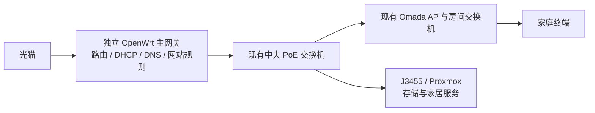

# 全屋规则分流：公开案例与可靠性选择

调研日期：2026-11-05。历史调研对象：Fusion 主网关、三台有线 AP、现有 J3455/Proxmox，当时要求所有联网设备纳入规则，并且 J3455 停机时普通上网继续可用。未连接或修改家庭设备。

> **范围已收窄并获批准：** 现行采用[同一LAN内按设备手动选用OpenWrt](superpowers/specs/2026-11-05-home-device-rule-routing-design.md)，普通设备继续走Fusion，规则终端故障时手动切回。执行见[现行计划](superpowers/plans/2026-11-05-home-device-rule-routing.md)和[验收单](validation/home-device-rule-routing.md)。以下全屋组合与独立主网关建议仅作历史比较；采购与物理布线不变。

## 1. 结论与对上一份建议的限定

**“定向 DNS + 合成地址段静态路由”这一类架构有人实际使用，也有现成项目；但本轮没有找到可核验的 Fusion 专用完整部署与宿主停机验收案例。**

此前[官方功能调研](fusion-domain-routing-capability-research.md)确认了 Fusion 的组件能力。现在补充的社区证据证明此类架构可以在其他网关上实现，不能替代 Fusion 的兼容性与故障测试。应将它定位为**保留 Fusion、复用 J3455 时的试验候选**，不能直接称作全屋成熟定案。

如果用户更看重长期维护简单，并接受调整尚未购买的主网关，优先比较**独立设备运行 OpenWrt，承担主网关及规则服务，J3455 只承担存储与家居服务**。它从结构上排除了 J3455 对普通上网的依赖，但不是全网双机冗余，也不自动保证规则插件故障时普通网络可用。

这只是新增比较建议，**不改变现有 Fusion 采购基线，不代表已经决定购买或替换设备**。

## 2. 实际找到的案例

| 来源及日期 | 实际报告的内容 | 能证明什么 | 不能证明什么 |
|---|---|---|---|
| [Mihomo #916](https://github.com/MetaCubeX/mihomo/issues/916)，2023-12-14 发起 | 发帖者说明自己在主路由运行 mosdns，分别返回真实地址与合成地址，再用静态路由交给规则设备 | DNS 与数据路径分离有实际使用者 | 帖首的部分配置是功能提案，不能整段当作现行配置；没有 Fusion 实测 |
| [同帖使用反馈](https://github.com/MetaCubeX/mihomo/issues/916#issuecomment-1869186304)，2023-12-26 | 一位参与者自述“用了2个月了，非常稳定” | 同类方案有持续使用自述 | 没有公开完整的断电、DNS 冷缓存或所有应用验收，不能量化故障率 |
| [RouterOS + J4125/PVE 案例](https://github.com/kkkgo/PaoPaoGateWay/discussions/48)，2023-12-23 至 12-30 | 独立 MikroTik 主路由，J4125/PVE 承载 DNS 与规则网关，主路由配置合成地址段静态路由；作者报告能访问但页面慢，之后反馈调整防火墙后问题解决 | 与本项目接近的“小主机 + PVE + 独立主路由”实际部署；转发/回包需要适配 | 普通 DNS 也在该 PVE 上，原文没有证明宿主停机后普通解析独立可用；不是 Fusion |
| [爱快 + PaoPao 网关案例](https://github.com/kkkgo/PaoPaoGateWay/discussions/26)，2023-10-08 起 | 作者报告已能访问，来源地址被转换成爱快地址，后反馈调整 NAT 规则后恢复来源识别；其他参与者报告不同路由方式下有故障 | 爱快主路由配合独立规则网关有实际案例，配置细节影响结果 | 不能由“爱快支持下一跳”推出自动故障切换已就绪；评论中的故障归因没有独立复测 |
| [梅林 + Hyper-V 教程](https://github.com/lesnolie/Marverick/issues/37)，2024-03-16 | 作者给出 DNS、规则 VM、主路由及静态路由的安装记录 | 另一平台上的实际部署记录 | 文章提出备用 DNS，但没有证明备用服务与主服务位于独立宿主，也没有完整的停机演练 |

另外，[PaoPaoGateWay 项目](https://github.com/kkkgo/PaoPaoGateWay)与[作者的原理说明](https://blog.03k.org/post/paopaogateway.html)明确描述了合成地址映射、主路由静态路由与 DNS 分流。[PaoPaoDNS 文档](https://github.com/kkkgo/PaoPaoDNS)的 `CUSTOM_FORWARD` 支持按名单向指定 DNS 转交查询。这证明已有实现思路和组件，不意味着应该把现有 OpenWrt 计划直接换成该项目。

不能照搬教程中的旧版本参数、地址池和防火墙放宽规则。此处引用的是部署事实与故障现象；具体设置应依据当前软件文档及本地验证。

## 3. 为什么“普通流量直连”仍可能在旁路停机时断网

普通访问依赖两个过程：先解析域名，再建立连接。

```text
数据直连，但解析依赖 J3455：
终端 → Fusion → 宽带                 数据路径独立
终端 → DNS 服务（J3455 上）           解析仍有共同故障点

目标结构：
普通域名 → Fusion 的独立普通解析
普通连接 → Fusion → 宽带
指定域名与指定连接 → J3455           允许这部分故障
```

因此，下列情况都不能证明本项目的要求已满足：

- 关闭规则服务后，已经打开的视频继续播放：这可能只说明已有连接尚可用。
- 两个 DNS 容器或两台 VM 都放在 J3455：宿主停机后会一起不可用。
- 终端填写两个 DNS 地址：终端或应用可能选择任意一个，不保证严格主备，也可能使指定规则失效。
- 只改变 DHCP 下发网关：旧租约和静态配置不会立即更新。
- 只 ping J3455：宿主在线并不代表 VM 内解析和规则服务正常。
- 只停用插件测试一次：不能替代 VM、宿主和数据线故障测试。

与本项目需求最接近的社区讨论也有人只依赖 DNS 缓存撑过短时间故障。缓存不覆盖未访问域名与过期记录，不能作为长期普通上网的保障。

## 4. 公开部署中的几类做法与适用性

以下是公开案例与可用机制的分类，**不是家庭部署占比统计，也不是各方案稳定性的实测排名**。

| 做法 | J3455 停机时 | 维护及限制 | 对本项目的判断 |
|---|---|---|---|
| J3455 OpenWrt 作为全屋网关/DNS | 全屋依赖它，停机会影响普通上网 | 教程较易套用，但需要另外设计接替 | 不满足已确认要求，继续暂停 |
| Fusion 保留网关/普通 DNS，定向 DNS + 合成地址段路由给 J3455 | 设计目标是仅指定网站受影响 | 两边域名清单、缓存、应用解析、双栈及设备兼容须维护 | 保留现有选型时可试验；尚不是 Fusion 成功定案 |
| 独立可编程主网关 + J3455，配健康检测及故障撤回 | 配置正确并通过演练后，可自动保留或恢复普通路径 | 主网关须独立；检测、路由、DNS、返回路径与恢复防抖缺一不可 | 可实现方向，复杂度较高，不是换个系统名就完成 |
| **独立 OpenWrt 设备承担主网关及规则服务** | **普通网络与规则服务均不依赖 J3455** | 规则插件、主网关自身仍可能故障；需要稳定版本和独立供电/存储 | **接受调整主网关时，优先比较，职责和故障边界较清楚** |
| 两台独立网关接替、虚拟地址等 | 可覆盖更广的网关故障 | 需要两台独立机器、地址与 DNS 接替；既有会话仍可能重建 | 对目前仅要求隔离 J3455 的目标通常过重，不默认选树莓派 |

### 可编程主网关有什么真实依据

[RouterOS Netwatch 官方文档](https://help.mikrotik.com/docs/spaces/ROS/pages/8323208/Netwatch)明确提供 ICMP、TCP、HTTP/HTTPS、DNS 检测及状态变化脚本；[RouterOS DNS 文档](https://help.mikrotik.com/docs/spaces/ROS/pages/37748767/DNS)说明 FWD、子域匹配及动态地址列表等能力。它具备实现受控分流与健康检测的基础，但仍要写出、审查和实测整套配置。

本文**没有确认爱快某个具体版本可以用一个原厂开关完成本项目所有故障退回要求**。已有爱快部署案例，不等于其普通 DNS、服务检测及缓存回退都已解决；主网关若同样安装在 J3455 上，更无法隔离宿主故障。

无需为了指定网站在故障时仍能打开而强制撤回它们的路由，因为用户已允许这部分失败。只有普通流量或普通解析也经过 J3455 时，自动切换才成为基本可用性的必需环节。

## 5. 独立 OpenWrt 主网关候选如何落地

若用户选择该方向，建议职责是：



- 新的网关是独立网络设备，不是 J3455 上的另一台 VM；可用适配良好的双网口设备，具体型号与吞吐需另行比较。
- 设备只承担网络职责，不同时承载影音存储等业务；保留已验证配置、升级回退与管理入口。裸机部署可减少本项目不需要的宿主与虚拟化依赖，但不能据此保证硬件永不故障。
- J3455 关机时，它上面的存储和家居服务可能停止，网络路由与解析仍在独立设备上运行。
- 这不是同时保留两台主网关的简单叠加方案。Fusion 尚未购时，可比较替换其主路由职责；若要保留 Fusion，则需另做清晰的地址/路由设计，不能直接串两台全功能网关而忽略影响。
- TP-Link 交换机与 AP 不因主路由更换就必须整套换掉。Omada 控制器要另行安排，不能假定 Fusion 的内置控制器自然迁移到 OpenWrt。
- 一个候选是控制器运行在 J3455 上。[Omada 官方说明](https://support.omadanetworks.com/us/document/12964/)区分控制器离线时继续保留的 AP 配置与依赖控制器的功能。基本已配置接入可以保留，但门户认证、统计和部分优化服务有影响；具体版本、家庭 SSID 认证方式与所需功能仍须验收。若要求控制管理也独立常开，再评估独立控制器，当前未新增采购。

推荐它的理由是**从结构上移除 J3455 这个共同依赖**，不是宣称 OpenWrt 天生比 Fusion 或爱快稳定。独立主网关自身的硬件、系统或插件故障仍需处理；若用户还要求这台网关自身故障也不中断普通上网，那是新增的冗余目标。

## 6. 合成地址方案新增的浏览器兼容检查

当前 PaoPaoGateWay 文档提醒合成地址池可能触发浏览器的本地网络访问检查。[Chrome 官方公告](https://developer.chrome.com/blog/local-network-access)说明相关权限从 Chrome 142 推出；[地址空间规范](https://wicg.github.io/local-network-access/)将 `198.18.0.0/15` 列为 loopback 地址空间。

这不等于所有合成地址连接都会被禁止。影响与浏览器版本、页面来源和资源请求类型有关，特别需要测试普通页面访问使用合成地址的资源。上一份方案中的 `198.18.0.0/16` 应继续仅作引擎示例，**不能跳过浏览器与应用测试直接定为最终地址池**。也不照搬旧教程中随意占用真实公网地址段的做法。

## 7. 当前建议与下一步

**如果首要目标是少维护、避免家人因 J3455 的宿主操作而断网：优先比较独立 OpenWrt 主网关，保留现有交换机/AP布线。** 这是待用户选择的架构方向，并未替换 Fusion 基线。

**如果要保留 Fusion 且继续复用 J3455：维持 Fusion 普通网络，先对组合方案做隔离小试。** 有同类案例作为参考，但不能因为社区有人成功就省去 Fusion 的验证。验收至少包括：

1. 实际固件的定向 DNS 匹配、规则容量、静态下一跳及可控的试验作用范围。
2. 普通域名完全独立于 J3455，覆盖缓存命中与首次解析。
3. 指定域名和相关资源能正确分流，浏览器本地网络检查、应用自身 DNS、IPv6 与 UDP 行为有记录。
4. 依次停规则服务、停 VM、正常停宿主、断开 J3455 数据线，普通已有会话和新连接仍可用。
5. 恢复后缓存与域名映射正确；普通流量不因列表误匹配被交给故障服务。

本轮资料核验结束，现场全部 `not_run`；没有新建 VM、改变网络参数、购买硬件或修改采购决定。原全屋 DHCP 迁移继续暂停。

## 8. 调研范围

已读取上述项目原始讨论、作者文档、官方 RouterOS 功能文档和 Omada 控制器离线说明。针对 Fusion/Omada 与合成地址、静态路由、条件转发等组合进行了公开检索；通用搜索有验证码或结果相关性不足的情况，因此没有把它们的无结果当成“全网不存在”的证据。结论限于**本轮已核验的公开资料中，没有 Fusion 完整成功及宿主故障隔离案例**。
