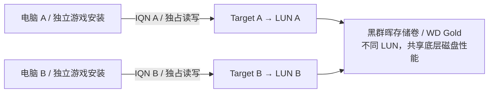

# J3455 黑群晖：iSCSI 游戏盘可行性与多电脑使用边界

更新：2026-11-25。对象是用户现有 **J3455 → Proxmox → 黑群晖 DSM 虚拟机**，不是另购官方群晖或未来高速 NAS。本页为研究与后续试验建议，未连接 NAS、未创建 LUN、未调整影视卷，也未增加采购。

## 结论与本户选择

**DSM 官方提供 iSCSI 功能；这台黑群晖能否使用，需要核实实际 DSM 版本、模拟机型及 SAN Manager（旧版环境可能是 iSCSI Manager）是否可运行。** 不能仅凭 J3455 的 CPU 型号确定支持，也不能把官方群晖适用机型清单当作黑群晖兼容保证。[1][2]

多台电脑同时运行同款游戏，可以考虑各自使用独立的 iSCSI LUN 和游戏安装。**不能把同一个普通 NTFS LUN 同时挂给多台 Windows 电脑读写。** iSCSI 提供远程块设备，客户端看到类似本地硬盘；它不自动提供共享文件系统的锁与缓存协调。更换为 TrueNAS 作为服务端也不会自动解决这个文件系统问题。[3][4]

| 想实现的效果 | 是否适合 | 本户处理 |
|---|---|---|
| 一台电脑用 NAS 上的盘安装游戏 | 条件可行 | 一个独立 LUN，只允许该电脑读写；游戏/启动器与断线恢复要实测 |
| 多台电脑同时玩同款游戏，各自有安装和写入空间 | 条件可行 | **每客户端独立 LUN**；游戏账号、启动器及反作弊兼容按具体游戏验证 |
| 同一个 NTFS 游戏盘同时被多台普通 Windows 挂载读写 | 不采用 | 多主机缓存及元数据写入缺少协调，可能损坏文件系统/数据 |
| 只存一份游戏基础数据，每台电脑都有独立写入层 | 需要额外架构 | 研究支持共享基础镜像与独立写入层的专用方案；单开 iSCSI 或 Multiple Sessions 不会自动实现 |
| 多电脑共享影视、安装包、备份文件 | 适合文件共享 | 优先沿用 SMB；文件共享不等于所有游戏都支持直接从共享目录启动 |

现阶段建议 **J3455 继续以影视资源为主，常玩的游戏优先放电脑本地 SSD**。若确实需要扩展游戏盘，在现有卷有足够空闲空间、数据备份已核实的前提下，先用小型独立 LUN 试验，评估两台电脑同时加载/更新对影视播放的影响，再决定是否长期使用。

## 官方依据：多连接与多机安全访问是两回事

SAN Manager 的 Multiple Sessions 允许多个 initiator 同时连接一个 target，但官方随即提示使用 VMFS、OCFS 等共享或集群文件系统，防止损坏与意外丢失。[3]

> “To protect your files from corruption or unexpected data loss, it is strongly suggested that you use a shared file system or cluster system …”

官方 Host 帮助的 `Concurrent LUN Access` 表中，普通 **Windows、Linux、macOS 均为 No**；Windows failover cluster 和 VMware ESXi 为 Yes。[4] 普通游戏电脑的 NTFS 并不因此具备 Windows 故障转移集群的配置与协调机制。

推荐对应关系：

- 每台电脑分配不同 LUN，按其 initiator IQN 限制读写；其他主机设为 No Access，不使用默认 Allow all。[4]
- 单独 target 是便于管理的建议；**真正的隔离是不同 LUN**。两个 target 如果仍映射同一 LUN，冲突仍存在。
- 不把多会话、CHAP、端口聚合或 MPIO 当成文件系统协调机制。CHAP 用于认证；MPIO 是多路径能力，均不能让普通 NTFS 安全地多主机写入。
- 如果确需将一个 LUN 从电脑 A 移交电脑 B，先在 A 关闭程序、卸载/脱机并断开会话，再由 B 接入；不做同时写入。

## 克隆能否省去重复安装

SAN Manager 支持在适用型号和存储条件下克隆 LUN，但不能保证用户当前黑群晖具备这些功能。官方规格及 LUN 帮助给出的边界包括：[2][5]

- 克隆/快照仅对特定型号可用；功能、数量上限依型号和版本而异。
- 新高级功能及即时快照/恢复需要满足 Btrfs、Thin Provisioning 和相应 DSM 版本条件；DSM 6.2+ 只是这些功能的部分前提，不是所有环境都可用的承诺。
- Thick Provisioned LUN 不支持快照及空间回收；快速克隆还取决于 LUN 功能和是否位于同一卷。
- 对没有快照或 legacy advanced features 的 LUN，官方建议克隆前断开连接，以减少克隆失败或数据不一致风险。

如果实机支持，可在游戏安装完成、程序退出并卸载源盘后生成独立克隆，再给另一台电脑使用。**克隆不是共享一个可写盘，也不会自动同步后续游戏更新。** 快速克隆初始可能共享底层数据块，后续写入和补丁会增加实际占用；不能承诺永久只占一份容量或不消耗额外 I/O。Thin LUN 的逻辑容量也不代表物理容量已预留，须监控存储卷剩余空间。

## J3455 的性能与 v1.6 网络路径

已知：J3455 有 16GB 内存、10TB 历史容量记录，使用 WD Gold、未做 RAID；具体盘数/型号、原始或可用容量、DSM 卷文件系统及磁盘直通方式未知。无 RAID 不代表已确认只有一块盘。当前物理网口为 1G，用户确认升级方向是 2.5G，尚未实施；黑群晖、代理以及规划的 HAOS/OpenWrt 共用宿主资源。

| 访问来源 | 到客厅 J3455 的路径 | 主要网络限制 |
|---|---|---|
| 客厅电视 / Apple TV | 客厅 ES206 内部转发 | 客户端网口、J3455 网口和存储；不经过 Fusion |
| 电竞房电脑 | 电竞 ES210 → Fusion → 中央 ES210 → 10G 光纤 → 客厅 ES206 | 电竞上联与中央—Fusion均为2.5G；多客户端共享路径 |
| 两个普通电脑墙口 | Fusion → 中央 ES210 → 10G 光纤 → 客厅 ES206 | 各墙口2.5G，但共同经过中央—Fusion的2.5G链路 |
| 中央所接 AP 的无线电脑 | AP → 中央 ES210 → 10G 光纤 → 客厅 ES206 | 无线实效、AP 2.5G回程与J3455网口 |

所有访问者还共享 J3455 的一个物理网口：现在合计 1G，升级后合计 2.5G。**中央—客厅 10G 并不使每台电脑都能独占 2.5G 读 J3455。** 同网段接入仍需实际验证 Fusion LAN 间转发，不能仅按接口标签保证整机吞吐。

大文件连续传输常见数量级：1G 约110–118MB/s，2.5G在存储/CPU足够时约260–290MB/s；这不是游戏加载测速。机械盘的游戏小文件随机读取、资源解压、补丁写入与多用户并发，可能先受磁盘 IOPS、CPU和虚拟化后端限制。2.5G升级有利于连续传输，但不会把机械盘变成本地SSD。独立LUN隔离写入权限，不隔离底层磁盘争用与故障。

用户若最终需要多人高负载游戏库，再评估已有SSD空间或未来高速NAS的实际存储方案；本轮不因此采购J3455的10G网卡、SSD、阵列或新整机。

## 实机待确认与试验顺序

需要补录：DSM完整版本、模拟机型、SAN Manager/iSCSI Manager版本与可用性、Btrfs/ext4、可用容量、硬盘直通/虚拟磁盘方式、DSM VM资源及客户端系统。当前这些信息未确认，不能记录为“已支持/已配置成功”。

后续若开展试验，按以下顺序执行；本次均 **not_run**：

1. 记录现有影视共享、虚拟磁盘/直通与备份状态，核实卷剩余空间；不重分区、不格式化或替换既有影视卷。
2. 在可用卷中新建容量受控的测试 LUN/target，只给电脑 A 的 IQN 读写；在客户端核对新盘身份后初始化该测试盘，不对原有盘操作。iSCSI 仅在家庭 LAN 使用，不对公网转发端口。
3. 验证网络吞吐，再测试一款可重新安装的游戏：安装、启动、加载、更新、重启后挂载；记录NAS/宿主CPU、内存、磁盘延迟与实际带宽，不仅看协商速度。
4. 用独立 LUN B 接电脑 B，两机同时加载和更新，并同时播放客厅影视；核对掉帧、卡顿和宿主其他服务是否受影响。
5. 只在可丢弃测试数据上验证断线/重启恢复；游戏退出、盘卸载或脱机、会话断开后再做主机维护，避免有写入时直接断电。
6. 评估客厅J3455/ES206、中央交换机与Fusion的供电依赖；UPS仍为后续选型。不能因为LUN分开，就忽略共用宿主故障及断电恢复。

## 已核实来源

以下官方页面在2026-11-25获取到对应正文；只用于核实DSM产品能力与安全边界，不代表黑群晖通过兼容认证。

1. [SAN Manager 套件及适用机型](https://www.synology.com/en-global/dsm/packages/ScsiTarget)；[SAN Manager 概述：块存储](https://kb.synology.com/en-global/DSM/help/ScsiTarget/SANManager_desc?version=7)。
2. [DSM 7.2 SAN Manager 软件规格](https://www.synology.com/en-global/dsm/7.2/software_spec/san_manager)：型号、LUN、克隆及快照限制。
3. [iSCSI：Multiple Sessions 与共享/集群文件系统警告](https://kb.synology.com/en-global/DSM/help/ScsiTarget/iscsi?version=7)。
4. [Host：LUN 权限与 Concurrent LUN Access 表](https://kb.synology.com/en-global/DSM/help/ScsiTarget/host?version=7)。
5. [LUN：创建、克隆、快照和预配条件](https://kb.synology.com/en-global/DSM/help/ScsiTarget/lun?version=7)。

以上DSM 7文档不作为未知DSM 6环境的直接兼容证明；若实机为旧版，按实际版本另核。相关接线见[网络拓扑 v1.6](network-topology.md)，硬件采购边界见[采购 BOM](purchase-bom.md)。
