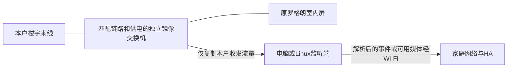

# ESP接入楼宇对讲：真实案例、视频边界与罗格朗调查路径

> 调查日期：2026-11-23。目标是保留现有罗格朗室内屏，将本户呼叫、一次开门及可用视频接入家庭网络。用户提议用ESP开发板监听／转发信号。本轮实际读取项目README、安装文档、兼容表及部分源码；没有接线、抓取现场流量、安装固件或操作门锁。
>
> 实物信息：Legrand／视得安罗格朗，背标`S6819161`，RJ45及MAC标签，另有两组红黑线；其电压、线制、协议均未确认。见[实物和手册记录](legrand-intercom-identification-and-manuals.md)。本机完整手册仍未取得。

## 1. 结论

**用户描述的改造确实存在，并且有可阅读的代码、电路和安装教程。** 其中最接近“保留原屏，一路给家庭网络”的是Doorman和Simplebus2 MQTT Bridge：它们通过专用电路接入已知总线，用ESP将呼叫事件和控制能力接入ESPHome／MQTT／Home Assistant。

但需要分开三件事：

1. **复制或解析控制消息**：例如有人按铃、按下开门、请求监视。这正是多种ESP总线项目实现的能力。
2. **取出音视频**：总线上存在视频，不表示控制消息里就含视频；视频可能需要另一种电气接口、媒体协议、会话或解密条件。
3. **接入米家**：Wi-Fi联网、MQTT或HA实体不是米家认证或视频接入证明。

对于这台带RJ45和MAC标签的罗格朗，优先调查是否为以太网／IP。**若确认是标准以太网，先保留原屏，用镜像／TAP和电脑调查本户流量；协议明确后再决定是否由ESP承担事件网关。** 若实际是专用总线，则按其电气接口和编码选择专用收发电路。此时仍不能直接套用下列任何其他型号的接法。

“原屏继续可用＋家庭网络可访问”的目标有工程路径；“一块普通ESP加分线头即可同时取得完整视频、通话和开门”尚无本机证据。

## 2. 已核查的真实项目

下表“实现／支持”均指所链接项目的文档或代码，不是本户实测。固定提交和来源分类见[证据索引](research/legrand-intercom-20261123/esp-sources.json)。

| 项目与教程 | 实际接法、硬件与公开能力 | 音视频与本户适用性 |
|---|---|---|
| [Doorman S3](https://github.com/AzonInc/Doorman)；[安装](https://doorman.azon.ai/guide/getting-started)；[兼容表](https://doorman.azon.ai/guide/hardware-compatibility) | ESP32-S3加专用TC:BUS收发、电源和继电器电路；安装文档明确并联总线，保留原机；通过ESPHome／MQTT等提供呼叫、开门等功能 | 针对TCS／Koch及部分贴牌总线设备，兼容表明确不支持 **TCS:IP**。未发现原音视频转发或S6819161兼容证据 |
| [Comelit Simplebus2 MQTT Bridge](https://github.com/Elektroarzt/simplebus2-mqtt-bridge)；[设置手册](https://github.com/Elektroarzt/simplebus2-mqtt-bridge/blob/main/software/docs/SETUP-GUIDE.md) | ESP32-C3加滤波、放大和比较器电路，读取两线总线上25kHz控制信号，提供呼叫、开门等MQTT功能 | 原系统可以带视频，但该桥接实现清单不是视频采集器；其电路不能接到未知RJ45针脚或红黑线 |
| [Siedle HTS 811-0改造](https://github.com/thamow/Smart-Doorbell) | Wemos D1 mini／ESP8266、光耦、独立USB供电；检测来电电压变化，模拟原机开门／灯光按钮，原按钮继续使用 | 这是按钮与事件改造，不是完整总线解码；无原视频和双向音频。作者明确公开的新电路图未测试，不能把旧实物多年运行等同于新图已经验证 |
| [Urmet 4+n Smart Intercom](https://github.com/darkobg79/smart-intercom-esphome) | NodeMCU／ESP8266加专用PCB，针对4+n模拟线制，包含来电、开门、静音等ESPHome示例 | 不是RJ45／IP适配；自动化中的“发送摄像头图片”不能证明取得了原门禁视频 |
| [BTicino C300X Controller](https://github.com/slyoldfox/c300x-controller) | 在特定C100X／C300X原屏Linux系统内运行程序，提供开门接口、事件、MQTT、SIP与RTSP／WebRTC／HomeKit相关功能 | 有真实视频路径，但不是ESP通用抓包器；依赖特定系统、软件与可维护访问。媒体涉及SIP会话管理，不能照搬到国内视得安S6819161 |
| [视得安980项目](https://github.com/luyumenq/shidean-980-deceiver) | README描述串接原电源和排针、保留原分机，并声称绑定米家实现远程开门／呼叫通知 | **当前完整仓库仅有667字节README，没有原理图、固件、BOM或视频实现，也未注明ESP。** 属于相关概念线索，不是可复现教程；980与本机也没有对应证据 |
| [ESP32-P4 Video Intercom](https://github.com/Gluxur/guition-jc8012p4a1c-intercom) | Guition P4＋C6屏板从go2rtc接收MJPEG／WebRTC，HA提供门铃触发和控制；作者报告一套安装中日常使用 | 证明特定ESP硬件可以做视频终端；前提是已有可被go2rtc读取的RTSP源，双向音频还需backchannel。它不负责解出罗格朗未知来线 |

### 2.1 Doorman为何最接近用户的设想

[早期peteh/doorman](https://github.com/peteh/doorman)直接称自己为ESP32／ESP8266 MQTT bridge，提供总线收发和HA发现；后继Doorman S3把专用接口和配置进一步集成。其架构可概括为：

这是真正的总线旁路方案，但Doorman的兼容范围是明确约束。其文档还指出总线负载、噪声和接地可能影响工作。“并联”避免ESP的软件转发成为原机通信的必经步骤，却不能保证新增电路短路、负载过大或错误发报时原屏仍不受影响。

### 2.2 抓到“开启摄像头”消息不等于获取画面

[Simplebus2原始逆向项目](https://github.com/plusvic/simplebus2-intercom)说明控制信息叠加在供电线上，记录了18位报文和开启门口摄像头／室内屏的控制命令。后续ESP32桥接利用这些协议研究。

这里的“开屏命令”只要求系统启动画面。要把画面送进家庭Wi-Fi，还需要证明视频所在的信号、编码和采集方法。不能因为命令表里有camera就把项目计为“视频已实现”。

### 2.3 ESP可以处理哪些视频任务

不能笼统地说“ESP性能不足，所有视频都不行”。上述P4项目使用硬件JPEG解码，在已知go2rtc媒体源上显示视频，并由C6提供Wi-Fi。其README明确P4的H.264硬件是编码器，项目选择MJPEG而不是假定有H.264硬解码。

[ESPHome VoIP Stack](https://github.com/n-IA-hane/esphome-voip-stack)也提供SIP／SDP／RTP及受支持的视频配置：S3摄像头发送JPEG，P4有相应收发／显示适配。这些项目解决已知协议、摄像头与终端之间的通信，**不是任意楼宇总线解码器**。收到已经编码的流也可能只需转发／重新封装，不一定必须解码；具体能否用ESP取决于接口、吞吐、缓冲、丢包和会话实现。

## 3. 如果本机RJ45确为以太网，应该如何保留原屏

### 3.1 首选调查方式：镜像或合适的TAP

以下是**条件研究拓扑**，不是已确认可接线的施工图。先核网口针脚、链路和供电：

- 普通交换机不会把另一端口的单播自动交给ESP。网卡开启混杂模式，也只能接收实际送到该端口的帧。[Wireshark官方抓包指南](https://wiki.wireshark.org/CaptureSetup/Ethernet)明确介绍镜像端口、TAP和双网卡中间桥。
- 常见RJ45被动一分二线并不能复制同一条标准以太网链路。某些“分线器”只是把不同线对用于两条独立链路，与复制同一会话不同。
- 镜像端只解决观察流量。它通常不能作为开门控制的回传通道；主动控制要另外验证本户授权接口、网络可达路径和协议。
- 监听端Wi-Fi用于应用层输出事件或媒体；不默认把楼宇专网整个桥接到家庭LAN。监听网卡首先按只读方式工作，不主动申请地址、扫描其他住户或发开门报文。
- 新增交换机位于原屏必经链路，其掉电会影响原屏；不能宣传成完全无故障影响。TAP是否有掉电旁路、是否支持实际速率和供电也要逐型号核。监听电脑退出通常不影响交换机继续转发，但仍须实测。
- 镜像流量包含收发双向，镜像口与监听端需有足够吞吐；丢包可能造成视频缺帧，不能只凭链路标称速率判断。

不把未知门禁线插入现有家庭Omada LAN。调查可使用独立、可撤回的测试设备；是否需要新设备尚未选型或采购，不改现行交换机数量。

### 3.2 双网口Linux盒与ESP双网口方案

两有线网口Linux盒可以串在原线路和屏幕之间，使用透明桥转发并抓包；这能看到完整通信，但软件、供电和网口故障都可能中断原屏，除非另有经过验证的硬件旁路。普通单RJ45 ESP板没有直接串接原线和原屏所需的两个有线接口。

可以为ESP增加第二个网卡或交换芯片；工程上不是绝对做不到。但这时是在设计专用网络设备，还需实现转发、取流、协议解析和故障行为，不是刷入普通ESPHome配置就完成。

### 3.3 官方ESP联网例子能证明什么

| 官方资料 | 已核事实 | 不能由此推出 |
|---|---|---|
| [ESPHome Ethernet](https://esphome.io/components/ethernet/)与[多接口说明](https://esphome.io/components/network/#multi-interface-support) | 当前ESP32可同时配置Ethernet和Wi-Fi，需按文档设置`network.priority`；另有WISP模式 | 不等于自动镜像室内机流量、透明二层桥或识别门禁协议；旧“二者互斥”说法不适用于当前文档 |
| Espressif iot_bridge 1.1.0 [wireless_nic](https://components.espressif.com/components/espressif/iot_bridge/versions/1.1.0/examples/wireless_nic?language=en)／[wired_nic](https://components.espressif.com/components/espressif/iot_bridge/versions/1.1.0/examples/wired_nic) | 示例明文使用NAT在接口间转发 | NAT上网例子不是复制原屏已有会话，也不保证楼宇组播、设备发现或私有协议工作 |
| [ESP-IDF Ethernet API](https://docs.espressif.com/projects/esp-idf/en/stable/esp32/api-reference/network/esp_eth.html) | 有混杂模式与自定义接收路径，可编写包接收／过滤程序 | 不保证ESP持续接收整条双向链路且不丢帧；还须把目标流量正确送到它 |
| [W5500资料](https://docs.wiznet.io/Product/Chip/Ethernet/W5500) | 10/100 MAC／PHY、SPI接口、32KB收发缓存等 | 100Mbps网口不是整套ESP程序的线速转发承诺，更不是双口交换机 |
| [Linux无线4-address说明](https://wireless.docs.kernel.org/en/latest/en/users/documentation/iw.html#using-4-address-for-ap-and-client-mode) | STA后方透明桥接多个MAC需要AP／STA和驱动共同支持4-address | 普通家用Wi-Fi连接不能自动原样延伸另一个以太网；不要把这一功能默认赋予ESP＋Omada组合 |

## 4. 从抓到包到“随时看、随时开”还差什么

| 实际观察结果 | 下一步能推进什么 | 仍不能承诺什么 |
|---|---|---|
| 能识别本户来电／挂机事件 | 编写事件解析并输出HA通知，之后评估ESP实现 | 不等于有视频或开门能力 |
| 原屏播放时有可识别、可重建的未加密媒体 | 在电脑上验证解码／重新封装，评估go2rtc等接入 | 只有正在产生的媒体可复制；原屏关闭后可能停流 |
| 有RTSP等本户可访问的原厂接口 | 验证独立拉流及编码兼容，可能不需持续抓包 | 仍要核凭据、闲时可用性和并发限制 |
| 原系统通过SIP／私有信令启动RTP／UDP媒体 | 需理解会话协商和结束机制；先只观察原屏正常行为 | 抓到UDP包不等于获得稳定RTSP地址；不能假定可独立建立第二会话 |
| 媒体或控制加密 | 查原厂授权接口或受支持的终端扩展方式 | 无密钥／接口时，不能因抓包成功就宣称能解码或控制 |
| 已知本户一次开门的受支持控制接口 | 单独实现短时动作和失败处理 | 抓到一次报文不证明可以无限重放；可能有会话、认证、计数或时效约束 |

BTicino C300X案例尤其说明视频获取可能包含主动SIP协商。其部分来电视频／录像路径可以复用已存在的媒体，其他路径需要建立会话；**它不是通用的纯被动网线视频复制器**。

上述判断分别由[RFC 7826的RTSP会话模型](https://www.rfc-editor.org/rfc/rfc7826.html)、[Wireshark RTP分析说明](https://www.wireshark.org/docs/wsug_html_chunked/ChTelRTP.html)及案例代码支撑，本机是否采用这些协议仍未知。

## 5. 针对S6819161的下一步验证顺序

这条研究路线不要求先承诺某个改造板能用，但需要先满足可判断的接口条件。

1. **电气与链路识别。** 核两组红黑线的原端子、去向和电源标签，核RJ45是否标准以太网及是否夹带专用供电。已有凯蕴手册的24V／非标准PoE不能套用本机。
2. **原机基线。** 记录待机、本户被呼叫、原屏接听、原屏主动监视、用户按原屏一次开门、挂机／监视超时。标明原机无人呼叫时能否主动看／开。
3. **只读观察。** 如果确认以太网，用匹配的镜像／TAP观察上述本户操作，关联时间、通信对端、协议、媒体是否出现和何时消失。只记录本户范围，不向楼宇网络发送探测／开锁命令。原始抓包可能含住户和会话信息，保存在本地，不上传仓库。
4. **先验证事件与媒体。** 在电脑上证明来电事件可稳定识别、媒体可合法取得并播放，再确定长期服务。现有J3455上的HA仍是规划状态；不把它写成已运行或直接接上楼宇专网。
5. **控制单独验证。** 确认明确的本户控制接口或可模拟按钮电路，验证一次开门；默认不启用教程的Party Mode／按铃自动放行，动作成功也不伪造实际门状态。
6. **再选硬件。** 低流量的已知事件／控制协议适合评估ESP；多路视频、复杂会话和转码通常先在Linux验证。根据实测再决定是否缩小硬件，当前不采购ESP、TAP或新交换机。

### 验收要记录的结果

| 验证项 | 通过条件 | 本轮状态 |
|---|---|---|
| 原屏功能保留 | 正常呼叫、接听、监视、开门和超时释放仍可用 | `not_run` |
| 来电通知 | 本户来电可辨识，不把其他消息或住户误认成本户呼叫 | `not_run` |
| 视频 | 原屏开启与关闭时分别记录是否可用、编码、延时和停流条件 | `not_run` |
| 闲时监视 | 无人按铃时确有合法可用的媒体路径，且不长时间占用楼宇系统 | `not_run` |
| 一次开门 | 无人来电、响铃中、接听后分别验证用户主动触发一次开门是否可用，记录限制；断电／重连／重启不误触发 | `not_run` |
| 故障与撤回 | ESP／Wi-Fi／监听电脑故障和新增串联设备故障分别验证，原接线可恢复 | `not_run` |
| 平台 | HA事件、视频、通话、控制及米家可用性分别记录 | `not_run` |

## 6. 米家与HA的实际差别

本轮有实现代码的ESP总线项目主要面向ESPHome／MQTT／HA。视得安980 README虽写“绑定米家”，却没有公开实现，不能据此选择本机模块。

[小米官方HA集成](https://github.com/XiaoMi/ha_xiaomi_home)的方向是把小米IoT设备导入HA；它没有承诺把任意ESP／HA虚拟设备反向注册到米家，也没有承诺任意门禁视频进入米家摄像头页面。若最终只做米家侧开门或通知，还需单独核对具体适配产品／服务；其控制能力不能自动扩展成视频和双向对讲。

**本户现阶段的技术优先级是：确认线制 → 保留原屏并识别本户协议 → 分别实现事件、媒体、一次开门 → 再验证用户使用的平台。** 用户提出的ESP旁路方向值得推进，但截至本轮仍没有S6819161现成可刷、可直接接线的方案。

## 7. 证据与本轮执行范围

- 本轮GitHub、GitHub API、项目文档站及官方网络文档已通过普通HTTPS实际读取；前轮访问失败未被当作“不存在方案”的证据。
- 可复现项目、作者自述、未测试电路和仅README概念项目分别标注；全部本户验证仍为`not_run`。
- 未执行外部仓库安装脚本，未刷写原屏，未使用默认密码或修改其认证，未联系外部人员。
- 固定提交、阅读文件和限制保存在[来源索引](research/legrand-intercom-20261123/esp-sources.json)。原厂手册与照片证据见[资料归档](research/legrand-intercom-20261123/README.md)。
