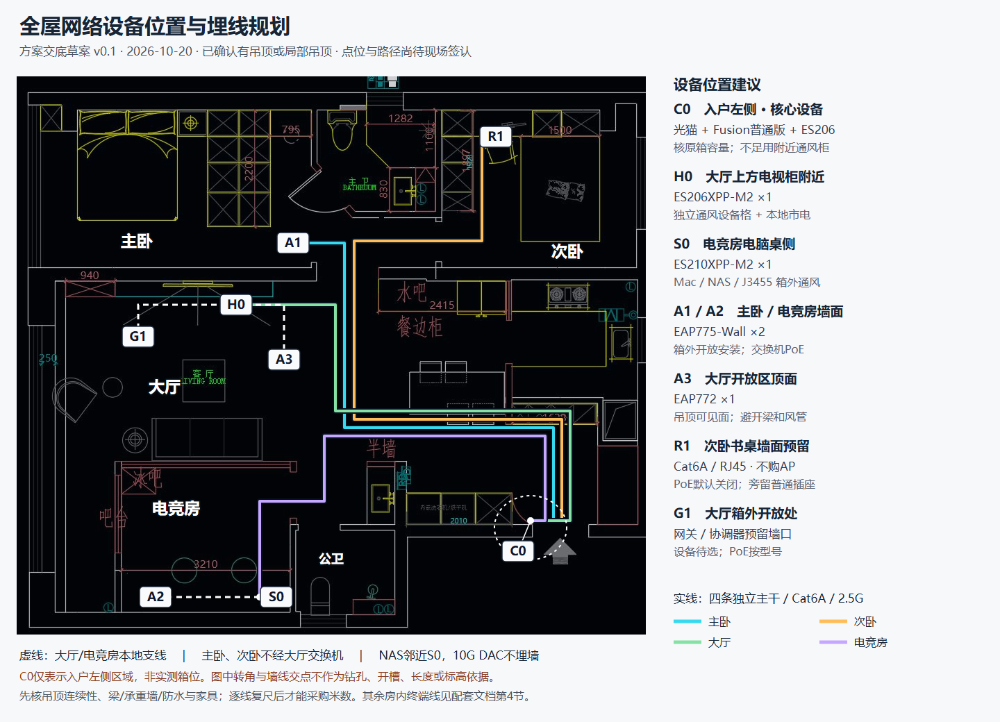

# 网络设备点位与吊顶埋线规划

> **版本说明**：下表按已确认v1.4（三交换机直连Fusion）列10条在用远端铜缆。拓扑v1.5主图为中央—客厅10G光纤对照方案：9条在用远端铜缆＋原客厅铜缆1条端接备用，另加1条光链路；Fusion剩2个LAN、客厅剩1个铜口。光纤/模块待核，未确定最终介质、未部署，不把两个上联同时接通。

> **2026-11-25 · v0.3，Fusion星型直连三台交换机。** 中央/电竞房各ES210，客厅（大厅）ES206；四AP、两M200、两普通电脑墙口独立回中央。中央10G电口给电脑墙口A，Fusion改占中央一个2.5G口。7台交换机/AP已下单待到货，Fusion购买未确认，未安装/部署。见[订单](network-order-20261118.md)、[现行拓扑](network-topology.md)。
>
> 入户集中汇聚、公共区走顶、房内下引是当前路线方向。**坐标、实际路径和高度仍待现场签认，本文不是正式施工图；不按图纸像素下料。**

## 1. 看图与使用边界

型号、数量、端口和逐线表以本文及现行逻辑拓扑为准。旧图只帮助讨论吊顶/墙体路线，不能据其“四条主干”或本地AP支线施工。

2026-10-20原标注图（历史路线背景，不作为当前线路数量与接法）

[历史PNG](images/floorplan-20261020/network-placement-and-cabling.png) · [历史SVG图源](images/floorplan-20261020/network-placement-and-cabling.svg) · [原始装修图与尺寸](floorplan-and-network-locations.md)

旧图含中央ES206、四主干、本地AP支线及三AP/未定网关等历史标签。当前为中央ES210、电竞房ES210、客厅ES206，全部四AP与两个M200回中央；两个普通电脑墙口另有回中央线。图中出现的同型号标签也不代表线路已更新。

- 上下左右是图纸方向，不代表南北。C0只确定在入户门左侧，精确箱位须现场标出。
- 线条经过墙/梁不是钻孔授权；吊顶通道共用不等于共用一根网线。局部吊顶不连续时，设计方先确定连接段和检修口。
- 不擅自开承重墙、梁或卫浴防水，家具与设备位置先复尺再定底盒/开孔。
- 不提供伪实测Wi-Fi热力图；覆盖、漫游和合法可用频段最终实测。

## 2. 网络设备位置安排

| 图号/施工名称 | 设备 | 位置与接入 | 安装维护要求 |
|---|---|---|---|
| C0 / 核心位 | 光猫、Fusion普通版、中央ES210各1 | 入户门左侧原弱电箱或附近通风核心柜 | 核容积、电源砖、配线与开门空间；不默认全部塞进原箱，避开给排水和积水风险 |
| H0 / 客厅设备位 | ES206XPP-M2×1 | 电视柜附近独立通风格；RJ45墙口直回Fusion | 自接交流电；柜外AP/无线网关不接此交换机 |
| S0 / 电竞房设备位 | ES210XPP-M2×1 | 桌侧/下侧干燥设备区，靠近Mac和未来NAS；RJ45墙口直回Fusion | 自接交流电，Mac/J3455/NAS箱外通风，避开湿墙/玻璃/半墙 |
| A1 / AP-MASTER | 主卧EAP775-Wall | 靠大厅/门口的适宜墙面，中央独立Cat6A＋PoE | 朝卧室开放区，避衣柜/门扇/床头遮挡，底盒按实物 |
| A2 / AP-STUDIO | 电竞房EAP775-Wall | 桌侧或门边完整墙面，中央独立Cat6A＋PoE | 不从S0供电，不被机箱/桌板/玻璃遮挡，不放设备箱 |
| A3 / AP-HALL | 大厅EAP772 | 开放区吊顶可见面，中央独立Cat6A＋PoE | 避横梁、风管、油烟和检修口，不藏吊顶腔 |
| A4 / AP-SECOND | 次卧EAP775-Wall | 可用墙面，中央独立Cat6A＋PoE | 无房间箱，按家具和实物复核位置 |
| HALL-M200 | 主M200×1 | 客餐厅吊顶高位，中央独立af PoE线 | 具体坐标待设计；可留1用1备，备用线另计 |
| SECOND-M200 | 次M200×1 | 升级至与主网关同型号，中央独立af PoE线 | 具体点位和合同/采购状态另核；不能按旧次网关电源施工 |
| PC-WALL-A | 普通RJ45＋光纤墙口 | RJ45独立回中央10G电口；光纤暂端接 | 高速电脑优先，具体房间/坐标待用户与家具图对应 |
| PC-WALL-B | 普通RJ45＋光纤墙口 | RJ45独立回中央2.5G口；光纤暂端接 | 不是AP，下联电脑自供电 |
| G1 / HALL-IOT-GW | 原备用墙口 | 保留原端接，未跳接 | 不占当前交换机口，不替代M200中央供电线 |
| HALL-FP400 | 候选管路/电源预留 | 按传感视场/家具另定 | 电源/以太网/PoE能力未核；当前客厅铜口已满，不视为已分配端口 |

A1/A2/A4可先按距完成地面约1.1–1.3m讨论，最终结合支架/底盒、家具和覆盖决定；不是强制规范。H0/S0按柜体检修确定高度，A3按吊顶完成面与支架确定。电脑普通墙口与AP位置分别确定，不能为迁就桌后插线而遮挡AP。

## 3. 十条在用中央出线与拟走线路径

以下是当前使用的长线连接关系；**8条从中央ES210出发，2条从同在C0的Fusion出发**。Fusion→中央ES210和光猫→Fusion的本地短跳线另计。

| 线路编号 | 起点→终点 | 路线建议 | 接口/用途 |
|---|---|---|---|
| TRUNK-MASTER | C0中央ES210→A1主卧AP | 公共吊顶→获批主卧入房路径→墙面下引 | 1条Cat6A，2.5G＋PoE |
| TRUNK-SECOND | C0中央ES210→A4次卧AP | 公共吊顶→次卧入口→墙面下引，避跨卫生间近路 | 1条Cat6A，2.5G＋PoE |
| AP-STUDIO-CENTRAL | C0中央ES210→A2电竞房AP | 公共干区顶面→获批入房路径→AP墙位 | 1条Cat6A，2.5G＋PoE；不接S0 |
| AP-HALL-CENTRAL | C0中央ES210→A3大厅AP | C0上引→公共吊顶→AP底座 | 1条Cat6A，2.5G＋PoE；不接H0 |
| HALL-M200 | C0中央ES210→主M200 | 公共吊顶→客餐厅网关位 | 1条Cat6A，af PoE；网关实际数据速率按实机 |
| SECOND-M200 | C0中央ES210→次M200 | 待次网关点位确认后标出独立路径 | 1条Cat6A，af PoE |
| PC-WALL-A | C0中央ES210的10G RJ45→电脑墙口A | 公共区顶面→对应房间/桌位墙口 | 1条Cat6A，纯数据；10G目标须完整通道与电脑网卡验收 |
| PC-WALL-B | C0中央ES210的2.5G口→电脑墙口B | 公共区顶面→对应房间/桌位墙口 | 1条Cat6A，2.5G纯数据 |
| TRUNK-HALL | C0 Fusion→客厅普通墙口→H0 ES206 | 公共吊顶→电视柜附近→允许墙面下引 | 1条Cat6A，2.5G纯数据；H0本地交流供电 |
| TRUNK-STUDIO | C0 Fusion→电竞房普通墙口→S0 ES210 | 公共干区顶面→避公卫湿区/玻璃→桌侧设备位 | 1条Cat6A，2.5G纯数据；S0本地交流供电 |

四AP仅提供Wi-Fi，数据下联不用且PoE Out关闭；两电脑墙口独立回中央。两卧室不设设备箱；大厅交换机不汇聚两卧室。Mac↔未来NAS在电竞房同一交换机内保留本地10G，跨房访问仍受电竞房2.5G上联限制。

### 3.1 材料、管路与普通面板

1. **首选康普SYSTIMAX 3091B，订货号760105122**：Cat6A、U/UTP、23AWG实心裸铜、LSZH圆形工程线。备选飞利浦正规Cat6A圆形实芯铜线，具体型号和来源核实后采购。禁止CCA，不把扁平成品跳线当墙内永久线。
2. 用户目标每条永久线低于37m，按完整实际路径、上下引和留量测量，设备跳线另计。合格Cat6A线＋Cat6无源模块可支持2.5G，前提是四对八芯完整、端接合格、两端设备支持2.5G；普通面板不会主动锁千兆。西蒙外壳不能替代内部模块规格。
3. 电脑墙口A和Mac若要以10G验收，优先使用Cat6A模块、跳线和完整通道测试，并核电脑10G网卡。Cat6模块混用后不能以“线短”或“交换机10G口”无条件保证10G，也不能冒写为完整Cat6A认证。
4. 每条线保留可抽换路径，可共走公共吊顶但按实际外径、填充率、弯曲与拉线距离确定管径/拉线盒。旧“每线Φ25”只可作询价参考，不把十条线硬塞一根管。强弱电分管、间距/交叉/防火按当地设计执行。
5. 吊顶线缆独立支撑，远离龙骨尖角、灯具和管道；每链路尽量连续，无不可检修暗接，保留牵引线并在封板前验证可抽换。AP端可用合规MPTL及对应测试，不使用无法认证的随手暗接头。
6. 各复合面板光纤完整布放、端接、标号与损耗测试，暂不跳接；先核OS2/多模、芯数、SC/LC和APC/UPC，SC外形不能决定光纤/端面。不要混接运营商PON光纤，不把SFP+ DAC封埋墙内。

### 3.2 中央—客厅10G光纤可选改法（尚未启用）

两台交换机各有10G SFP+，可用两只兼容光模块和两端跳线直连，不需另买光纤收发器。OS2双芯单模可配10GBASE-LR和SC/LC双芯跳线；仅一芯时改配成对波长的10G BiDi及单芯跳线。跳线端面须与面板匹配，APC/UPC不得直接互插；光纤未端接时先施工和测试再买模块。

SC/LC是接头形态，家装常见单模G.657蝶形线配SC，但本宅型号/芯数/端面仍待核。若未布线，建议中央到客厅/电竞房各至少2芯OS2单模，条件允许可4芯备用，具体数量另列报价；SC面板可用匹配SC—LC跳线接模块，不因接头形状而限千兆。此建议不等于已采购。

使用普通10G以太网光模块，不是PON猫棒。若改用非屏蔽Cat6A连接两端SFP+，需各一只兼容10GBASE-T电口模块；其功耗/发热通常高于普通光模块，不少型号10G仅30m，距离含跳线且受交换机插槽支持限制，不能保证墙内低于37m就可用。完整模块分类与散热说明见[网络拓扑](network-topology.md#普通光模块电口模块与猫棒)。

采用后为Fusion→中央ES210→10G光纤→客厅ES206，**撤掉客厅→Fusion原上联**，不要同时保留两条二层路径。光纤增加跨交换机总带宽，不能突破电视/游戏机等自身网口或Fusion/外网瓶颈，也不传PoE，交换机仍本地供电。中央到电竞房光纤会占未来NAS预留的唯一SFP+，当前不采用。

## 4. 房内支线与备用线

下表条数是连接关系，不是全部暗埋米数；同柜/同桌优先可拆理线槽和成品跳线，跨家具/墙体才按永久线施工。

| 编号 | 起点→终点 | 数量/状态 | 接线要点 |
|---|---|---|---|
| HALL-TV | H0→电视 | 1在用 | 柜内跳线或电视背后独立管路，按实机网口速率 |
| HALL-ATV | H0→客厅Apple TV | 1在用 | 与电竞房已有Apple TV分列，实际设备/采购状态另核 |
| HALL-GAME1 / HALL-GAME2 | H0→Switch / PS | 2在用连接规划 | 不因端口规划推定游戏机已经购入 |
| HALL-IOT-GW | H0→G1原墙口 | 1备用端接 | 未跳接、不占端口；H0无空闲铜口 |
| HALL-M200-SPARE | C0→主M200点位 | 1建议备用 | 在用线已计中央十条，备用另计 |
| SECOND-M200-SPARE | C0→次M200点位 | 可选1备用 | 点位确认后单列报价/数量，不自动算已施工 |
| HALL-FP400 | H0→候选位置 | 管路/电源预留 | 有线接入先重排端口；接口/电源未核，不直接送PoE |
| STUDIO-MAC | S0原生10G RJ45→Mac Studio | 1在用连接规划 | Cat6A短跳线或合规永久链路；不用AP下联 |
| STUDIO-PC1 / STUDIO-PC2 | S0→两台PC | 2在用连接规划 | 按家具与终端网卡核1G/2.5G；与中央电脑A/B独立编号 |
| STUDIO-MINI | S0→Mac mini | 1在用连接规划 | 终端速率按实际配置，不默认10G |
| STUDIO-J3455 | S0→J3455 | 1在用连接规划 | 西数金盘无RAID，现1G、确认升级2.5G；升级后沿用，未实施；HAOS/OpenWrt VM共用宿主接口，不另算物理线 |
| STUDIO-ATV | S0→已有Apple TV | 1在用连接规划 | 有线，按柜位布管；不用AP下联 |
| STUDIO-PROJECTOR | S0→已有米家激光投影 | 1在用连接规划 | 点位和网口按实机，不能默认激光投影吊装 |
| STUDIO-NAS | S0独立SFP+→未来附近NAS | 后置1 | 按实机选兼容DAC或模块/光纤，箱外可维护，不埋DAC、不先买网卡 |

AP-STUDIO-CENTRAL和AP-HALL-CENTRAL已计在中央十条长线，不再有S0/H0→AP本地支线；M200在用线也不从H0出发。两普通电脑墙口不从AP下联取网。

### 4.1 大厅—电竞房影音专线（不计入网络主干）

依[影音与游戏连接规划](av-and-gaming-layout.md)，两房间之间另预留两条约10m、方向相反的主动光纤 HDMI；不是Cat6A网络线，也不占用交换机端口：

| 链路编号 | 源端 `HDMI OUT` → 显示端 `HDMI IN` | 计划用途 | 施工状态 |
|---|---|---|---|
| HDMI-A HALL→STUDIO | 大厅影音源区 → 电竞房候选投影仪区 | 大厅 PS5 / Switch 底座等按需经源端切换后送往投影 | 用户确认光纤 HDMI；端点随投影墙/机位复尺 |
| HDMI-B STUDIO→HALL | 电竞房影音源区 → 大厅电视区 | 电竞房 Switch 底座/其他源按需送往电视 | 用户确认光纤 HDMI；端点随柜体/电视输入复尺 |

两线均按 `Source → Display` 定向安装，禁止把端头反接；管路需能容纳较大的 HDMI 头部并可更换。两条路径长度“约10m”仅为估计，采购按最终吊顶/墙内实际路径、上下引、检修和设备跳接复尺；投影墙未定，不预定吊装点。详细规格、游戏端连接与施工验收见[影音规划](av-and-gaming-layout.md)。

当前可确定的在用连接为：10条中央长线＋客厅4条终端铜连接＋电竞房7条终端铜连接（含Mac）＝21条。另有C0光猫→Fusion、Fusion→中央的两条短跳线；墙口/配线架短跳线、备用线、光纤与未来NAS介质另计。21条不是全部暗埋长线，不能按统一长度下料；旧20条候选口径作废。两条跨房HDMI AOC独立计量。

## 5. 端口和供电复核

使用逻辑用途，到货后按实机补机身端口编号；每终端只连一个数据端口。

| 设备 | 当前分配 | 余量/供电 |
|---|---|---|
| C0中央ES210 | 8×2.5G＝Fusion＋四AP＋两M200＋电脑墙口B；10G RJ45＝电脑墙口A | 铜口全分配；SFP+空闲。200W预算，六个PD口供电，其他关闭PoE |
| H0客厅ES206 | 5×2.5G＝Fusion上联＋TV＋Apple TV＋Switch＋PS | 铜口全分配；SFP+空闲，PoE关闭；没有10G RJ45 |
| S0电竞房ES210 | 7×2.5G＝Fusion上联＋PC×2＋Mini＋J3455＋已有Apple TV＋投影；10G RJ45给Mac、SFP+预留NAS | 余1个2.5G口；本案无PoE负载，PoE关闭 |

全部四AP和两个M200由中央ES210供电，三交换机各接交流电。以775的802.3at 26W参考、772最大25.4W和M200暂按12W/台，合计127.4W，加30%为165.62W；仅是200W预算内的规划筛查，非实测或自动预留保证。775的bt 45W包含转供，关闭PoE Out并不保证只预留26W或30W，不能45−25推定裸机20W。按实际型号/固件、at/bt协商、端口预留、同时冷启动和并发验收；当前不预购注入器。M200规格按实机铭牌复核。

## 6. 装修材料与电源交底

| 项目 | 当前口径 | 现场需补 |
|---|---|---|
| 网络设备 | ES210×2放中央/电竞房，ES206×1放客厅，775×3、772×1；7台已下单，Fusion未确认购买 | 数量/金额沿用订单，不按旧图重复采购 |
| 网线/模块 | 首选康普3091B/760105122，备选核型号的飞利浦Cat6A；2.5G可用合格Cat6模块，10G目标链路优先全Cat6A | 实际路径、跳线、余量和箱数；端接形式按每线决定，不默认8模块/8跳线 |
| 管路/拉线盒 | 十条中央长线、房内分支/备用与光纤分列，可抽换并保留牵引线 | 内径、填充率、弯曲/牵引限制、数量和检修口 |
| 光纤配件 | 当前布放/端接/标号/测试，光模块暂不采购 | 单多模、芯数、接口/端面、长度/损耗；若选客厅10G再定模块和跳线 |
| C0市电/柜体 | 光猫、Fusion、中央ES210及六个PoE负载的散热/后备电源条件 | 净尺寸、适配器/插座间距、通风、接地与UPS预留；不能按三设备等于三个紧邻插孔 |
| H0市电 | ES206、电视、Apple TV/游戏机及HomeView按家具留电 | 交换机本地供电，不靠光纤或上联PoE |
| S0市电 | ES210、Mac、PC、Mini、J3455、影音与未来NAS | 铭牌同时负荷、回路/保护、散热，电竞房AP负载已转中央 |
| AP/网关/普通面板 | 三面板AP＋一吊顶AP、两M200、两普通RJ45＋光纤电脑口 | AP底盒/附件按实物，普通面板与AP分开计件，次网关与电脑墙口精确点位待核 |
| HDMI/后置设备 | 两条反向AOC预计各约10m；NAS/UPS后选 | 先测实际路径、头部可穿管尺寸、源/显示方向和需要的辅助供电，不能按估长下料 |

设备金额和状态以[订单](network-order-20261118.md)与[当前BOM](purchase-bom.md)为准；材料/人工未报价。原PNG/SVG及旧Excel未重绘，不作为当前签认图。FP400、对讲机等候选只预留管路/电源，接入时先重核全满的客厅铜口。

## 7. 现场签认与验收

- [ ] 标出C0准确墙段/净尺寸/标高与进排风，确认原箱是否适用；H0/S0按设备与家具复尺。
- [ ] 标出吊顶连续范围、梁/承重墙、湿区、风管和获批入房孔洞，确定可检修路径。
- [ ] 定A1/A2/A3/A4、两M200、两电脑墙口与房间交换机墙口坐标；AP先临时试挂核遮挡，次网关升级型号与电源确认。
- [ ] 十条在用中央线、两本地短跳线、房内支线、备用线与光纤分别编号/计量；电脑A接中央10G、电脑B接2.5G，Fusion占中央2.5G口。
- [ ] 封板前照片记录实际路径、长度、端接、可抽换和强弱电/结构/防火要求；逐线填配线口、机身口及PoE状态。
- [ ] Cat6模块混接链路按实际等级验收，不写成完整Cat6A；AP MPTL按相应标准测试，不能只测导通。验2.5G协商，10G目标链路另验网卡/通道及吞吐。
- [ ] 光纤核类型、芯数、接口/端面、清洁及损耗；当前光模块不启用，若未来客厅光上联，则撤Fusion铜上联后再开通。
- [ ] 中央六设备同时冷启动及AP并发、PoE实际预留和温升通过；AP PoE Out关闭且下联数据不用。
- [ ] 两条反向HDMI按方向与目标格式测试，端点和投影墙定案后采购，不凭示意位置吊装。
- [ ] NAS购入后测本地Mac↔NAS 10G与并发，区分磁盘性能和链路能力；当前不写已验收。
- [ ] 家具到位后实测Wi-Fi覆盖、漫游和次卧关门可用性，按合法频段调优；归档竣工图和测试报告。

签认方：业主、装修/电气设计方、弱电施工方；智能家居公司复核网关点位。本文经现场签认后才能作为开孔、箱体定制与按米采购依据。
