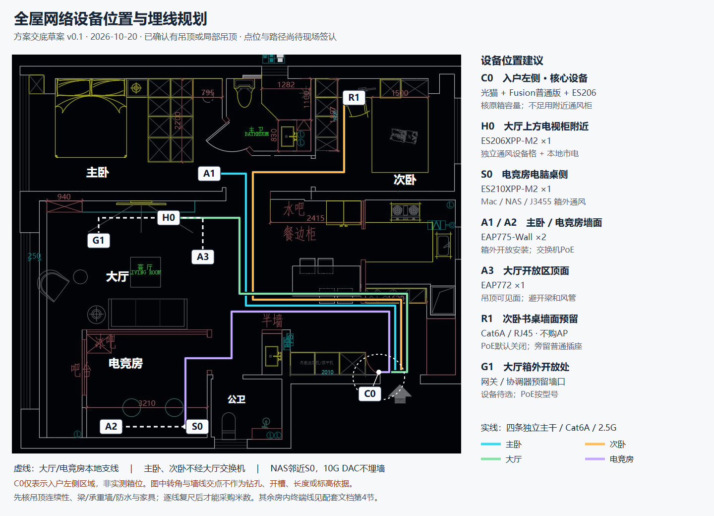

# 网络设备点位与吊顶埋线规划

> 2026-10-20 · 方案交底草案 v0.1。用户已确认大厅及入户过道有吊顶或局部吊顶；采用“入户集中汇聚、公共区走顶、房内垂直下引”的建议路线。**网络拓扑已确认，本文新增的点位、走线路径与安装高度是建议，尚不是用户逐点确认或设计方签发的施工图。** 设备未购、未安装；不按图中像素距离采购或下料。

## 1. 看图与使用边界

[可转发PNG图](images/floorplan-20261020/network-placement-and-cabling.png) · [可缩放SVG图源](images/floorplan-20261020/network-placement-and-cabling.svg) · [原始装修图、尺寸与已知条件](floorplan-and-network-locations.md) · [逻辑网络拓扑](network-topology.md) · [通用施工要求](renovation-wiring-requirements.md)

- 底图沿用用户装修布置图；上下左右只表示图纸方向，不代表南北。尺寸图与布置图不能保证每处一致。
- 彩色实线表示四条独立 Cat6A 主干的**拟走向**；虚线表示本地分支。线条经过墙/梁的画法不是钻孔授权，折点不是实测坐标；共用吊顶通道不等于串接或共用一根网线。
- C0 仅标“入户门左侧”这一已确认区域，不是从原图识别出的精确弱电箱符号。必须在现场标出箱体位置后再定起点。
- 主干走可用的公共区吊顶/局部吊顶；如果局部吊顶不连通，先由设计方规划连接段、检修位或合规线槽，不默认全屋吊顶连续。
- 不绘制伪实测 Wi-Fi 热力图，不保证大厅穿墙覆盖次卧；6GHz 合规及终端支持仍按现有专项记录核验。

## 2. 网络设备位置安排

| 图号 / 施工名称 | 设备与数量 | 建议区域 | 安装、供电与维护要点 |
|---|---|---|---|
| C0 / 核心位 | 光猫/ONT、Fusion 2.5G普通版、中央 ES206XPP-M2，各1 | 入户门左侧原弱电箱，或紧邻其的通风核心柜 | 先核原箱容积、插头/电源砖、弯线及开门空间；不足时在附近设通风柜并保留原光纤交接，不默认全部塞入旧箱。避开洗衣/洗手给排水与积水风险；不得影响通行 |
| H0 / 大厅设备位 | ES206XPP-M2 ×1 | 大厅上方电视墙附近，电视柜的独立通风设备格 | 独立市电，门板/配线可维护。不要在承重墙上挖大设备箱，不用密闭柜格；AP、网关在柜外 |
| S0 / 电竞房设备位 | ES210XPP-M2 ×1 | 电脑桌侧边或下侧干燥完整墙段，靠近 Mac Studio 和未来 NAS | 独立市电；Mac、NAS、J3455 箱外通风摆放。避免玻璃、半墙及卫浴湿墙；先核电脑桌与投影布置再定柜位 |
| A1 / AP-MASTER | EAP775-Wall ×1 | 主卧靠大厅一侧、近门口的可用墙面，面向卧室内 | 主干直接到 AP 上联；中央 PoE。避开衣柜、门扇、床头遮挡；承重墙不任意横槽/深埋底盒，必要时用获批浅表安装方式 |
| A2 / AP-STUDIO | EAP775-Wall ×1 | 电竞房桌侧或门边完整墙面，面向活动区 | 从 S0 独立 Cat6A 支线、交换机 PoE；不装玻璃、不被机箱/桌板或半墙遮挡，不放设备箱内 |
| A3 / AP-HALL | EAP772 ×1 | 大厅开放区顶面，略向次卧入口方向偏移 | 从 H0 独立支线、交换机 PoE，装吊顶可见面。避开横梁阴影、金属风管、空调检修口和右侧灶台油烟，不埋吊顶腔内 |
| R1 / SECOND-RJ45 | 次卧 Cat6A 信息口 ×1 | 次卧现有/未来书桌附近的可维护墙面 | 中央直达，默认 PoE 关闭；旁置市电、留未来面板 AP 空间。可选已有 TL-7DR3630 有线 AP 模式，单独管理；不购次卧 AP |
| G1 / HALL-IOT-GW | 有线网关/以太网协调器预留信息口 ×1 | 大厅柜外开放处，优先公共区侧墙或开放搁板 | H0 本地支线；远离金属柜、电源砖和强干扰，旁置市电。图示为候选区，按 Zigbee 覆盖移动；硬件未选，PoE 是否开启按型号，不双份采购 |

**安装高度不先写死**：A1/A2 可先以距完成地面约 1.1–1.3m 讨论，但需与 AP 支架、底盒孔距、家具和下联线缆外观一起定点；不是强制安装规范。H0/S0 高度取决于柜体检修和插头空间；A3 按吊顶完成面及安装支架实物确定。书桌低位 RJ45 与面板 AP 位置不同，必要时增设房内支线，不把 AP 隐藏到桌背后。

## 3. 四条主干与拟走线路径

| 主干编号 | 接线关系 | 吊顶/墙面路线建议 | 供电及接口 |
|---|---|---|---|
| TRUNK-MASTER | C0中央交换机 → A1主卧AP | C0上引 → 入户公共区顶面 → 大厅/卧室入口公共通道 → 经批准的入房路径 → 主卧AP墙面下引 | 1条Cat6A，2.5G + 匹配PoE；不是H0下联 |
| TRUNK-SECOND | C0中央交换机 → R1次卧墙口 | C0上引 → 公共吊顶 → 次卧入口 → 室内允许的顶沿/墙边路线 → 书桌墙口下引 | 1条Cat6A，预留2.5G，PoE默认关闭；不跨两卧室之间的卫生间抄近路 |
| TRUNK-HALL | C0中央交换机 → H0大厅交换机 | C0上引 → 公共吊顶 → 大厅上方电视墙附近 → 沿允许墙面下引至通风设备格 | 1条Cat6A，2.5G数据；H0自带电源，本地交流供电 |
| TRUNK-STUDIO | C0中央交换机 → S0电竞房交换机 | C0上引 → 公共区干区顶面 → 绕开公卫湿区和玻璃隔断 → 经获批入房路径 → 桌侧设备位下引 | 1条Cat6A，2.5G数据；S0本地交流供电，不靠上联PoE取电 |

四条主干数量不变。主卧、次卧没有设备箱或独立交换机；大厅交换机不汇聚两卧室。主卧 AP 由 C0 供电，另外两台 AP 由所在区域交换机供电。仅 Mac↔未来 NAS 采用 S0 内本地 10G；跨房间访问共享 2.5G 上联，同 VLAN 本地传输不经过该上联。

### 3.1 管路做法

1. 优先为四条主干分别设置可抽换管路，可沿同一条公共吊顶通道并行。**每条 Cat6A 的公称 Φ25 管仅作为询价起点**，不是已审核规格；施工方按实际内径、线径、弯曲半径、填充率和拉线距离复核，必要时加大或设可检修拉线盒。不要把四条线硬塞进一根 Φ25 管。
2. 吊顶内做独立支撑，不把线缆随意搁在灯具、龙骨尖角、风管或管道上；强弱电分管，交叉、间距、接地、防火封堵按当地标准及电气设计执行。
3. 每条链路尽量连续，中途无不可检修接头；拐弯过多或难拉的区段用可到达拉线盒，留牵引线。吊顶封板前验证可抽换性并记录实际路径。
4. 不擅自打梁、钻承重墙、横向长距离开槽、切钢筋或破坏卫浴防水层；优先既有/预留孔洞或经设计方认可的门旁/非结构路径。多绕几米合格 Cat6A 通常不会因此降速；永久链路/完整通道长度分别按所采用标准控制，通常为90m/100m上限，不拿“短直线”换结构风险。
5. 按最终 AP 实物确定墙面底盒和吊顶固定件，不默认美国版面板与国产86盒直接兼容。采用配套 Cat6A 模块、端接和跳线；AP 端可用可维护信息口+短跳线，或按适用标准做并测试 MPTL，不使用随手压接且无法认证的暗接头。
6. 不每房预埋光纤，不埋 SFP+ DAC。已有入户光纤按运营商弯曲半径保护；NAS 短 DAC/光模块介质待入住后按实机选。可选额外空管必须单列报价，不擅自增加第二条各房主干。

## 4. 房内支线：一房一主干不等于只有一条网线

以下“条数”是连接关系，**不是均需埋墙的材料数量**。同柜/同桌优先用可拆线槽和成品跳线；跨家具或不便更换的路径在装修时预埋管、铺设合规实芯 Cat6A 并认证。

| 支线编号 | 起点 → 终点 | 数量 | 埋线/接线建议 |
|---|---|---:|---|
| HALL-AP | H0 → A3 EAP772 | 1 | 必留本地管路：电视柜上引至公共吊顶，再到AP底座；2.5G+PoE；不另拉C0直达线 |
| HALL-TV | H0 → 大厅电视 | 1 | 同电视柜可走可维护线槽；电视挂墙时预留柜内至电视背后的独立弱电通道，终端速率按实物 |
| HALL-IOT-GW | H0 → G1网关信息口 | 1 | 本地Cat6A预埋管/墙口；旁置市电；网关PoE待选型再开 |
| STUDIO-AP | S0 → A2 EAP775-Wall | 1 | 本地独立Cat6A，2.5G+PoE；短距离也不能藏在玻璃或不可维护接头中 |
| STUDIO-MAC | S0原生10G RJ45 → Mac Studio | 1 | 桌边可维护Cat6A短跳线；如果跨墙则用合规永久链路，不从AP下联替代10G口 |
| STUDIO-PC1 / STUDIO-PC2 | S0 → 两台PC | 2 | 同桌理线槽/必要的桌位墙口；现1G，升级后2.5G，不因此追加中央主干 |
| STUDIO-MINI | S0 → Mac mini | 1 | 同桌可维护跳线；终端1G |
| STUDIO-J3455 | S0 → J3455 | 1 | 通风服务器位短线；现1G，升级后2.5G；HAOS VM共用宿主网络，不另算一根物理网线 |
| STUDIO-ATV | S0 → 已有Apple TV | 1 | 根据实际影音柜位布管；有线，不用Wi-Fi代替 |
| STUDIO-PROJECTOR | S0 → 已有米家激光投影仪 | 1 | 按实机摆放和网口核验后定位；不默认激光投影吊装，不擅自把点位放天花 |
| STUDIO-NAS | S0独立10G SFP+ → 未来附近NAS | 后置1 | 兼容短DAC或光模块+光纤按NAS实物确认；箱外可维护，不埋墙、不提前买网卡 |
| MASTER-DESK（可选） | A1数据下联 → 主卧书桌墙口 | 按需1 | 主卧电脑不在AP旁才需本地支线；AP下联仅1×2.5G+3×1G，PoE Out禁用，不新增中央主干 |

### 4.1 大厅—电竞房影音专线（不计入网络主干）

依[影音与游戏连接规划](av-and-gaming-layout.md)，两房间之间另预留两条约10m、方向相反的主动光纤 HDMI；不是Cat6A网络线，也不占用交换机端口：

| 链路编号 | 源端 `HDMI OUT` → 显示端 `HDMI IN` | 计划用途 | 施工状态 |
|---|---|---|---|
| HDMI-A HALL→STUDIO | 大厅影音源区 → 电竞房候选投影仪区 | 大厅 PS5 / Switch 底座等按需经源端切换后送往投影 | 用户确认光纤 HDMI；端点随投影墙/机位复尺 |
| HDMI-B STUDIO→HALL | 电竞房影音源区 → 大厅电视区 | 电竞房 Switch 底座/其他源按需送往电视 | 用户确认光纤 HDMI；端点随柜体/电视输入复尺 |

两线均按 `Source → Display` 定向安装，禁止把端头反接；管路需能容纳较大的 HDMI 头部并可更换。两条路径长度“约10m”仅为估计，采购按最终吊顶/墙内实际路径、上下引、检修和设备跳接复尺；投影墙未定，不预定吊装点。详细规格、游戏端连接与施工验收见[影音规划](av-and-gaming-layout.md)。

现行网络基线含 **4条中央主干 + 大厅3条本地铜缆连接 + 电竞房8条本地铜缆连接 = 15条网络区域/终端铜缆连接**，不含 C0 内光猫→Fusion、Fusion→中央交换机两条短跳线，不含模块两侧的额外短跳线、可选主卧书桌支线、未来 NAS 介质。另有大厅↔电竞房两条单向光纤 HDMI AOC（各约10m，长度待复尺），不计入上述网络铜缆数。15条不是15条暗埋长线；由家具定位决定其中多少采用暗管、墙口或柜内跳线，不按15直接下单同一长度成品线。

Apple TV/投影当前按直连S0交底。若日后改接A2的两个1G下联，需修改两端编号/端口图与可维护接线路径；不能把直连S0及改接AP同时接上形成环路，也不能只改逻辑图却不留可接通线路。该改法可释放两个S0铜口，但影音链路将依赖AP通电/正常运行。

## 5. 端口及供电复核

下表使用逻辑用途，不臆造机身端口号码；到货后按面板与控制器映射填写端口表。每个终端只连一个数据端口。

| 设备 | 当前分配 | 余量与供电 |
|---|---|---|
| C0 中央ES206 | 5个2.5G铜口分别留给Fusion、主卧AP、次卧墙口、大厅上联、电竞房上联 | 规划铜口全占，次卧未启用时可不跳接；4个PoE++口/120W，只给主卧AP开PoE。优先非PoE铜口接Fusion，其余非PD链路关闭PoE；SFP+空闲但不是现成RJ45扩展口 |
| H0 大厅ES206 | 上联、吊顶AP、电视、G1，共4个铜口 | 余1铜口；4个PoE++口/120W，确定1个AP负载。G1按最终网关型号核PoE；新增摄像头等需重算端口与功率 |
| S0 电竞房ES210 | 8个2.5G口：上联、AP、PC×2、Mini、J3455、Apple TV、投影；原生10G RJ45给Mac，10G SFP+给未来NAS | 8个普通铜口已分配满，NAS口专留；8个PoE++口/200W，仅AP开启PoE，其余关闭。新增有线设备需先调整端口，不默认还能再接一台 |

三台交换机均使用本地交流电源。AP没有独立注入器、AP PoE Out不启用；ES206/ES210单口上限与AP真实协商按[现行拓扑PoE说明](network-topology.md)核验。EAP775-Wall标称45W含下游转供，不能简单减去25W认定裸机功耗；EAP772最大25.4W。按到货固件、at/bt协商和交换机预留预算验证冷启动/并发，不以标称总功率代替实测。

## 6. 装修材料与电源交底

| 项目 | 当前可确定的口径 | 现场报价/施工前要补的量 |
|---|---|---|
| 网络设备 | Fusion普通版×1、ES206×2、ES210×1、EAP775-Wall×2、EAP772×1 | 不新增交换机或AP；精确型号见当前BOM |
| 铜缆与配套端接 | 纯铜实芯Cat6A永久布线，禁用CCA；配套Cat6A模块/配线附件/跳线 | 每条实际路径+上下引入+检修余量，按整箱/盘采购另核余料；屏蔽系统需完整接地设计，不能只买屏蔽线 |
| 弱电管与拉线盒 | 四主干可抽换管路；H0/S0本地分支；管口保护、牵引线、固定件、标签 | 实际长度、弯头/拉线盒/检修口数量，管径按计算确定 |
| 核心与房间设备位 | C0原箱/邻柜评估；H0/S0两处通风设备格 | 净尺寸、设备散热、电源砖和弯线空间；不把建议柜位当已确认开孔尺寸 |
| AP固定与信息口 | 首期2面板+1吊顶安装位；R1次卧口、G1网关口 | 底盒/孔距/支架按实物；其他终端墙口按家具布局，避免把AP底盒和普通面板重复计件 |
| C0市电 | 供光猫、Fusion、中央交换机3台设备 | 合规插座/接地、插头与适配器间距及余量；3台不等于只需3个紧挨孔位 |
| H0市电 | 大厅交换机1台；电视和HomeView另供电 | G1普通插座预留；HomeView走Wi-Fi，不加PoE主干；位置按柜体布置 |
| S0市电 | 交换机、Mac、PC×2、Mini、J3455、影音设备，以及未来NAS位置 | 电工按铭牌/同时使用功率核回路、保护和插座，不以交换机PoE预算代替电脑总负载 |
| 影音设备与两条跨房HDMI | 电视、已有投影仪及各自源设备留可维护电源；大厅→电竞房与电竞房→大厅各预留1条主动光纤HDMI | HDMI AOC 预计各约10m；现场复量、核插头通过尺寸、弯曲半径、源/显示方向、端点电源/USB辅助供电需求后再采购；保留可抽换管与检修口 |
| 预留项 | 次卧旧路由器旁市电；未来NAS/UPS的空间、通风和可维护电源路径 | UPS入住后再选；壁挂平板、摄像头与其他智能家居点位尚未定，不擅自新增负载或精确数量 |

预算仍以[当前BOM](purchase-bom.md)为准：本次只落实布线方案，**硬件选型和数量不变，材料/人工未报价**。现行两份采购Excel**尚未写回本次吊顶确认与点位草图**，其硬件BOM继续适用；交底时必须附本文，不能把Excel当成已同步的完整施工点位表。

## 7. 现场签认与验收清单

- [ ] 在完整设计图上标出C0准确墙段、中心高度、净尺寸、门板及邻近给排水；确认核心设备能否放原箱。
- [ ] 标出公共区吊顶连续范围、梁/承重墙、空调风管/水管、允许的入房孔洞和可到达检修口；局部吊顶断点给出替代路径。
- [ ] 按家具图定H0/S0、电视/投影/电脑桌、A1/A2/A3、R1/G1最终坐标和完成面标高；AP位置先临时试挂验证遮挡。
- [ ] 按[影音与游戏连接规划](av-and-gaming-layout.md)确定电视/投影输入点、两条反向 HDMI AOC 的实际管路和可维护端点；投影墙定案后再复尺采购，封板前按方向与目标影音格式逐条测试。
- [ ] 逐线登记：编号、起终端、实际路由、长度、端接方法、配线口、交换机口、PoE开关和测试报告编号；签认后再采购米数、开孔、封板。
- [ ] 封板前照片含标尺/参照物，确认强弱电分隔、无暗接、可抽换、干湿隔离及结构/防火措施。
- [ ] 永久链路做Cat6A认证；采用MPTL的AP链路用相应测试适配器/标准，不仅测8芯导通。安装后另测四主干2.5G协商、Mac链路10G、PoE冷启动/并发及机柜温升。
- [ ] NAS购入后测同VLAN Mac↔NAS并发，区分网卡/交换链路与NAS磁盘性能；当前不把未购NAS写成已通过测试。
- [ ] 家具到位后测试2.4/5GHz覆盖、漫游和次卧关门可用性；按合法可用频段调优，不把大陆6GHz纳入保证验收。

签认人：业主、装修/电气设计方、弱电施工方；智能家居公司核G1及后续设备。**本文无签认不作为打孔开槽、箱体定制或按米采购的最终依据。**
