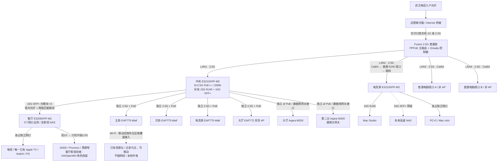
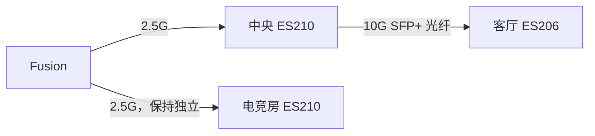

# 全屋网络拓扑 v1.6：Fusion 双电脑墙口、客厅光纤与影视 NAS

> **更新：2026-11-26，沿用 v1.6 并更正影音终端，未安装/未部署。** Fusion 的四个 2.5G LAN 分别接中央 ES210、电竞房 ES210、两个普通电脑墙口；中央 ES210 经 10G SFP+ 光纤连接客厅 ES206。J3455 改放客厅（大厅）箱外通风位，主要存放影视资源，仍沿用现有 Proxmox/黑群晖与原定 HA/OpenWrt 角色。光纤类型、芯数及模块型号待核，配件采购未确认。
>
> **本版替代 v1.4 三交换机直连与 v1.5 光纤预览，当前文档及采购 JSON 统一采用 v1.6。** 四 AP、两 M200 仍各自独立回中央 PoE；两个普通电脑墙口的线也回中央设备位，但跳接 Fusion。AP 仅作无线接入，不用数据下联，关闭 PoE Out。
>
> 已确认的 Omada 订单仍为 7 台：ES210×2、ES206×1、EAP775-Wall×3、EAP772×1，订单总额 $901.49；仅调换中央与客厅交换机的规划位置，不新增交换机。Fusion 普通版×1购买未确认。见[订单记录](network-order-20261118.md)、[采购 BOM](purchase-bom.md)。
>
> 次网关按用户要求升级为与大厅一致的 M200，两台均回中央 PoE；升级采购、差价及具体点位待核。原绿米签字合同 ¥19,324 作为历史金额保留，不据此推定已含两台 M200。

**2026-11-26终端更正：已有Apple TV只在大厅（客厅）接ES206，电竞房没有Apple TV；已有投影仪主放主卧、可移动，使用Wi-Fi、不插网线。电竞房删除原两项铜口占用后，2.5G口用4余4；其他设备端口分配不变。**

## 当前主图：Fusion 四个 LAN 全部分配

图示速率为端口能力/验收目标，不代表已经跑到该速度。所有设备仍在同一家庭 LAN，不新增 VLAN；Fusion 保持唯一 DHCP 和普通 DNS。J3455 随主机移至客厅，其 OpenWrt/HA 软件角色规划不变，见[规则分流设计](superpowers/specs/2026-11-05-home-device-rule-routing-design.md)。Fusion 的各 LAN 口需配置在同一 LAN，跨端口实效吞吐到货验证。

## 当前端口与施工口径

下表对应 v1.6 已确认规划，不是已实施记录。LAN1–4 为逻辑用途标签，机身编号到货核对。

**Fusion 对账：5个口 − 光猫WAN×1 − 两台交换机×2 − 两个电脑墙口×2 = 剩0口。** 客厅通过中央上联；两处房间交换机均使用本地交流电源，光纤不供电。

| 设备 | 2.5G RJ45 分配 | 10G RJ45 | 10G SFP+ |
|---|---|---|---|
| Fusion 普通版 | WAN接光猫；LAN1中央、LAN2电竞房、LAN3电脑墙口A、LAN4电脑墙口B；**全部用满** | 无 | 无 |
| 中央 ES210 | **7/8**：Fusion上联×1、775×3、772×1、M200×2；余1口 | **空闲**，可留未来高速终端 | **10G光纤接客厅ES206** |
| 电竞房 ES210 | **4/8**：Fusion上联、PC×2、Mac mini；余4口 | **Mac Studio** | **未来高速NAS**预留 |
| 客厅 ES206 | **5/5**：电视、Apple TV、Switch、PS、J3455；无余口 | 无 | **10G光纤上联中央ES210** |

| 设备 | 剩余电口 | 剩余光口 |
|---|---|---|
| Fusion | **0** | 无SFP+ |
| 中央ES210 | **1个2.5G＋1个10G RJ45** | **0** |
| 电竞房ES210 | **4个2.5G** | 无未分配口；SFP+尚未插用，但已留未来NAS |
| 客厅ES206 | **0** | **0** |

### 接线约束

原客厅铜缆保留端接备用，不与光上联同时连通。中央八个2.5G口中六个用于PoE负载（四AP＋两M200），Fusion上联及空闲口关闭PoE；电竞房、客厅当前无PoE终端，其PoE口关闭。Apple TV明确仅已有一台，放大厅接客厅交换机；电竞房不再保留第二台的端口占位。投影仪主放主卧、可到处移动，使用Wi-Fi与本地市电，不接网线、不占任何交换机口或PoE预算。电竞房PC为房间既有设备位，两个普通电脑墙口为独立线路，不据此新增电脑采购数量。

**中央10G电口留空：** 当前上联Fusion只需2.5G口，两电脑墙口也已改接Fusion；没有必须占用此10G口的已分配设备。以后可接高速存储或电脑，但需核终端网卡、完整链路与跨房间路径。两电脑墙口当前即使配10G网卡也最高协商2.5G，因为路由器端口为2.5G；未来可重新跳接中央10G口，届时才按10G通道验收。

原“影音接AP释放端口”方案取消，AP下联数据口不接线、PoE Out关闭。客厅原先由光上联释放的铜口现已分配给J3455，不能再分配FP400或楼宇对讲；这些设备接口及启用方案仍待核。M200备用线未跳接不占端口。

### 四台2.5G客户端能否同时访问10G服务器

可以：四台各具备2.5G网口的客户端分别接电竞房ES210的四个2.5G口，同一LAN内访问本机10G RJ45上的Mac Studio，或10G SFP+上的未来NAS，流量在交换机内部转发，不经过Fusion的2.5G上联。四条2.5G链路合计10Gbps；ES210标称80Gbps交换容量按全双工收发合计，不能把80Gbps误当服务器单口速率，也不能把2.5G单口规格误当整机总带宽。

这是网络端口层面的并发能力，不保证四台文件传输都恒定满速：10Gbps为线路速率，协议开销后应用吞吐较低，NAS磁盘/阵列、Mac存储、CPU与文件共享协议也可能限制速度。若服务器同时服务更多设备，仍共享其10G口；当前J3455只有1G，升级2.5G后仍是所有访问者合计共享2.5G，不能按未来10G NAS的能力算。PC/Mac mini等实际网卡须逐台核验。

跨房访问则不同：Fusion电脑墙口或客厅设备到电竞房Mac/NAS，均经过电竞房的2.5G上联，这部分流量合计共享2.5G。四台设备若接在同一个AP后面，也共享该AP的2.5G有线上联。验收本地四客户端并发时，应四台同时向同一10G服务器测试，并检查单机及总吞吐；不能以逐台单独测速代替并发测试。

### J3455金盘与NAS网速选择（2026-11-25确认）

用户确认现有J3455使用**西数金盘（WD Gold），未做RAID**，并确认升级2.5G网卡的方向。当前网口仍为1G，升级未实施；搬至客厅后使用ES206的一个2.5G接入口，当前按1G协商，网卡升级不再增加端口；不占用电竞房预留给未来NAS的10G SFP+。未做RAID不等于已确认只有一块盘，金盘具体型号、盘数及既有10TB记录的原始/可用容量口径仍待核。

| 对象 | 大文件连续传输参考 | 本户选择 |
|---|---|---|
| 1G网络 | 应用层常见约110–118MB/s | 当前J3455可能先受网口限制 |
| 2.5G网络 | 存储与CPU足够时约260–290MB/s | J3455升级目标，不保证金盘和CPU持续跑满 |
| 10G网络 | 存储与CPU足够时约900–1100MB/s | 电竞房Mac Studio与未来高速NAS的接入方向 |
| 独立机械盘 | 常见连续读写约120–250MB/s，随型号、盘面位置及负载变化 | 当前金盘未组阵列，不按阵列叠加吞吐估算；2.5G比1G有余量 |

以上为数量级参考，不是本户测速；GB/s、Gbps与MB/s不能混用。大量小文件、SMB加密/签名、虚拟化、CPU和磁盘随机访问会进一步限制吞吐。未来NAS是否能发挥10G取决于实际HDD阵列或SSD存储池，单加SSD缓存不等于持续写入可跑万兆。J3455不因未来NAS方向而采购10G网卡；升级时核PCIe/驱动与Proxmox桥接，先测网络再测真实文件，保留原1G接口回退。

### 客厅影视与黑群晖游戏盘路径

- 客厅电视/唯一Apple TV → 同一台ES206 → J3455：本地转发，不经过Fusion；速率取决于终端接口、J3455网口与存储。
- 主卧移动投影仪 → 所在区域覆盖合适的AP（Wi-Fi）→ 中央ES210 → 客厅ES206 → J3455：无线实际吞吐与播放兼容需验收；移动使用不预设固定以太网或吊装点。
- 中央所接AP的无线客户端 → 中央ES210 → 10G光链路 → 客厅ES206 → J3455：还受AP回程和J3455接口限制。
- 两个Fusion电脑墙口 → Fusion → 中央ES210 → 客厅ES206 → J3455：共享中央—Fusion的2.5G链路；电竞房客户端还经过电竞房的2.5G上联。
- J3455升级后，所有客户端合计共享其2.5G物理网口，黑群晖、HA及OpenWrt也共用宿主资源。10G房间光链路不会让J3455自身变成10G NAS。

现有黑群晖能否提供iSCSI取决于实际DSM版本、模拟机型及SAN Manager/iSCSI Manager能否运行。**建议每台电脑独立LUN，不将同一个普通NTFS LUN交给多台Windows同时读写。** 同时运行同款游戏可用独立LUN/独立安装实现，但机械盘并发随机I/O和游戏兼容性需实测，详见[J3455黑群晖iSCSI游戏盘评估](j3455-iscsi-game-library.md)。当前仅记录研究，不部署、不调整既有影视卷。

### 布线数量和材料

本版中央核心位发出的**在用远端铜缆为9条**：中央交换机到四AP＋两M200共6条；Fusion到两个电脑墙口＋电竞房交换机共3条。另有**中央—客厅1条光纤链路**。原计划第10条客厅Cat6A保留端接备用、不跳接。Fusion—中央另用1条本地短跳线，本地分支和网关备用线另计。

| 优先级 | 墙内线材 | 采购与端接要求 |
|---|---|---|
| **首选康普** | **CommScope SYSTIMAX 3091B / 760105122** | Cat6A、U/UTP、23AWG实心裸铜、LSZH、304.8m/箱；核完整订货号和正规授权渠道、原箱批次 |
| **备选飞利浦** | 明确具体型号的 Cat6A 圆形实心铜永久链路线 | 核厂家规格、线径、阻燃标识和来源；不凭“超六/万兆”商品标题验收；型号尚未锁定 |

墙内穿管使用圆形永久链路线，不以扁平成品跳线代替。长度低于37m是用户提供的条件，最终按实测长度记录；遵守弯曲半径、牵引力、弱强电隔离和可维护端接。

**Cat6A线＋Cat6模块可以承载2.5G。** 低于37m的合格链路有充分距离余量，普通RJ45模块是无源连接器，不会主动把速率锁成1G；必须四对八芯完整、端接合格，设备两端支持2.5G，并使用合格跳线。西蒙等装饰面板外壳不决定性能，查内部模块型号和类别。含Cat6模块的链路不能标为全Cat6A通道。

两个电脑墙口当前按2.5G验收。若未来改跳接中央10G口，优先将模块、配线端与跳线统一为Cat6A，并使用10G网卡；保留Cat6模块可能在短距离跑10G，但不能只凭“不到37m”保证，应按完整通道测试。两端2.5G设备做iperf等局域网测试，另查协商速率、错误计数和稳定性；只测八芯通断不足以认证带宽。

### 中央200W PoE预算

| 负载 | 数量 | 规划参考 |
|---|---:|---:|
| EAP775-Wall | 3 | 官方at模式26W/台（含最多6W PoE Out）；本案关闭下游供电 |
| EAP772 | 1 | 最大约25.4W |
| M200 | 2 | 暂按12W/台，最终按铭牌/版本核验 |
| **合计** | **6** | **127.4W；加30%为165.62W** |

该数值用于选型参考，支持先保留中央ES210的200W方案，不是实测或交换机已分配功率。775的bt模式45W包含最多25W转供；关闭PoE Out不等于自动切at，也不等于交换机只预留26W，不能用45−25反推裸机实测。六台同时冷启动时核输入模式、单口功率分配与总预算，必要时调整受支持的供电配置或增加标准注入器；当前不新增注入器采购。200W为PoE输出预算，交换机自身耗电另计入交流/UPS负载。

## 光口如何使用

**本图分配：中央与客厅的SFP+互联，电竞房SFP+继续留未来NAS。** 普通Fusion没有SFP+，到中央和电竞房仍使用2.5G铜缆。接线已纳入v1.6，光纤规格待核，设备尚未接通，光模块购买未确认。

本页主图的上联简图如下：

启用时撤掉Fusion—客厅的有源连接，铜线可保留不跳接；不同时连成三角形。客厅上联释放的一个2.5G铜口已给J3455，中央SFP+被占用。提升的是客厅与中央设备间的**汇聚带宽**；电视/Apple TV/游戏机的单机速度仍受自身网口限制，互联网与电竞房方向仍受2.5G路径限制，不能因此宣称全屋10G或更低游戏延迟。光纤无PoE，两端交换机各自交流供电。

普通RJ45＋光纤面板里的光口疑为SC；SC只说明接头类型，必须核芯数、单模/多模、APC/UPC及两端连续性后再买配件。

家装常见单模蝶形光缆（例如G.657系列）配SC面板，但不能据此确定本宅已敷材料。SC/LC是接头形态，OS2/单模是线缆类别，芯数与接头数量另核。若还未铺设，建议中央到客厅/电竞房各至少2芯单模，条件允许可4芯留备；这是布线建议，不是新增采购或已施工事实。SC面板可通过匹配的SC—LC跳线接光模块，不必为使用SFP+全部换成LC面板。

| 实际墙内光纤 | 额外配件（中央—客厅一条链路） |
|---|---|
| 双芯OS2单模 | 兼容交换机的10G SFP+ LR模块×2；两端各1条匹配面板SC端与模块LC端的单模双芯跳线 |
| 单芯OS2单模 | 兼容且波长互补的一对10G BiDi SFP+模块；两端各1条匹配接口的单芯跳线 |
| 多模 | 按具体等级/芯数/距离另配模块与跳线，不能套用上述单模组合 |

必要时另计光纤敷设、熔接尾纤/适配器及测试；已有合格端接可复用。不需外置光纤收发器。SC/APC与SC/UPC不得直接对接，跳线可以采用匹配面板一侧的SC/APC、匹配模块一侧的LC/UPC，两端分别对接相应接口即可。

### 普通光模块、电口模块与猫棒

| 插在SFP类插槽中的设备 | 外部介质与用途 | 本案状态 |
|---|---|---|
| 10G SFP+以太网光模块（LR/BiDi等） | 光纤，连接中央与客厅交换机；两端各一只，规格匹配 | 光纤方案所需；具体型号未选、未购 |
| 10GBASE-T SFP+电口模块 | RJ45＋Cat6A铜缆，将SFP+转成万兆电口 | 只有改用铜缆10G上联才考虑；不能把网线插进普通光模块 |
| PON猫棒（ONU/ONT模块） | 运营商PON入户光纤，替代部分光猫功能，涉及线路协议和注册 | 当前不采购；现有光猫桥接方案不变，不能用于普通交换机间以太网光链路 |

常见短距SR/LR以太网光模块约1–2W/只，具体功耗以规格为准；它们会发热，通常比PON猫棒和10G电口模块更易散热，不保证任何型号都低温。中央/客厅各一只光模块时按交换机规定留通风，中央还要计PoE与电源的整体热量，是否需风扇依据整柜温升而非“光模块不热”判断。

**SFP+改接非屏蔽Cat6A时，两端要用兼容的10G电口模块。** Cat6A U/UTP可以承载10G；但不少电口模块的10G距离仅30m，部分型号支持更长距离，必须按具体模块与交换机的兼容清单、插槽供电/散热要求和完整通道长度（含跳线）核验。不能把原生10G RJ45的100m能力套在所有SFP+电口模块上，也不能仅凭“墙内线低于37m”保证可用。若实际光纤可用，中央—客厅仍优先比较普通光模块＋光纤；没有新增两只电口模块的采购决定。

中央与电竞房也能10G光纤互联，但会占用电竞房唯一SFP+，与未来NAS预留冲突；且中央唯一SFP+也不能同时连客厅和电竞房。若将来需要两条10G房间上联和NAS同时可用，再评估更多10G端口的汇聚设备；当前先保留光纤端接与编号。

## 当前 WAN、安装与验收

武汉电信1,000Mbps；原光猫Internet桥接，Fusion拨号。原光猫交付口、实际PON制式和上行速度待实机核验，不把LAN端口速率当宽带实测。保留在用IPTV/固话；见[桥接方案](wan-bridge-plan.md)。

中央设备位在入户门左侧弱电箱或附近通风柜；电竞房/客厅各保留一个设备箱，卧室不设交换机箱。AP装开放位置，不藏入金属柜或吊顶内部。逐线施工以[布线要求](renovation-wiring-requirements.md)及[位置说明](network-placement-and-cabling-plan.md)为准；[原始装修图](floorplan-and-network-locations.md)用于复核位置，不能代替现行逐线表。

此前大厅—电竞房两条反向光纤HDMI AOC仍保留为预留意向，本次“不插网线”不等于取消HDMI。电竞房PC→大厅电视方向保留；原大厅→电竞房方向不再绑定固定投影仪，其显示用途与端点待重核，不自动改敷到主卧。约10m为旧估算，不能据此按旧投影点采购/施工；HDMI不是网络光纤、不接SFP+，详见[影音规划](av-and-gaming-layout.md)。

- [ ] 核全部铜缆编号、实测长度、模块类别及性能；AP四条2.5G回程、普通电脑墙口单独验收。电竞房仅上联、PC×2与Mini占4个2.5G口，Apple TV只验大厅有线，投影仪验主卧及移动位置Wi-Fi播放。
- [ ] 核Fusion四LAN分别接中央、电竞房、电脑A、电脑B，中央—客厅10G光链路及同网段转发；J3455客厅接入口、电竞房Mac本地10G分别验收，NAS到货后另验。
- [ ] 四AP及两M200同时冷启动，验PoE预算、重启恢复和无线覆盖；不使用AP下联。
- [ ] 光纤先验芯数、类型、连接器、连续性及损耗；未改上联前不跳接成环。

## 规格来源

- [ES210XPP-M2](https://www.omadanetworks.com/us/business-networking/omada-switch-agile/es210xpp-m2/) · [ES206XPP-M2](https://www.omadanetworks.com/us/business-networking/omada-switch-agile/es206xpp-m2/)
- [Fusion普通版](https://www.tp-link.com/productpages/spec/116210-3.html)
- [EAP775-Wall](https://www.omadanetworks.com/us/business-networking/omada-wifi-wall-plate/eap775-wall/#specifications) · [EAP772](https://www.omadanetworks.com/us/business-networking/omada-wifi-ceiling-mount/eap772/#specifications)
- [康普3091B / 760105122](https://www.commscope.com/product-type/cables/twisted-pair-cables/category-6a-cables/item760105122)
