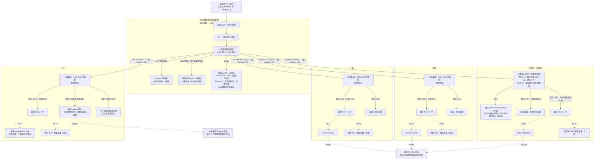

# 全屋网络拓扑 v1.0 与连接说明

> 更新日期：2026-10-13。**连接关系、设备位置和目标链路速率按 v1.0 定稿**；不是已施工、已购买或已验收记录，也不是可直接放线的施工图。
> 事实源：[家庭基础设施台账](home-infrastructure-register.md)。智能设备的无线协议与控制层见 [智能家居拓扑图](smart-home-topology.md)。
> 配套：[设备选型清单](device-selection-list.md)、[施工需求](renovation-wiring-requirements.md)、[TP-Link 产品调研](tplink-network-research.md)。

## 1. 定稿范围与实施边界

本版确定一套连接方案：**中央机柜星型连接四个房间交换机；Mac 留工作室，NAS/J3455 接中央交换机；每个 AP 与本房间电脑并列接入。** 静音由用户另行考虑，不再以“必须无风扇”作为拓扑定稿的前置条件；工作室仍只设一台交换机，不自动恢复旧的双交换机方案。

| 已确定的 v1.0 设计基线 | 后续落实，不阻挡本次拓扑定稿 |
|---|---|
| 光纤 → 光猫 → 主路由 → 中央交换机；Omada 控制器旁接 LAN | 运营商桥接/认证参数、具体设备 SKU 与管理能力 |
| 四条 Cat6A 主干；工作室 10G，其余三个区域 2.5G | 实际走线路径、通道长度、配线与模块兼容性 |
| 四区域各一台房间交换机、一个箱外 Wi-Fi 7 AP 点位；AP 有线接口 ≥2.5G | AP 最终型号、PoE 供电配置、现场覆盖与启用数量 |
| Mac 工作室 10G；J3455 中央 1G；未来 NAS 中央预留 10G | NAS 是否新增、机柜/房间箱尺寸与散热；静音由用户考虑 |
| NAS、Mac、全屋网络停电后按至少 1 小时目标设计 | 各处完整供电路径、实测负载、UPS 容量及续航验收 |

- 住宅约 **100㎡**、一层矩形，目前只有房间相对位置，尚无正式设计图；柜体位置、尺寸、散热和实际走线长度须复尺后确定。宽带计划为 **1000Mbps 下载 / 30Mbps 上传**，不是已开通实测速率。
- 网络设备按 TP-Link 选型，管理设备优先 Omada；智能家居以 Aqara 为主，**不考虑任何小米、华为设备**。
- 主卧、次卧、工作室/电竞房、大厅各设一个可维护的小设备箱；中央柜到每个区域**只拉一条 Cat6A 主干，共四条**。两个卫生间不默认增设设备箱或独立回线。
- 每个房间箱内放交换机和配线，箱外放 Wi-Fi 7 AP；电脑可以接墙面网口或房间交换机，不必经过 AP。
- 工作室主干按 **10GbE** 建设。用户已确认 Mac Studio 采购目标为 **M5 Ultra、512GB 统一内存、4TB 内置 SSD**，使用 **10GbE 网口**连接工作室交换机，不另拉独立线回中央柜；容量需求已确认，官方可购 SKU 另核。
- 主卧、次卧、大厅主干在本版按 **2.5GbE** 定稿；AP 有线接口至少 2.5GbE，工作室可按性能需求选择 10GbE AP，型号未定。图中速率均为设计目标，不是实测结果。
- HomePod mini 暂按主卧、次卧、工作室各一台。未来 Apple Home Hub 按用户计划通过大厅 AP 的 Wi-Fi 接入；产品型号、上市和能力尚未确认，不把它当作已部署设备或已确认的 Thread 边界路由器。
- 用户已确认 **Mac 留工作室，NAS 与核心网络设备规划放在弱电箱附近的服务器机柜**。现有 J3455 为 **16GB 内存、10TB 存储、1GbE 网口、Proxmox**，运行非官方群晖存储及家庭代理/数据转发容器；拟纳入中央机柜，尚未搬迁。10TB 的原始/可用容量、磁盘健康、冗余及备份状态未核，不是空闲 HA 主机，HA 部署状态未确认。
- 未来高速 NAS 如采购，也放中央服务器机柜并预留 10G 接入；型号、磁盘及是否新增仍待定。停电后 **NAS、Mac 和全屋网络均需继续运行，UPS 按至少 1 小时目标规划**；实际负载、峰值与停电满载策略仍待核算，不保证现有 UPS 已达成，也不据此直接锁定容量/型号。

工作室按 **单台交换机、型号待核** 落实。NAS/J3455 集中后，工作室为中央上联、Mac、AP、电竞电脑四连接，至少两个同时可用 10G 接口用于上联和 Mac，建议至少三个以保留一个 10G 备用口。旧 TL-SX1008 + POE260S 和 SX3206HPP + ES206X-M2 的房间放置组合仍不列入当前采购基线，仅保留产品研究历史；本次暂缓静音决策不等于重新选中旧产品，也不把旧五口不足结论照搬到新的四连接布局。更新后的候选与采购状态见 [设备购买清单](device-selection-list.md)。

## 2. 全屋物理连接总图

实线表示有线连接，虚线表示无线连接。房间分组表示空间，不表示所有设备都塞进箱内；图中的网关和摄像头是接法示意，实际型号、数量和安装点待确认。

每个区域都可规划智能灯、开关、传感器等，**不是只有主卧和大厅有智能设备**。Wi-Fi、Zigbee、Thread 是不同的接入路径；全屋设备的房间与协议分配见 [智能家居拓扑图](smart-home-topology.md)，不能把图中的大厅网关理解为只服务大厅。

摄像头可接任一就近且供电能力匹配的房间 PoE 交换机；上图的大厅分支只是示例，不默认在卧室或卫生间安装摄像头。两个卫生间按覆盖接入附近 AP、Zigbee 或 Thread 网络。

## 3. 主干、端口与速率

| 编号 | 起点 → 终点 | 入房主干数量 | 目标速率 | 箱内分支 |
|---|---|---:|---|---|
| `TRUNK-MASTER` | 中央柜 → 主卧箱 | 1 条 Cat6A | 2.5GbE | AP、电脑等 |
| `TRUNK-SECOND` | 中央柜 → 次卧箱 | 1 条 Cat6A | 2.5GbE | AP、电脑等 |
| `TRUNK-STUDIO` | 中央柜 → 工作室箱 | 1 条 Cat6A | 10GbE | Mac、AP、电竞电脑；NAS/J3455 接中央柜 |
| `TRUNK-HALL` | 中央柜 → 大厅箱 | 1 条 Cat6A | 2.5GbE | AP、兼容网关、确认点位后的摄像头等 |

“一条 Cat6A”限制的是中央到房间的主干，不是房间内总共只能有一条网线。房间交换机到 AP、墙面网口、电脑、摄像头均需独立支线；可预留空管、牵引线和检修余量，不默认增加第二条中央回线。

- **中央交换机**：重新核算主路由上联、主卧/次卧/大厅三个 2.5G 下联、工作室 10G 下联、未来 NAS 10G 预留、现有 J3455 千兆口、独立 OC200 管理口，共八个连接/预留，再增加备用余量。至少两个 10G 接口需同时可用，SFP+ 模块另核；Mac 不占独立中央回线或端口。普通数据端口不必全部带 PoE，不能沿用旧的中央五口加一个 SFP+ 预算。
- **工作室交换机**：中央上联、Mac、AP、电竞电脑共四连接；至少两个可同时使用的 10G 接口用于上联和 Mac，建议至少三个以保留一个 10G 备用口，且总端口有扩展余量。按单台交换机核验实际型号及管理能力，不默认已满足 Omada/VLAN；风扇/静音由用户后续评估，不改变连接关系。AP 和电竞电脑接口至少 2.5G，不能占用一个接口后还把它算为空闲 10G 余量。AP 供电按所选型号确认；非 PoE 交换机可评估匹配速率和功率的注入器，并核验温度及维护空间。
- “多千兆”只是 2.5G/5G/10G 等能力的概称，采购时写每个端口的实际速率。一个 10G 上联口不能让其他 2.5G 口变成 10G。SFP+ 插槽也不等于现成的 RJ45 铜口；模块兼容、距离、温度都需核验。
- SM5310-T 的 10G 铜通道上限为 **30m，含两端跳线**；这是模块限制，不是 Cat6A 的上限。若采用该模块须先测长再下单；超过 30m 时另核适用的两端原生 10G RJ45 设备，不能只更换其中一端就默认取消另一端模块的限制。
- 合格 Cat6A 完整通道配两端原生 10GBASE-T 接口，标准上限为 **100m**（通常永久链路 90m + 跳线合计 10m）；2.5G 也按 100m 通道设计，不因降速就默认可以无限延长。以端到端器件约束和链路认证为准，无需因本案 10G 需求升级到 Cat7/8。
- Mac 与中央未来 NAS **不再接同一交换机**：流量经过工作室 10G 主干，与该房间其他跨区域流量共享上联。Mac 访问现有 J3455 仍受 J3455 的 1GbE 网口及磁盘/CPU 等限制。10G 是链路速率，不承诺文件拷贝达到理论约 1.25GB/s；网卡、存储、CPU、协议与交换容量都会影响实际吞吐。
- 互联网计划为 1000Mbps 下 / 30Mbps 上；30Mbps 上传理论约 3.75MB/s，远程访问和异地备份不能按局域网速率估算。同一 VLAN 的本地 10G 传输不要求主路由 WAN 也是 10G；跨 VLAN 大流量还要核对路由/三层转发能力。

## 4. 光猫、主路由与控制器不能混淆

光猫/ONT 负责运营商光接入、PON 协议与注册认证；AC 在本项目中专指主路由器/网关，负责 PPPoE/DHCP 接入、NAT、防火墙和家庭网络策略。光猫桥接后，主路由可接管路由功能，但普通路由器不能因此替代光猫的光接入功能。

只有运营商支持且完成兼容认证的集成设备/光接入模块才可能合并两者，普通以太网 SFP 光模块不能直接当作 PON 光猫。桥接涉及的 PPPoE、ISP VLAN、IPv6、IPTV/电话等业务要向运营商确认，不在未核验前改动现网。

Omada 无线/网络控制器只作 LAN 内管理节点；不串在光猫与交换机之间，也不承担全部客户端流量的转发。

初期沿用台账中的同一可信 LAN 集成方向，让 HomePod、Apple Home/Matter、Aqara 网关和 HA 先完成发现、配网与控制；管理/IoT/访客 VLAN、IP 地址和 ACL 不在本次物理拓扑定稿范围。后续若分 VLAN，须核验全链路交换机管理能力、mDNS/IPv6 和跨网访问策略，不改变这里的四条物理主干。

## 5. 箱体、供电与故障边界

- 四个房间小箱放交换机、配线模块及合规电源，需可开门、通风、防尘、强弱电分隔并保留弯曲/维护空间。工作室 10G 设备发热按实际满载测量，不先锁死薄型箱尺寸。
- 弱电箱附近服务器机柜规划承载核心网络、现有 J3455 和未来 NAS；静音方案由用户另行考虑，不作为本图定稿条件。散热、承重和维护空间仍须落实，不能在无正式设计图时锁死机柜尺寸或用密闭箱体代替散热设计。Mac 留工作室的箱外通风设备位，AP、Zigbee/Thread 无线网关均放箱外，尤其不要放在金属箱内。
- 房间交换机默认本地供电。中央 PoE 不会穿过普通交换机为 AP 供电；房间 PoE 交换机或注入器必须独立核验单口标准和总预算。每个供电点按实际受电设备最大功耗之和乘 1.3 预留，并核对单口上限。
- 停电保活范围已确认包括 NAS、Mac、全屋网络：光猫、网关、中央交换机、房间交换机及 AP/注入器的完整链路都要覆盖；承担关键代理/转发的 J3455 也需纳入。中央 UPS 只保护实际接入负载，不自动覆盖本地市电房间交换机或工作室 Mac。后续在房间 UPS 与合规的集中后备供电回路之间做电气设计，不靠新增网线或普通 PoE 透传来假定保活。
- UPS 按各位置实测功耗、启动峰值、VA/W 和 **至少 1 小时的目标续航**选择，最终按实际负载和电池续航曲线核算并做断电验收；停电是否继续模型/剪辑满负载、安全关机阈值与顺序尚待确认。若机柜主动排风是必要散热条件，也须后备供电。用户尚未给预算上限，不等于无限采购；目前不锁 UPS 型号或宣称已达成目标。HA/Thread 中枢停电保活与恢复能力另按最终部署验收。
- AP 与 Mac/电脑并列接房间交换机，AP 重启不应切断这些有线终端；房间交换机或唯一主干故障则影响整个房间。其余房间不应因此中断，具体故障测试见施工验收。

## 6. J3455、NAS 与家庭服务位置

用户已有 J3455 自建服务器，配置为 **16GB 内存、10TB 存储、1GbE 网口、Proxmox**，已运行非官方群晖存储及简单家庭代理/转发容器。计划放入弱电箱附近服务器机柜，不代表已经迁移；需保留现有服务和数据。10TB 不自动等于阵列可用容量或备份容量，盘数、冗余、健康、扩展及恢复测试另核。它不是空闲主机，Home Assistant 部署状态未确认；是否增加 HA 虚拟机/容器，要先核实余量、现有依赖及故障边界，不因内存数字直接决定安装。

未来高速 NAS 如需新增，安装方向已确认为中央服务器机柜，并在中央交换机预留 10G 接口；不再占工作室 NAS 口。型号、存储容量、磁盘方案、录像需求及购买必要性尚待确认，不把已有 J3455 与未来 NAS 占位同时列成已购设备。Mac 保持工作室 10G 接入；访问中央 NAS 共享工作室主干，未来实测性能与备份/恢复测试分别记录。

## 7. 保存与维护

本文件中的 Mermaid 代码块就是可编辑图源；支持 Mermaid 的 Markdown 预览可直接渲染。没有另生成 PNG/SVG，也没有实际配置家庭网络。

后续按 v1.0 的连接、位置、端口和速率要求选具体型号，不能为适配某个商品链接擅自增加房间主干或工作室交换机。设备型号落实时同步本图、[基础设施台账](home-infrastructure-register.md)、[设备清单](device-selection-list.md) 和 [施工需求](renovation-wiring-requirements.md)；如确需改变连接关系，记录新的拓扑版本和用户决定。智能设备协议、区域与 Thread 规划维护在 [智能家居拓扑图](smart-home-topology.md)。
