# 全屋网络拓扑 v1.2 与连接说明

> 更新日期：2026-10-15。**v1.2：主卧、次卧取消设备箱和独立交换机，中央 2.5G PoE 直达各自 Wall AP；电竞房、大厅保留设备箱与交换机。全屋主干 2.5G，Mac Studio 与高速 NAS 本地 10G；HA与Omada改由J3455上的两个独立VM承载。** 这是用户确认的设计，不是已施工、已购买或已验收记录，也不是可直接放线的施工图。
> 事实源：[家庭基础设施台账](home-infrastructure-register.md)。智能设备的无线协议与控制层见 [智能家居拓扑图](smart-home-topology.md)。
> 配套：[设备选型清单](device-selection-list.md)、[施工需求](renovation-wiring-requirements.md)、[TP-Link 产品调研](tplink-network-research.md)。
> **AP 选型沿用（2026-10-13）**：主卧、次卧、工作室各暂定 1 台 EAP775-Wall 三频 Wi-Fi 7 面板 AP，大厅保留 1 台 EAP772 Wi-Fi 7 吊顶（吸顶）AP 候选，均按 2.5G 有线回程。

## 1. 定稿范围与实施边界

本版确定的速率与电竞房方案为：**全屋新建以太网主干、交换机铜口和AP上联以2.5G为基线；卧室Wall AP下联按实际1×2.5G+3×1G。电竞房只有一台ES210XPP-M2，原生10G RJ45给Mac Studio，10G SFP+给未来高速NAS。** J3455、两台PC、Mac Mini、有线Apple TV、投影仪和面板AP都接这台交换机。已有千兆/百兆设备按自身接口协商，不因接上2.5G端口就升级。

全屋保持**中央星型四条 Cat6A 主干、每区一条**：主卧、次卧各直接接 EAP775-Wall，由中央交换机提供 2.5G 数据和匹配 PoE；电竞房、大厅各接房间箱交换机。**两卧室不设设备箱、独立交换机或房间网络 UPS 点，电脑/有线设备改接各自 Wall AP 下联口。** 此前“大厅交换机再接主卧/次卧面板 AP”的提议未采纳，不按大厅汇聚施工。

| 已确定的 v1.2 设计基线 | 后续落实，不阻挡本次拓扑定稿 |
|---|---|
| 光纤 → 光猫 → 主路由 → 中央交换机；Omada 控制器旁接 LAN | 运营商桥接/认证参数、具体设备 SKU 与管理能力 |
| 四条 Cat6A 主干，全部 2.5G | 实际走线路径、通道长度和配线认证 |
| 主卧/次卧仅 Wall AP，电竞房/大厅各一台房间交换机；三房面板 AP 暂定 EAP775-Wall ×3，大厅吊顶候选 EAP772 ×1；均为 Wi-Fi 7、开放位置安装和 2.5G 上联 | 实际发货版本、地区频段许可、中央两口 PoE 与房间供电配置、安装尺寸及现场覆盖/功率调优 |
| 电竞房单台 ES210XPP-M2；Mac 10G RJ45、未来 NAS 10G SFP+；J3455 电竞房 1G | NAS 是否新增及 SFP+ 网卡、DAC/光纤兼容、箱外设备位与散热 |
| 电竞房十个端口全部分配，无备用口；对外上联共享 2.5G | 实际端口映射和并发测试；增加终端须重新审议，不自动添第二台交换机 |
| NAS、Mac、全屋网络停电后按至少 1 小时目标设计 | 各处完整供电路径、实测负载、UPS 容量及续航验收 |

- 住宅约 **100㎡**、一层矩形，目前只有房间相对位置，尚无正式设计图；柜体位置、尺寸、散热和实际走线长度须复尺后确定。宽带计划为 **1000Mbps 下载 / 30Mbps 上传**，不是已开通实测速率。
- 网络设备按 TP-Link 选型，管理设备优先 Omada；智能家居以 Aqara 为主，**不考虑任何小米、华为设备**。
- 仅工作室/电竞房、大厅各设一个可维护的小设备箱；**主卧、次卧不设设备箱和独立交换机**。中央柜到每个区域只拉一条 Cat6A 主干，共四条；两个卫生间不默认增设设备箱或独立回线。
- 电竞房/大厅箱内放交换机和配线；三房 Wi-Fi 7 面板 AP 安装在墙面开放位置，大厅 Wi-Fi 7 吊顶 AP 安装在顶面可见位置，不藏入吊顶内部。主卧/次卧电脑与有线设备接 Wall AP 的四个下联口（**1×2.5G + 3×1G**）；工作室终端仍直接接 ES210XPP-M2。
- 工作室主干改为 **2.5GbE**。用户已确认 Mac Studio 采购目标为 **M5 Ultra、512GB 统一内存、4TB 内置 SSD**，使用 **10GbE 网口**连接 ES210XPP-M2 的唯一原生 10G RJ45，不另拉独立线回中央柜；容量需求已确认，官方可购 SKU 另核。
- 主卧、次卧、工作室、大厅主干全部 **2.5GbE**；四台 AP 的目标有线链路为 2.5GbE。只有电竞房 Mac 与未来高速 NAS 的本地链路按 10G；图中速率是设计目标，不是实测结果。光猫 WAN 交付口、控制器及既有终端仍按实际能力记录。
- HomePod mini 暂按主卧、次卧、工作室各一台。未来 Apple Home Hub 按用户计划通过大厅 AP 的 Wi-Fi 接入；产品型号、上市和能力尚未确认，不把它当作已部署设备或已确认的 Thread 边界路由器。
- 核心网络仍规划放弱电箱附近机柜；**Mac、J3455 和未来高速 NAS 改为电竞房接入、箱外通风设备位**，不塞入网络小箱。现有 J3455 为 **16GB 内存、10TB 存储、1GbE 网口、Proxmox**，运行独立黑群晖 VM 及家庭代理/数据转发容器；计划接电竞房交换机，尚未搬迁。用户已决定在其上分别新增独立 HAOS VM 与 Omada Linux VM，但尚未部署；10TB 的原始/可用容量、磁盘健康、冗余、备份及运行余量仍须核验。
- 未来高速 NAS 的 **10G SFP+** 接入预留在电竞房，型号、磁盘及是否新增仍待定；需选兼容的 10G SFP+ 网卡/接口。同柜可用兼容 DAC 短线，分开摆放则按距离选择两端匹配的光模块与光纤，不把 SFP+ 当现成铜口。停电后 **NAS、Mac 和全屋网络均需继续运行，UPS 按至少 1 小时目标规划**；实际负载、峰值与停电满载策略仍待核算，不保证现有 UPS 已达成。

工作室选用 **ES210XPP-M2 ×1**，8×2.5G PoE++ RJ45 + 1×10G RJ45 + 1×10G SFP+；十个端口已全部分配，未来 NAS 尚未到货也不把其预留口记为扩展余量。该方案不再采购第二台工作室交换机、AP 注入器或主干 10G 铜模块。旧 TL-SX1008、SX3206HPP 扩口组合仅保留历史。完整端口表见第 3.1 节，采购状态见 [设备购买清单](device-selection-list.md)。

## 2. 全屋物理连接总图

实线表示有线连接，虚线表示无线连接。房间分组表示空间，不表示所有设备都塞进箱内；图中的网关和摄像头是接法示意，实际型号、数量和安装点待确认。

```mermaid
flowchart TD
    ISP["运营商入户光纤<br/>计划 1000Mbps 下 / 30Mbps 上"]

    subgraph CENTRAL["弱电箱附近机柜<br/>核心网络；尚未安装"]
        ONT["光猫 / ONT：优先桥接"]
        ROUTER["AC：主路由器 / 网关"]
        CORE["中央 Omada PoE 交换机 · 型号待锁<br/>建议至少 8 个 2.5G RJ45<br/>5 连接；至少两口匹配 Wall AP PoE<br/>另留余量；不强制 10G"]
        ONT -->|"WAN 交付口按运营商实际"| ROUTER
        ROUTER -->|"LAN 2.5G 目标"| CORE
    end
    ISP --> ONT

    CORE -->|"TRUNK-MASTER：一条 Cat6A / 2.5G + 匹配 PoE"| MA
    CORE -->|"TRUNK-SECOND：一条 Cat6A / 2.5G + 匹配 PoE"| SA
    CORE -->|"TRUNK-STUDIO：一条 Cat6A / 2.5G"| WS
    CORE -->|"TRUNK-HALL：一条 Cat6A / 2.5G"| HS

    subgraph MASTER["主卧"]
        MA["AP-MASTER：Wi-Fi 7 面板 AP<br/>EAP775-Wall 暂定 · 中央 2.5G PoE 直供<br/>主卧墙面；无房间箱/独立交换机"]
        MPC["电脑 / 有线设备"]
        MHP["HomePod mini"]
        MIOT["主卧 Wi-Fi 智能设备 / 手机"]
        MA -->|"AP 下联：1×2.5G + 3×1G<br/>按终端分配，不使用 PoE Out"| MPC
        MA -. Wi-Fi .-> MHP
        MA -. Wi-Fi .-> MIOT
    end

    subgraph SECOND["次卧"]
        SA["AP-SECOND：Wi-Fi 7 面板 AP<br/>EAP775-Wall 暂定 · 中央 2.5G PoE 直供<br/>次卧墙面；无房间箱/独立交换机"]
        SPC["电脑 / 有线设备"]
        SHP["HomePod mini"]
        SIOT["次卧 Wi-Fi 智能设备 / 手机"]
        SA -->|"AP 下联：1×2.5G + 3×1G<br/>按终端分配，不使用 PoE Out"| SPC
        SA -. Wi-Fi .-> SHP
        SA -. Wi-Fi .-> SIOT
    end

    subgraph STUDIO["工作室 + 电竞房"]
        WS["设备箱：ES210XPP-M2 ×1<br/>8×2.5G PoE++ + 1×10G RJ45 + 1×10G SFP+<br/>10 口全分配，无备用口；上联 2.5G"]
        MAC["箱外 Mac Studio M5 Ultra（计划）<br/>512GB 统一内存 / 4TB SSD<br/>用户确认 10GbE"]
        NAS["箱外未来高速 NAS · 未采购<br/>10G SFP+ 接口/网卡待选<br/>视频素材与游戏库"]
        J["箱外现有 J3455 · 计划电竞房接入<br/>16GB RAM / 10TB / 1GbE / Proxmox"]
        DSM["现有独立黑群晖 VM<br/>影音 NAS"]
        HAVM["计划新增 HAOS VM<br/>位置已定，尚未部署"]
        OMC["计划新增 Omada Linux VM<br/>Java 17 + MongoDB 4.4<br/>J3455无AVX；尚未部署"]
        PC1["PC 1：现 1G，计划升级 2.5G"]
        PC2["PC 2：现 1G，计划升级 2.5G"]
        MINI["Mac Mini：1G"]
        ATV["Apple TV：有线连接<br/>100M/1G 按实际型号"]
        PROJ["投影仪：有线接入计划<br/>接口及速率待实机核验"]
        WA["AP-STUDIO：Wi-Fi 7 面板 AP<br/>EAP775-Wall 暂定 · 2.5G 上联<br/>工作室墙面，箱外"]
        WHP["HomePod mini"]
        WIOT["工作室 Wi-Fi 智能设备 / 手机"]
        WS -->|"原生 10G RJ45 / Cat6A"| MAC
        WS -->|"10G SFP+ / 兼容 DAC 或光纤"| NAS
        WS -->|"1G"| J
        J -. "Proxmox 虚拟实例" .-> DSM
        J -. "Proxmox 虚拟实例" .-> HAVM
        J -. "Proxmox 虚拟实例" .-> OMC
        WS -->|"1G → 2.5G，按升级"| PC1
        WS -->|"1G → 2.5G，按升级"| PC2
        WS -->|"1G"| MINI
        WS -->|"以太网，速率按型号"| ATV
        WS -->|"以太网，速率按实机"| PROJ
        WS -->|"2.5G + 匹配 PoE++"| WA
        WA -. Wi-Fi .-> WHP
        WA -. Wi-Fi .-> WIOT
    end

    subgraph HALL["大厅"]
        HS["小设备箱：2.5G PoE 交换机<br/>本地供电"]
        HA["AP-HALL：Wi-Fi 7 吊顶 AP<br/>EAP772 候选 · 2.5G 上联<br/>大厅顶面可见，箱外"]
        HUB["未来 Apple Home Hub<br/>计划连接，产品能力待确认"]
        HIOT["大厅 Wi-Fi 智能设备 / 手机"]
        AQ["箱外 Aqara 网关<br/>有线型号示意，位置按覆盖调整"]
        CAM["PoE 摄像头接法示例<br/>点位与数量未定"]
        TV["大厅电视：有线接入计划<br/>速率按实际接口"]
        HS -->|"至少 2.5G + 匹配 PoE"| HA
        HA -. Wi-Fi .-> HUB
        HA -. Wi-Fi .-> HIOT
        HS -->|"网线，速率按网关接口"| AQ
        HS -->|"网线 + 匹配 PoE"| CAM
        HS -->|"以太网，速率按电视接口"| TV
    end

    AQ -. Zigbee .-> ZB["全屋兼容 Zigbee 设备<br/>含四个主要区域及两卫生间"]
    MHP -. Thread .-> TM["全屋 Thread Mesh<br/>接入层详见智能家居拓扑图"]
    SHP -. Thread .-> TM
    WHP -. Thread .-> TM
```

每个区域都可规划智能灯、开关、传感器等，**不是只有主卧和大厅有智能设备**。Wi-Fi、Zigbee、Thread 是不同的接入路径；全屋设备的房间与协议分配见 [智能家居拓扑图](smart-home-topology.md)，不能把图中的大厅网关理解为只服务大厅。

摄像头可接中央或大厅**有空闲端口**、供电能力匹配的 PoE 交换机；电竞房已经无备用口，两卧室已无独立 PoE 交换机，不能据此再加摄像头或有线网关，也不通过 Wall AP 转供 PoE。上图大厅分支只是接法示例，不默认在卧室或卫生间安装摄像头。两个卫生间按覆盖接入附近 AP、Zigbee 或 Thread 网络。

### 2.1 AP 形态与 BOM 对照

| 点位 | 已确定形态 / 数量 | 本地支线与候选状态 |
|---|---|---|
| `AP-MASTER` 主卧 | Wi-Fi 7 面板 AP ×1，暂定 EAP775-Wall | 中央交换机 → 一条 Cat6A → 墙面 AP，2.5G + 匹配 PoE；有线终端接 AP 下联 |
| `AP-SECOND` 次卧 | Wi-Fi 7 面板 AP ×1，暂定 EAP775-Wall | 中央交换机 → 一条 Cat6A → 墙面 AP，2.5G + 匹配 PoE；有线终端接 AP 下联 |
| `AP-STUDIO` 工作室 | Wi-Fi 7 面板 AP ×1，暂定 EAP775-Wall | ES210XPP-M2 → 墙面 AP，2.5G + 匹配 PoE++；Mac 占原生 10G RJ45，NAS 占 SFP+ |
| `AP-HALL` 大厅 | Wi-Fi 7 吊顶（吸顶）AP ×1，候选 EAP772 | 大厅交换机 → 顶面 AP，2.5G + 匹配 PoE |

当前数量为 **EAP775-Wall 面板 3 台 + EAP772 吊顶 1 台**；面板型号是用户本次暂定选择，非已采购。EAP775-Wall 的[美国官方规格](https://www.omadanetworks.com/us/business-networking/omada-wifi-wall-plate/eap775-wall/#specifications)已确认三频 2.4/5/6GHz、1×2.5G 上联及 1×2.5G + 3×1G 下联，取代原无 6GHz 的 EAP725-Wall 条件候选。美国硬件规格不等于中国大陆的频段许可、固件功能或保修已核验。型号及采购入口统一维护在 [BOM 第 6.4 节](device-selection-list.md#64-按最新拓扑更新的候选购买清单)。

面板 AP 的底盒、孔距、深度和进线方式按最终区域版本核对，避开床头、家具和金属遮挡；大厅从本地设备箱预埋支线至吊顶安装面，预留支架与维护位置，不新增中央主干。主卧/次卧每台 AP 的 **4 个下联口为 1×2.5G + 3×1G**，需要 2.5G 的电脑优先接唯一 2.5G 下联，其他终端接 1G 口；有线下联和 Wi-Fi 对外共享 AP 的 2.5G 上联，不是四个口各独享 2.5G。工作室电脑仍直接接交换机。PoE/UPS 按最终四台型号重新核算，不把 EAP772 的功耗套给面板 AP。

EAP775-Wall 支持 802.3at/bt 输入，官网最大功耗记录为 **45W（含 25W PoE 输出）**，不是 AP 独立功耗。官网概览与规格表对下游 PoE 输出所需 at/bt 输入的描述不一致，因此当前方案**不使用 AP 下游 PoE 输出**（下联口传数据仍正常规划）。主卧/次卧由中央两路匹配 bt 口直接供电；工作室由 ES210XPP-M2 的匹配 bt 口直接供电，注入器数量为 0；其 90W/口、200W 全机预算按最终版本核验。暂按每台 45W 规格上限保守预留，乘 1.3 为 58.5W，中央两台合计 **117W** 仅为这两台的保守 PoE 预算，其他中央受电设备另加；不由 45−25 推定裸机功耗。摄像头仍直接接有余量的中央/大厅 PoE 交换机，不使用 AP 转供。

## 3. 主干、端口与速率

6GHz 的法规、客户端与公开案例边界见[专项研究](wifi7-6ghz-mainland-china-research.md)：当前不计入大陆部署保证能力，AP暂选数量、面板/吊顶形态、2.5G回程和工作室10G连接不变；图示不是6GHz已开启或已通过实机验收的记录。

| 编号 | 起点 → 终点 | 入房主干数量 | 目标速率 | 区域内分支 |
|---|---|---:|---|---|
| `TRUNK-MASTER` | 中央柜 → 主卧 EAP775-Wall | 1 条 Cat6A | 2.5GbE + 匹配 PoE | AP 下联电脑等：1×2.5G + 3×1G；无房间箱/独立交换机 |
| `TRUNK-SECOND` | 中央柜 → 次卧 EAP775-Wall | 1 条 Cat6A | 2.5GbE + 匹配 PoE | AP 下联电脑等：1×2.5G + 3×1G；无房间箱/独立交换机 |
| `TRUNK-STUDIO` | 中央柜 → 工作室箱 | 1 条 Cat6A | 2.5GbE | 本地 Mac/NAS 10G；PC×2、Mac Mini、J3455、有线 Apple TV、投影及面板 AP |
| `TRUNK-HALL` | 中央柜 → 大厅箱 | 1 条 Cat6A | 2.5GbE | 吊顶 AP、兼容网关、确认点位后的摄像头等 |

“一条 Cat6A”限制的是中央到区域的主干，不是房间内总共只能有一条网线。两卧室从 Wall AP 下联口到电脑/有线设备仍需短线或本地支线；电竞房/大厅从房间交换机到 AP、墙口和终端仍需独立支线。可预留空管、牵引线和检修余量，不默认增加第二条中央回线。

- **中央交换机**：主路由 LAN、主卧 Wall AP、次卧 Wall AP、电竞房交换机、大厅交换机，共五个连接，建议至少 8×2.5G RJ45 以留三口余量。必须有至少 **2 个匹配 EAP775-Wall 输入标准与功率的 2.5G PoE 端口**，当前保守选兼容 802.3bt 口，两台 PoE 预算按上一节核算；不能继续按无 PoE 中央型号直接下单。Omada 软件控制器复用 J3455 在电竞房的现有1G接入口，不增加中央物理端口；中央不再重复预算 NAS/J3455，也不强制 10G 或全口 PoE。型号继续按 Omada 管理/供货/实际供电需求核验。
- **工作室交换机**：ES210XPP-M2 ×1，两个 10G 接口专给 Mac/NAS，8×2.5G 口含上联全部分配，详见下表。没有 10G 备用口，也没有普通备用口；不因 AP 自带下联而把这些端口计成交换机余量，终端仍直接接交换机。
- “多千兆”只是 2.5G/5G/10G 等能力的概称，采购时写每个端口的实际速率。一个 10G 上联口不能让其他 2.5G 口变成 10G。SFP+ 插槽也不等于现成的 RJ45 铜口；模块兼容、距离、温度都需核验。
- 当前主干使用 2.5G RJ45，不需要 SM5310-T。NAS 采用兼容 10G SFP+ DAC 或光模块/光纤，不默认另买铜模块。若 NAS 改用仅 RJ45 的网卡，先重新批准接口方案并核模块兼容、散热和距离；旧 SM5310-T 10G 铜通道 **30m（含跳线）**限制只适用于实际使用该模块的链路。
- 合格 Cat6A 完整通道配两端原生 10GBASE-T 接口，标准上限为 **100m**（通常永久链路 90m + 跳线合计 10m）；2.5G 也按 100m 通道设计，不因降速就默认可以无限延长。以端到端器件约束和链路认证为准，无需因本案 10G 需求升级到 Cat7/8。
- Mac 与高速 NAS **接同一台电竞房交换机**：同 VLAN/子网的本地传输不经过中央 2.5G 上联，目标链路为 10G。Apple TV↔J3455 的同 VLAN 本地流量也留在该交换机内，可与前者并发，不因共用一台交换机就互相分摊单条上联；仍需验收交换容量、拥塞及实际终端性能。所有访问同一个 NAS 的客户端仍共享 NAS 的 10G 网口及存储能力，PC/影音终端按各自接口限速。
- 电竞房访问其他房间、其他房间访问 NAS/J3455以及联网下载，都共享工作室 **2.5G** 上联；它不是各终端独享带宽。唯一上联断开时，正常供电、既有地址/服务且同 VLAN 的本地转发仍可继续，但互联网和跨房访问不可用，不承诺所有依赖中央服务的功能仍运行。
- 互联网计划为 1000Mbps 下 / 30Mbps 上；30Mbps 上传理论约 3.75MB/s，远程访问和异地备份不能按局域网速率估算。同一 VLAN 的本地 10G 传输不要求主路由 WAN 也是 10G；跨 VLAN 大流量还要核对路由/三层转发能力。

### 3.1 电竞房十口端口表

下列编号是规划标签，不声称与实物面板端口号一致；到货后按前面板/控制器映射记录。全部十个接口均已分配，NAS 尚未购置的预留口也计为占用。

| 规划接口 | 连接 | 目标/实际速率 | 供电及状态 |
|---|---|---|---|
| `STUDIO-10G-RJ45` | Mac Studio | 10G | 原生铜口，Cat6A；计划购买 |
| `STUDIO-10G-SFP` | 未来高速 NAS | 10G | 兼容 10G SFP+ 网卡 + DAC 或光模块/光纤；未采购 |
| `STUDIO-2G5-1` | 中央交换机 | 2.5G | 唯一 Cat6A 主干，共享对外上联 |
| `STUDIO-2G5-2` | PC 1 | 现 1G，计划 2.5G | 网卡/驱动升级后验收 |
| `STUDIO-2G5-3` | PC 2 | 现 1G，计划 2.5G | 同上 |
| `STUDIO-2G5-4` | Mac Mini | 1G | 不默认升级或追加采购 |
| `STUDIO-2G5-5` | J3455 影音 NAS / 代理 | 1G | 已有，搬迁/接线尚未执行 |
| `STUDIO-2G5-6` | Apple TV | 有线，100M/1G 按型号 | 不再画成 Wi-Fi；型号与接口待实机确认 |
| `STUDIO-2G5-7` | 投影仪 | 按实际接口 | 有线接入计划，网口存在性/速率待核 |
| `STUDIO-2G5-8` | EAP775-Wall | 2.5G + 匹配 802.3bt | 直接 PoE++ 供电，不用注入器或 AP PoE Out |

## 4. 光猫、主路由与控制器不能混淆

光猫/ONT 负责运营商光接入、PON 协议与注册认证；AC 在本项目中专指主路由器/网关，负责 PPPoE/DHCP 接入、NAT、防火墙和家庭网络策略。光猫桥接后，主路由可接管路由功能，但普通路由器不能因此替代光猫的光接入功能。

只有运营商支持且完成兼容认证的集成设备/光接入模块才可能合并两者，普通以太网 SFP 光模块不能直接当作 PON 光猫。桥接涉及的 PPPoE、ISP VLAN、IPv6、IPTV/电话等业务要向运营商确认，不在未核验前改动现网。

Omada 无线/网络控制器只作 LAN 内管理节点；不串在光猫与交换机之间，也不承担全部客户端流量的转发。

初期沿用台账中的同一可信 LAN 集成方向，让 HomePod、Apple Home/Matter、Aqara 网关和 HA 先完成发现、配网与控制；管理/IoT/访客 VLAN、IP 地址和 ACL 不在本次物理拓扑定稿范围。后续若分 VLAN，须核验全链路交换机管理能力、mDNS/IPv6 和跨网访问策略，不改变这里的四条物理主干。

## 5. 箱体、供电与故障边界

- 仅电竞房、大厅的两个房间小箱放交换机、配线模块及合规电源，需可开门、通风、防尘、强弱电分隔并保留弯曲/维护空间；两卧室不设设备箱或独立交换机。工作室 10G 设备发热按实际满载测量，不先锁死薄型箱尺寸。
- 弱电箱附近机柜规划承载核心网络；Mac、现有 J3455 和未来 NAS 留/改接电竞房的箱外通风设备位。中央及电竞房分别落实承重、散热和维护空间；不在无正式设计图时锁死柜体尺寸，不把服务器/NAS塞入网络小箱。AP、Zigbee/Thread 无线网关均在箱外，尤其不放金属箱内。
- 主卧/次卧 Wall AP 由中央交换机经各自 Cat6A 直接 PoE 供电，不需房间网络电源/UPS 点；电脑与 HomePod 等仍按自身市电和所需保活另核。电竞房/大厅交换机默认本地供电，中央 PoE 不会穿过普通交换机为其 AP 供电；本地 PoE 交换机必须独立核验单口标准和总预算。每个供电点按实际受电设备最大功耗之和乘 1.3 预留，并核对单口上限。
- 停电保活范围已确认包括 NAS、Mac、全屋网络：光猫、网关、中央交换机、电竞房/大厅交换机及四台 AP 的完整链路都要覆盖；承担关键代理/转发的 J3455 也需纳入。中央 UPS 通过中央 PoE 供电链路可保活两卧室 AP，**取消两个卧室的独立房间网络 UPS 点**；但不自动覆盖两卧室电脑/HomePod、本地市电大厅/电竞房交换机或工作室 Mac。后续在中央、电竞房、大厅 UPS 与合规集中后备回路之间做电气设计，不靠普通 PoE 透传来假定保活。
- UPS 按各位置实测功耗、启动峰值、VA/W 和 **至少 1 小时的目标续航**选择，最终按实际负载和电池续航曲线核算并做断电验收；停电是否继续模型/剪辑满负载、安全关机阈值与顺序尚待确认。若机柜主动排风是必要散热条件，也须后备供电。用户尚未给预算上限，不等于无限采购；目前不锁 UPS 型号或宣称已达成目标。HA/Thread 中枢停电保活与恢复能力另按最终部署验收。
- **主卧/次卧电脑经过各自 Wall AP，AP 重启、故障或中央 PoE 断电会同时影响本卧室 Wi-Fi 和 AP 下联有线终端**；这与原独立交换机方案的故障边界不同。电竞房 AP 与 Mac/电脑并列接 ES210XPP-M2，AP 重启不应切断这些有线终端；电竞房交换机或其供电故障影响本房全部有线设备/AP，包括两台存储设备。唯一主干故障影响互联网和跨房访问，本地同 VLAN 转发按第 3 节边界验收。其余区域不应因电竞房分支故障直接中断，但依赖电竞房 NAS/代理的服务可能受影响。

## 6. J3455、NAS 与家庭服务位置

用户已有 J3455 自建服务器，配置为 **16GB 内存、10TB 存储、1GbE 网口、Proxmox**，已运行独立黑群晖 VM 及简单家庭代理/转发容器。最新计划接电竞房 ES210XPP-M2，作为影音 NAS 服务有线 Apple TV 等设备，箱外安装，不代表已经迁移；需保留现有服务和数据。用户已决定新增独立 HAOS VM 与 Omada Linux VM，部署位置不再待选，但两者尚未安装。实施前仍须核实余量、SSD/磁盘健康、备份、UPS与宿主故障边界；Omada 采用 Java 17 + MongoDB 4.4 兼容路径，禁止在无 AVX 的 J3455 上自动升级到 MongoDB 5+。

未来高速 NAS 如需新增，规划在电竞房箱外，以兼容的 10G SFP+ 接入本地交换机，主要服务 Mac 视频剪辑，其次 PC/Mac Mini 的游戏库等用途。型号、存储容量、磁盘方案、录像需求及购买必要性尚待确认，不把已有 J3455 与未来 NAS 占位同时列成已购设备。Mac↔高速 NAS 的同 VLAN 10G 传输不经过房间上联；其他房间访问共享 2.5G 主干。未来分别记录并发吞吐、备份和恢复测试。

## 7. 保存与维护

本文件中的 Mermaid 代码块就是可编辑图源；支持 Mermaid 的 Markdown 预览可直接渲染。没有另生成 PNG/SVG，也没有实际配置家庭网络。

后续按 v1.2 的连接、位置、端口和速率要求落实设备，不能为适配商品链接擅自恢复卧室交换机/设备箱、增加主干或第二台工作室交换机。更新时同步本图、[基础设施台账](home-infrastructure-register.md)、[设备清单](device-selection-list.md) 和 [施工需求](renovation-wiring-requirements.md)；智能设备协议、区域与 Thread 规划维护在 [智能家居拓扑图](smart-home-topology.md)。

### 2026-10-14 v1.2 变更记录

- 用户确认主卧/次卧仅保留各自 EAP775-Wall，取消两个卧室设备箱、独立交换机和房间网络 UPS 点；电脑/有线设备接 AP 的 1×2.5G + 3×1G 下联口，不把四口都记成 2.5G。
- 四条 2.5G Cat6A 中央星型主干不变：两条直达卧室 Wall AP 并由中央匹配 PoE 供电，另外两条连接电竞房/大厅交换机。大厅汇聚两个卧室 AP 的旧提议未采纳。
- 中央仍为网关、两台 Wall AP、电竞房/大厅交换机和控制器共六连接；新增中央两路 PoE 和两台保守 117W 总预算要求，中央 UPS 负载重新核算。电竞房十口、Mac/NAS 本地 10G 与全屋 Thread/智能设备规划不变。
- 图源、主干/端口、供电与 AP 故障边界同步更新；尚未采购、施工或验收。

### 2026-10-14 v1.1 变更记录（历史，卧室箱/交换机已被 v1.2 替代）

- 用户确认全屋 2.5G 基线，工作室上联由 10G 改为 2.5G；只保留电竞房 Mac Studio 与高速 NAS 本地 10G。
- 电竞房锁定单台 ES210XPP-M2，原生 10G RJ45 给 Mac，10G SFP+ 给 NAS；十口全分配、无余量。
- NAS/J3455 从 v1.0 的中央柜规划改回电竞房接入；补 PC×2、Mac Mini、有线 Apple TV、投影及其真实速率边界。v1.0 的“工作室四连接、NAS 中央、10G 主干、中央八连接”均不再用于本次采购/施工。
- 双交换机建议未采用，旧 TL-SX1008/SX3206HPP/铜模块/注入器组合不恢复。大厅汇聚两卧室 AP 的提议继续单列待确认，不因本次速率确认就默认为批准。
- 尚未采购、迁移、配置或验收家庭网络；正式施工前仍需现场测量和版本/合规核验。
