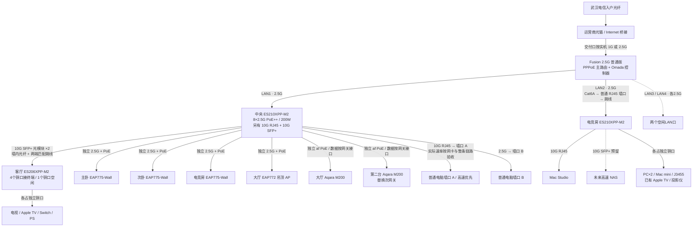
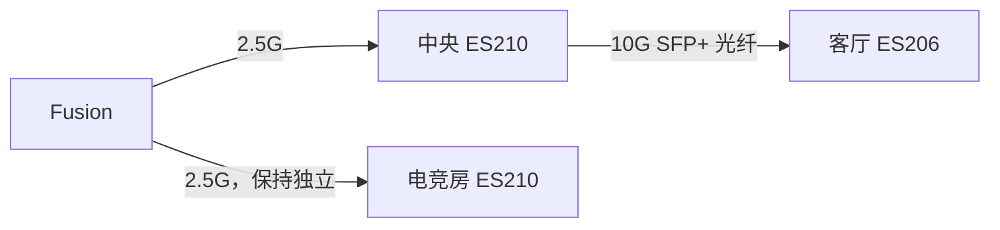
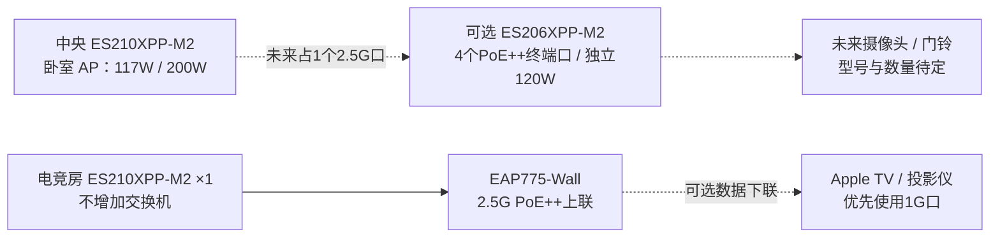

# 全屋网络拓扑 v1.5：客厅光纤上联展示图

> **更新：2026-11-25，本页主图展示中央 ES210 经10G光纤连接客厅 ES206的方案。** Fusion仅直连中央和电竞房，剩两个2.5G LAN口；客厅不再直接接Fusion。本轮为图纸展示，光纤类型、芯数与配件待核，未部署，不将查看图纸记为已批准采购或施工。
>
> **此前确认的v1.4是Fusion直连三台交换机，剩一个LAN口**，两版对照见下表。其他采购/施工文档与采购JSON的已确认基线暂保留v1.4，本页光纤展示另记为预览。两版均为中央/电竞房ES210各1、客厅ES206×1；四AP、两M200、两普通电脑墙口独立回中央。AP仅作无线接入，不用数据下联，关闭PoE Out。
>
> 已确认的 Omada 订单仍为 7 台：ES210×2、ES206×1、EAP775-Wall×3、EAP772×1，订单总额 $901.49；仅调换中央与客厅交换机的规划位置，不新增交换机。Fusion 普通版×1购买未确认。见[订单记录](network-order-20261118.md)、[采购 BOM](purchase-bom.md)。
>
> 次网关按用户要求升级为与大厅一致的 M200，两台均回中央 PoE；升级采购、差价及具体点位待核。原绿米签字合同 ¥19,324 作为历史金额保留，不据此推定已含两台 M200。

## 光纤方案主图：Fusion剩两个LAN口

图示速率为端口能力/验收目标，不代表已经跑到该速度。所有设备仍在同一家庭 LAN，不新增 VLAN；Fusion 保持唯一 DHCP 和普通 DNS。电竞房 J3455 的 OpenWrt/HA 规划不变，见[规则分流设计](superpowers/specs/2026-11-05-home-device-rule-routing-design.md)。Fusion 的各 LAN 口需配置在同一 LAN，跨端口实效吞吐到货验证。

## 当前端口与施工口径

下表对应上方光纤展示方案，不是已实施记录。LAN1–4为逻辑用途标签，机身编号到货核对。

**Fusion对账：5个口 − 光猫WAN占1个 − 中央占1个 − 电竞房占1个 = 剩2个2.5G LAN口。** 图中没有Fusion→客厅的连接，客厅通过中央上联；客厅仍用本地交流电源。

| 设备 | 2.5G RJ45 分配 | 10G RJ45 | 10G SFP+ |
|---|---|---|---|
| Fusion 普通版 | WAN接光猫；LAN1中央、LAN2电竞房；**LAN3和LAN4空闲** | 无 | 无 |
| 中央 ES210 | 8/8：Fusion上联×1、775×3、772×1、M200×2、电脑墙口B×1 | **电脑墙口A**，优先高速电脑 | **10G光纤接客厅ES206** |
| 电竞房 ES210 | 7/8：Fusion上联、PC×2、Mac mini、J3455、已有Apple TV、投影仪；余1口 | **Mac Studio** | **未来高速NAS**预留 |
| 客厅 ES206 | 4/5：电视、Apple TV、Switch、PS；**余1个2.5G口** | 无 | **10G光纤上联中央ES210** |

| 设备 | 本图剩余电口 | 本图剩余光口 |
|---|---|---|
| Fusion | **2个2.5G** | 无SFP+ |
| 中央ES210 | **0** | **0** |
| 电竞房ES210 | **1个2.5G** | 无未分配口；SFP+尚未插用，但已留未来NAS |
| 客厅ES206 | **1个2.5G** | **0** |

### 与此前确认星型方案的区别

| 项目 | v1.4已确认：三交换机直连Fusion | v1.5本页展示：客厅光纤接中央 |
|---|---|---|
| 客厅上联 | Fusion→客厅，2.5G铜缆 | 中央→客厅，10G光纤 |
| Fusion空闲LAN | 1个 | 2个 |
| 客厅空闲铜口 | 0个 | 1个 |
| 中央、客厅SFP+ | 各1个空闲 | 各1个相互连接，无剩余 |
| 电竞上联、Mac/NAS | 电竞2.5G直连Fusion；Mac/NAS本地10G | 不变 |

两版中央PoE负载、电脑墙口分配与订单数量不变。采用光纤方案时，原客厅铜缆保留端接备用，不与光上联同时连通。

中央八个2.5G口中只有六个用于PoE负载（四AP＋两M200），上联及电脑墙口关闭PoE。电竞房、客厅当前无PoE终端，其PoE口关闭。两台Apple TV按旧方案电竞房已有设备与本轮客厅接入位分别列容量，不代表两台均已购；若同一台迁移，取消原位置端口占用即可。电竞房PC为房间既有设备位，两个中央电脑墙口为独立线路，不据此新增电脑采购数量。

**为什么中央10G电口不再接Fusion：** 把一个电脑墙口改接中央10G电口，即可在2.5G口中腾出Fusion上联，不增加线材或设备。此前“八个低速口全给终端、Fusion占10G口”的分配取消。10G口连接2.5G网卡会按2.5G工作；连接千兆网卡则按1G工作。

原“影音接AP释放端口”方案取消。本图客厅释放一个铜口，尚未分配给FP400或楼宇对讲；这些设备的型号/接口仍待核，不能按腾出口就认定已接入。M200备用线未跳接不占端口。

### 四台2.5G客户端能否同时访问10G服务器

可以：四台各具备2.5G网口的客户端分别接电竞房ES210的四个2.5G口，同一LAN内访问本机10G RJ45上的Mac Studio，或10G SFP+上的未来NAS，流量在交换机内部转发，不经过Fusion的2.5G上联。四条2.5G链路合计10Gbps；ES210标称80Gbps交换容量按全双工收发合计，不能把80Gbps误当服务器单口速率，也不能把2.5G单口规格误当整机总带宽。

这是网络端口层面的并发能力，不保证四台文件传输都恒定满速：10Gbps为线路速率，协议开销后应用吞吐较低，NAS磁盘/阵列、Mac存储、CPU与文件共享协议也可能限制速度。若服务器同时服务更多设备，仍共享其10G口；当前J3455只有1G，升级2.5G后仍是所有访问者合计共享2.5G，不能按未来10G NAS的能力算。PC/Mac mini等实际网卡须逐台核验。

跨房访问则不同：中央电脑墙口或客厅设备到电竞房Mac/NAS，均经过电竞房的2.5G上联，这部分流量合计共享2.5G。四台设备若接在同一个AP后面，也共享该AP的2.5G有线上联。验收本地四客户端并发时，应四台同时向同一10G服务器测试，并检查单机及总吞吐；不能以逐台单独测速代替并发测试。

### J3455金盘与NAS网速选择（2026-11-25确认）

用户确认现有J3455使用**西数金盘（WD Gold），未做RAID**，并确认升级2.5G网卡的方向。当前网口仍为1G，升级未实施；沿用电竞房ES210已有接入口，不占用预留给未来NAS的10G SFP+。未做RAID不等于已确认只有一块盘，金盘具体型号、盘数及既有10TB记录的原始/可用容量口径仍待核。

| 对象 | 大文件连续传输参考 | 本户选择 |
|---|---|---|
| 1G网络 | 应用层常见约110–118MB/s | 当前J3455可能先受网口限制 |
| 2.5G网络 | 存储与CPU足够时约260–290MB/s | J3455升级目标，不保证金盘和CPU持续跑满 |
| 10G网络 | 存储与CPU足够时约900–1100MB/s | 电竞房Mac Studio与未来高速NAS的接入方向 |
| 独立机械盘 | 常见连续读写约120–250MB/s，随型号、盘面位置及负载变化 | 当前金盘未组阵列，不按阵列叠加吞吐估算；2.5G比1G有余量 |

以上为数量级参考，不是本户测速；GB/s、Gbps与MB/s不能混用。大量小文件、SMB加密/签名、虚拟化、CPU和磁盘随机访问会进一步限制吞吐。未来NAS是否能发挥10G取决于实际HDD阵列或SSD存储池，单加SSD缓存不等于持续写入可跑万兆。J3455不因未来NAS方向而采购10G网卡；升级时核PCIe/驱动与Proxmox桥接，先测网络再测真实文件，保留原1G接口回退。

### 布线数量和材料

若采用本图，中央核心位发出的**在用远端铜缆为9条**：四AP＋两M200＋两普通电脑墙口共8条接中央，电竞房交换机1条上联接Fusion；另有**中央—客厅1条光纤链路**。原计划第10条客厅Cat6A保留端接备用、不跳接。Fusion—中央另用1条本地短跳线，本地分支和网关备用线另计。此前v1.4仍为10条在用远端铜缆。

| 优先级 | 墙内线材 | 采购与端接要求 |
|---|---|---|
| **首选康普** | **CommScope SYSTIMAX 3091B / 760105122** | Cat6A、U/UTP、23AWG实心裸铜、LSZH、304.8m/箱；核完整订货号和正规授权渠道、原箱批次 |
| **备选飞利浦** | 明确具体型号的 Cat6A 圆形实心铜永久链路线 | 核厂家规格、线径、阻燃标识和来源；不凭“超六/万兆”商品标题验收；型号尚未锁定 |

墙内穿管使用圆形永久链路线，不以扁平成品跳线代替。长度低于37m是用户提供的条件，最终按实测长度记录；遵守弯曲半径、牵引力、弱强电隔离和可维护端接。

**Cat6A线＋Cat6模块可以承载2.5G。** 低于37m的合格链路有充分距离余量，普通RJ45模块是无源连接器，不会主动把速率锁成1G；必须四对八芯完整、端接合格，设备两端支持2.5G，并使用合格跳线。西蒙等装饰面板外壳不决定性能，查内部模块型号和类别。含Cat6模块的链路不能标为全Cat6A通道。

电脑墙口A若以10G验收，优先将模块、配线端与跳线统一为Cat6A，并使用10G网卡；保留Cat6模块可能在短距离跑10G，但不能只凭“不到37m”保证，应按完整通道测试。两端2.5G设备做iperf等局域网测试，另查协商速率、错误计数和稳定性；只测八芯通断不足以认证带宽。

### 中央200W PoE预算

| 负载 | 数量 | 规划参考 |
|---|---:|---:|
| EAP775-Wall | 3 | 官方at模式26W/台（含最多6W PoE Out）；本案关闭下游供电 |
| EAP772 | 1 | 最大约25.4W |
| M200 | 2 | 暂按12W/台，最终按铭牌/版本核验 |
| **合计** | **6** | **127.4W；加30%为165.62W** |

该数值用于选型参考，支持先保留中央ES210的200W方案，不是实测或交换机已分配功率。775的bt模式45W包含最多25W转供；关闭PoE Out不等于自动切at，也不等于交换机只预留26W，不能用45−25反推裸机实测。六台同时冷启动时核输入模式、单口功率分配与总预算，必要时调整受支持的供电配置或增加标准注入器；当前不新增注入器采购。200W为PoE输出预算，交换机自身耗电另计入交流/UPS负载。

## 光口如何使用

**本图分配：中央与客厅的SFP+互联，电竞房SFP+继续留未来NAS。** 普通Fusion没有SFP+，到中央和电竞房仍使用2.5G铜缆。光纤规格待核，图纸更新不代表设备已接通或光模块已下单。

本页主图的上联简图如下：

启用时撤掉Fusion—客厅的有源连接，铜线可保留不跳接；不同时连成三角形。客厅释放一个2.5G铜口，中央SFP+被占用。提升的是客厅与中央设备间的**汇聚带宽**；电视/Apple TV/游戏机的单机速度仍受自身网口限制，互联网与电竞房方向仍受2.5G路径限制，不能因此宣称全屋10G或更低游戏延迟。光纤无PoE，两端交换机各自交流供电。

普通RJ45＋光纤面板里的光口疑为SC；SC只说明接头类型，必须核芯数、单模/多模、APC/UPC及两端连续性后再买配件。

家装常见单模蝶形光缆（例如G.657系列）配SC面板，但不能据此确定本宅已敷材料。SC/LC是接头形态，OS2/单模是线缆类别，芯数与接头数量另核。若还未铺设，建议中央到客厅/电竞房各至少2芯单模，条件允许可4芯留备；这是布线建议，不是新增采购或已施工事实。SC面板可通过匹配的SC—LC跳线接光模块，不必为使用SFP+全部换成LC面板。

| 实际墙内光纤 | 额外配件（中央—客厅一条链路） |
|---|---|
| 双芯OS2单模 | 兼容交换机的10G SFP+ LR模块×2；两端各1条匹配面板SC端与模块LC端的单模双芯跳线 |
| 单芯OS2单模 | 兼容且波长互补的一对10G BiDi SFP+模块；两端各1条匹配接口的单芯跳线 |
| 多模 | 按具体等级/芯数/距离另配模块与跳线，不能套用上述单模组合 |

必要时另计光纤敷设、熔接尾纤/适配器及测试；已有合格端接可复用。不需外置光纤收发器。SC/APC与SC/UPC不得直接对接，跳线可以采用匹配面板一侧的SC/APC、匹配模块一侧的LC/UPC，两端分别对接相应接口即可。

### 普通光模块、电口模块与猫棒

| 插在SFP类插槽中的设备 | 外部介质与用途 | 本案状态 |
|---|---|---|
| 10G SFP+以太网光模块（LR/BiDi等） | 光纤，连接中央与客厅交换机；两端各一只，规格匹配 | 光纤方案所需；具体型号未选、未购 |
| 10GBASE-T SFP+电口模块 | RJ45＋Cat6A铜缆，将SFP+转成万兆电口 | 只有改用铜缆10G上联才考虑；不能把网线插进普通光模块 |
| PON猫棒（ONU/ONT模块） | 运营商PON入户光纤，替代部分光猫功能，涉及线路协议和注册 | 当前不采购；现有光猫桥接方案不变，不能用于普通交换机间以太网光链路 |

常见短距SR/LR以太网光模块约1–2W/只，具体功耗以规格为准；它们会发热，通常比PON猫棒和10G电口模块更易散热，不保证任何型号都低温。中央/客厅各一只光模块时按交换机规定留通风，中央还要计PoE与电源的整体热量，是否需风扇依据整柜温升而非“光模块不热”判断。

**SFP+改接非屏蔽Cat6A时，两端要用兼容的10G电口模块。** Cat6A U/UTP可以承载10G；但不少电口模块的10G距离仅30m，部分型号支持更长距离，必须按具体模块与交换机的兼容清单、插槽供电/散热要求和完整通道长度（含跳线）核验。不能把原生10G RJ45的100m能力套在所有SFP+电口模块上，也不能仅凭“墙内线低于37m”保证可用。若实际光纤可用，中央—客厅仍优先比较普通光模块＋光纤；没有新增两只电口模块的采购决定。

中央与电竞房也能10G光纤互联，但会占用电竞房唯一SFP+，与未来NAS预留冲突；且中央唯一SFP+也不能同时连客厅和电竞房。若将来需要两条10G房间上联和NAS同时可用，再评估更多10G端口的汇聚设备；当前先保留光纤端接与编号。

## 当前 WAN、安装与验收

武汉电信1,000Mbps；原光猫Internet桥接，Fusion拨号。原光猫交付口、实际PON制式和上行速度待实机核验，不把LAN端口速率当宽带实测。保留在用IPTV/固话；见[桥接方案](wan-bridge-plan.md)。

中央设备位在入户门左侧弱电箱或附近通风柜；电竞房/客厅各保留一个设备箱，卧室不设交换机箱。AP装开放位置，不藏入金属柜或吊顶内部。原平面图与旧“四主干”图仅作位置历史，现行逐线施工以[布线要求](renovation-wiring-requirements.md)及[位置说明](network-placement-and-cabling-plan.md)为准。

大厅—电竞房两条相反方向的光纤HDMI AOC仍独立保留，约10m为旧估算；它们不是网络光纤，不接SFP+，方向与最终长度见[影音规划](av-and-gaming-layout.md)。

- [ ] 核全部铜缆编号、实测长度、模块类别及性能；AP四条2.5G回程、普通电脑墙口单独验收。
- [ ] 若采用本图，核Fusion两LAN上联与另外两口空闲、中央—客厅10G光链路及同网段转发；电竞房Mac本地10G、NAS到货后另验。
- [ ] 四AP及两M200同时冷启动，验PoE预算、重启恢复和无线覆盖；不使用AP下联。
- [ ] 光纤先验芯数、类型、连接器、连续性及损耗；未改上联前不跳接成环。

## 规格来源

- [ES210XPP-M2](https://www.omadanetworks.com/us/business-networking/omada-switch-agile/es210xpp-m2/) · [ES206XPP-M2](https://www.omadanetworks.com/us/business-networking/omada-switch-agile/es206xpp-m2/)
- [Fusion普通版](https://www.tp-link.com/productpages/spec/116210-3.html)
- [EAP775-Wall](https://www.omadanetworks.com/us/business-networking/omada-wifi-wall-plate/eap775-wall/#specifications) · [EAP772](https://www.omadanetworks.com/us/business-networking/omada-wifi-ceiling-mount/eap772/#specifications)
- [康普3091B / 760105122](https://www.commscope.com/product-type/cables/twisted-pair-cables/category-6a-cables/item760105122)

历史 v1.2 四 AP 图、中央ES210建议与旧PoE核算（非当前采购/施工口径）

## 历史 v1.2 四 AP 图与说明（非当前采购口径）

> **2026-10-19 第三版成本拓扑（最新采购主案）**：[更新Excel](../outputs/network-value-20261019/基础网络采购与装修交底_第三版Omada成本优化.xlsx)将双频Wi-Fi 7与交换机直接PoE结合。3A：普通Fusion → 中央ES206XPP-M2 → 四条Cat6A主干；中央五个铜口全占，两卧室AP直接PoE。工作室ES210XPP与大厅ES206XPP保留并直接PoE供本地AP，Mac使用原生10G RJ45、NAS使用独立10G SFP+，不买注入器或铜模块。3B为Fusion 2.5G PoE直接连接四主干的互斥备选。详见[第三版说明](network-cost-optimization.md)。本条覆盖下方较早的中央ES210/三频AP采购建议，不代表设备已购或施工完成。

> **2026-10-16 当前采购/装修范围**：[基础网络采购与装修交底 Excel](../outputs/network-renovation-20261016/基础网络采购与装修交底.xlsx)覆盖网络硬件、材料、逐条布线、端口/PoE、配置和分阶段验收。高速NAS、UPS搬入后再考虑，不作为入住前必购；NAS要求自带10G SFP+，不买网卡，介质待实物确认。Mac走原生10G RJ45；Apple TV 4K旧款、米家激光投影仪、树莓派均已有，不重复购买。壁挂屏先试已有杂牌安卓，不合适再选二手iPad mini/便宜iPad，暂未定。J3455已确认PCIe 2.0 x1，TX201为兼容性待验的首选候选。下方较早的固定DAC与UPS入住前要求由本条更新；不改四主干/两房间箱/三面板一吊顶。

> 更新日期：2026-10-15。**v1.2：主卧、次卧取消设备箱和独立交换机，中央 2.5G PoE 直达各自 Wall AP；电竞房、大厅保留设备箱与交换机。全屋主干 2.5G，Mac Studio 与高速 NAS 本地 10G；HA使用J3455独立HAOS VM；主路由暂定Fusion 2.5G普通版并使用内置Omada控制器。** 这是用户确认的设计，不是已施工、已购买或已验收记录，也不是可直接放线的施工图。
> 事实源：[家庭基础设施台账](home-infrastructure-register.md)。智能设备的无线协议与控制层见 [智能家居拓扑图](smart-home-topology.md)。
> **采购/最新布线（2026-10-15）**：[集中采购BOM](purchase-bom.md)区分已确认、暂选与未决。NAS已确定放工作室交换机附近，当前采用兼容10G SFP+ DAC短线；不每房额外预埋光纤，保留可抽换弱电管和牵引线。
> 配套：[设备选型清单](device-selection-list.md)、[施工需求](renovation-wiring-requirements.md)、[TP-Link 产品调研](tplink-network-research.md)。
> **AP 选型沿用（2026-10-13）**：主卧、次卧、工作室各暂定 1 台 EAP775-Wall 三频 Wi-Fi 7 面板 AP，大厅保留 1 台 EAP772 Wi-Fi 7 吊顶（吸顶）AP 候选，均按 2.5G 有线回程。
> **PoE/端口复核（2026-10-15）**：三处交换机的端口和供电预算已按当前 AP 规划核对；详见第 2.2 节。未来中央 PoE 可按需增加无风扇 ES206XPP-M2。用户已决定电竞房不扩交换机，继续只用 ES210XPP-M2；工作室 EAP775-Wall 另有 1×2.5G + 3×1G 下联数据口，可作为低带宽终端扩展位。

## 1. 定稿范围与实施边界

本版确定的速率与电竞房方案为：**全屋新建以太网主干、交换机铜口和AP上联以2.5G为基线；三台EAP775-Wall均有1×2.5G+3×1G下联数据口。电竞房只有一台ES210XPP-M2，原生10G RJ45给Mac Studio，10G SFP+给未来高速NAS。** J3455、两台PC、Mac Mini和面板AP直接接交换机；Apple TV、投影仪当前可直接接交换机，也可在点位合适时改接工作室Wall AP的千兆数据下联，以释放最多两个交换机端口。已有千兆/百兆设备按自身接口协商，不因接上2.5G端口就升级。

全屋保持**中央星型四条 Cat6A 主干、每区一条**：主卧、次卧各直接接 EAP775-Wall，由中央交换机提供 2.5G 数据和匹配 PoE；电竞房、大厅各接房间箱交换机。**两卧室不设设备箱、独立交换机或房间网络 UPS 点，电脑/有线设备改接各自 Wall AP 下联口。** 此前“大厅交换机再接主卧/次卧面板 AP”的提议未采纳，不按大厅汇聚施工。

| 已确定的 v1.2 设计基线 | 后续落实，不阻挡本次拓扑定稿 |
|---|---|
| 光纤 → 光猫 → 暂定 Fusion 2.5G 普通版 → 中央交换机；Omada 内置于 Fusion | 运营商桥接/认证参数、Fusion 具体发货版本与全套 adoption/固件兼容 |
| 四条 Cat6A 主干，全部 2.5G | 实际走线路径、通道长度和配线认证 |
| 主卧/次卧仅 Wall AP，电竞房/大厅各一台房间交换机；三房面板 AP 暂定 EAP775-Wall ×3，大厅吊顶候选 EAP772 ×1；均为 Wi-Fi 7、开放位置安装和 2.5G 上联 | 实际发货版本、地区频段许可、中央两口 PoE 与房间供电配置、安装尺寸及现场覆盖/功率调优 |
| 电竞房单台 ES210XPP-M2；Mac 10G RJ45、未来 NAS 10G SFP+；J3455 现1G、计划升级2.5G，复用已分配端口 | NAS整机/容量入住后再选，要求自带SFP+，不买网卡；DAC或光模块+光纤按实机确认；J3455网卡接口、驱动和桥接迁移；箱外设备位与散热 |
| 电竞房不增加第二台交换机；ES210十口按完整设备表分配；Wall AP另有4个数据下联口 | 实际端口映射和并发测试；低带宽终端可改接AP下联，但不把关键服务器或PoE摄像头挂在AP后面 |
| UPS入住后再考虑增添；装修只做供电/位置预留 | 原至少1小时为后续评估目标，不是入住前验收条件 |

- 住宅约 **100㎡**、一层矩形，目前只有房间相对位置，尚无正式设计图；柜体位置、尺寸、散热和实际走线长度须复尺后确定。宽带计划为 **1000Mbps 下载 / 30Mbps 上传**，不是已开通实测速率。
- 网络设备按 TP-Link 选型，管理设备优先 Omada；智能家居以 Aqara 为主，**不新增小米/米家、华为设备；已有米家激光投影仪继续复用**。
- 仅工作室/电竞房、大厅各设一个可维护的小设备箱；**主卧、次卧不设设备箱和独立交换机**。中央柜到每个区域只拉一条 Cat6A 主干，共四条；两个卫生间不默认增设设备箱或独立回线。
- 电竞房/大厅箱内放交换机和配线；三房 Wi-Fi 7 面板 AP 安装在墙面开放位置，大厅 Wi-Fi 7 吊顶 AP 安装在顶面可见位置，不藏入吊顶内部。主卧/次卧电脑与有线设备接 Wall AP 的四个下联口（**1×2.5G + 3×1G**）；工作室 Mac/NAS、PC、Mac Mini、J3455直接接ES210XPP-M2，Apple TV/投影可按点位改接Wall AP下联。
- 工作室主干改为 **2.5GbE**。用户已确认 Mac Studio 采购目标为 **M5 Ultra、512GB 统一内存、4TB 内置 SSD**，使用 **10GbE 网口**连接 ES210XPP-M2 的唯一原生 10G RJ45，不另拉独立线回中央柜；容量需求已确认；Apple美国配置页2026-10-15明确512GB选项10月下旬提供，目标整机报价待开放后核验。
- 主卧、次卧、工作室、大厅主干全部 **2.5GbE**；四台 AP 的目标有线链路为 2.5GbE。只有电竞房 Mac 与未来高速 NAS 的本地链路按 10G；图中速率是设计目标，不是实测结果。光猫 WAN 交付口、控制器及既有终端仍按实际能力记录。
- 三房HomePod mini暂各1台，新购优先推荐mini 2，代际/数量/地区待用户确认。大厅 **Apple HomeView非壁挂／桌面版×1已确认**，美国预购$299、11月13日起供货，Wi-Fi/Thread能力已核；仍通过大厅AP Wi-Fi，使用随箱电源，不新增主干或HomeView PoE底座。未购/未部署，大陆服务/账户/配套设备待验。壁挂另用平板电脑或iPad，具体型号、数量、点位与供电/接入方式待定，暂不画物理线路、不计端口/PoE。详见[Apple核验](apple-home-devices-2026.md)。
- 核心网络仍规划放弱电箱附近机柜；**Mac、J3455 和未来高速 NAS 改为电竞房接入、箱外通风设备位**，不塞入网络小箱。现有 J3455 为 **16GB 内存、10TB 存储、1GbE 网口、Proxmox**，运行独立黑群晖 VM 及家庭代理/数据转发容器；计划接电竞房交换机，尚未搬迁。用户已决定在其上新增独立 HAOS VM，尚未部署；Omada 使用中央暂定 Fusion 的内置控制器；10TB 的原始/可用容量、磁盘健康、冗余、备份及运行余量仍须核验。
- 未来高速NAS已确定放在工作室交换机附近的箱外通风设备位，整机型号、磁盘及采购仍待定；采用自带10G SFP+光口，介质在DAC或光模块+光纤中按实机确认，长度随实物布局确定。不再并列采购光模块/光纤，也不把SFP+当现成RJ45铜口。停电后 **NAS、Mac 和全屋网络均需继续运行，UPS 按至少 1 小时目标规划**；实际负载、峰值与停电满载策略仍待核算，不保证现有 UPS 已达成。

工作室选用 **ES210XPP-M2 ×1**，8×2.5G PoE++ RJ45 + 1×10G RJ45 + 1×10G SFP+；不再采购第二台工作室交换机。完整设备表可占满十口，但 EAP775-Wall 本身另有4个下联数据口；需要释放交换机口时优先迁移Apple TV/投影，未来NAS的SFP+保留不算普通扩展口。AP注入器和主干10G铜模块仍不采购，旧TL-SX1008、SX3206HPP扩口组合仅保留历史。

## 2. 全屋物理连接总图

实线表示已规划的有线连接，虚线表示 Wi-Fi、Thread、Zigbee 无线关系或尚未选定的候选分支（边上注明）。房间分组表示空间，不表示所有设备都塞进箱内；图中的网关和摄像头是接法示意，实际型号、数量和安装点待确认。

```mermaid
flowchart TD
    ISP["运营商入户光纤<br/>计划 1000Mbps 下 / 30Mbps 上"]

    subgraph CENTRAL["弱电箱附近机柜<br/>核心网络；尚未安装"]
        ONT["光猫 / ONT：优先桥接"]
        ROUTER["AC：Fusion 2.5G 普通版 ×1 · 暂定<br/>主路由 / 5×2.5G / 无PoE、无SFP<br/>未购 / 未部署"]
        OMC["Fusion 内置 Omada 控制器<br/>同一物理设备，无独立VM/网口"]
        CORE["中央 Omada PoE 交换机<br/>推荐 ES210XPP-M2，尚待用户确认<br/>8×2.5G PoE++ / 200W；5个已规划连接<br/>两卧室保守 PoE 规划 117W"]
        ONT -->|"WAN 交付口按运营商实际"| ROUTER
        ROUTER -->|"LAN 2.5G 目标"| CORE
        ROUTER -. "内置管理应用" .-> OMC
        OMC -. "经LAN管理交换机与AP" .-> CORE
    end
    ISP --> ONT

    CORE -->|"TRUNK-MASTER：一条 Cat6A / 2.5G + 匹配 PoE"| MA
    CORE -->|"TRUNK-SECOND：一条 Cat6A / 2.5G + 匹配 PoE"| SA
    CORE -->|"TRUNK-STUDIO：一条 Cat6A / 2.5G"| WS
    CORE -->|"TRUNK-HALL：一条 Cat6A / 2.5G"| HS

    subgraph MASTER["主卧"]
        MA["AP-MASTER：Wi-Fi 7 面板 AP<br/>EAP775-Wall 暂定 · 中央 2.5G PoE 直供<br/>主卧墙面；无房间箱/独立交换机"]
        MPC["电脑 / 有线设备"]
        MHP["HomePod mini<br/>优先推荐mini 2 · 待确认"]
        MIOT["主卧 Wi-Fi 智能设备 / 手机"]
        MA -->|"AP 下联：1×2.5G + 3×1G<br/>按终端分配，不使用 PoE Out"| MPC
        MA -. Wi-Fi .-> MHP
        MA -. Wi-Fi .-> MIOT
    end

    subgraph SECOND["次卧"]
        SA["AP-SECOND：Wi-Fi 7 面板 AP<br/>EAP775-Wall 暂定 · 中央 2.5G PoE 直供<br/>次卧墙面；无房间箱/独立交换机"]
        SPC["电脑 / 有线设备"]
        SHP["HomePod mini<br/>优先推荐mini 2 · 待确认"]
        SIOT["次卧 Wi-Fi 智能设备 / 手机"]
        SA -->|"AP 下联：1×2.5G + 3×1G<br/>按终端分配，不使用 PoE Out"| SPC
        SA -. Wi-Fi .-> SHP
        SA -. Wi-Fi .-> SIOT
    end

    subgraph STUDIO["工作室 + 电竞房"]
        WS["设备箱：ES210XPP-M2 ×1<br/>8×2.5G PoE++ + 1×10G RJ45 + 1×10G SFP+<br/>完整直连可占满；改接AP后可空出2个2.5G口<br/>上联 2.5G"]
        MAC["箱外 Mac Studio M5 Ultra（计划）<br/>512GB 统一内存 / 4TB SSD<br/>用户确认 10GbE"]
        NAS["箱外未来高速 NAS · 未采购<br/>靠近交换机；自带10G SFP+光口；入住后选NAS<br/>视频素材与游戏库"]
        J["箱外现有 J3455 · 计划电竞房接入<br/>16GB RAM / 10TB / Proxmox<br/>现1GbE，计划升级2.5GbE"]
        DSM["现有独立黑群晖 VM<br/>影音 NAS"]
        HAVM["计划新增 HAOS VM<br/>位置已定，尚未部署"]
        PC1["PC 1：现 1G，计划升级 2.5G"]
        PC2["PC 2：现 1G，计划升级 2.5G"]
        MINI["Mac Mini：1G"]
        ATV["已有Apple TV 4K旧款：有线连接<br/>不新增采购；按实机接口验收"]
        PROJ["已有米家激光投影仪：复用<br/>有线接口及速率待实机核验；不购买"]
        WA["AP-STUDIO：Wi-Fi 7 面板 AP<br/>EAP775-Wall 暂定 · 2.5G 上联<br/>工作室墙面，箱外"]
        WADOWN["AP数据下联扩展位<br/>1×2.5G + 3×1G<br/>不使用PoE Out"]
        WHP["HomePod mini<br/>优先推荐mini 2 · 待确认"]
        WIOT["工作室 Wi-Fi 智能设备 / 手机"]
        WS -->|"原生 10G RJ45 / Cat6A"| MAC
        WS -. "入住后再采购；10G SFP+ / DAC或光模块+光纤待实机" .-> NAS
        WS -->|"现1G → 升级后2.5G；同一端口"| J
        J -. "Proxmox 虚拟实例" .-> DSM
        J -. "Proxmox 虚拟实例" .-> HAVM
        WS -->|"1G → 2.5G，按升级"| PC1
        WS -->|"1G → 2.5G，按升级"| PC2
        WS -->|"1G"| MINI
        WS -->|"以太网，速率按型号"| ATV
        WS -->|"以太网，速率按实机"| PROJ
        WS -->|"2.5G + 匹配 PoE++"| WA
        WA -->|"4个下联数据口"| WADOWN
        WADOWN -. "点位合适时可改接" .-> ATV
        WADOWN -. "点位合适时可改接" .-> PROJ
        WA -. Wi-Fi .-> WHP
        WA -. Wi-Fi .-> WIOT
    end

    subgraph HALL["大厅"]
        HS["小设备箱：ES206XPP-M2 ×1<br/>5×2.5G，其中4×PoE++ / 120W<br/>本地供电；未购/未部署"]
        HA["AP-HALL：Wi-Fi 7 吊顶 AP<br/>EAP772 候选 · 2.5G 上联<br/>大厅顶面可见，箱外"]
        HUB["Apple HomeView 桌面版 ×1<br/>型号已确认 · 未购 · Wi-Fi / Thread<br/>大陆服务 / 账户待验"]
        HIOT["大厅 Wi-Fi 智能设备 / 手机"]
        HALLGW["HALL-IOT-GW：大厅墙面信息口<br/>网关 / 协调器接入位；二选一<br/>PoE 仅取决于最终型号；旁置普通插座"]
        AQ["方案A：Aqara 有线网关<br/>箱外，位置按覆盖调整"]
        C["方案B：HA 以太网 Zigbee 协调器<br/>型号待选"]
        CAM["未来 PoE 摄像头候选<br/>点位/型号/功耗待确认"]
        TV["大厅电视：有线接入计划<br/>速率按实际接口"]
        HS -->|"HALL-2G5-2：2.5G + 802.3at PoE+"| HA
        HA -. Wi-Fi .-> HUB
        HA -. Wi-Fi .-> HIOT
        HS -->|"HALL-IOT-GW：网线；PoE按型号决定"| HALLGW
        HALLGW -. "二选一" .-> AQ
        HALLGW -. "二选一" .-> C
        HS -. "HALL-2G5-5：未来候选；未计入PoE" .-> CAM
        HS -->|"以太网，速率按电视接口"| TV
    end

    AQ -. "方案A：Zigbee" .-> ZB["全屋兼容 Zigbee 设备<br/>含四个主要区域及两卫生间"]
    C -. "方案B：Zigbee" .-> ZB
    MHP -. Thread .-> TM["全屋 Thread Mesh<br/>接入层详见智能家居拓扑图"]
    SHP -. Thread .-> TM
    WHP -. Thread .-> TM
    HUB -. "Thread能力已核；配网/地区体验待验" .-> TM
```

每个区域都可规划智能灯、开关、传感器等，**不是只有主卧和大厅有智能设备**。Wi-Fi、Zigbee、Thread 是不同的接入路径；全屋设备的房间与协议分配见 [智能家居拓扑图](smart-home-topology.md)，不能把 `HALL-IOT-GW` 理解为只服务大厅。该墙面口固定为网关／协调器的接入位，Aqara 网关与 HA 直管协调器是同一批 Zigbee 设备的二选一路径，并非两台都必须购买。

摄像头可接中央或大厅**有空闲端口**、供电能力匹配的 PoE 交换机；电竞房在完整直连表下没有备用口，Apple TV/投影改接AP后虽可释放最多两个PoE++数据口，但这些口尚未分配给摄像头，仍须按点位、布线与PoE预算单独复核。两卧室已无独立 PoE 交换机，也不通过 Wall AP 转供 PoE。上图大厅分支只是接法示例，不默认在卧室或卫生间安装摄像头。两个卫生间按覆盖接入附近 AP、Zigbee 或 Thread 网络。

### 2.1 AP 形态与 BOM 对照

| 点位 | 已确定形态 / 数量 | 本地支线与候选状态 |
|---|---|---|
| `AP-MASTER` 主卧 | Wi-Fi 7 面板 AP ×1，暂定 EAP775-Wall | 中央交换机 → 一条 Cat6A → 墙面 AP，2.5G + 匹配 PoE；有线终端接 AP 下联 |
| `AP-SECOND` 次卧 | Wi-Fi 7 面板 AP ×1，暂定 EAP775-Wall | 中央交换机 → 一条 Cat6A → 墙面 AP，2.5G + 匹配 PoE；有线终端接 AP 下联 |
| `AP-STUDIO` 工作室 | Wi-Fi 7 面板 AP ×1，暂定 EAP775-Wall | ES210XPP-M2 → 墙面 AP，2.5G + 匹配 PoE++；Mac 占原生 10G RJ45，NAS 占 SFP+ |
| `AP-HALL` 大厅 | Wi-Fi 7 吊顶（吸顶）AP ×1，候选 EAP772 | ES206XPP-M2 → 顶面 AP，2.5G + 802.3at PoE+ |

当前数量为 **EAP775-Wall 面板 3 台 + EAP772 吊顶 1 台**；面板型号是用户本次暂定选择，非已采购。EAP775-Wall 的[美国官方规格](https://www.omadanetworks.com/us/business-networking/omada-wifi-wall-plate/eap775-wall/#specifications)已确认三频 2.4/5/6GHz、1×2.5G 上联及 1×2.5G + 3×1G 下联，取代原无 6GHz 的 EAP725-Wall 条件候选。美国硬件规格不等于中国大陆的频段许可、固件功能或保修已核验。型号、采购状态与当日报价统一维护在[集中采购BOM](purchase-bom.md)，[设备清单第6.4节](device-selection-list.md#64-按最新拓扑更新的候选购买清单)保留选型/端口门槛。

面板 AP 的底盒、孔距、深度和进线方式按最终区域版本核对，避开床头、家具和金属遮挡；大厅从本地设备箱预埋支线至吊顶安装面，预留支架与维护位置，不新增中央主干。主卧/次卧每台 AP 的 **4 个下联口为 1×2.5G + 3×1G**，需要 2.5G 的电脑优先接唯一 2.5G 下联，其他终端接 1G 口；有线下联和 Wi-Fi 对外共享 AP 的 2.5G 上联，不是四个口各独享 2.5G。工作室电脑仍直接接交换机。PoE/UPS 按最终四台型号重新核算，不把 EAP772 的功耗套给面板 AP。

EAP775-Wall 支持 802.3at/bt 输入，官网最大功耗记录为 **45W（含 25W PoE 输出）**，不是 AP 独立功耗。官网概览与规格表对下游 PoE 输出所需 at/bt 输入的描述不一致，因此当前方案**不使用 AP 下游 PoE 输出**（下联口传数据仍正常规划）。主卧/次卧由中央两路匹配 bt 口直接供电；工作室由 ES210XPP-M2 的匹配 bt 口直接供电，注入器数量为 0；其 90W/口、200W 全机预算按最终版本核验。暂按每台 45W 规格上限保守预留，乘 1.3 为 58.5W，中央两台合计 **117W** 仅为这两台的保守 PoE 预算，其他中央受电设备另加；不由 45−25 推定裸机功耗。摄像头仍直接接有余量的中央/大厅 PoE 交换机，不使用 AP 转供。

### 2.2 交换机 PoE 与端口复核（2026-10-15）

规划公式为“受电设备可查最大功耗 × 1.3”，用途是为交换机和 UPS 留出余量，**不是实测常态耗电**。EAP775-Wall 暂按含 PoE Out 的 45W 规格上限估算，但本方案不启用其下游 PoE；EAP772 按 25.4W 最大功耗估算。网关／协调器的型号尚未定，因此不虚构其功耗或 PoE 需求。

| 位置 / 交换机 | 可供电端口与全机预算 | 当前 PoE 规划负载 | 复核结论 |
|---|---|---:|---|
| 中央（推荐 ES210XPP-M2，待确认） | 8×2.5G PoE++；90W/口；200W | 主卧 + 次卧 EAP775-Wall：`2 × 45 × 1.3 = 117W` | 足够，按此保守规划仍余约 83W；8 个数据口规划使用 5 个，余 3 个。若改型号，仍须满足两口 bt 与约 200W 级总预算。 |
| 电竞房（ES210XPP-M2，已选） | 8×2.5G PoE++；90W/口；200W | 工作室 EAP775-Wall：`45 × 1.3 = 58.5W` | 功率余约141.5W；交换机十口按完整设备表分配，但Wall AP另有4个数据下联口。低带宽非PoE终端可改接AP；摄像头/协调器仍不使用AP PoE Out。 |
| 大厅（ES206XPP-M2，已选） | 5×2.5G，其中 4×PoE++；90W/PoE口；120W | EAP772：`25.4 × 1.3 ≈ 33W` | 足够，规划余约 87W；有 1 个未分配 2.5G 口。`HALL-IOT-GW` 占用一个数据口，只有最终设备支持 PoE 时才加入功耗复核。 |

**未来 PoE 设备的容量判断**：当前中央两台 EAP775-Wall 采用 45W 规格上限的保守预算后，`200−117=83W` 只是规划余量，不是可以不经核算随意增加的设备数。灯、开关和电池传感器大多走 Zigbee/Thread/Wi-Fi，不会自动占 PoE；真正可能增加中央 PoE 的主要是摄像头、门铃、网关或其他有线设备。每个最终型号按 `最大功耗×1.3` 加入，并同时核对端口标准。举例：规划功耗 12W 的设备 4 台需约 `4×12×1.3=62.4W`，尚余约 20.6W；5 台则约 78W，几乎没有其他余量；实际设备功耗、夜视/加热峰值和启动行为可能更高。未锁定型号和数量前，不把 83W 记录成可购买的摄像头额度。

**中央首选扩展方式（不是当前采购）**：保持 ES210XPP-M2 承担两卧室 AP，在核心机柜预留一个 2.5G 口、插座、UPS 功率与安装空间；真正确定 PoE 摄像头/门铃点位后，再用一台无风扇 **ES206XPP-M2** 作为下游专用 PoE 交换机。它占用中央一个 2.5G 上联口，新增 4 个可供电的 2.5G PoE++ 终端口和独立 120W 预算；四路摄像头共享 2.5G 上联，对住宅录像通常足够，仍须按码率/录像服务器位置验算。这样不会让新增 PoE 负载挤占卧室 AP 的 200W，也无需现在为未知设备购买大型风扇交换机。

**中央大型单机备选（不是当前已选）**：若明确需要超过 4 个新增 PoE 端口、希望全部回线汇聚到单机，或长期端口需求明显增加，可将中央 ES210XPP-M2 改为 **SG3218XP-M2**：16×2.5G RJ45（4×PoE++、12×PoE+）、4×PoE++ 最高 90W/口、12×PoE+ 最高 30W/口、240W 总预算、2×10G SFP+。它能提供 11 个中央空闲数据口（按当前五个连接计），但 PoE 总预算只比 ES210XPP-M2 多 40W，并非端口翻倍、功率也翻倍；另有 2 个风扇和 19 英寸机身。中央不承载 Mac/NAS 10G，因此没有原生 10G RJ45不是阻塞条件。

**电竞房决定（2026-10-15）**：不增加第二台交换机，也不改用SG3218XP-M2。继续使用单台ES210XPP-M2；其自身端口按完整设备表分配。EAP775-Wall官方另有1×2.5G+3×1G下联，均可传数据；需要释放ES210端口时，优先把Apple TV、投影仪等低带宽非关键设备改接AP的1G下联。Mac、NAS、PC、J3455仍直接接ES210，避免AP重启/故障影响存储与HA；Omada改由Fusion内置控制器承载。所有AP下联设备共享AP的2.5G上联，AP故障会同时影响其Wi-Fi和下联设备。

以下只表示**推荐的未来扩展路径**，不改变上方当前基线，也不表示已经新增采购：

大厅端口按下表标识，**标签是逻辑编号，不代表设备前面板物理编号**；上联优先接唯一非 PoE 的 2.5G 口，AP、可能需要 PoE 的网关及未来摄像头接四个 PoE 口。上联、普通终端与未使用口应在 Omada 中关闭 PoE。ES206XPP-M2 的 5 个 2.5G 口中只有 4 个能输出 PoE，不应把五口都当 PoE 口。

| 大厅标签 | 当前用途 | PoE 状态 |
|---|---|---|
| `HALL-2G5-1` | 中央 `TRUNK-HALL` 2.5G 上联 | 优先映射到唯一非 PoE 物理口；若实际布置不同则关闭 PoE |
| `HALL-2G5-2` | EAP772 | 802.3at PoE+；最大 25.4W |
| `HALL-2G5-3` | 大厅电视 | 关闭 |
| `HALL-IOT-GW` | 大厅墙面网关／协调器接入位 | 仅最终设备支持时启用；否则仅数据 + 邻近普通插座 |
| `HALL-2G5-5` | 未分配；未来 PoE 摄像头候选 | 未采购、未计入负载 |

## 3. 主干、端口与速率

6GHz 的法规、客户端与公开案例边界见[专项研究](wifi7-6ghz-mainland-china-research.md)：当前不计入大陆部署保证能力，AP暂选数量、面板/吊顶形态、2.5G回程和工作室10G连接不变；图示不是6GHz已开启或已通过实机验收的记录。

| 编号 | 起点 → 终点 | 入房主干数量 | 目标速率 | 区域内分支 |
|---|---|---:|---|---|
| `TRUNK-MASTER` | 中央柜 → 主卧 EAP775-Wall | 1 条 Cat6A | 2.5GbE + 匹配 PoE | AP 下联电脑等：1×2.5G + 3×1G；无房间箱/独立交换机 |
| `TRUNK-SECOND` | 中央柜 → 次卧 EAP775-Wall | 1 条 Cat6A | 2.5GbE + 匹配 PoE | AP 下联电脑等：1×2.5G + 3×1G；无房间箱/独立交换机 |
| `TRUNK-STUDIO` | 中央柜 → 工作室箱 | 1 条 Cat6A | 2.5GbE | 本地 Mac/NAS 10G；PC×2、Mac Mini、J3455及面板AP；Apple TV/投影可直连交换机或改接AP下联 |
| `TRUNK-HALL` | 中央柜 → 大厅箱 | 1 条 Cat6A | 2.5GbE | 吊顶 AP、兼容网关、确认点位后的摄像头等 |

“一条 Cat6A”限制的是中央到区域的主干，不是房间内总共只能有一条网线。两卧室从 Wall AP 下联口到电脑/有线设备仍需短线或本地支线；电竞房/大厅从房间交换机到 AP、墙口和终端仍需独立支线。可预留空管、牵引线和检修余量，不默认增加第二条中央回线。

- **中央交换机**：主路由 LAN、主卧 Wall AP、次卧 Wall AP、电竞房交换机、大厅交换机，共五个连接，建议至少 8×2.5G RJ45 以留三口余量。必须有至少 **2 个匹配 EAP775-Wall 输入标准与功率的 2.5G PoE 端口**，当前保守选兼容 802.3bt 口，两台 PoE 预算按上一节核算；不能继续按无 PoE 中央型号直接下单。Omada 控制器内置于 Fusion，不增加中央物理端口；中央不再重复预算 NAS/J3455，也不强制 10G 或全口 PoE。型号继续按 Omada 管理/供货/实际供电需求核验。
- **工作室交换机**：ES210XPP-M2 ×1，两个10G接口专给Mac/NAS。完整直连表可分配完8个2.5G口，但用户已决定不增加交换机；EAP775-Wall另有4个数据下联。Apple TV/投影改接AP后可释放两个ES210端口，具体按家具和线缆点位确定；J3455、Mac、NAS和PC保持交换机直连。
- “多千兆”只是 2.5G/5G/10G 等能力的概称，采购时写每个端口的实际速率。一个 10G 上联口不能让其他 2.5G 口变成 10G。SFP+ 插槽也不等于现成的 RJ45 铜口；模块兼容、距离、温度都需核验。
- 当前主干使用2.5G RJ45，不需要SM5310-T。NAS已确定靠近交换机，当前采用兼容10G SFP+ DAC短线，不另买光模块对或铜模块。若以后改为仅RJ45的网卡，先重新批准接口方案并核模块兼容、散热和距离；旧SM5310-T 10G铜通道**30m（含跳线）**限制只适用于实际使用该模块的链路。
- 合格 Cat6A 完整通道配两端原生 10GBASE-T 接口，标准上限为 **100m**（通常永久链路 90m + 跳线合计 10m）；2.5G 也按 100m 通道设计，不因降速就默认可以无限延长。以端到端器件约束和链路认证为准，无需因本案 10G 需求升级到 Cat7/8。
- Mac 与高速 NAS **接同一台电竞房交换机**：同 VLAN/子网的本地传输不经过中央 2.5G 上联，目标链路为10G。Apple TV即使改接工作室AP下联，其访问J3455也只经过AP的2.5G上联和本房交换机，不经过中央主干；但会受AP重启/故障影响。所有访问同一个NAS的客户端仍共享NAS的10G网口及存储能力，PC/影音终端按各自接口限速。
- 电竞房访问其他房间、其他房间访问 NAS/J3455以及联网下载，都共享工作室 **2.5G** 上联；它不是各终端独享带宽。唯一上联断开时，正常供电、既有地址/服务且同 VLAN 的本地转发仍可继续，但互联网和跨房访问不可用，不承诺所有依赖中央服务的功能仍运行。
- 互联网计划为 1000Mbps 下 / 30Mbps 上；30Mbps 上传理论约 3.75MB/s，远程访问和异地备份不能按局域网速率估算。同一 VLAN 的本地 10G 传输不要求主路由 WAN 也是 10G；跨 VLAN 大流量还要核对路由/三层转发能力。

### 3.1 电竞房十口端口表

下列编号是完整直连基线，不声称与实物面板端口号一致；到货后按前面板/控制器映射记录。Apple TV/投影若改接AP下联，则`STUDIO-2G5-6/7`变为空闲；NAS尚未购置的SFP+仍计为保留，不作为普通扩展口。

| 规划接口 | 连接 | 目标/实际速率 | 供电及状态 |
|---|---|---|---|
| `STUDIO-10G-RJ45` | Mac Studio | 10G | 原生铜口，Cat6A；计划购买 |
| `STUDIO-10G-SFP` | 未来高速 NAS | 10G | 靠近交换机，NAS自带10G SFP+光口；介质待实机确认；未采购 |
| `STUDIO-2G5-1` | 中央交换机 | 2.5G | 唯一 Cat6A 主干，共享对外上联 |
| `STUDIO-2G5-2` | PC 1 | 现 1G，计划 2.5G | 网卡/驱动升级后验收 |
| `STUDIO-2G5-3` | PC 2 | 现 1G，计划 2.5G | 同上 |
| `STUDIO-2G5-4` | Mac Mini | 1G | 不默认升级或追加采购 |
| `STUDIO-2G5-5` | J3455 影音 NAS / 代理 / HA | 现1G；计划升级2.5G | 已有，网卡升级/搬迁/新VM尚未实施；复用本口 |
| `STUDIO-2G5-6` | Apple TV，或改接AP的1G下联 | 有线，100M/1G 按型号 | 改接AP后本口空闲；按点位决定 |
| `STUDIO-2G5-7` | 投影仪，或改接AP的1G下联 | 按实际接口 | 改接AP后本口空闲；按点位决定 |
| `STUDIO-2G5-8` | EAP775-Wall | 2.5G + 匹配 802.3bt | 直接 PoE++ 供电，不用注入器或 AP PoE Out |

**工作室EAP775-Wall下联口：** 1×2.5G + 3×1G，均可作普通数据口；本方案不启用下游PoE。优先候选为Apple TV和投影仪各用一个1G口，另留1×2.5G + 1×1G数据口。AP下联与Wi-Fi共享AP的2.5G上联，且AP故障会同时中断这些有线终端，因此J3455/HA、Mac、NAS和PC不迁到AP后面。

## 4. 光猫、主路由与控制器不能混淆

光猫/ONT 负责运营商光接入、PON 协议与注册认证；AC 在本项目中专指主路由器/网关，负责 PPPoE/DHCP 接入、NAT、防火墙和家庭网络策略。光猫桥接后，主路由可接管路由功能，但普通路由器不能因此替代光猫的光接入功能。

只有运营商支持且完成兼容认证的集成设备/光接入模块才可能合并两者，普通以太网 SFP 光模块不能直接当作 PON 光猫。桥接涉及的 PPPoE、ISP VLAN、IPv6、IPTV/电话等业务要向运营商确认，不在未核验前改动现网。

暂定 Fusion 2.5G 普通版把主路由和 Omada 控制器集成于同一物理设备。其主路由功能位于光猫与中央交换机之间；内置控制器应用经 LAN 管理交换机/AP，不另占端口，也不需要 J3455 控制器 VM。普通版无 PoE、无 SFP、无 Wi-Fi，中央 PoE 交换机继续负责卧室 AP 供电。Fusion 的 USB-C 适配器输入100–240V、50/60Hz，输出5V/3A，中央 UPS 计入其整机输入功耗。

初期沿用台账中的同一可信 LAN 集成方向，让 HomePod、Apple Home/Matter、Aqara 网关和 HA 先完成发现、配网与控制；管理/IoT/访客 VLAN、IP 地址和 ACL 不在本次物理拓扑定稿范围。后续若分 VLAN，须核验全链路交换机管理能力、mDNS/IPv6 和跨网访问策略，不改变这里的四条物理主干。

## 5. 箱体、供电与故障边界

- 仅电竞房、大厅的两个房间小箱放交换机、配线模块及合规电源，需可开门、通风、防尘、强弱电分隔并保留弯曲/维护空间；两卧室不设设备箱或独立交换机。工作室 10G 设备发热按实际满载测量，不先锁死薄型箱尺寸。
- 弱电箱附近机柜规划承载核心网络；Mac、现有 J3455 和未来 NAS 留/改接电竞房的箱外通风设备位。中央及电竞房分别落实承重、散热和维护空间；不在无正式设计图时锁死柜体尺寸，不把服务器/NAS塞入网络小箱。AP、Zigbee/Thread 无线网关均在箱外，尤其不放金属箱内。
- 主卧/次卧 Wall AP 由中央交换机经各自 Cat6A 直接 PoE 供电，不需房间网络电源/UPS 点；电脑与 HomePod 等仍按自身市电和所需保活另核。电竞房/大厅交换机默认本地供电，中央 PoE 不会穿过普通交换机为其 AP 供电；本地 PoE 交换机必须独立核验单口标准和总预算。每个供电点按实际受电设备最大功耗之和乘 1.3 预留，并核对单口上限。
- 停电保活范围已确认包括 NAS、Mac、全屋网络：光猫、网关、中央交换机、电竞房/大厅交换机及四台 AP 的完整链路都要覆盖；承担关键代理/转发的 J3455 也需纳入。中央 UPS 通过中央 PoE 供电链路可保活两卧室 AP，**取消两个卧室的独立房间网络 UPS 点**；但不自动覆盖两卧室电脑/HomePod、本地市电大厅/电竞房交换机或工作室 Mac。后续在中央、电竞房、大厅 UPS 与合规集中后备回路之间做电气设计，不靠普通 PoE 透传来假定保活。
- UPS 按各位置实测功耗、启动峰值、VA/W 和 **至少 1 小时的目标续航**选择，最终按实际负载和电池续航曲线核算并做断电验收；停电是否继续模型/剪辑满负载、安全关机阈值与顺序尚待确认。若机柜主动排风是必要散热条件，也须后备供电。用户尚未给预算上限，不等于无限采购；目前不锁 UPS 型号或宣称已达成目标。HA/Thread 中枢停电保活与恢复能力另按最终部署验收。
- **主卧/次卧电脑经过各自 Wall AP，AP 重启、故障或中央 PoE 断电会同时影响本卧室 Wi-Fi 和 AP 下联有线终端**；这与原独立交换机方案的故障边界不同。电竞房 AP 与 Mac/电脑并列接 ES210XPP-M2，AP 重启不应切断这些有线终端；电竞房交换机或其供电故障影响本房全部有线设备/AP，包括两台存储设备。唯一主干故障影响互联网和跨房访问，本地同 VLAN 转发按第 3 节边界验收。其余区域不应因电竞房分支故障直接中断，但依赖电竞房 NAS/代理的服务可能受影响。

## 6. J3455、NAS 与家庭服务位置

**网卡升级计划（2026-10-15）**：用户计划将J3455由1GbE升级到2.5GbE，继续使用电竞房`STUDIO-2G5-5`，不增加主干、交换机或占用端口。先核主板可用接口、网卡与Proxmox内核驱动、散热和稳定性，再迁移Linux bridge的物理上联；HAOS和黑群晖VM通过各自虚拟网卡共享该物理上联，通常不需要将整张网卡直通HA。升级前保留本地控制台与回退接法，升级后验证链路协商、吞吐和断线恢复。2.5G仅解除当前千兆链路上限，不保证磁盘或J3455处理能力达到2.5G满速。

用户已有 J3455 自建服务器，配置为 **16GB 内存、10TB 存储、1GbE 网口、Proxmox**，已运行独立黑群晖 VM 及简单家庭代理/转发容器。最新计划接电竞房 ES210XPP-M2，作为影音 NAS 服务有线 Apple TV 等设备，箱外安装，不代表已经迁移；需保留现有服务和数据。HA 继续规划为独立 HAOS VM，尚未安装，先核余量、SSD/磁盘健康、备份、UPS 与宿主故障边界。Omada 改用暂定 Fusion 的内置控制器，取消 J3455 的控制器 VM 及其 Java/MongoDB 部署；J3455 重启影响 HA/NAS，但不会直接重启 Fusion 的网络管理应用。Fusion 整机重启会同时影响主路由与内置控制器，须核重启恢复、配置备份和中央 UPS。

未来高速 NAS 如需新增，规划在电竞房箱外，以兼容的 10G SFP+ 接入本地交换机，主要服务 Mac 视频剪辑，其次 PC/Mac Mini 的游戏库等用途。型号、存储容量、磁盘方案、录像需求及购买必要性尚待确认，不把已有 J3455 与未来 NAS 占位同时列成已购设备。Mac↔高速 NAS 的同 VLAN 10G 传输不经过房间上联；其他房间访问共享 2.5G 主干。未来分别记录并发吞吐、备份和恢复测试。

## 7. 保存与维护

本文件中的 Mermaid 代码块就是可编辑图源；支持 Mermaid 的 Markdown 预览可直接渲染。没有另生成 PNG/SVG，也没有实际配置家庭网络。

后续按 v1.2 的连接、位置、端口和速率要求落实设备，不能为适配商品链接擅自恢复卧室交换机/设备箱、增加主干或第二台工作室交换机。更新时同步本图、[基础设施台账](home-infrastructure-register.md)、[设备清单](device-selection-list.md) 和 [施工需求](renovation-wiring-requirements.md)；智能设备协议、区域与 Thread 规划维护在 [智能家居拓扑图](smart-home-topology.md)。

### 2026-10-15 电竞房端口补充

- 用户确认电竞房不增加第二台交换机，也不采用16口替代型号。
- EAP775-Wall官方下联为1×2.5G + 3×1G，共4个数据口，并非只有2个；本方案不使用其PoE Out。
- Apple TV、投影仪可在施工点位合适时改接AP的1G下联，释放ES210的两个2.5G口；J3455/HA、Mac、NAS和PC保持交换机直连。

### 2026-10-14 v1.2 变更记录

- 用户确认主卧/次卧仅保留各自 EAP775-Wall，取消两个卧室设备箱、独立交换机和房间网络 UPS 点；电脑/有线设备接 AP 的 1×2.5G + 3×1G 下联口，不把四口都记成 2.5G。
- 四条 2.5G Cat6A 中央星型主干不变：两条直达卧室 Wall AP 并由中央匹配 PoE 供电，另外两条连接电竞房/大厅交换机。大厅汇聚两个卧室 AP 的旧提议未采纳。
- 中央仍为网关、两台 Wall AP、电竞房/大厅交换机和控制器共六连接；新增中央两路 PoE 和两台保守 117W 总预算要求，中央 UPS 负载重新核算。电竞房十口、Mac/NAS 本地 10G 与全屋 Thread/智能设备规划不变。
- 图源、主干/端口、供电与 AP 故障边界同步更新；尚未采购、施工或验收。

### 2026-10-14 v1.1 变更记录（历史，卧室箱/交换机已被 v1.2 替代）

- 用户确认全屋 2.5G 基线，工作室上联由 10G 改为 2.5G；只保留电竞房 Mac Studio 与高速 NAS 本地 10G。
- 电竞房锁定单台 ES210XPP-M2，原生 10G RJ45 给 Mac，10G SFP+ 给 NAS；当时按所有终端直接连接交换机计算为十口全分配，后续已由上方“AP下联释放两口”方案补充。
- NAS/J3455 从 v1.0 的中央柜规划改回电竞房接入；补 PC×2、Mac Mini、有线 Apple TV、投影及其真实速率边界。v1.0 的“工作室四连接、NAS 中央、10G 主干、中央八连接”均不再用于本次采购/施工。
- 双交换机建议未采用，旧 TL-SX1008/SX3206HPP/铜模块/注入器组合不恢复。大厅汇聚两卧室 AP 的提议继续单列待确认，不因本次速率确认就默认为批准。
- 尚未采购、迁移、配置或验收家庭网络；正式施工前仍需现场测量和版本/合规核验。

