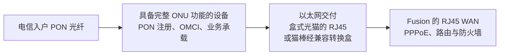

# 武汉电信光猫替换备用计划与证据（2026-11-18）

**当前执行方案：保留运营商光猫，将 Internet 业务桥接给 Omada Fusion 2.5G 普通版，由 Fusion PPPoE 拨号。替换光猫仅作备份研究，未选定、未购买、未实施。** 具体桥接交付和验收见[当前接入方案](wan-bridge-plan.md)。这份研究不增加已确认的 7 台 Omada 订单，不改变另待购 Fusion 的状态、四条 Cat6A 主干或家庭同一 LAN 方案。

## 1. 结论与适用范围

用户已说明地点为武汉、运营商为中国电信、宽带 1,000 Mbps；**XG-PON 是本轮研究假设，尚未由现有光猫状态页或装维确认**。旧项目的上行 30 Mbps 仍只是规划值。原光猫型号、硬件/固件、局端 OLT、认证方式、光纤连接头、实际业务 VLAN、IPTV/固话需求均待记录。1,000 Mbps 套餐本身不能推导 PON 制式。

| 路径 | 本轮判断 | 在本项目中的位置 |
|---|---|---|
| 原运营商光猫桥接 → Fusion | 保留既有 PON 注册与业务适配，实施变量最少 | **当前采用，待实施/验收** |
| 电信认可或装维可登记的非华为 2.5G 光猫 → Fusion | 先确认本线路可换机及可桥接，必要时可作为原光猫的升级替换 | 备用路径优先核实；型号由实际适配决定 |
| 自购中兴 F7015TV3 / F7005TV3 → Fusion | 有国内换机图文、视频和武汉电信问题线索；本户兼容性仍未证实 | **大品牌盒式备用候选**，核省份固件、业务模板和退换条件 |
| VSOL V2901Q-A / V2904QT-Z → Fusion | 官方明确 XG-PON、2.5G 和桥接；未找到本户或相同武汉 OLT 的完整复现 | **规格匹配候选**，不是已验证电信即插即用设备 |
| Nokia XG-040G-MD → Fusion | 新找到 2.5G、XG-PON 的社区资料与 PonWrt 支持；国内定制机、固件/注册差异明显 | **诺基亚品牌进阶备选**，优先验证原厂桥接，不以刷机为前提 |
| PRX126 XG-PON 猫棒 + MC420L → Fusion | 有联通 XG-PON 猫棒实测自述；没有查到该棒与 MC420L、武汉电信、Fusion 全组合的实测 | **实验级备选，暂不买转换盒或猫棒** |

这次修正了此前搜索受限的结论：并非没有诺基亚 XG-PON 设备线索，**XG-040G-MD 值得继续核查**；但它不是此前讨论的 XS-010X-Q，也不是常见的 G-010S-A 猫棒。没有任何候选在本项目完成实机验证。设备品牌、标准符合性、同城他人成功和本户成功是四种不同证据。

## 2. 为什么不能只买普通光转电模块



普通以太网 SFP/SFP+ 模块和 media converter 不能代替 PON ONU 的注册、时隙与业务承载功能。**“with MAC / ONU inside”的完整猫棒与“without MAC”的 PON 光收发模块也不同**；后者需要主机提供 PON MAC，普通 Fusion/MC420L 没有这项能力。[S09]

| 标识 | 应核对的标准/含义 | 对当前假设的意义 |
|---|---|---|
| XG-PON（通常指 XG-PON1） | ITU-T G.987 系列，约下行 10G / 上行 2.5G | 本轮目标；共享 PON 速率不等于用户套餐速率 |
| XGS-PON | ITU-T G.9807.1，对称 10G | 仅标 XGS-PON 不足以证明能接纯 XG-PON；需明确双模支持 |
| GPON / XPON 双模猫棒 | 常见 GPON 或 GPON/EPON；“XPON”写法不统一 | 2.5G 电接口不意味着支持 XG-PON |
| 10G EPON | IEEE 802.3av 系列 | 不等于 XG-PON；必须确认光猫相应模式 |
| 2.5G RJ45 / 2500BASE-X / HSGMII / 10GBASE-R | 主机侧不同物理接口/速率模式 | 不能因都写“2.5G”或都能插进 SFP 插槽而认定兼容 |

标准索引见 ITU [G.987.2][S07] 与 [G.9807.1][S08]。最终仍以设备完整 SKU、固件支持的模式及本线路实际注册结果为准。

## 3. 盒式替换设备

### 3.1 大品牌优先：中兴 F7015TV3 / F7005TV3

| 项目 | 已取得的证据 | 尚未确认 |
|---|---|---|
| F7015TV3 | 2024 年图文记录称支持 XG-PON / 10G EPON 手动切换、1×2.5G + 3×GE、电话口，无 Wi-Fi；展示桥接给软路由及 IPTV 配置 [S10] | 本次未取得匹配所有地区硬件版的中兴官方产品规格；不能跨 V1/V2/V3 或型号后缀套用 |
| F7005TV3 | 同一图文称相较 F7015TV3 少电话口；OpenRouter 有该型号配置/测速视频 [V04] | 若需要固话，不能按同价位随意替换；实际端口和固件须看铭牌/后台 |
| 电信适配 | 武汉电信 F7005TV3 有“OLT 成功、ITMS 40%、不能上网”的已解决标题 [L01] | 武汉帖正文被站点拦截，**未核实具体解决步骤**；不能认定武汉统一无需 SN/MAC 绑定 |
| 更换实例 | 江门移动用户换 F7015TV3，明确提及装维解绑后才能用 [S11]；山东济宁联通图文已读 [S10] | 移动、联通经验不能证明武汉电信的模板、ITMS 和 IPTV 会自动恢复 |

**定位：最值得向当地装维/提供本地适配的卖家核实的大品牌备用方向。** 与只看芯片或接口相比，完整地区版、原厂固件的桥接能力、可登记/可下发业务更重要。本轮未核实在售新机库存、正规保修和当前成交价；图文中的 ¥110、¥160，或视频标题中的 ¥90 都是旧记录，不作为报价。国内定制设备即使自行购买，仍可能需要运营商登记，不能把“自购”理解为脱离 PON 管理。

### 3.2 官方规格明确：VSOL

VSOL 官网说明公司为广州 V-Solution，2007 年成立，主营 PON 等接入产品，为福建星网锐捷控股子公司。[S06] 这些资料支持“有明确主体和产品线的接入设备厂商”，**不构成故障率、售后或武汉兼容性的证明**。

| 型号 | 2026-11-18 官方页面确认 | 购买/适配边界 |
|---|---|---|
| **V2901Q-A** [S02] | XG-PON / XGS-PON 可选；列 G.987 和 G.9807.1；1×2.5GbE；Bridge/Router；SC/UPC | 要明确买 XG-PON 对应版本，不能把页面“可选”理解为每台自动双模；核 LOID/SN/OMCI 可配置范围、地区固件 |
| **V2904QT-Z** [S03] | XG(S)-PON 自动适配；1×2.5GbE + 3×GE + CATV；Bridge；SC/APC | 端口更多、光头不同；CATV 不是电信 IPTV 的替代接口，不因多 CATV 就能恢复 IPTV |

如果追求小盒子、只做 Internet 桥接，V2901Q-A 的结构更直接；如果原入户跳线需要 SC/APC，须把接头匹配成本一起核对。**APC/UPC 不能直接硬对接**，应使用端面分别匹配两端设备的正确跳线。两款均不用 MC420L。尚未找到足以证明这两款在用户同一武汉电信 OLT 上成功注册、PPPoE 和 IPv6/IPTV 都正常的公开案例，因此保留为规格候选，不作直接下单建议。

### 3.3 国外品牌线索：Nokia XG-040G-MD

这次查到的社区仓库明确描述 **Nokia XG-040G-MD、Airoha AN7581、XG-PON、1×2.5G + 3×GE**；PonWrt 上游支持列表也包含该机型。[S12][S13] B 站视频简介直接提到购买 XG-040G-MD 做光猫并刷 OpenWrt。[V07] **北京移动的换机帖子正文与第一页回复已读**：作者使用二手移动版 XG-040G-MD，处理管理权限、地区及身份参数后配置 2.5G 口桥接，并自述在北京朝阳一次成功；同帖另一位用户虽显示光路认证成功，仍遇到 PPPoE 691 鉴权失败。[S22] 这是有过程的成功自述和失败反馈，不是武汉电信复现，也未提供受控长期测试。

可保留的路线是：**核真机型号和地区固件 → 先验证原厂 Internet 桥接 → 接 Fusion 拨号**。不要因为社区能刷 OpenWrt，就将 PON、路由、代理全部合并到它；这会改变当前 Fusion 主网关与 J3455 的分工。社区分支还记录 PON 收包异常恢复、硬件卸载和固件适配问题，缺少本项目长期稳定性证据。[S12]

本轮没有取得该型号对应的官方公开规格页，也没有核实正规零售、保修、武汉电信登记支持。**诺基亚品牌不等于海外零售新机**；二手/运营商定制机应核来源、硬件修订、原厂分区与恢复能力。驱动菜单支持多种 PON 模式不代表这台机器的光学硬件支持全部模式。与其他 Nokia 的 XG/XS/G 前缀型号不能混买。

## 4. 猫棒与 MC420L：保留，但降为实验路线

### 4.1 找到了真正的 XG-PON 猫棒使用自述

OpenRouter 的 [2025-09-30 视频][V01] 简介明确写：猫棒未看到品牌，采用 **PRX126**，作者实测支持国内 XG-PON、不支持 GPON；线路是联通千兆，配小米 BE10000 Pro 与水星 SE106 Pro。它提供了“完整 XG-PON 猫棒在国内线路使用”的证据线索，但：

- **PRX126 是芯片名，不是可据以锁定的完整商品型号。** 不推荐随便购买同芯片商品。
- 作者简介提示第三方固件兼容性问题和升级后可能不能拨号；其链接的国内固件 fork 已于 **2026-08-13 归档，README 明确停止维护**。[S14]
- 视频中的路由器/交换机不是 Fusion/MC420L；引用该案例不把小米设备纳入本项目采购。
- 本轮核验了视频标题、作者、日期、简介与固件仓库，**没有逐帧观看或自行复现实测**。

海外常见 WAS-110 和 8311 资料主要按 XGS-PON 整理。[S15] 不能把视频中的无品牌 PRX126 棒直接等同于任意 WAS-110，也不能把 XGS-PON 固件直接刷入不同国产硬件。猫棒对应板卡、光学模块、原厂/社区固件版本、恢复方式和注册能力都要锁定。

### 4.2 MC420L 版本与接口约束

| 项目 | 官方可确认内容 | 尚需整机验证 |
|---|---|---|
| Fusion 普通版 [S01] | 1×2.5G RJ45 WAN + 4×2.5G RJ45 LAN/WAN；支持 PPPoE；无 SFP/SFP+ | 不能直接插猫棒；实际 PPPoE 吞吐与所开功能需验收 |
| MC420L V2.0 [S04] | FAQ 明确有拨码；默认 1G/10G，拨到 2.5G；2.5G 模式写 IEEE 802.3bz、2500BASE-X | 不等于承诺所有 HSGMII/2.5G ONU 可用；确认发货版及具体猫棒 |
| MC420L V3 [S05] | 页面明确 1G/10G 与 2.5G 光口模式切换，RJ45 多速率；本次美国页仍标 Coming Soon | 不能按 V3 页面描述购买未标版的 Amazon 商品 |
| MC420L V1 | 本轮页面有版本入口，早期资料未明确 2.5G 光口支持 | 不因 RJ45 可协商 2.5G 就推导 SFP+ 支持 2500BASE-X；采购前核对应手册 |

预期链路只能写为条件方案：

```text
入户 XG-PON 光纤
  → 完整 XG-PON ONU 猫棒（精确硬件/固件待选）
  → 匹配主机侧模式的 MC420L（实际硬件版待核）
  → 2.5G RJ45 → Fusion WAN → PPPoE
```

如果猫棒主机侧为 10GBASE-R、MC420L 电口以 2.5G 连接 Fusion，还要验证混合速率下的缓存、突发、流控和丢包；接口规格不能替代端到端测试。转换盒的模块供电上限、猫棒功耗/温度、冷启动和重新注册都要核实。用户给出的 [Amazon MC420L 链接](https://www.amazon.com/Converter-MC420L-Hot-Swappable-Indicators-Extension/dp/B0DLM8Q77G)只保留为原商品入口，本次未确认卖家发货硬件版、库存或价格。

**当前不拿中央 ES206 的空闲 SFP+ 口试插猫棒。** 它现在是家庭 LAN 交换机；将 WAN ONU 接入同一交换域会改变隔离和故障边界。复用它必须另做严格 WAN/LAN 隔离设计与验证，不属于本次保留同一家庭 LAN 的执行方案。独立转换盒更便于试验隔离，但仍需增加电源和散热，未必比小盒式光猫节省空间。

## 5. 应排除的“看起来能用”的设备

| 设备/类别 | 本轮依据 | 处理 |
|---|---|---|
| Nokia G-010S-A 猫棒 | Hack GPON 将其列在 GPON；2.5G 主机接口经验不改变 PON 制式 [S16] | 在 XG-PON 假设下排除 |
| Nokia XS-010X-Q | 社区列入 XGS-PON，不能视为 XG-040G-MD 同类 [S17] | 未取得双模证据前排除 |
| Adtran SDX 621 | 社区引用数据表为 XGS-PON，电口可 100M/1/2.5/5/10G [S18] | 电口很合适，PON 制式证据不匹配 |
| Genexis FiberTwist XGS2110-2.5G | 数据表摘录为 G.9807.1 Annex B / XGS-PON [S19] | 不能因 2.5G 电口而推荐给纯 XG-PON |
| Zyxel PM7300-T0 | 社区 XGS-PON 设备目录 [S20] | 仅作海外 XGS-PON 对照，不是武汉 XG-PON 已验证候选 |
| 普通 10G SFP+ LR/SR、PON OLT 模块、without-MAC ONU 光模块 | 不具备本链路所需的完整 ONU 行为 [S09] | 不采购作为光猫替代 |

这些是**具体型号证据的筛选**，不代表相关品牌所有产品都不支持 XG-PON。若日后确认本户实际为 XGS-PON，应重新打开 XGS-PON 候选清单，而不是继续套用本报告的排除项。

## 6. 案例和视频备查

### 6.1 图文/项目：读到了什么、能证明什么

| 来源 | 线路/设备与内容 | 证据局限 |
|---|---|---|
| [脑吧评测室，2024-07-22][S10] | 山东济宁联通 **10G EPON**，F7015TV3；已读正文，涵盖模式切换、LOID、ITMS、桥接、IPTV/组播及作者 1,200 Mbps 测速自述 | 是成功经验，**不是 XG-PON 或武汉案例**；价格/功耗是旧文自述，未独立测量；不照抄其“清空配置”等操作 |
| [nickwingg，2024-03-28][S11] | 江门移动千兆，电信版 F7015TV3；作者称商家处理参数后还需装维解绑 | 提醒 OLT/业务绑定影响结果；不代表武汉也采用该认证流程 |
| [XG2010G 更换后回退记录][S21] | 作者称原组合下载约 2,300 Mbps；换 BrightSpeed/Gemtek XG2010G + OpenWrt 后下载异常，最终切回原设备 | 不是严格受控测试；不能将评论里的“模板限速/硬件卸载”猜测当故障定论；说明新硬件/刷机不保证性能 |
| [PonWrt 上游][S13]、[XG-040G-MD 社区分支][S12] | 可核对支持的精确设备、恢复原厂校准/身份数据要求、已记录的软件问题 | 上游支持列表不等于武汉认证或长期桥接验证 |
| [boringcat，北京移动 XG-040G-MD 换机，2025-12-29][S22] | 正文与第一页回复已读；二手移动版、地区/身份参数配置、2.5G口桥接，作者自述北京朝阳一次成功；另一回复报告光路认证成功但 PPPoE 691 | 北京移动经验不能证明武汉电信适配；不复制公共默认密码、身份参数或“删除管理/IPTV连接”的建议，也不能据作者原机为GPON推定本户制式 |
| [武汉电信 F7005TV3 故障帖][L01] | 搜索标题标“已解决”；摘要写 OLT 成功、ITMS 40% 且拨号/桥接失败 | 原站 567 拦截，只读到检索摘要，**未知解决方法，不判为已核实成功案例** |
| [武汉电信 B866-S1 讨论][L02] | 提供本地换机讨论的继续核查入口 | 正文受阻；不升级为本方案实施依据，不据此新增 FTTR 采购 |

### 6.2 可直接打开的视频

以下 **8 条均核验了 B 站页面元数据（标题、作者、发布日期、时长、简介）**，未完整观看视频，也未核验所有评论或每一帧测速。标题中的价格和增速是原作者表述，不是本项目报价或承诺。

| 优先级 | 视频与作者 | 发布时间 / 时长 | 建议关注点 |
|---|---|---|---|
| 先看本地限制 | [且玩且珍惜湖北电信自购光猫已经不能下发了][V02]，连收破烂都失业了 | 2025-09-16 / 2:10 | 是湖北限制的个人报告；**不能仅凭标题推定全省当前禁换**，须问本线路装维 |
| 盒式光猫 | [手把手教你换中兴光猫 F7015TV3，网速提升20%！][V03]，超人梅有机 | 2024-04-29 / 2:24 | 认识设备与更换流程；增速取决于端口瓶颈、套餐配置及全链路 |
| 盒式光猫 | [90元2.5G小光猫，中兴F7005TV3 设置教程 开telnet 测速][V04]，OpenRouter | 2024-08-04 / 7:16 | 核型号/参数及桥接差异；不照抄身份值或无条件改地区 |
| XG-PON 猫棒 | [联通宽带换万兆猫棒测速，PRX126][V01]，OpenRouter | 2025-09-30 / 11:43 | 简介明确 XG-PON、联通、无明确品牌和第三方固件问题；不是 MC420L 组合 |
| Nokia 进阶 | [20来块的2.5G光猫刷OpenWrt（上）][V07]，数码罗记 | 2025-10-01 / 7:04 | 简介明确 XG-040G-MD；刷机/改内存演示不等于本户业务适配，当前不需改硬件 |
| 其他中兴线索 | [中兴G7615拆机][V05]，OpenRouter | 2023-12-13 / 2:20 | 认识硬件；G7615 与 G7615V2、F7015TV3 不能混用规格/固件 |
| 制式/固件线索 | [中兴F7607P/F4607P，电信版，可切换XEPON/XGPON][V06]，吖毅哥 | 2023-02-14 / 3:01 | 简介为公司双宽带聚合升级场景；不证明武汉新版固件可按同样步骤操作 |
| 基础准备 | [如何自己换2.5G光猫，获取LOID][V08]，南通弱电全屋WiFi | 2026-03-27 / 2:02 | 参数准备；LOID 不一定是本户唯一认证项，1G/2.5G 电口与 PON 制式要分开看 |

## 7. 备用方案启动条件、采购问题与回退

### 7.1 启动顺序

1. **先把原光猫桥接主案交付**，保存可工作的配置、接线与测速基线；用有线终端测量，不用 Wi-Fi 测速判定光猫瓶颈。
2. 若原光猫只有 1G 电口且确有超过千兆的交付需求，先问电信是否能提供非华为 2.5G 设备并保持桥接。1G 口常见 TCP 测速约 930–950 Mbps；换 2.5G 可消除该端口限制，但不保证套餐额外放量。
3. 若要自购，先选择**能提供本地同 OLT/同固件案例并明确退换条件的完整盒式设备**。大品牌偏好先核中兴；Nokia XG-040G-MD 为进阶分支；VSOL 以官方规格为起点单独核认证。
4. 只有确实需要猫棒形态且能接受额外调试时，再锁定精确猫棒、MC420L 版本、主机侧模式与固件组合。不会因有 SFP+ 空位就启用。
5. 本轮所有实际设备/线路测试均为 `not_run`。不购买、不刷机、不登录或修改家中网络。

### 7.2 可发给装维/卖家的核对文本

> 使用地点武汉，中国电信，1,000 Mbps；目前按 XG-PON 研究，但购买前会提供原光猫型号、PON 状态及 OLT 信息。需要 ONU 完成电信注册，Internet 桥接经 2.5G RJ45 接 Omada Fusion 2.5G，由 Fusion PPPoE 拨号。请确认完整型号、硬件版、地区/固件版、XG-PON（G.987）支持、是否可在我这条线路登记及正常下发业务、LOID/SN/PLOAM 等实际所需认证、桥接与 VLAN 处理、IPv6 PD、IPTV/固话兼容范围、恢复方法、同线路成功证据、保修与无法注册时退换条件。猫棒另请提供明确品牌/SKU、主机侧协议及速率、供电/温度指标，以及与指定 MC420L 硬件版的实测。仅写“电信通用”“万兆”“XPON”不够。

该文本仅作为用户以后沟通的模板，本轮没有向卖家或运营商发送消息。不要把本户 PPPoE 密码、LOID/PLOAM、设备 SN/MAC、原配置/校准备份提交到公开仓库；参数通过私人方式与授权装维核对。

### 7.3 分层验收与失败定位

| 层级 | 通过证据 | 失败时先看 |
|---|---|---|
| 光学/制式 | 接头端面匹配；光功率在具体模块范围内；没有 LOS | 跳线、接头、光衰、PON 制式；不盲目增加激光功率 |
| PON 注册 | ONU 运行态/OLT 注册正常（例如 O5）；持续稳定 | SN/LOID/PLOAM、设备登记、OLT 模板/OMCI，而非先改 PPPoE |
| 业务承载 | Internet VLAN/GEM 映射正确；PPPoE discovery 可达；必要的 ITMS/业务配置完成 | 仅亮 PON 或 O5 不代表互联网已通；区分 ITMS 流程与数据面 |
| 以太网 | 与 Fusion 的 WAN 协商预期速率，全双工、无异常错误/反复协商 | 线缆、猫棒主机模式、MC420L 硬件版、供电/温度 |
| PPPoE/双栈 | Fusion 建立 PPPoE；IPv4、IPv6 PD、DNS 和终端访问正常 | 账号、旧会话、VLAN 重复标记、MTU、IPv6配置；不猜本地 VLAN 值 |
| 附属业务 | 若使用 IPTV/固话，直播/回看/通话、组播与业务隔离均正常 | 独立业务 VLAN、IGMP、SIP/ACS；不把 CATV 当 IPTV |
| 持续运行 | 对照原光猫做并发、重拨、冷启动、断电恢复及至少 72 小时观察 | 建议观察期不是厂商保证；记录掉线、丢包、延迟、温度和固件，不只留一次测速 |

实验失败即恢复原光猫、原跳线和 Fusion 已验证配置；若运营商变更了 SN/设备绑定，需要装维恢复登记，不能承诺“插回去一定立刻好”。原光猫保持可恢复，换机前不要恢复出厂或删掉 IPTV/语音/管理配置。不同 ONU 不同时冒用同一条线路的注册身份，不用无源分光器把两个测试设备同时接上试运气。

## 8. 资料状态与后续补证

本轮访问日期 **2026-11-18（Asia/Shanghai）**。厂商页面、标准索引、已读正文、视频元数据和未能读到正文的检索线索分别记录在[来源清单](research/ont-replacement-20261118/sources.json)。搜索摘要和视频标题没有升级成官方政策或实测结论；未归档他人的完整文章/视频/固件。

最需要补齐的三项：**原光猫/PON/OLT 的实际信息；武汉电信本线路目前的换机/业务下发条件；精确候选 SKU 与 Fusion 的实际桥接验收**。在这些完成前，本报告保持备用，不改变当前采购表、订单或现场网络。

## 9. 来源索引

- [S01] Omada. [Fusion 2.5G 官方产品规格](https://www.omadanetworks.com/us/business-networking/omada-fusion-gateway-series/fusion-2.5g/).
- [S02] VSOL. [V2901Q-A](https://www.vsolcn.com/product/10g-pon-2-5gbe-onu-v2901q-a).
- [S03] VSOL. [V2904QT-Z](https://www.vsolcn.com/product/10g-pon-2-5gbe-3ge-catv-sfu-onu-v2904qt-z).
- [S04] Omada Support. [SFP / Media Converter FAQ](https://support.omadanetworks.com/us/document/12930/).
- [S05] Omada. [MC420L 产品及版本入口](https://www.omadanetworks.com/us/business-networking/omada-accessory-media-converter/mc420l/).
- [S06] VSOL. [About](https://www.vsolcn.com/about).
- [S07] ITU-T. [G.987.2](https://www.itu.int/rec/T-REC-G.987.2/en).
- [S08] ITU-T. [G.9807.1](https://www.itu.int/rec/T-REC-G.9807.1/en).
- [S09] Hack GPON. [SFP with PON MAC and w/o PON MAC](https://hack-gpon.org/ont-wo-mac/).
- [S10] 脑吧评测室. [中兴 F7015TV3 更换小记](https://news.qq.com/rain/a/20240722A0ABVR00), 2024-07-22.
- [S11] nickwingg. [更换 F7015TV3 记录](https://www.bilibili.com/opus/913936385956642822), 2024-03-28.
- [S12] include-H. [XG-040G-MD 社区构建与已知问题](https://github.com/include-H/XG-040G-MD).
- [S13] pbs05. [PonWrt 上游与设备列表](https://github.com/pbs05/ponwrt).
- [S14] xiao-k233. [8311 国内 fork：已归档/停止维护](https://github.com/xiao-k233/8311-was-110-firmware-builder).
- [S15] PON dot WIKI. [WAS-110](https://pon.wiki/xgs-pon/ont/bfw-solutions/was-110/).
- [S16] Hack GPON. [Nokia G-010S-A](https://hack-gpon.org/ont-nokia-g-010s-a/).
- [S17] Hack GPON. [Nokia XS-010X-Q](https://hack-gpon.org/xgs/ont-nokia-xs-010x-q/).
- [S18] Hack GPON. [Adtran SDX 621](https://hack-gpon.org/xgs/ont-adtran-sdx-621/).
- [S19] Hack GPON. [Genexis FiberTwist XGS2110-2.5G](https://hack-gpon.org/xgs/ont-genexis-ft-xgs2110-2.5g/).
- [S20] Hack GPON. [Zyxel PM7300-T0](https://hack-gpon.org/xgs/ont-zyxel-pm7300-t0/).
- [S21] 社区作者. [XG2010G 使用后回退记录](https://post.smzdm.com/talk/p/agg4v543/), 页面月日 08-29，检索索引为 2026 年。
- [S22] boringcat. [北京移动自行换2.5G光猫 XG-040G-MD](https://www.right.com.cn/forum/thread-8459603-1-1.html), 2025-12-29；正文及第一页回复已读。
- [L01] Chiphell. [武汉电信 F7005TV3：OLT 认证成功但无法上网](https://www.chiphell.com/forum.php?mobile=no&mod=viewthread&ordertype=1&tid=2640075)，仅检索摘要，正文受阻。
- [L02] 恩山. [武汉电信 B866-S1 讨论](https://www.right.com.cn/FORUM/thread-8401752-5-1.html)，仅检索摘要，正文受阻。

[S01]: https://www.omadanetworks.com/us/business-networking/omada-fusion-gateway-series/fusion-2.5g/
[S02]: https://www.vsolcn.com/product/10g-pon-2-5gbe-onu-v2901q-a
[S03]: https://www.vsolcn.com/product/10g-pon-2-5gbe-3ge-catv-sfu-onu-v2904qt-z
[S04]: https://support.omadanetworks.com/us/document/12930/
[S05]: https://www.omadanetworks.com/us/business-networking/omada-accessory-media-converter/mc420l/
[S06]: https://www.vsolcn.com/about
[S07]: https://www.itu.int/rec/T-REC-G.987.2/en
[S08]: https://www.itu.int/rec/T-REC-G.9807.1/en
[S09]: https://hack-gpon.org/ont-wo-mac/
[S10]: https://news.qq.com/rain/a/20240722A0ABVR00
[S11]: https://www.bilibili.com/opus/913936385956642822
[S12]: https://github.com/include-H/XG-040G-MD
[S13]: https://github.com/pbs05/ponwrt
[S14]: https://github.com/xiao-k233/8311-was-110-firmware-builder
[S15]: https://pon.wiki/xgs-pon/ont/bfw-solutions/was-110/
[S16]: https://hack-gpon.org/ont-nokia-g-010s-a/
[S17]: https://hack-gpon.org/xgs/ont-nokia-xs-010x-q/
[S18]: https://hack-gpon.org/xgs/ont-adtran-sdx-621/
[S19]: https://hack-gpon.org/xgs/ont-genexis-ft-xgs2110-2.5g/
[S20]: https://hack-gpon.org/xgs/ont-zyxel-pm7300-t0/
[S21]: https://post.smzdm.com/talk/p/agg4v543/
[S22]: https://www.right.com.cn/forum/thread-8459603-1-1.html
[L01]: https://www.chiphell.com/forum.php?mobile=no&mod=viewthread&ordertype=1&tid=2640075
[L02]: https://www.right.com.cn/FORUM/thread-8401752-5-1.html
[V01]: https://www.bilibili.com/video/BV1c2nrzREPi/
[V02]: https://www.bilibili.com/video/BV1x1p2zmEK2/
[V03]: https://www.bilibili.com/video/BV1St421c7bj/
[V04]: https://www.bilibili.com/video/BV1vb421J7RQ/
[V05]: https://www.bilibili.com/video/BV1Uu4y1u7HE/
[V06]: https://www.bilibili.com/video/BV1vv4y1s7KZ/
[V07]: https://www.bilibili.com/video/BV1zrHnzhEGZ/
[V08]: https://www.bilibili.com/video/BV1LKXtBqEuf/
