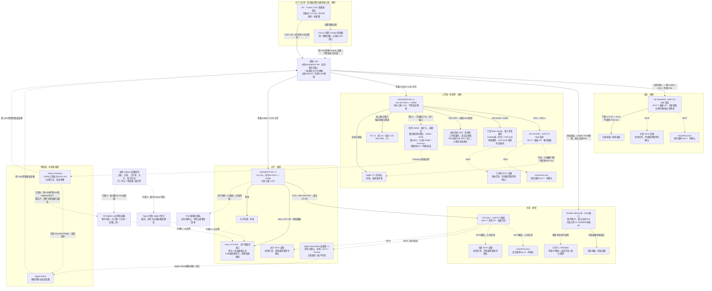
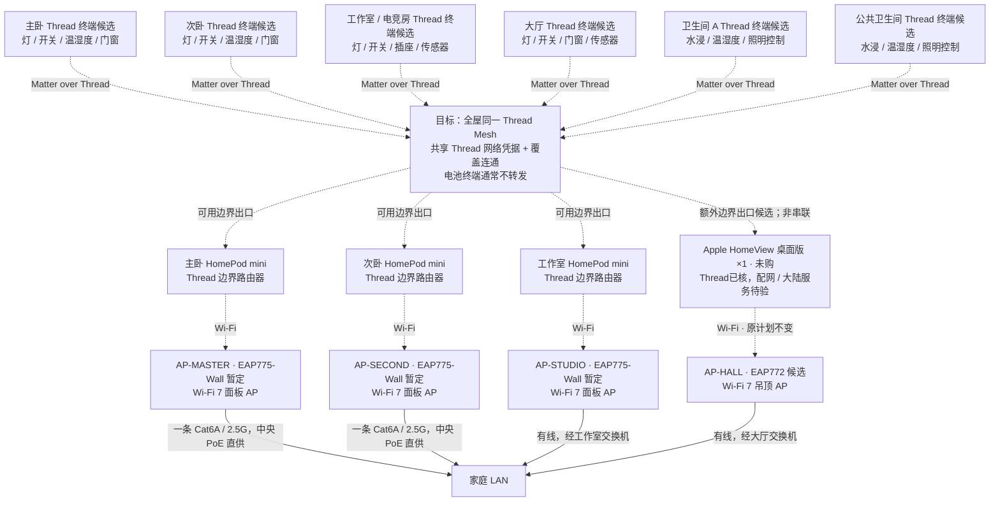

# 全屋智能家居接入拓扑 v1.2

> **2026-10-20 当前网络方案：3A三频，暂定定稿。** 普通Fusion ×1、中央及大厅ES206XPP-M2各1、电竞房ES210XPP-M2 ×1、主卧/电竞房EAP775-Wall ×2、大厅吊顶EAP772 ×1。双频725×2+723×1保留预算备选。次卧只施工Cat6A/RJ45，已有TL-7DR3630可选有线复用。四条2.5G主干、两房间设备箱、Mac/NAS本地双10G与交换机PoE直供保持。设备未购/未部署。
>
> 当前型号/数量/链接/预算见[采购BOM](purchase-bom.md)与[方案比较](network-cost-optimization.md)，商品链接已于2026-10-20逐项核对；[核对记录](network-link-audit.md)。下方带旧日期的三面板一吊顶、次卧AP或中央ES210建议仅用于追溯。

较早版本说明与核验日期

> **2026-10-19 承载层 AP 更新**：主卧/电竞房 EAP775-Wall ×2 + 大厅吊顶 EAP772 ×1，三频支持 6GHz；次卧无新 AP，Cat6A/RJ45 及已有 TL-7DR3630 可选复用。下方旧四 AP / 双频网络承载数量为历史说明；协议关系与 HA/Aqara/Thread 规划不因 AP 换型改变。[现行物理拓扑](network-topology.md)优先，6GHz 在大陆能否启用仍待合规核验。

> **2026-10-19 网络承载最新覆盖**：首期主卧、电竞房面板及大厅吊顶共三台 Omada AP，次卧暂不购 AP；原图的 `AP-SECOND` 为历史规划，不是现行设备。次卧由大厅 AP 覆盖并实测，必要时复用已有 TL-7DR3630 有线 AP（独立市电及管理，非 Omada）；智能灯、传感器和规划的 Thread 终端不因此取消。次卧 Cat6A 端接 RJ45 墙口；[当前物理图](network-topology.md)为准。

> **2026-10-19 网络承载层更新**：[第三版Omada成本方案](network-cost-optimization.md)以交换机/PoE网关直接给四台AP供电，不使用独立供电器；3A中央ES206XPP-M2为主案，3B Fusion 2.5G PoE为互斥备选。智能家居协议层、J3455上的HAOS、Aqara为主及Thread/Zigbee路径不因这次交换机优化而改变。

> **2026-10-16 当前采购/装修范围**：[基础网络采购与装修交底 Excel](../outputs/network-renovation-20261016/基础网络采购与装修交底.xlsx)覆盖网络硬件、材料、逐条布线、端口/PoE、配置和分阶段验收。高速NAS、UPS搬入后再考虑，不作为入住前必购；NAS要求自带10G SFP+，不买网卡，介质待实物确认。Mac走原生10G RJ45；Apple TV 4K旧款、米家激光投影仪、树莓派均已有，不重复购买。壁挂屏先试已有杂牌安卓，不合适再选二手iPad mini/便宜iPad，暂未定。J3455已确认PCIe 2.0 x1，TX201为兼容性待验的首选候选。下方较早的固定DAC与UPS入住前要求由本条更新；不改四主干/两房间箱/三面板一吊顶。

> **更新日期**：2026-10-15
>
> **状态**：设计规划，不代表已采购、已安装或已验收。图中的设备类别、数量、协议和位置均须按最终型号及现场点位复核。
>
> **采购与介质（2026-10-15）**：[集中采购BOM](purchase-bom.md)。NAS确定靠近工作室交换机，采用兼容10G SFP+ DAC短线，整机入住后再选；自带SFP+，介质/长度待核；四主干仍为Cat6A，不每房另埋光纤，保留可抽换管路。
>
> **关联文档**：[家庭基础设施登记与实施台账](home-infrastructure-register.md)、[家庭网络拓扑](network-topology.md)、[设备选型清单](device-selection-list.md)

## 1. 接入原则

- 全屋以 Aqara/绿米为主要选型方向，目标接入 Apple Home 和 Home Assistant（HA），**不新增小米/米家、华为设备；已有米家激光投影仪继续复用**；不是所有 Aqara 产品都使用同一种协议，也不是所有型号都能完整接入两个平台。
- 住宅约 **100㎡**、一层矩形，已收到[装修布置图与尺寸标注图](floorplan-and-network-locations.md)；弱电箱在**入户门左侧**，核心网络规划在该箱或附近通风核心柜。完整电气点位/管线路径、墙材、柜体与覆盖仍须现场核验，截图不是施工放线依据。宽带计划 **1000Mbps 下载 / 30Mbps 上传**，局域网/本地自动化能力不由 WAN 标称速度保证。
- 网络拓扑 **v1.2** 的基线已确定：四区域各一条Cat6A星型回中央；主卧Wall AP、次卧仅RJ45预留，电竞房/大厅各一台交换机。电竞房单台 **ES210XPP-M2**，不增加交换机；10G RJ45给Mac、10G SFP+给NAS。两台EAP775-Wall均有1×2.5G+3×1G数据下联，工作室Apple TV/投影可改接其中两个1G口；J3455、Mac、NAS和PC保持ES210直连。不使用AP PoE Out。
- AP 形态已确认：主卧、工作室各暂定一台 **EAP775-Wall 三频 Wi-Fi 7 面板 AP**，大厅候选一台 **EAP772 Wi-Fi 7 吊顶（吸顶）AP**，共 2+1 台，次卧AP暂不购、2.5G 上联。面板装箱外墙面，大厅 AP 装顶面可见位置，不藏吊顶内部；地区频段/发货版本/供电验收见 [BOM](device-selection-list.md#64-按最新拓扑更新的候选购买清单)。三房mini优先推荐mini 2，代际待确认；大厅Apple HomeView已发布，Wi-Fi接法不变。两款官方列Wi-Fi 6E，但大陆6GHz不计保证；Thread仍独立于Wi-Fi，不能把美版频段规格当本户可用性。
- Wi-Fi 终端接 AP；Zigbee 设备接 Zigbee 网关/协调器；Matter over Thread 设备通过 Thread 网络和边界路由器进入家庭 LAN。**Matter 是应用层互通标准，Thread 与 Wi-Fi 才是这里的网络接入方式。**
- Apple Home与HA属于控制层，不是串在交换机、AP与终端之间的网络转发设备。**HomeView非壁挂／桌面版×1已确认**，支持Wi-Fi/Thread及HomeKit/Matter，经大厅AP Wi-Fi接入，使用随箱电源；大陆服务/账户/配套设备和配网待验。壁挂另用平板电脑或iPad，具体型号/数量/点位/供电与网络方式待选，作为交互终端记录，不替代HA主机、家庭中枢或Thread边界路由器；不先增加网口/PoE或物理图节点。详见[Apple官方核验](apple-home-devices-2026.md)。
- 用户同时需要 **HomePod/Siri 家居控制**与**各房间同 Mac 本地模型对话**，两类需求都保留，具体语音终端/接入方案未定。不能默认 HomePod 的麦克风能作为任意本地模型前端，HomeView/Siri AI也不等于Mac本地模型，官网未承诺开放原始麦克风流。
- 已确认 **Mac 留工作室；未来高速 NAS 与现有 J3455 规划在工作室箱外通风存储位，核心网络设备仍放弱电箱附近机柜**，不把服务器塞入密闭网络小箱。J3455 为现有 16GB / 10TB / 1GbE / Proxmox 主机，已运行独立黑群晖 VM 和代理/转发容器，拟迁入工作室而非已搬迁；2026-10-15继续计划新增独立 HAOS VM，尚未部署；主路由暂定Fusion 2.5G普通版，Omada由其内置控制器承载。未来高速 NAS 接电竞房交换机的 10G SFP+，需兼容SFP+接口/网卡与近距离DAC短线；已确定靠近交换机摆放，整机/长度待选，未采购。

## 2. Wi-Fi、Zigbee、有线设备与控制层

本图表示逻辑接入关系；主卧AP由中央交换机有线PoE直连，次卧只预留RJ45墙口，电竞房/大厅AP经各自房间交换机接入LAN。虚线表示无线连接、规划候选或控制/集成关系，边上文字区分。三房各预留一台HomePod mini（优先推荐mini 2，代际待确认），大厅已确认一台Apple HomeView桌面版（非壁挂，未购/未部署）。壁挂平板/iPad待选，尚未确定点位及网络方式，不按占位节点施工。三处交换机的PoE数量与瓦数核算见[当前网络拓扑](network-topology.md#当前端口与施工口径)。

### 2.1 各协议的实际接法

| 设备类别 | 接入路径 | 必须核验的边界 |
|---|---|---|
| Aqara Zigbee 灯、开关、传感器、窗帘等 | Zigbee → Aqara 网关 → LAN；或改为 Zigbee → HA 协调器 → HA | **单台设备不能同时配对两个独立 Zigbee 网络**。选择网关路径时，核对 HomeKit/Matter 桥接及 HA 集成实际暴露的实体；选择 HA 路径时，核对具体设备支持与功能差异。 |
| Matter over Wi-Fi 设备 | 所在区域 AP → LAN → 支持的 Matter 控制器 | 按支持情况使用 Matter 多管理员接入 Apple Home 和 HA；共享控制不等于任何品牌私有功能都可用。 |
| 非 Matter 的 Wi-Fi 设备 | 所在区域 AP → LAN → 该型号支持的集成 | 核对 HomeKit/HA 支持、本地或云端依赖、离线行为；Wi-Fi 本身不是兼容性保证。 |
| 普通灯具 + 智能开关/继电器 | 市电 → 智能开关/继电器 → 普通灯；开关的智能控制走 Zigbee、Thread 或 Wi-Fi | 灯本身不接网线。零火线、负载、调光、盒深及防潮要求由电气设计确认，交合格电工施工。 |
| PoE摄像头 | 从有余量的中央/大厅PoE交换机拉独立支线 → 摄像头；录像经LAN到NVR/NAS/录像服务 | 两卧室不设独立交换机；电竞房完整直连时无备用，Apple TV/投影改接AP后最多释放两个交换机口，但尚未分配给摄像头。当前不使用Wall AP下游PoE；核逐口/总功率、布线、RTSP/ONVIF、本地录像与HA集成，不自动等于Apple Home/HKSV支持。 |

Zigbee 的覆盖目标是**全屋六个区域**，不是只覆盖大厅；网关与中继能力依实际设备确定，电池传感器通常不承担 Zigbee 路由扩展。两卫生间的 Wi-Fi 设备由覆盖实测合适的邻近 AP 服务，不预先锁定某一台 AP，也不默认增加卫生间 AP。

**协调器接入澄清（2026-10-15）**：本项目预留固定路径 `大厅箱外网关／协调器 → HALL-IOT-GW 墙面口 → 大厅 ES206XPP-M2 → TRUNK-HALL → LAN → 电竞房 J3455 上的 HA`，不默认让HA通过Proxmox USB直通，也不占电竞房已满的交换机口。若使用Aqara有线网关，接法为`Zigbee设备 → Aqara网关 → LAN → HA支持的集成`；不能把它当作任意ZHA/Zigbee2MQTT可直接控制的通用协调器。若选择HA直接管理Zigbee，则使用兼容的以太网协调器，经LAN由ZHA或Zigbee2MQTT其中一个管理同一协调器；两条路径对同一设备二选一，型号与软件路径尚未选定，不额外默认采购两台。网关放箱外、按射频覆盖定位，只有最终型号支持PoE才从大厅交换机供电，否则使用墙口旁的普通插座；其负载需在确定型号后加入大厅120W预算。使用DHCP保留地址、受控LAN访问，并将所选网关与沿途交换机纳入UPS与重连测试；百兆以太网通常足够Zigbee控制，不需要协调器本身2.5G。

Thread走受支持的HomePod mini等Thread边界路由器接入LAN，再由HA的Matter集成控制，按实际型号与配网测试确认；不是所有Thread设备都可用一个Zigbee协调器接入，也不默认需要另一只USB棒。

**J3455网卡计划**：当前为1G，计划升级2.5G，仍占电竞房同一端口；升级后HA/黑群晖/代理共享2.5G物理上联；Omada由Fusion承载，现有千兆瓶颈描述仅适用于升级前。网卡、Proxmox驱动和桥接迁移尚未实施，不能标为已测速或已部署。

J3455 的 10TB 尚未区分原始/可用容量，盘数、冗余、备份、硬盘健康和运行余量仍须核实；现有服务不因本图更新而被迁移或改装。HAOS VM继续规划在J3455上，尚未创建或验收；它与黑群晖共用宿主、供电和物理网口（现1G、计划2.5G），须验证资源、SSD、备份、UPS和宿主重启恢复。Omada改用暂定Fusion的内置控制器，取消J3455上的控制器VM与Java/MongoDB部署；Fusion整机重启会同时影响主路由和网络管理，配置备份与中央UPS须落实。Mac↔未来高速 NAS 在同交换机、同 VLAN 时为本地 10G，不经中央 2.5G 主干；有线 Apple TV↔J3455 同条件下也本地转发，但受自身网口/存储性能限制。其他房间访问工作室设备共享该房 2.5G 上联；跨 VLAN 若经网关需核实际三层路径，不能直接套用本地 10G。Apple TV 的以太网接法与是否具备 Thread 边界路由器能力是两个事项，后者按具体型号确认，本图不因有线连接新增 Thread 角色。

## 3. 全屋 Matter over Thread 规划

下图把四个主要区域和两个卫生间都纳入 Thread 类别规划。**这是可选协议与点位规划，不是六个区域已确定采购 Thread 设备**；尤其 Aqara 各型号可能使用 Zigbee、Wi-Fi 或 Thread，采购后必须按实际协议归类，不应把现有 Zigbee 候选直接标成 Thread。

- 三房HomePod mini与大厅HomeView均可规划Thread边界出口，不是四台串联或每房必经本房mini；同一网络凭据、多边界路由器和恢复须配网实测。HomeView已确认桌面版×1；三房mini仍暂各1台，mini 2代际/数量/地区未获最终确认。壁挂平板不按Thread边界路由器计数。
- 同一 Thread 网络需要共享网络凭据并保持覆盖连通；**不要假定所有品牌的边界路由器会自动并为一个 Mesh**。Matter 多管理员共享控制与 Thread 网络凭据共享是不同事项。
- 只有具备 Thread 路由能力的常电设备才可扩展 Mesh；不能把所有常电设备或电池传感器都当作中继。两卫生间需结合墙体、防潮和现场信号实测选点。
- Thread 边界路由器承担 IP 网络连通，Matter 控制器承担设备管理；两种角色可能由同一产品承载，但概念与验收项不同。Thread 支持也不自动等于 Matter/Apple Home/HA 兼容。

## 4. 设备箱、供电与验收边界

1. 保持四条中央 **2.5G** 主干；仅电竞房/大厅各一房间箱/交换机。电竞房单台ES210XPP-M2、不增加第二台，10G RJ45给Mac、10G SFP+给NAS。完整直连表可占满8个2.5G口；Apple TV/投影可改接工作室EAP775-Wall的1G数据下联，释放两个ES210端口。J3455/HA、Mac、NAS和PC保持交换机直连。
2. 主卧Wall AP经中央PoE直供；次卧仅RJ45预留、默认关闭PoE。工作室EAP775-Wall由ES210XPP-M2、大厅EAP772由大厅ES206XPP-M2供电；两台面板AP下联可传数据，不使用PoE Out。摄像头只接有余量且供电匹配的交换机，型号/点位另核。任何接在AP下联的设备都会随AP重启、故障或断电而离线，因此关键服务保持交换机直连。
3. **UPS入住后再评估，不列入住前必购或强制验收**；原NAS、Mac和全屋网络至少1小时仅为后续评估目标。装修先为入户核心位、电竞房/大厅本地交换机、Mac/J3455及未来NAS留供电、承重和通风空间。后续中央UPS只计当前主卧AP的中央PoE负载，电竞房/大厅AP计各自本地供电；两卧室无独立网络箱UPS点。按三处实测功耗/峰值/策略/电池曲线核算，不能宣称已达成。HomePod、Aqara网关、HA等控制节点按停电时所需功能另核，AP有电不代表控制层可用。
4. 首期优先验证同一可信网络中的发现、配网、控制和离线自动化；之后再隔离访客、摄像头或 IoT。跨 VLAN 要另验收 IPv6、mDNS/Bonjour、组播和访问规则，不能以“能上网”代替智能家居联通验收。
5. 最终逐设备登记型号、区域版本、协议、供电、所在区域、所属网关/Thread 网络、Apple Home/HA 集成方式及离线测试结果。摄像头点位和隐私边界单独确认，不默认在卧室或卫生间部署。
6. 中央核心设备规划在**入户门左侧弱电箱或附近通风核心柜**，不代表原箱已通过容积/散热验收；NAS/J3455规划电竞房箱外通风存储位，未迁移/采购。已有装修布置图/尺寸图，仍须现场核箱体、电源、散热和检修位置；三处不是已完成安装/隔声工程，通风柜不等于隔音柜。UPS入住后按实测负载再选并测试安全关机与来电恢复，不在本次按截图锁定尺寸/型号或承诺续航。

## 5. 变更记录

- **2026-10-20（装修图与弱电箱）**：归档两张装修原图；弱电箱在入户门左侧，更新核心网络位置，四条Cat6A由此汇聚。无线网关仍箱外按覆盖选位，不因弱电箱位置改变而迁入金属箱；同步当前三AP、次卧RJ45及UPS入住后评估边界，设备数量不变。

- **2026-10-15（HomeView安装决定）**：用户确认大厅HomeView非壁挂／桌面版×1，英语Siri AI可接受，Wi-Fi/原装电源不变；壁挂另用平板或iPad，型号/数量/点位/供电待选，不买HomeView壁挂版/底座，不新增主干、端口或PoE负载。mini代际/数量/地区继续待选，产品地区服务仍须验收。

- **2026-10-15（Apple产品更正）**：大厅目标为Apple HomeView，美国已发布/开放预购，官方Wi-Fi/Thread已核；现行图更名并补Thread边界出口候选。三房新购优先推荐mini 2，代际/数量及HomeView桌面/壁挂/大陆体验待用户确认；四主干/AP PoE与HA在J3455不变，不视为Mac模型开放麦克风。

- **2026-10-15（电竞房端口）**：用户确认不增加电竞房交换机。EAP775-Wall下联为1×2.5G+3×1G，并非只有两个；Apple TV/投影可改接两个1G数据口，J3455/HA、Mac、NAS和PC保持ES210直连，不使用AP PoE Out。
- **2026-10-15（较早方案，已被下条取代）**：Home Assistant与Omada部署位置确定为现有J3455/Proxmox上的两个独立VM：HAOS VM和Linux软件控制器VM；黑群晖VM及代理服务保留，两个新VM尚未部署。OC200退出当前BOM，中央物理连接从6减为5。Omada采用Java 17 + MongoDB 4.4兼容路径，记录无AVX、数据库EOL、管理面隔离与迁移风险。
- **2026-10-15（采购一致性）**：NAS已确定放工作室交换机附近，两张现行拓扑统一为10G SFP+ DAC；四条Cat6A、两处房间箱、中央五连接与AP 3+1不变。新增集中采购BOM，已确认/暂选/未决分表，不自动追加中央交换机或改变HomePod代际。
- **2026-10-15（Fusion暂定）**：用户暂定Fusion 2.5G普通版作为主路由并使用内置Omada控制器；ER707-M2/J3455 Omada VM退出当前计划。HA仍在J3455独立HAOS VM，未部署；四条2.5G主干、中央PoE供电、电竞房Mac/NAS本地10G与端口数量沿用。
- **2026-10-14 / v1.2**：两卧室取消设备箱/独立交换机/网络UPS点；各自一条Cat6A/2.5G由中央PoE直达EAP775-Wall，电脑/有线设备用1×2.5G+3×1G下联。大厅汇聚提议未采纳。电竞房/大厅保留箱与交换机，电竞房十口与Mac/NAS本地10G不变；中央仍六连接但新增两路PoE及两台保守117W预算，中央UPS重算。同步Wi-Fi/Thread图和AP故障边界，全屋智能设备类别/协议规划不变，未采购/施工。
- **2026-10-14 / v1.1（历史，卧室箱/交换机已被v1.2替代）**：确认全屋2.5G主干，工作室单台ES210XPP-M2，本地Mac/NAS两个10G口；八个2.5G口全占。J3455/未来高速NAS改为工作室箱外通风存储位，未迁移/未采购。同步逻辑图、端口、PoE及UPS边界，Thread规划不变，Apple TV仅新增有线接入事实，不预设其Thread能力。
- **2026-10-13 / v1.0（历史，已替代）**：工作室主干10G、NAS/J3455中央机柜布局及工作室至少第三个10G备用口要求不再适用当前设计；AP形态、三台HomePod mini及Thread逻辑保留。
