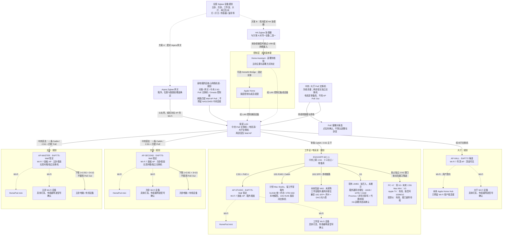
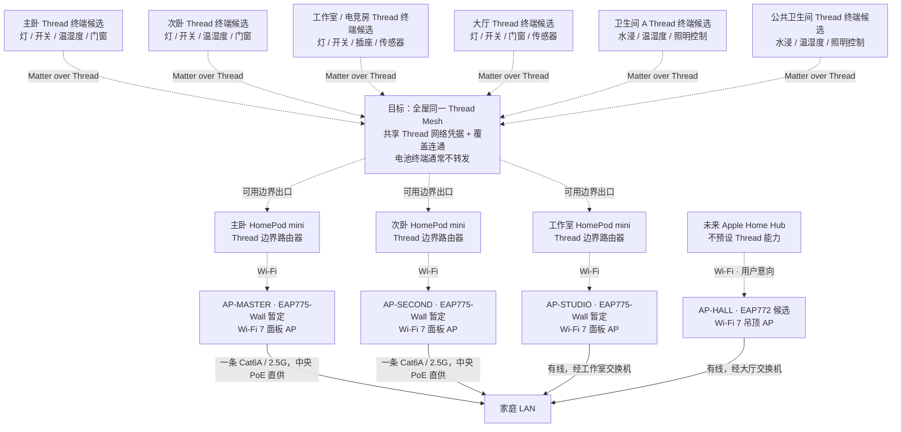

# 全屋智能家居接入拓扑 v1.2

> **更新日期**：2026-10-14
>
> **状态**：设计规划，不代表已采购、已安装或已验收。图中的设备类别、数量、协议和位置均须按最终型号及现场点位复核。
>
> **关联文档**：[家庭基础设施登记与实施台账](home-infrastructure-register.md)、[家庭网络拓扑](network-topology.md)、[设备选型清单](device-selection-list.md)

## 1. 接入原则

- 全屋以 Aqara/绿米为主要选型方向，目标接入 Apple Home 和 Home Assistant（HA），**不考虑任何小米、华为设备**；不是所有 Aqara 产品都使用同一种协议，也不是所有型号都能完整接入两个平台。
- 住宅约 **100㎡**、一层矩形，目前无正式设计图，房间关系已知但覆盖、点位及数量须复尺。宽带计划 **1000Mbps 下载 / 30Mbps 上传**，局域网/本地自动化能力不由 WAN 标称速度保证。
- 网络拓扑 **v1.2** 的基线已确定：四区域各一条Cat6A星型回中央；**主卧/次卧仅墙面Wall AP，不设房间箱/独立交换机，中央2.5G PoE直供，有线终端接AP下联1×2.5G+3×1G**。电竞房/大厅各保留设备箱和一台交换机再接箱外AP；四区域上联均2.5G，仅电竞房Mac Studio↔高速NAS本地10G。电竞房单台 **ES210XPP-M2**，10G RJ45给Mac、10G SFP+给NAS，十口全部占用。详见[家庭网络拓扑](network-topology.md)。房内短线/支线仍需布置；大厅汇聚两卧室AP的旧提议未采纳，静音由用户另行考虑。
- AP 形态已确认：主卧、次卧、工作室各暂定一台 **EAP775-Wall 三频 Wi-Fi 7 面板 AP**，大厅候选一台 **EAP772 Wi-Fi 7 吊顶（吸顶）AP**，共 3+1 台、2.5G 上联。面板装箱外墙面，大厅 AP 装顶面可见位置，不藏吊顶内部；地区频段/发货版本/供电验收见 [BOM](device-selection-list.md#64-按最新拓扑更新的候选购买清单)。HomePod mini 和未来 Home Hub 的 Wi-Fi 接入关系不变，Thread 仍走独立的 Thread 网络，AP 支持 6GHz 不代表 HomePod mini 支持该频段。
- Wi-Fi 终端接 AP；Zigbee 设备接 Zigbee 网关/协调器；Matter over Thread 设备通过 Thread 网络和边界路由器进入家庭 LAN。**Matter 是应用层互通标准，Thread 与 Wi-Fi 才是这里的网络接入方式。**
- Apple Home 与 HA 属于控制层，不是串在交换机、AP 与终端之间的网络转发设备。未来 Apple Home Hub 只按用户意向预留大厅 Wi-Fi 连接，不承诺其未确认的 Thread、Matter 或其他产品能力，也不视为 HA 或 Zigbee 网关的替代品。
- 用户同时需要 **HomePod/Siri 家居控制**与**各房间同 Mac 本地模型对话**，两类需求都保留，具体语音终端/接入方案未定。不能默认 HomePod 的麦克风能作为任意本地模型前端，未来 Home Hub 也不据此预设能力。
- 已确认 **Mac 留工作室；未来高速 NAS 与现有 J3455 规划在工作室箱外通风存储位，核心网络设备仍放弱电箱附近机柜**，不把服务器塞入密闭网络小箱。J3455 为现有 16GB / 10TB / 1GbE / Proxmox 主机，已运行非官方群晖存储和代理/转发容器，拟迁入工作室而非已搬迁；HA 部署状态未确认，它不是空闲 HA 主机。未来高速 NAS 接电竞房交换机的 10G SFP+，需兼容网卡与 DAC/光模块介质，未采购。

## 2. Wi-Fi、Zigbee、有线设备与控制层

本图表示逻辑接入关系；两卧室AP由中央交换机有线PoE直连，电竞房/大厅AP经各自房间交换机接入LAN。虚线表示无线连接或控制/集成关系，边上文字区分两者。主卧、次卧、工作室各预留一台HomePod mini，大厅预留未来Apple Home Hub。

### 2.1 各协议的实际接法

| 设备类别 | 接入路径 | 必须核验的边界 |
|---|---|---|
| Aqara Zigbee 灯、开关、传感器、窗帘等 | Zigbee → Aqara 网关 → LAN；或改为 Zigbee → HA 协调器 → HA | **单台设备不能同时配对两个独立 Zigbee 网络**。选择网关路径时，核对 HomeKit/Matter 桥接及 HA 集成实际暴露的实体；选择 HA 路径时，核对具体设备支持与功能差异。 |
| Matter over Wi-Fi 设备 | 所在区域 AP → LAN → 支持的 Matter 控制器 | 按支持情况使用 Matter 多管理员接入 Apple Home 和 HA；共享控制不等于任何品牌私有功能都可用。 |
| 非 Matter 的 Wi-Fi 设备 | 所在区域 AP → LAN → 该型号支持的集成 | 核对 HomeKit/HA 支持、本地或云端依赖、离线行为；Wi-Fi 本身不是兼容性保证。 |
| 普通灯具 + 智能开关/继电器 | 市电 → 智能开关/继电器 → 普通灯；开关的智能控制走 Zigbee、Thread 或 Wi-Fi | 灯本身不接网线。零火线、负载、调光、盒深及防潮要求由电气设计确认，交合格电工施工。 |
| PoE摄像头 | 从有余量的中央/大厅PoE交换机拉独立支线 → 摄像头；录像经LAN到NVR/NAS/录像服务 | 两卧室不设独立交换机，电竞房零备用，当前不使用Wall AP下游PoE；核逐口/总功率、RTSP/ONVIF、本地录像与HA集成，不自动等于Apple Home/HKSV支持。 |

Zigbee 的覆盖目标是**全屋六个区域**，不是只覆盖大厅；网关与中继能力依实际设备确定，电池传感器通常不承担 Zigbee 路由扩展。两卫生间的 Wi-Fi 设备由覆盖实测合适的邻近 AP 服务，不预先锁定某一台 AP，也不默认增加卫生间 AP。

J3455 的 10TB 尚未区分原始/可用容量，盘数、冗余、备份、硬盘健康和运行余量仍须核实；现有服务不因本图更新而被迁移或改装。HA 可评估独立主机或现有虚拟化资源，但必须先确认余量、备份和故障边界，不能把 NAS 或 Mac 自动等同于已部署 HA。Mac↔未来高速 NAS 在同交换机、同 VLAN 时为本地 10G，不经中央 2.5G 主干；有线 Apple TV↔J3455 同条件下也本地转发，但受自身网口/存储性能限制。其他房间访问工作室设备共享该房 2.5G 上联；跨 VLAN 若经网关需核实际三层路径，不能直接套用本地 10G。Apple TV 的以太网接法与是否具备 Thread 边界路由器能力是两个事项，后者按具体型号确认，本图不因有线连接新增 Thread 角色。

## 3. 全屋 Matter over Thread 规划

下图把四个主要区域和两个卫生间都纳入 Thread 类别规划。**这是可选协议与点位规划，不是六个区域已确定采购 Thread 设备**；尤其 Aqara 各型号可能使用 Zigbee、Wi-Fi 或 Thread，采购后必须按实际协议归类，不应把现有 Zigbee 候选直接标成 Thread。

- 三台 HomePod mini 是 Thread 网络进入 LAN 的可用边界出口，不是三个串联的必经节点，也不表示每个房间的终端必须固定经过本房间的 mini。路径依无线覆盖和实际网络状态确定。
- 同一 Thread 网络需要共享网络凭据并保持覆盖连通；**不要假定所有品牌的边界路由器会自动并为一个 Mesh**。Matter 多管理员共享控制与 Thread 网络凭据共享是不同事项。
- 只有具备 Thread 路由能力的常电设备才可扩展 Mesh；不能把所有常电设备或电池传感器都当作中继。两卫生间需结合墙体、防潮和现场信号实测选点。
- Thread 边界路由器承担 IP 网络连通，Matter 控制器承担设备管理；两种角色可能由同一产品承载，但概念与验收项不同。Thread 支持也不自动等于 Matter/Apple Home/HA 兼容。

## 4. 设备箱、供电与验收边界

1. 保持四条中央 **2.5G** 主干；仅电竞房/大厅各一房间箱/交换机，**两卧室只有Wall AP，下联有线设备1×2.5G+3×1G，不设箱/独立交换机**。中央为网关、两卧室Wall AP、电竞房/大厅交换机和OC200共六连接，建议至少8×2.5G，至少两口匹配Wall AP PoE，10G非必需。电竞房单台ES210XPP-M2，10G RJ45给Mac、10G SFP+给NAS，八个2.5G口用于上联、PC×2、Mac Mini、J3455、有线Apple TV、投影和AP，十口全占/零备用。NAS SFP+/DAC或光介质另核；不恢复旧TL-SX1008/SX3206HPP组合或加第二台。电竞房/大厅箱须可维护/通风、强弱电分隔；AP、HomePod、网关/协调器天线放开放位置，Mac/NAS/J3455不塞密闭小箱。
2. 主卧/次卧Wall AP经各自主干由中央匹配PoE口直供；工作室EAP775-Wall由ES210XPP-M2的2.5G PoE++口供电，不另购注入器。电竞房/大厅交换机需本地市电，普通交换机不会转送中央PoE。EAP775-Wall的at/bt下游输出条件厂商表述有冲突，当前不使用AP PoE Out（卧室下联传数据仍可用）；每台45W最大值含25W转供，不当裸机功耗，未核明确模式前保守45W×1.3，中央两台合计117W，其他受电设备另加。摄像头仅接有余量且供电匹配的中央/大厅交换机，电竞房零备用，两卧室无独立交换机。两卧室AP重启/故障/PoE断电会连带AP下联电脑，与电竞房电脑直接接交换机的边界不同。详见BOM。
3. 用户要求停电后 **NAS、Mac 与全屋网络继续运行，UPS目标至少1小时**。覆盖光猫/网关/中央交换机、电竞房/大厅交换机及四AP、NAS/J3455和Mac完整供电路径；中央UPS须计两卧室AP PoE负载，**取消两卧室独立网络UPS点**。但本地市电大厅/电竞房交换机、卧室电脑/HomePod不因中央UPS自动保活。按中央、电竞房、大厅三处实测功耗/峰值/策略/电池曲线核算UPS或合规后备回路，不能宣称已达成。HomePod、Aqara网关、HA等控制节点按停电时所需功能另核，AP有电不代表控制层可用。
4. 首期优先验证同一可信网络中的发现、配网、控制和离线自动化；之后再隔离访客、摄像头或 IoT。跨 VLAN 要另验收 IPv6、mDNS/Bonjour、组播和访问规则，不能以“能上网”代替智能家居联通验收。
5. 最终逐设备登记型号、区域版本、协议、供电、所在区域、所属网关/Thread 网络、Apple Home/HA 集成方式及离线测试结果。摄像头点位和隐私边界单独确认，不默认在卧室或卫生间部署。
6. 中央核心机柜仍放弱电箱附近；NAS/J3455规划工作室箱外通风存储位，未迁移/采购。工作室后备供电覆盖ES210XPP-M2、其AP、Mac、NAS/J3455及必要排风；中央UPS按中央核心设备和两卧室AP PoE负载计算，不把工作室存储误计中央；大厅本地交换机/AP另核后备供电。三处都不是已完成安装/隔声工程；静音/隔声由用户另行考虑，通风柜不等于隔音柜。承重/散热/维护空间仍核；约定实际负载下验收至少1小时续航、安全关机与来电恢复，无正式设计图/负载数据时不锁尺寸或UPS型号。

## 5. 变更记录

- **2026-10-14 / v1.2**：两卧室取消设备箱/独立交换机/网络UPS点；各自一条Cat6A/2.5G由中央PoE直达EAP775-Wall，电脑/有线设备用1×2.5G+3×1G下联。大厅汇聚提议未采纳。电竞房/大厅保留箱与交换机，电竞房十口与Mac/NAS本地10G不变；中央仍六连接但新增两路PoE及两台保守117W预算，中央UPS重算。同步Wi-Fi/Thread图和AP故障边界，全屋智能设备类别/协议规划不变，未采购/施工。
- **2026-10-14 / v1.1（历史，卧室箱/交换机已被v1.2替代）**：确认全屋2.5G主干，工作室单台ES210XPP-M2，本地Mac/NAS两个10G口；八个2.5G口全占。J3455/未来高速NAS改为工作室箱外通风存储位，未迁移/未采购。同步逻辑图、端口、PoE及UPS边界，Thread规划不变，Apple TV仅新增有线接入事实，不预设其Thread能力。
- **2026-10-13 / v1.0（历史，已替代）**：工作室主干10G、NAS/J3455中央机柜布局及工作室至少第三个10G备用口要求不再适用当前设计；AP形态、三台HomePod mini及Thread逻辑保留。
