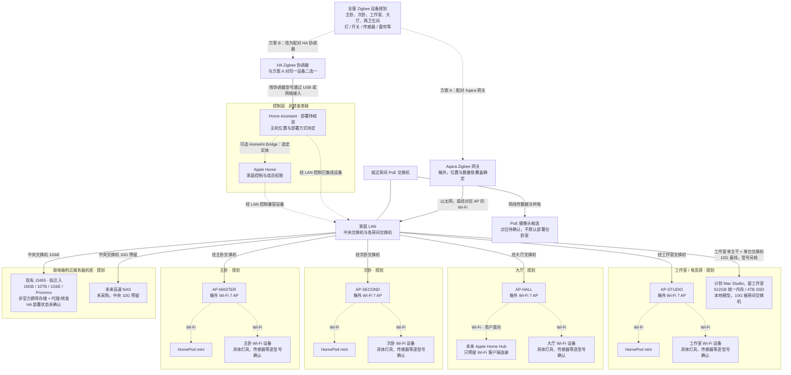
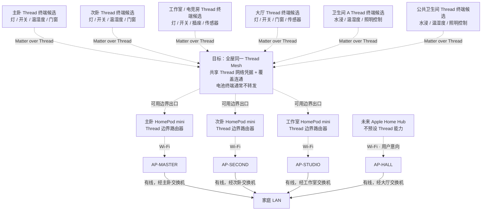

# 全屋智能家居接入拓扑

> **更新日期**：2026-10-13
>
> **状态**：设计规划，不代表已采购、已安装或已验收。图中的设备类别、数量、协议和位置均须按最终型号及现场点位复核。
>
> **关联文档**：[家庭基础设施登记与实施台账](home-infrastructure-register.md)、[家庭网络拓扑](network-topology.md)、[设备选型清单](device-selection-list.md)

## 1. 接入原则

- 全屋以 Aqara/绿米为主要选型方向，目标接入 Apple Home 和 Home Assistant（HA），**不考虑任何小米、华为设备**；不是所有 Aqara 产品都使用同一种协议，也不是所有型号都能完整接入两个平台。
- 住宅约 **100㎡**、一层矩形，目前无正式设计图，房间关系已知但覆盖、点位及数量须复尺。宽带计划 **1000Mbps 下载 / 30Mbps 上传**，局域网/本地自动化能力不由 WAN 标称速度保证。
- 网络拓扑 v1.0 的连接、位置与速率基线已确定：主卧、次卧、工作室/电竞房、大厅各一条 Cat6A 主干接入房间设备箱，每箱一台交换机再接箱外 AP 和本地设备；工作室上联/Mac 为 10G，其余三区域上联为 2.5G，AP 有线接口至少 2.5G。详见[家庭网络拓扑](network-topology.md)。房间内部仍需短网线或支线；静音由用户另行考虑，不影响此连接基线。
- Wi-Fi 终端接 AP；Zigbee 设备接 Zigbee 网关/协调器；Matter over Thread 设备通过 Thread 网络和边界路由器进入家庭 LAN。**Matter 是应用层互通标准，Thread 与 Wi-Fi 才是这里的网络接入方式。**
- Apple Home 与 HA 属于控制层，不是串在交换机、AP 与终端之间的网络转发设备。未来 Apple Home Hub 只按用户意向预留大厅 Wi-Fi 连接，不承诺其未确认的 Thread、Matter 或其他产品能力，也不视为 HA 或 Zigbee 网关的替代品。
- 用户同时需要 **HomePod/Siri 家居控制**与**各房间同 Mac 本地模型对话**，两类需求都保留，具体语音终端/接入方案未定。不能默认 HomePod 的麦克风能作为任意本地模型前端，未来 Home Hub 也不据此预设能力。
- 已确认 **Mac 留工作室，NAS 与核心网络设备放弱电箱附近服务器机柜**。J3455 为现有 16GB / 10TB / 1GbE / Proxmox 主机，已运行非官方群晖存储和代理/转发容器，拟迁入中央机柜而非已搬迁；HA 部署状态未确认，它不是空闲 HA 主机。未来高速 NAS 如新增，中央预留 10G，未采购。

## 2. Wi-Fi、Zigbee、有线设备与控制层

本图表示逻辑接入关系；AP 实际经各自房间交换机有线接入 LAN。虚线表示无线连接或控制/集成关系，边上文字区分两者。主卧、次卧、工作室各预留一台 HomePod mini，大厅预留未来 Apple Home Hub。

### 2.1 各协议的实际接法

| 设备类别 | 接入路径 | 必须核验的边界 |
|---|---|---|
| Aqara Zigbee 灯、开关、传感器、窗帘等 | Zigbee → Aqara 网关 → LAN；或改为 Zigbee → HA 协调器 → HA | **单台设备不能同时配对两个独立 Zigbee 网络**。选择网关路径时，核对 HomeKit/Matter 桥接及 HA 集成实际暴露的实体；选择 HA 路径时，核对具体设备支持与功能差异。 |
| Matter over Wi-Fi 设备 | 所在区域 AP → LAN → 支持的 Matter 控制器 | 按支持情况使用 Matter 多管理员接入 Apple Home 和 HA；共享控制不等于任何品牌私有功能都可用。 |
| 非 Matter 的 Wi-Fi 设备 | 所在区域 AP → LAN → 该型号支持的集成 | 核对 HomeKit/HA 支持、本地或云端依赖、离线行为；Wi-Fi 本身不是兼容性保证。 |
| 普通灯具 + 智能开关/继电器 | 市电 → 智能开关/继电器 → 普通灯；开关的智能控制走 Zigbee、Thread 或 Wi-Fi | 灯本身不接网线。零火线、负载、调光、盒深及防潮要求由电气设计确认，交合格电工施工。 |
| PoE 摄像头 | 从就近房间 PoE 交换机拉网线支线 → 摄像头；录像流经 LAN 到 NVR/NAS/录像服务 | 核对逐口功率、总 PoE 预算、RTSP/ONVIF、本地录像和 HA 集成。支持 RTSP/ONVIF 不自动等于支持 Apple Home 或 HomeKit Secure Video。 |

Zigbee 的覆盖目标是**全屋六个区域**，不是只覆盖大厅；网关与中继能力依实际设备确定，电池传感器通常不承担 Zigbee 路由扩展。两卫生间的 Wi-Fi 设备由覆盖实测合适的邻近 AP 服务，不预先锁定某一台 AP，也不默认增加卫生间 AP。

J3455 的 10TB 尚未区分原始/可用容量，盘数、冗余、备份、硬盘健康和运行余量仍须核实；现有服务不因本图更新而被迁移或改装。HA 可评估独立主机或现有虚拟化资源，但必须先确认余量、备份和故障边界，不能把 NAS 或 Mac 自动等同于已部署 HA。Mac↔中央 NAS 的通信经过并共享工作室 10G 主干；现有 J3455 仍受千兆接口限制。

## 3. 全屋 Matter over Thread 规划

下图把四个主要区域和两个卫生间都纳入 Thread 类别规划。**这是可选协议与点位规划，不是六个区域已确定采购 Thread 设备**；尤其 Aqara 各型号可能使用 Zigbee、Wi-Fi 或 Thread，采购后必须按实际协议归类，不应把现有 Zigbee 候选直接标成 Thread。

- 三台 HomePod mini 是 Thread 网络进入 LAN 的可用边界出口，不是三个串联的必经节点，也不表示每个房间的终端必须固定经过本房间的 mini。路径依无线覆盖和实际网络状态确定。
- 同一 Thread 网络需要共享网络凭据并保持覆盖连通；**不要假定所有品牌的边界路由器会自动并为一个 Mesh**。Matter 多管理员共享控制与 Thread 网络凭据共享是不同事项。
- 只有具备 Thread 路由能力的常电设备才可扩展 Mesh；不能把所有常电设备或电池传感器都当作中继。两卫生间需结合墙体、防潮和现场信号实测选点。
- Thread 边界路由器承担 IP 网络连通，Matter 控制器承担设备管理；两种角色可能由同一产品承载，但概念与验收项不同。Thread 支持也不自动等于 Matter/Apple Home/HA 兼容。

## 4. 设备箱、供电与验收边界

1. 保持四个房间箱、四条中央主干、每箱一台交换机；工作室上联/Mac/AP/电脑四连接，至少两个 10G 口同时用于上联/Mac，建议第三个作备用，AP/电脑口至少 2.5G。静音由用户另议，不再以无风扇作为拓扑定稿门槛；旧 TL-SX1008 和 SX3206HPP + ES206X-M2 组合仍仅作历史，不自动恢复采购。具体型号、箱体尺寸另核，箱体需可维护、通风及满足插头/弯曲空间，**AP、HomePod mini、Zigbee/Thread 网关和协调器天线放箱外**，尤其不要藏在金属箱内。强弱电分隔按现场规范执行。
2. 房间 PoE 交换机通常需要本地市电，再为 AP/摄像头供电；普通交换机不会自动转送中央 PoE 电力。PoE 受电并转供仅在具体型号、协议和功率预算核验后使用；每台 AP/摄像头仍需各自的网线支线。
3. 用户要求停电后 **NAS、Mac 与全屋网络继续运行，UPS 目标至少 1 小时**。必须覆盖光猫/主路由/中央交换机、所有房间交换机及 AP/注入器、NAS/J3455、工作室 Mac 的实际供电路径；本地市电设备不会仅因中央机柜有 UPS 就自动续航。容量/型号按实测功耗、峰值、停电满载策略与电池曲线核算，不能宣称已经达成；房间 UPS 或集中后备回路须经电气设计。HomePod、Aqara 网关、HA 等控制节点的保活需按停电时所需家居功能另核，不能以 AP 有电替代控制层可用性验收。
4. 首期优先验证同一可信网络中的发现、配网、控制和离线自动化；之后再隔离访客、摄像头或 IoT。跨 VLAN 要另验收 IPv6、mDNS/Bonjour、组播和访问规则，不能以“能上网”代替智能家居联通验收。
5. 最终逐设备登记型号、区域版本、协议、供电、所在区域、所属网关/Thread 网络、Apple Home/HA 集成方式及离线测试结果。摄像头点位和隐私边界单独确认，不默认在卧室或卫生间部署。
6. 中央服务器机柜位置基线已定，不是已完成安装或隔声工程；静音/隔声由用户另行考虑，普通通风柜不等于隔音柜。承重、散热及维护空间仍需核验，必要的机柜排风也要后备供电。实际约定负载下验收至少 1 小时续航、安全关机及来电恢复，尺寸和 UPS 型号不在无设计图/负载数据时锁定；这些实施细节不影响连接拓扑定稿。
