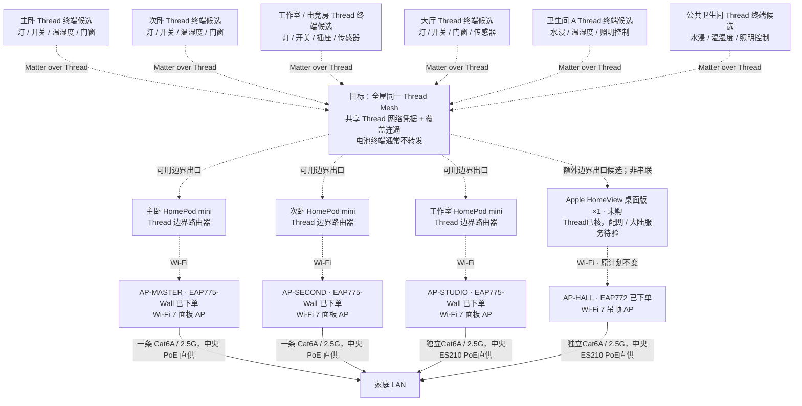

# 全屋智能家居接入拓扑 v1.6

> **2026-11-26 当前方案（v1.6影音终端更正）**：Fusion四个2.5G LAN分别接中央ES210、电竞房ES210、普通电脑墙口A/B，LAN余0；中央SFP+经10G光纤连接客厅ES206。四台AP和两台M200全部独立回中央PoE；AP只提供Wi-Fi，不使用下游数据口或PoE Out。电脑墙口房间位置尚未确认。
>
> **Apple TV仅一台，放大厅有线接ES206；投影仪主放主卧、可移动，Wi-Fi接入、不插网线。** 电竞房2.5G口改为用4余4，不再有Apple TV/投影仪有线占位。
>
> **J3455改放客厅箱外通风位**，影视存储为主，HAOS/OpenWrt仍在该机；现1G，确认升级2.5G，迁移/升级尚未实施。Mac及未来高速NAS留电竞房本地10G。两M200的次网关升级、差价、点位和子设备迁移另核；原M200＋M1S合同及¥19,324仅保留为历史，不能推定已含升级。
>
> 接法已确认、尚未安装验收；光纤芯数/端面和模块具体型号仍待核。Omada原7台订单数量与$901.49不变，Fusion购买未确认。现行[网络拓扑](network-topology.md)、[逐线表](network-placement-and-cabling-plan.md)、[采购BOM](purchase-bom.md)优先，旧v1.4/v1.5不再作为并列待确认版本。
>
> 智能设备候选沿用[增补计划](aqara-supplement-plan-20261118.md)：公共区FP400、两卫FP310→Aqara→HA→Xiaomi Home→奥普米家版一体机链路，仍须核型号/实体/云依赖；门锁限可视猫眼、独立门铃取消，次卧照明不新增、窗户仅检测，欧瑞博四类系统保留。本次只同步网络承载与网关方向，不据此新增采购或确认集成已经可用。

**合同与补充选型依据**：[2026-10-26绿米签字清单](aqara-final-quote-20261026.md)的原合同金额为¥19,324（产品¥15,459＋服务费¥3,865），原网关组合为M200＋M1S；该原始凭据保留，不能据此推定已含第二台M200升级。S100场景屏仅客餐厅1台、E1摄像机为Wi-Fi非PoE；本批合同未列Matter over Thread终端。后续新增候选以[增补计划](aqara-supplement-plan-20261118.md)和[型号核验](aqara-model-verification-20261121.md)为准，采购与到货状态逐项核验。

## 1. 接入原则

- 全屋以 Aqara/绿米为主要选型方向，目标接入 Apple Home 和 Home Assistant（HA），**本轮奥普米家版两卫一体机为有限例外；其他小米/米家及华为不新增，已有米家激光投影仪继续复用**；不是所有 Aqara 产品都使用同一种协议，也不是所有型号都能完整接入两个平台。
- 住宅约 **100㎡**、一层矩形，已收到[装修布置图与尺寸标注图](floorplan-and-network-locations.md)；弱电箱在**入户门左侧**，核心网络规划在该箱或附近通风核心柜。完整电气点位/管线路径、墙材、柜体与覆盖仍须现场核验，截图不是施工放线依据。武汉电信下载按用户记录 **1000Mbps**，原规划上传30Mbps仍未实测，局域网/本地自动化能力不由 WAN 标称速度保证。
- 网络承载采用**v1.6**：Fusion四LAN分别接中央ES210、电竞房ES210、两个普通电脑墙口A/B；中央与客厅ES206以10G SFP+光纤互联。四AP和两M200全部独立回中央PoE；AP不使用下游数据口，PoE Out关闭。两电脑墙口所在房间未确认，不能按主卧/次卧自动分配。电竞房Mac Studio走10G RJ45，未来NAS留独立SFP+；J3455在客厅。端口和逐线以[施工表](network-placement-and-cabling-plan.md)为准。
- AP 形态已确认：主卧、次卧、工作室各已下单一台 **EAP775-Wall 三频 Wi-Fi 7 面板 AP**，大厅已下单一台 **EAP772 Wi-Fi 7 吊顶（吸顶）AP**，共3+1台，均待到货验收，2.5G上联。面板装箱外墙面，大厅 AP 装顶面可见位置，不藏吊顶内部；地区频段/发货版本/供电验收见 [BOM](device-selection-list.md#64-当前端口与采购边界)。三房mini优先推荐mini 2，代际待确认；大厅Apple HomeView已发布，Wi-Fi接法不变。两款官方列Wi-Fi 6E，但大陆6GHz不计保证；Thread仍独立于Wi-Fi，不能把美版频段规格当本户可用性。
- Wi-Fi 终端接 AP；Zigbee 设备接 Zigbee 网关/协调器；Matter over Thread 设备通过 Thread 网络和边界路由器进入家庭 LAN。**Matter 是应用层互通标准，Thread 与 Wi-Fi 才是这里的网络接入方式。**
- Apple Home与HA属于控制层，不是串在交换机、AP与终端之间的网络转发设备。**HomeView非壁挂／桌面版×1已确认**，支持Wi-Fi/Thread及HomeKit/Matter，经大厅AP Wi-Fi接入，使用随箱电源；大陆服务/账户/配套设备和配网待验。壁挂另用平板电脑或iPad，具体型号/数量/点位/供电与网络方式待选，作为交互终端记录，不替代HA主机、家庭中枢或Thread边界路由器；不先增加网口/PoE或物理图节点。详见[Apple官方核验](apple-home-devices-2026.md)。
- 用户同时需要 **HomePod/Siri 家居控制**与**各房间同 Mac 本地模型对话**，两类需求都保留，具体语音终端/接入方案未定。不能默认 HomePod 的麦克风能作为任意本地模型前端，HomeView/Siri AI也不等于Mac本地模型，官网未承诺开放原始麦克风流。
- **Mac与未来高速NAS留电竞房，J3455改放客厅箱外通风位**；核心网络仍在入户门左侧弱电箱或附近通风柜。J3455现有16GB内存、10TB存储记录、1GbE与Proxmox，WD Gold未RAID；容量口径/盘数/硬盘状态待核。影视存储为主，黑群晖VM与代理服务保留，HAOS/OpenWrt仍规划在该机，物理迁移和2.5G网卡升级未实施。升级沿用客厅同一线/口，不占电竞房10G口；Omada由Fusion内置控制器承载。未来NAS未采购，接口/介质按实机确认。

## 2. Wi-Fi、Zigbee、有线设备与控制层

实线为当前规划的物理连接，虚线为无线、虚拟实例或控制/集成关系；图示不是已部署状态。四AP及两M200集中接中央ES210，客厅/电竞房交换机均不供本地AP。三房HomePod mini代际/数量与实际配网继续待核；大厅HomeView桌面版沿用既有确认，壁挂平板/iPad另选，不添加未经确认的物理节点或端口。

```mermaid
flowchart TB
    subgraph CENTRAL["C0 入户门左侧核心位 · 规划"]
        ONT["现有光猫 / Internet桥接"]
        FUSION["Fusion 2.5G普通版<br/>主路由 + 唯一DHCP/普通DNS<br/>4个LAN全分配，购买未确认"]
        CORE["中央ES210XPP-M2<br/>7/8个2.5G口使用，余1<br/>10G RJ45空闲 / PoE 200W"]
        OMC["Fusion内置Omada控制器<br/>同一物理设备，不另占网口"]
        ONT -->|"WAN，交付速率按实机"| FUSION
        FUSION -->|"LAN1 · 2.5G"| CORE
        FUSION -. "内置应用" .-> OMC
    end

    PCA["普通电脑墙口A / 2.5G<br/>房间点位未确认，独立回C0"]
    PCB["普通电脑墙口B / 2.5G<br/>房间点位未确认，独立回C0"]
    FUSION -->|"LAN3 · Cat6A + RJ45模块"| PCA
    FUSION -->|"LAN4 · Cat6A + RJ45模块"| PCB

    subgraph MASTER["主卧 · 规划"]
        AP1["AP-MASTER / EAP775-Wall<br/>墙面开放处，无房间交换机"]
        HP1["HomePod mini候选<br/>代际/数量待核"]
        W1["主卧Wi-Fi设备<br/>协议按具体型号"]
        AP1 -. "Wi-Fi" .-> HP1
        AP1 -. "Wi-Fi" .-> W1
        PROJ["已有投影仪 / 主卧为主，可移动<br/>Wi-Fi / 不插网线 / 本地市电"]
        AP1 -. "Wi-Fi；移动后按所在区域覆盖接入" .-> PROJ
    end
    subgraph SECOND["次卧 · 规划"]
        AP2["AP-SECOND / EAP775-Wall<br/>墙面开放处，无房间交换机"]
        HP2["HomePod mini候选<br/>代际/数量待核"]
        W2["次卧Wi-Fi设备<br/>协议按具体型号"]
        AP2 -. "Wi-Fi" .-> HP2
        AP2 -. "Wi-Fi" .-> W2
    end
    subgraph STUDIO["电竞房 · Mac与未来NAS箱外通风"]
        SW3["ES210XPP-M2<br/>4/8个2.5G口使用，余4<br/>PoE关闭"]
        AP3["AP-STUDIO / EAP775-Wall<br/>中央PoE直供，不接SW3"]
        HP3["HomePod mini候选<br/>代际/数量待核"]
        W3["电竞房Wi-Fi设备"]
        MAC["Mac Studio / 本地模型<br/>10G RJ45"]
        NAS["未来高速NAS / 未购<br/>10G SFP+，介质按实机"]
        WIRED["PC×2 / Mac mini<br/>各占独立铜口"]
        SW3 -->|"10G RJ45 / Cat6A"| MAC
        SW3 -. "10G SFP+预留" .-> NAS
        SW3 -->|"按实际网卡速率"| WIRED
        AP3 -. "Wi-Fi" .-> HP3
        AP3 -. "Wi-Fi" .-> W3
    end
    subgraph HALL["客厅/大厅 · J3455箱外通风"]
        SW4["ES206XPP-M2<br/>5个铜口全分配 / PoE关闭<br/>SFP+上联中央"]
        AP4["AP-HALL / EAP772<br/>吊顶可见面，中央PoE直供"]
        J["现有J3455 / 拟迁客厅，未实施<br/>Proxmox / WD Gold未RAID<br/>现1G，升级2.5G沿用同口<br/>影视存储、黑群晖与代理服务"]
        AV["电视 / 唯一已有Apple TV / Switch / PS<br/>4台各占独立铜口"]
        M200A["Aqara M200主网关<br/>客餐厅吊顶高位 / 中央af PoE<br/>Matter Controller / Bridge / Thread BR"]
        FUTURE["Apple HomeView桌面版×1<br/>Wi-Fi / Thread，未购待验"]
        W4["大厅Wi-Fi设备"]
        CAM["Aqara E1摄像机候选/合同项<br/>Wi-Fi非PoE，独立供电"]
        SW4 -->|"现1G，升级后2.5G"| J
        SW4 -->|"按实际网口速率"| AV
        AP4 -. "Wi-Fi" .-> FUTURE
        AP4 -. "Wi-Fi" .-> W4
        AP4 -. "Wi-Fi，非PoE" .-> CAM
    end
    M200B["第二台Aqara M200 / 升级次网关<br/>具体位置与子设备迁移待核<br/>中央af PoE，不锁定旧M1S墙位"]

    FUSION -->|"LAN2 · Cat6A / 2.5G"| SW3
    CORE -->|"10G SFP+光纤<br/>配套模块/跳线待核"| SW4
    CORE -->|"独立Cat6A / 2.5G + PoE"| AP1
    CORE -->|"独立Cat6A / 2.5G + PoE"| AP2
    CORE -->|"独立Cat6A / 2.5G + PoE"| AP3
    CORE -->|"独立Cat6A / 2.5G + PoE"| AP4
    CORE -->|"独立af PoE + 数据"| M200A
    CORE -->|"独立af PoE + 数据"| M200B

    Z["Aqara Zigbee灯/开关/传感器/窗帘<br/>设备数量沿合同，升级不自动增购<br/>逐设备选择一个网关配对"]
    Z -. "主网关所属设备" .-> M200A
    Z -. "次网关所属设备 / 迁移待验" .-> M200B
    COORD["HA以太网Zigbee协调器<br/>入住后演进备选，未采购/未分配网口<br/>同一终端与Aqara网关路径二选一"]
    Z -. "可选迁移，不可同时配对" .-> COORD

    subgraph CONTROL["控制层 · 非网络转发串联"]
        HA["Home Assistant / 独立HAOS VM<br/>宿主仍为客厅J3455，待部署验收"]
        OPENWRT["指定终端规则网关 / OpenWrt VM<br/>宿主仍为J3455，非全屋主路由"]
        APPLE["Apple Home<br/>家庭控制与成员权限"]
        HA -. "可选HomeKit Bridge / 选定实体" .-> APPLE
    end
    J -. "Proxmox虚拟实例" .-> HA
    J -. "Proxmox虚拟实例" .-> OPENWRT
    M200A -. "支持的桥接/集成，实体到货核验" .-> HA
    M200B -. "支持的桥接/集成，迁移后核验" .-> HA
    M200A -. "支持的Apple Home接入" .-> APPLE
    M200B -. "支持的Apple Home接入" .-> APPLE
    HA -. "备选ZHA或Zigbee2MQTT，核兼容" .-> COORD
    FUTURE -. "家庭中枢/交互，服务待验" .-> APPLE
    OMC -. "同一LAN管理交换机/AP，不转发业务" .-> CORE
```

中央到客厅只有光纤这一条在用上联，原客厅铜缆保留端接备用、不跳接。C0远端铜缆为9条在用（中央六PD＋Fusion两电脑/电竞房），另有一条客厅备用铜缆和一条光链路；本地跳线与其他备用另计。原`HALL-IOT-GW`墙口保留端接，FP400/对讲机/协调器候选不能据图认定已分配客厅端口；客厅铜口已满。

### 2.1 各协议的实际接法

| 设备类别 | 接入路径 | 必须核验的边界 |
|---|---|---|
| Aqara Zigbee灯、开关、传感器、窗帘 | Zigbee→所属M200（主或次）→中央ES210→同一LAN→Apple Home/HA支持的桥接/集成 | 单台终端只配对一个Zigbee网络；两台同型号网关不是自动共享同一协调器。原次网关子设备迁移后重验配对、实体、自动化和功能，合同差价另核 |
| Matter over Wi-Fi | 所在AP→中央ES210→同一LAN→支持的Matter控制器 | 多管理员按支持情况配置；不保证品牌私有功能全部暴露 |
| Matter over Thread | Thread Mesh→受支持的边界路由器→家庭LAN→Matter控制器 | Thread凭据共享与Matter多管理员不同，详见第3节；不把Zigbee终端自动改记Thread |
| 非Matter Wi-Fi设备 | 所在AP→中央ES210→LAN→型号支持的集成 | 核HomeKit/HA、本地/云依赖及离线行为；Wi-Fi不保证兼容 |
| 普通灯具＋智能开关/继电器 | 市电经智能开关/继电器到灯，控制用该型号的Zigbee/Thread/Wi-Fi | 灯不接网线；零火线、负载、调光、盒深和防潮按电气设计 |
| Aqara E1摄像机 | Wi-Fi→覆盖合适的AP→中央ES210→LAN；独立电源、非PoE | 原支架/75开孔要求按实机复尺；HomeKit/HA、录像/云功能到货实测，不默认卧室/卫生间点位，不增加PoE口 |
| J3455上的HAOS/OpenWrt | VM→Proxmox网桥→客厅ES206→10G光纤→中央ES210；经Fusion同一LAN到其他分支 | HA/代理/存储共享宿主与单个物理口，当前1G，升级后共享2.5G；Fusion仍为唯一全屋DHCP/普通DNS，不因迁客厅启用第二DHCP |

Zigbee覆盖仍面向全屋六区域，电池传感器通常不扩展路由；两卫生间Wi-Fi按实测邻近AP服务，不自动增设AP。两M200均中央af PoE，主网关客餐厅吊顶方向沿用，次网关位置待核；各点备用线单列。Aqara网关不是可直接供ZHA/Zigbee2MQTT使用的通用协调器，HA以太网协调器仅后续演进备选，同终端路径二选一，不新增采购。

### 2.2 J3455位置、网卡与服务依赖

J3455改规划在客厅箱外通风位，影视存储为主，HAOS与OpenWrt仍在该机。现有黑群晖VM及代理服务不因文档改图而被迁移或重装；物理搬迁、2.5G网卡/驱动、Proxmox网桥、VM部署和服务恢复分别验收。WD Gold未RAID，未据此假定只有一块盘；10TB原始/可用口径、健康与备份待核，不用无RAID机械盘性能承诺万兆。网卡从1G升2.5G沿用客厅同一线/口，不占10G接口；游戏库与iSCSI用途另见[专项研究](j3455-iscsi-game-library.md)。

HA与黑群晖/OpenWrt共用宿主、供电和物理网口，须核资源、SSD/存储、备份和宿主重启恢复。Omada仍在Fusion，不新增J3455控制器VM；Fusion重启同时影响主路由和网络管理。客厅Apple TV↔J3455同交换机内转发，受两端网口及存储限制；主卧投影仪通过覆盖合适的AP无线访问J3455，再经中央—客厅光链路；无线体验按实际位置验收，移动使用不分配固定网口。Mac↔未来NAS同一电竞房交换机内可走本地10G，其他房间访问仍共享电竞房2.5G上联。

Apple TV是否具备Thread边界路由器能力按具体型号确认，不因有线接入新增Thread角色。所有设备保持同一家庭LAN；指定终端手动选择J3455 OpenWrt的规则分流方案继续沿用，不因迁移位置自动增加VLAN、DHCP或旁路网段。

## 3. 全屋 Matter over Thread 规划

下图把四个主要区域和两个卫生间都纳入 Thread 类别规划。**这是可选协议与点位规划，不是六个区域已确定采购 Thread 设备**；尤其 Aqara 各型号可能使用 Zigbee、Wi-Fi 或 Thread，采购后必须按实际协议归类，不应把现有 Zigbee 候选直接标成 Thread。

- 三房HomePod mini与大厅HomeView均可规划Thread边界出口，不是四台串联或每房必经本房mini；同一网络凭据、多边界路由器和恢复须配网实测。HomeView已确认桌面版×1；三房mini仍暂各1台，mini 2代际/数量/地区未获最终确认。壁挂平板不按Thread边界路由器计数。
- 同一 Thread 网络需要共享网络凭据并保持覆盖连通；**不要假定所有品牌的边界路由器会自动并为一个 Mesh**。Matter 多管理员共享控制与 Thread 网络凭据共享是不同事项。
- 只有具备 Thread 路由能力的常电设备才可扩展 Mesh；不能把所有常电设备或电池传感器都当作中继。两卫生间需结合墙体、防潮和现场信号实测选点。
- Thread 边界路由器承担 IP 网络连通，Matter 控制器承担设备管理；两种角色可能由同一产品承载，但概念与验收项不同。Thread 支持也不自动等于 Matter/Apple Home/HA 兼容。

两台M200的Thread Border Router能力继续作为可用能力记录；是否加入同一Thread网络、凭据共享及Matter控制路径须按实际版本和配网验证，不因换成同型号网关就认定自动并网或新增Thread终端采购。

## 4. 设备箱、供电与验收边界

1. 三处设备位仍为C0核心、电竞房ES210与客厅ES206；两卧室无独立设备箱。Fusion四LAN全用；中央2.5G用7余1、10G电口空闲；电竞房2.5G用4余4、10G电口给Mac及SFP+留NAS；客厅五铜口接电视/Apple TV/Switch/PS/J3455，全满。中央与客厅SFP+相连，光纤类型及模块兼容待核，不代表已安装。
2. **四AP＋两M200全部由中央ES210供PoE**，AP仅作Wi-Fi，下游数据口不用、PoE Out关闭；电竞房和客厅PoE关闭。中央预算200W，按775 at模式26W×3＋772 25.4W＋M200暂按12W×2为127.4W，加30%为165.62W，仅是规划参考；关闭转供不保证bt只预留26W，须核实际协商/预留与六设备同时冷启动。交换机整机耗电另计交流输入。E1/S100等原Wi-Fi/市电项目不占PoE口。
3. **UPS入住后再评估**，装修先留电源、承重和通风，不把至少一小时目标写成已验收。中央UPS负载包括光猫、Fusion、中央ES210及其四AP/两M200；电竞房计ES210、Mac、未来NAS及需要的设备；客厅计ES206、J3455与需保活影音。J3455规划已改为客厅，不重复计电竞房UPS。停电需HA/OpenWrt继续服务时，客厅主机/交换机、中央光链路/交换机与Fusion必须一起保活，必要的HomePod等常电控制节点也另核。
4. 所有设备保持同一家庭LAN，先验发现、配网、实体控制、离线自动化、重连与IPv6/mDNS/组播；本轮不新增VLAN。网关升级后重新登记子设备归属和实体映射，避免重复桥接造成重复实体。Thread凭据与多边界出口恢复按第3节独立测试。
5. 逐设备登记型号、地区版本、协议、供电、位置、所属Zigbee/Thread网络及Apple Home/HA集成方式。摄像头点位与隐私边界单独确认；候选集成的本地/云依赖不能以“可以上网”替代验收。
6. 原弱电箱/附近通风柜按实物核容量、适配器/弯线、温升与检修；Mac/未来NAS在电竞房箱外，J3455在客厅箱外，均不塞密闭网络箱。按实际整机负载和电池曲线选UPS，核安全关机/来电恢复；通风柜不等于隔音柜，不凭截图锁箱体或承诺续航。

## 5. 变更记录

- **2026-11-26 / v1.6终端更正**：用户确认Apple TV仅一台放大厅；投影仪主放主卧、可移动且不接网线，使用Wi-Fi/本地市电。电竞房取消两项有线占位，2.5G口由用6余2改为用4余4；中央PoE、客厅5铜口及Fusion4LAN分配不变。

- **2026-11-25 / v1.6**：当前物理图、协议路径和供电归属同步重画。四AP/两M200由中央ES210供电；电脑墙口A/B接Fusion，房间未指定；中央SFP+连客厅ES206；J3455移客厅并保留HA/OpenWrt角色，2.5G升级与UPS规划改计客厅；Mac/未来NAS留电竞房。原合同金额/设备采购状态不因升级方案自动变更。
