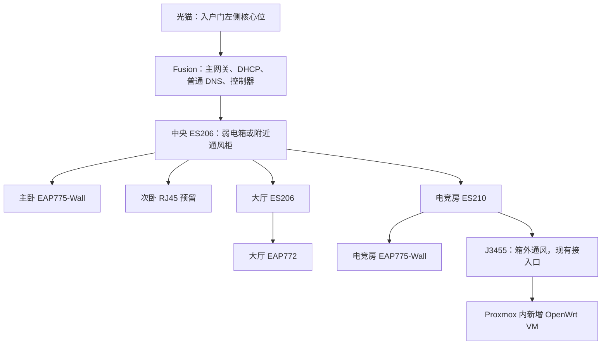
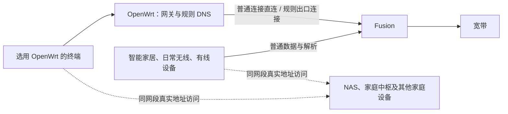

# 同一家庭 LAN 内按设备选用 OpenWrt：批准版方案

日期：2026-11-05。状态：**用户已批准方案；仅完成文档整理，家庭设备尚未部署或实测。** 全部现场验收项为 `not_run`。

执行入口：[实施计划](../plans/2026-11-05-home-device-rule-routing.md) · [验收与应急操作单](../../validation/home-device-rule-routing.md)。物理位置和采购以[网络拓扑](../../network-topology.md)、[基础设施台账](../../home-infrastructure-register.md)为准。

## 1. 已批准的决定

全家保留**同一 LAN、同一 IP 网段**。Fusion 承担主网关、全屋唯一 DHCP、独立普通 DNS、宽带接入与 Omada 控制器；J3455 在现有 Proxmox 内新增一台 OpenWrt 完整虚拟机，只服务主动选择它的终端。

2.4GHz 共用一个无线名称，智能家居继续自动获取 Fusion 的网络参数；指定手机或平板在这个无线网络的配置里手动填写 OpenWrt 网关和规则 DNS。日常 5GHz 使用另一个无线名称，自动获取 Fusion 参数；6GHz 仅在地区、设备与终端实际支持时纳入日常接入，不作为保证能力。

这两个无线名称都桥接到原家庭 LAN，不划分 VLAN，不采用 PPSK 分网，也不启用阻断家庭互访的访客或客户端隔离。有线设备仍在这个 LAN 内。频段与无线名称不决定设备是否同网段，终端的网关设置决定其外网路径。

**批准的故障边界：** J3455 停机不改变其他设备的普通上网路径。正在使用 OpenWrt 的终端可能失去外网，由使用者切换日常无线名称或恢复自动网络设置。此方案不承诺这些终端自动无感恢复；原先“所有设备自动按规则访问”的目标已由本次按需接入范围取代。

## 2. 设备位置与物理连接

以上是规划连接，不表示设备已到货。J3455 沿用现有一根网线、现有网口和交换机端口，现有 1GbE 可先试点；2.5G 网卡升级是另一个待验事项，不与本次桥接配置同时迁移。四条 Cat6A 主干、AP 数量、PoE 供电及设备预算不变。

Fusion 本身没有无线覆盖职责，无需为改善无线信号搬到大厅；大厅由 AP 覆盖。因此本方案不新增“弱电箱到大厅主路由、再回交换机”的回线，也不增加交换机、备用树莓派或独立主网关。原弱电箱是否能容纳设备仍须现场核对，保留附近通风柜选项。

## 3. 按设备配置表

以下 `Home-24`、`Home-Daily` 仅为说明用途的名称，最终命名沿用现场约定；已有智能家居的无线名称与密码尽量保持，避免全屋重新配对。

| 设备与接入方式 | 地址来源 | IPv4 网关 / DNS | 日常行为 | J3455 停机时 |
|---|---|---|---|---|
| 智能家居，`Home-24`，2.4GHz | Fusion DHCP | Fusion / Fusion 普通解析 | 普通联网与家庭互访 | 基础网络保持原路径 |
| 指定手机、平板，仍连接 `Home-24` | 该无线配置中手动填写已查重地址与掩码 | OpenWrt / OpenWrt 规则解析 | 指定网站走规则，其余默认直连 | 本终端外网可能中断；手动切 `Home-Daily` |
| 手机、平板，`Home-Daily`，5GHz/可用 6GHz | Fusion DHCP | Fusion / Fusion 普通解析 | 普通上网，按需启用终端客户端工具 | 普通路径不依赖 J3455 |
| Apple TV 等有线终端 | 默认 Fusion DHCP 或既有保留 | Fusion / Fusion 普通解析 | 优先保留有线；工具能力另核 | 普通路径不依赖 J3455 |
| PVE、存储、未来 HAOS、AP/交换机管理面 | 沿用已核验的静态/保留方式 | Fusion / 独立普通解析 | 启动和管理不依赖规则 VM | 宿主自身服务另受其停机影响 |
| OpenWrt VM | 固定管理地址 | 上游 Fusion / 启动解析经 Fusion | 为选用它的终端转发和解析 | 停机后由终端切回普通路径 |

两个无线名称必须在实际 AP 上指向同一家庭网络。不能依靠同名网络在 2.4GHz 与 5GHz 间漫游自动更换网关；单个终端通常按无线名称保存网络配置。自动加入优先级也不是可靠的故障切换机制。

手动 IPv4 配置需要地址、掩码和网关，不能只改网关。使用 Fusion 动态池外的可用地址，或经实机确认不会再发给其他设备的保留/排除方式；先查租约、静态地址登记和邻居表，单次 ping 无响应不能证明地址空闲。若依赖 MAC 保留，需记录该无线网络实际使用的固定私有地址模式；轮换地址后必须重新核验。登记资料脱敏后才入库。

## 4. 软件选择与资源

| 选择 | 本案决定与原因 |
|---|---|
| OpenWrt 完整 VM | 首期采用；独立内核、网络栈和防火墙，适合规则组件，便于单独备份与恢复 |
| OpenWrt 容器 | 暂不采用；共享宿主内核，网络权限与内核模块适配增加维护工作 |
| 爱快 | 本案不新增；Fusion 已负责主网关与地址服务，无需再增加一层管理系统 |
| 规则组件 | OpenClash 管理界面与 Mihomo 引擎为现有候选；安装前重新核验发行来源、版本、依赖和组合兼容性 |
| VM 初始资源 | 候选 2 vCPU、2GiB 内存、8GiB 虚拟盘；必须先盘点宿主实际余量，不保证满带宽性能 |
| 网络与存储 | 单张 VirtIO 网卡桥接已有家庭桥，不设新的 VLAN tag、不直通物理网卡；使用不依赖存储 VM 启动的宿主本地可靠存储 |

不重装 Proxmox，不迁移已有存储服务，不把 OpenWrt 与 HA 合并成一个系统。新 VM 的隔离与可恢复性不等于硬件冗余；同一宿主上的备用 VM 不能接替宿主故障。

此前研究中的具体镜像版本、文件名、插件包和校验值都是当时的候选信息，不能直接视为本次安装基线。实施时记录实际版本、文件 SHA256、官方校验材料及恢复所需安装文件，保留宿主外副本。

## 5. 网关、规则与解析设计

1. Fusion 的 DHCP 网关和普通 DNS 下发值始终保持普通路径；普通解析及其上游不能依赖 J3455。本案不在 Fusion 上设置全屋定向 DNS 或合成地址段静态路由。
2. OpenWrt 的固定地址、默认上游和启动 DNS 指向已核实的家庭 LAN 与 Fusion。连接家庭网络前关闭 VM 的 DHCPv4、DHCPv6 服务与路由通告；DNS 服务可独立保留，不因关闭 DHCP 而一并停止。
3. 单臂转发先在无规则组件状态验证：IPv4 转发启用，同一 LAN 接口允许必要转发，对试点外网转发采用标准 fw4 SNAT，使回包经过 OpenWrt。关闭该 VM 的 ICMP redirect 与流量卸载，避免终端被引导绕过规则或出现不可解释的路径差异。
4. 只维护一套明确的转发/NAT 方案。插件如提供额外旁路兼容选项，先核对其行为，避免与标准 SNAT 叠加。源地址、出接口、目的范围及实际回包必须通过计数器或短时脱敏抓包核对。
5. 指定终端把 DNS 指向 OpenWrt；普通终端仍用 Fusion。不要用“一个 OpenWrt DNS 加一个普通 DNS”假装严格主备，终端可能任选一个，导致规则不一致。
6. 规则顺序先保护真实局域网地址和本地名称，再匹配指定网站及必要依赖域名，其余默认 `DIRECT`；指定出口以 `RULE-OUT` 中性名称登记。节点启动解析不能依赖自身尚未就绪的规则服务。
7. 规则 DNS 模式须按所选组件版本验证。若 VM 内使用合成地址，范围只在试点配置中处理，不向普通设备下发，也不新增 Fusion 全屋路由；本地名称与真实家庭地址必须排除。

同一网段设备通常通过交换机直接通信，不需要把对方流量送给默认网关。实际可用性仍取决于名称解析、终端工具是否允许局域网、AP 隔离、主机防火墙及应用权限；验收须覆盖发现与实际控制。

## 6. IPv6、应用与兼容性边界

手动修改 IPv4 网关并不会让 IPv6 自动改走 OpenWrt。终端仍可能接受 Fusion 或现有网络发布的 IPv6 路由，应用自身解析和地址选择也可能改变实际路径。**本案不声明双栈规则已经完整覆盖。**

试点必须分别记录 A/AAAA 解析、IPv4/IPv6 出口以及指定应用的行为。发现目标应用未按规则工作时，先将该终端恢复普通路径；可使用经验证的终端客户端工具处理所需流量。不得为少数设备而全局关闭家庭 IPv6、Thread 或修改全屋路由通告。不能逐设备完成所需覆盖时，该设备保持未通过状态。

Apple TV 工具能力按实际型号、tvOS、商店地区和应用支持核验；有线 Apple TV 不因手机无线名称选择而改变网关。智能家居仍可需要云端控制、时间同步、账户认证和更新，不能因“不浏览网页”就禁止其普通互联网访问。

## 7. 故障影响与恢复

| 故障 | 普通设备 | 正在使用 OpenWrt 的终端 | 恢复办法 |
|---|---|---|---|
| 规则服务异常，VM 仍在线 | 普通路由与解析应不受影响 | 规则或解析可能失败，普通访问也可能受影响 | 终端切日常无线；再从 PVE 控制台修 VM |
| OpenWrt VM 停止 | 普通路径应不受影响 | 外网可能不可用 | 切日常无线或恢复 IPv4、DNS 自动设置 |
| J3455 维护停机、网线断开或宿主故障 | 经其他健康网络链路接入者应可普通上网 | 同上 | 不改 Fusion DHCP；恢复宿主后再逐设备切回 |
| 电竞房交换机/上联故障 | 电竞房受影响链路上的设备会断网；其他分支按实际链路验证 | 同样受该链路故障影响 | 修复交换机或链路；不能靠切网关修复物理中断 |
| Fusion、中央交换机或宽带故障 | 对应全屋路径会受影响 | 同样受影响 | 不属于 J3455 故障隔离所能解决的范围 |

指定终端的应急步骤：选择 `Home-Daily`，确认该无线配置的 IPv4 与 DNS 均为自动；暂停可能继续接管访问的终端工具，确认网关/DNS 来自 Fusion；重新建立应用连接，必要时清理该终端旧解析缓存。若只能使用 `Home-24`，在原无线配置恢复自动 IPv4 和自动 DNS，重连获取 Fusion 参数。

整个过程不关闭 Fusion DHCP，不开启 OpenWrt DHCP，不改其他家庭设备。AP 仍广播并不表示其指定网关可用，手机不保证自行切换；需把这份操作单离线保存在手机与管理电脑。

J3455 上的 NAS、未来 HA 服务会随宿主停机暂停。因此“智能家居基础网络独立”不代表 HA 自动化、NAS 媒体或依赖这些服务的功能也不受影响。独立供电的家庭中枢、网关及具体自动化另行实测。

## 8. 执行阶段与交付门槛

按[实施计划](../plans/2026-11-05-home-device-rule-routing.md)顺序进行：盘点与备份 → 隔离建 VM → 普通转发 → 单终端规则 → 本地/双栈验证 → 故障与切回演练 → 登记少量终端并观察。

扩展使用前必须通过：Fusion 唯一 DHCP、普通 DNS 独立、未出现 VM 路由通告、普通设备在规则服务/VM/宿主停机时仍可新建普通连接、指定终端能够按操作单切回、局域网发现正常、IPv6 限制已记录。任何一项失败都保持普通路径，停止扩大规则设备范围；文档批准不能替代这些检查。

## 9. 资料与历史方案

- [Fusion 第三方能力与同 SSID 按设备分流调研](../../fusion-third-party-and-device-routing.md)：保留软件扩展、逐设备网关与认证方式的官方证据。
- [官方功能调研](../../fusion-domain-routing-capability-research.md)、[社区案例比较](../../home-routing-community-and-reliability.md)：仅作历史研究；定向 DNS 与合成地址段全屋路由不属于现行方案。
- [原全屋设计](2026-11-05-home-rule-routing-design.md)、[故障隔离比较](2026-11-05-home-rule-routing-availability.md)、[旧实施计划](../plans/2026-11-05-home-rule-routing.md)、[旧验收单](../../validation/home-rule-routing.md)：已被本方案取代，不执行其中全屋网关/DHCP 迁移与切换步骤。

真实节点、订阅地址、凭据与完整访问记录仅保存在个人受保护的运维资料中，不进入 Git。后续现场记录使用[现行验收单](../../validation/home-device-rule-routing.md)。
