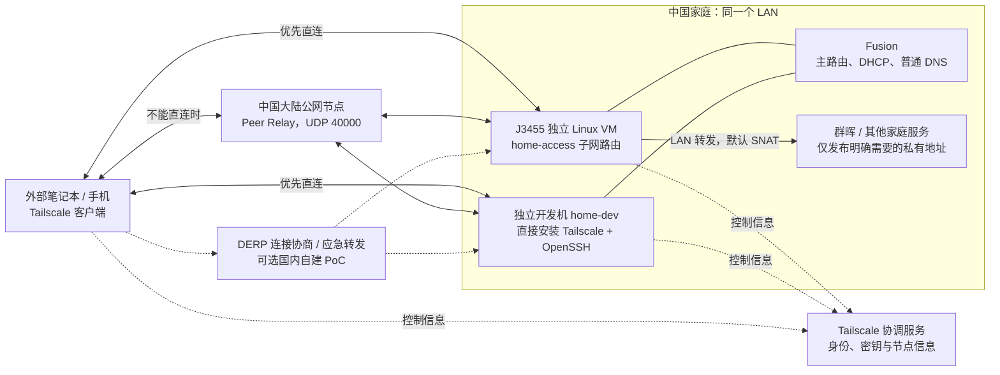

# 家庭服务远程接入设计：直连优先、国内中继备用

日期：2026-11-05（Asia/Shanghai）。状态：**方案已编写；设备、账户、云节点及家庭线路均未配置，实机验收为 `not_run`。** 用户已认可家庭私有网络接入方向，并要求详细方案提交远程仓库；本次交付不包含购买服务器或部署真实网络。

配套：[实施计划](../plans/2026-11-05-home-remote-access.md)、[验收与运行记录](../../validation/home-remote-access.md)、[现有网络拓扑](../../network-topology.md)、[基础设施台账](../../home-infrastructure-register.md)。

## 1. 目标与已确认约束

让用户自己的笔记本、手机在外面访问中国家里的群晖、开发机、VS Code Remote-SSH、Jupyter、Web/API、文件共享及远程桌面。按**中国家庭没有可供公网入站的 IPv4/IPv6**设计，不依赖申请公网地址、家庭 DDNS、UPnP 或运营商端口映射。

- 远程办公优先低延迟。美国家庭节点继续承担原有上网出口，不作为中国家庭服务的常规中转。
- 保留 Fusion 主路由、唯一 DHCP 和普通 DNS；家庭设备保持同一 LAN，不因远程接入增加 VLAN、修改 AP/布线或迁移全屋默认网关。
- 现有 J3455 是在用的 Proxmox/NAS/代理宿主（16GB、现 1GbE），不是空闲服务器。接入功能放独立 Linux VM，先核资源，不重装宿主或改造现有 NAS VM。
- 开发机可直接安装客户端；不能或不适合安装的设备通过子网路由访问。Mac Studio、高速 NAS 等计划设备不写成已到货。
- 初期按用户自己的设备允许安装客户端设计。无需客户端的公开网站、多用户对外托管、公共 API 发布不属于本方案首期。
- 远程接入 VM 停机不应影响其他家庭设备普通上网；不能承诺运行在同一 J3455 上的 NAS/HA 在宿主停机后继续服务。
- 本项目宽带规划是 1000Mbps 下载 / 30Mbps 上传，尚非实测速率。远程下载家庭文件主要受家庭上传影响。

## 2. 推荐架构与备选

### 2.1 主案：Tailscale + 直接接入的开发机 + 家庭子网路由

初期用现有设备验证直连；需要长期稳定的中继能力时，在**中国大陆线路合适的公网服务器**部署 Tailscale Peer Relay。它是专用转发节点，不是全局上网出口。[S1][S2]

业务连接优先级：

1. NAT 穿透直连，流量直接在外部设备与家庭节点之间传送。
2. 直连不可用时，尝试已配置且可达的国内 Peer Relay。
3. Peer Relay 不可用时，回退 DERP；默认 DERP 可能在境外，只视为可用性应急，不自动判定满足办公体验。

这不是“只要安装 Tailscale 就一定低延迟”。生产验收须记录 `direct`、`peer-relay` 或 `relay` 的实际路径，再测 SSH、Jupyter 和文件访问。

图中 VPN 接口、虚拟地址属于覆盖网络，不是新增家庭 VLAN；不会要求家里的所有设备修改地址或网关。虚拟组网通常提供三层 IP 互通，不保证 mDNS、广播、AirPlay 自动发现跨网工作。

### 2.2 Peer Relay 与 DERP 的选择

| 项目 | 国内 Peer Relay：主要备用路径 | 国内自建 DERP：可选试验 |
|---|---|---|
| 用途 | 不能直连时，以自有节点转发加密业务流量 | 无法使用直连/Peer Relay 时的连接协商与 TCP 转发备用 |
| 要求 | 服务端和参与客户端 Tailscale ≥ 1.86；可达的 UDP 端口；relay capability 授权 | 公网直接接入、域名/有效 TLS、TCP 80/443、UDP 3478、ICMP；编译和维护 derper |
| 网络限制 | 两端到节点的 UDP 不通时不能解决问题 | 可覆盖部分 UDP 受限环境；不是任意 HTTPS 代理/审计网络下都可达 |
| 成熟度/运维 | 官方现有功能；仍需现场验证版本、路径和带宽 | 官方文档当前标注 alpha；不作为未经验证的唯一恢复通道 |
| 数据可见性 | 转发端到端加密数据 | 转发端到端加密数据，不能解密业务内容 |
| 本项目安排 | 初次直连试点后，按外部网络实测选购节点 | 只有常用网络需要 TCP 备用或要求自有 DERP 时再做 PoC |

官方文档核验日期为 2026-11-05；稳定包索引当日返回 `1.104.5`，作为候选版本记录，不表示已经在 J3455、macOS 或 DSM 验证。部署时从官方稳定通道选择并记录实际版本；不使用低于功能要求的客户端。[S1][S2][S3][S10]

**国内中继不替代协调服务。** 注册设备、身份验证、策略更新和部分重新建连仍依赖 Tailscale 控制服务。已有连接在部分控制服务故障下可能继续工作，但不能承诺新设备登录、换网和重启恢复均正常。必须把这些情况纳入验收。

默认先保留公共 DERP 作为恢复选项。若以后要求“业务转发只使用自建国内节点”，须先验证国内 DERP，再配置 `OmitDefaultRegions`；这样会减少恢复路径。建议两个独立故障域、不同自定义 region 的 DERP 后再评估。单台 VPS 上同时运行 Peer Relay 和 DERP **不构成高可用**。[S3]

### 2.3 备选：国内 WireGuard 汇合点

若 Tailscale 登录/控制服务在常用网络长期不可用，或更重视固定路径及减少第三方控制服务依赖，可改为“外部设备 → 国内 WireGuard 服务器 ← 家庭接入 VM”。所有业务经国内服务器转发，不再自动尝试点对点直连。

- 家庭端主动连接、配置 `PersistentKeepalive = 25`；在 NAT 后保持映射，不需要家庭公网入站。[S9]
- 客户端只路由获准家庭主机及 VPN 地址，不下发 `0.0.0.0/0`；家庭端只路由 VPN 地址，默认网关仍是 Fusion。
- VPS 做明确的 VPN peer 间转发；家庭 VM 对发往 NAS 的流量做限定目的地址的 SNAT，或另设计完整回程路由。
- WireGuard 仍依赖 UDP。若外部网络完全限制 UDP，不能把它当成 DERP 的 TCP 替代品。
- SSH/Jupyter 的用法不变，但要更新主机地址和路由。切换时关闭原 Tailscale 子网路由，避免两套 VPN 同时抢相同目的地址。

首期不同时部署两套网络；实施计划提供备选切换边界，不把它写成已经自动故障切换。

## 3. 设备职责和资源

| 设备 | 责任 | 初始资源/要求 | 故障影响 |
|---|---|---|---|
| Fusion | 宽带出口、家庭 DHCP、独立普通 DNS、Omada | 现有采购基线；不假定可装 Tailscale | 主路由故障影响家庭上网和远程连接 |
| `home-access` VM | 子网路由，只发布需要的家庭服务地址 | 建议 1 vCPU、1GiB RAM、8GiB 系统盘、1×VirtIO 接现有 LAN 桥；先核宿主余量 | 经它访问的 NAS 等暂时不可达；不接管家庭基础网络 |
| `home-dev` | OpenSSH、VS Code Server、Jupyter/开发服务；直接加入 tailnet | 使用现有或未来独立开发机；系统需满足 VS Code 官方要求 | 开发服务停机；若独立物理机，不受接入 VM 停机直接影响 |
| 群晖 | 文件/照片/DSM | 初期优先经 VM 的子网路由，不要求修改现有非官方 DSM 环境 | NAS 所在宿主、存储或系统故障使服务不可用 |
| `cn-relay-1` | Peer Relay，可选同机 DERP 试验 | 建议从 1 vCPU、1GiB RAM 的短期实例试测；带宽和线路优先于 CPU 核数 | 仍可直连的会话不一定受影响；中继会话需要切换或重连 |
| 外部笔记本/手机 | Tailscale 客户端、应用客户端 | 个人身份登录；能实际连到控制服务和选定中继 | 本终端无法远程访问 |

未来若必须在 J3455 重启时继续访问“其他独立家庭设备”，可把子网路由迁到已有的独立常开机器，或增加第二台独立宿主上的子网路由。第二个 VM 放同一个 J3455 不解决宿主故障；J3455 自己承载的 NAS 也不会因网关冗余而保活。

## 4. 地址、路由与名称设计

以下均为**规划示例**，没有从现场读取实际地址。部署前核对地址、DHCP 保留和冲突，不按示例强行改现网。

| 角色 | LAN 示例 | 组网名称/访问入口 |
|---|---|---|
| Fusion | `192.168.50.1/24` | 首期不对外发布管理地址 |
| 可选规则代理节点 | `192.168.50.2` | 仅保留角色，不由本方案部署 |
| Proxmox | `192.168.50.3` | 首期不发布管理地址 |
| 接入 VM | `192.168.50.4` | `home-access`，使用分配的 Tailscale 地址 |
| 开发机 | `192.168.50.20` | 优先 `home-dev` 的 MagicDNS 名称或实际 Tailscale 地址 |
| 群晖 | `192.168.50.30` | 子网路由发布 `192.168.50.30/32` |
| 国内中继 | 不在家庭 LAN | `cn-relay-1`；公网地址由服务器分配 |

1. **开发机直接加入**：远程使用其组网地址；在家访问大型 NAS 文件时继续用真实 LAN 地址，保留本地交换路径。
2. **子网路由从单个主机开始**：首期只发布 NAS 的 `/32`，有新增服务再追加对应主机；全面访问能力不等于必须默认开放全部家庭设备。
3. **保留 Tailscale 默认子网 SNAT**：NAS 看到的来源是 `home-access` 的 LAN 地址，回复直接返回 VM；通常无需在 Fusion 增加到 tailnet 的静态路由。代价是 NAS 网络日志不再区分远程终端，身份依靠应用账户/组网策略记录。[S4]
4. **路由与授权分别配置**：广告路由、控制台批准路由、终端接受路由、grants 放行、系统防火墙放行五项均须满足。只批准路由不等于授权访问。
5. **网段冲突**：酒店/办公室也可能使用 `192.168.50.0/24`。开发机优先组网地址；NAS 的 `/32` 路由可减少整段冲突，但如果与当前终端地址或本地网关恰好相同，仍可能冲突。此时优先让支持的 NAS 直接加入、使用 SSH 本地端口转发或另做地址转换，不直接接管外部网络。
6. **名称解析**：MagicDNS 只为 Tailscale 节点提供名称，不会自动为 NAS 的 LAN 地址创建记录。首期 NAS 使用固定 IP/应用书签；需要统一内部域名时，再为 `home.arpa` 配置分域 DNS，仅把该域查询交给内部解析器。
7. Tailscale 的 `100.64.0.0/10` 地址属于私有覆盖网络使用，不是运营商给家庭分配了公网地址；可能与其他 VPN/运营商路由冲突，需要检查实际路由表。

家庭无公网 IPv6 不影响上述 IPv4 出站组网。保留现有 LAN IPv6/Thread 能力；不因远程接入去关闭全屋 IPv6 或修改 RA。

## 5. 各服务的实际使用方式

### 5.1 VS Code：Remote-SSH 为主

外部 VS Code 安装 Remote-SSH 扩展，SSH 连接 `home-dev`，打开开发机上的项目目录。代码、依赖、编译和模型/数据计算留在开发机，本地承担编辑器界面。[S7]

- 使用普通 OpenSSH、独立开发账户和 SSH 公钥；首期不启用 Tailscale SSH，避免把两套身份及 DSM 的功能差异混在一起。
- 首次安装 VS Code Server、扩展、容器依赖需要下载条件。安装失败要先查开发机和外部电脑下载路径，不能都归为 VPN 问题。
- 容器服务必须先映射到开发机可访问的端口；远程开发机上的 `localhost` 和笔记本的 `localhost` 是不同主机。
- 文件密集型工作不把远程 SMB 共享直接当作本地编译目录。使用 Remote-SSH 将文件操作和构建留在家中，可减少大量小文件往返。

### 5.2 Jupyter 和开发 Web/API

Jupyter 首选监听开发机 `127.0.0.1:8888`，通过 SSH/VS Code 端口转发到外部电脑的 `127.0.0.1:8888`；保留 token 或密码认证。浏览器的 HTTP/WebSocket 流量通过加密 SSH 隧道传输。[S7][S8]

前端开发服务例如远端 `127.0.0.1:3000`，API 例如 `127.0.0.1:8000`，按同一方法转发。VS Code 端口面板足够覆盖个人开发，无需给每个端口配置公网域名、证书或 frp。

需要手机浏览器直接访问时，可以将选定应用监听到私有组网接口，明确放行对应端口并保留应用认证；涉及安全上下文的浏览器功能使用有效 HTTPS。此扩展不默认把 Jupyter 改成无认证 `0.0.0.0` 服务。

### 5.3 群晖和文件共享

首期从外部通过子网路由访问 DSM 的**实际 HTTPS 端口**（默认示例 `5001`）及 SMB `445`；证书名称、应用账户、共享目录权限独立核验。组网连通不消除证书名称不匹配，也不等于已登录群晖。

未来官方 DSM 套件兼容通过后，可直接安装 Tailscale，减少对 `home-access` 的依赖。DSM 7 的入站访问与其他套件主动发起的 Tailscale 出站连接不同；后者涉及 TUN/`configure-host` 和重启持久化。官方 Synology 文档不能视为现有非官方 DSM 的兼容保证。[S6]

## 6. 与美国家庭出口、规则代理共存

- `home-access` 和国内中继不启用 exit node；本方案不宣传默认路由，不让所有互联网流量进入 VPN。
- 家庭接入 VM 的默认网关/DNS 指向 Fusion，启动、控制连接、NAT 探测和中继连接不依赖美国代理。
- 外部电脑上的实际 tailnet 地址、NAS `/32` 路由、国内中继公网地址、相关节点名称应走直接路径。全局 TUN、透明代理、规则 DNS 必须通过实际路由和流量验证，不只检查网页代理开关。
- 不将整个 `100.64.0.0/10` 盲目塞入另一套 VPN；按真实路由冲突和客户端规则调整。若使用 fake-IP，避免覆盖组网节点和内部解析域。
- 手机系统/客户端可能不能同时运行两个 VPN。必须验证 Tailscale 与原美国 VPN 是否能共存；不能共存时，以明确的客户端切换方式使用，不承诺同时在线。
- 美国节点不自动成为国内 Peer Relay，不给它配置本方案的 relay tag。它的现有 DDNS 可继续用于原有用途。

## 7. 国内节点的选购与费用方法

第一轮不年付、不购买新家用路由器。用短期可取消实例比较家附近及外部常用地区的线路；家宽到节点和外部到节点都要测试，不能只看服务器所在城市或“BGP”宣传。

| 项目 | 起步建议 | 扩容依据 |
|---|---|---|
| 本地设备 | 复用 J3455 独立 VM，开发机直接装客户端 | 宿主余量不足、需要宿主故障隔离时才考虑独立硬件 |
| 云计算资源 | 1 vCPU、1GiB RAM 作为试测起点 | 看转发时 CPU、内存和实际吞吐，不按广告核数判断 |
| 带宽 | 先试 20–50Mbps 级别的可用出口；按预算及产品计费选择 | 家庭实际上传、并发用户、桌面画质和文件任务 |
| 流量 | 记录按出站、双向或套餐流量计费的具体口径 | 云中继的实际出站字节和账单，而非只算家庭文件大小 |
| 域名 | Peer Relay 单独使用不要求购买业务域名 | 自建 DERP/私有 HTTPS 时再准备域名和 TLS |
| 第二节点 | 首期非必购 | 中继是工作刚需且单节点故障不可接受时增加独立线路 |

家庭上传若实际为 30Mbps，理论上限约 3.75MB/s；持续一小时约 13.5GB 单向应用数据（未扣协议开销）。5Mbps 中继出口理论仅 0.625MB/s，容易成为限制。远程 NAS 不会因本地 10G 交换机变成公网 10G。

月成本按“实例 + 公网带宽/流量 + 域名年费折月 + 备份/可选第二节点”计算。本文不把未询价的套餐写成确定报价，也不假设个人免费套餐永远保持现有额度。

## 8. 权限、运行和故障边界

首期只授权个人设备到开发机 SSH、NAS HTTPS/SMB、接入节点 SSH。Jupyter/开发端口通过 SSH 转发；不默认开放 Fusion、Proxmox、IoT 管理面或家庭所有端口。Tailscale policy 是允许规则累加，旧的全通配允许规则不会被新增窄规则覆盖。[S5]

普通 SSH 公钥、Jupyter token、身份提供商会话、Tailscale auth key 和状态文件都留在私有环境；仓库只放示例。服务账户、节点吊销、设备丢失后的撤权流程纳入验收。

| 故障 | 预期影响 | 恢复方式 |
|---|---|---|
| `home-access` VM 停机 | 子网 NAS 不可达；独立 `home-dev` 仍应能通过自身客户端访问 | PVE 本地控制台恢复 VM；不改全屋网关 |
| J3455 宿主停机 | 它承载的 NAS、HA、代理和接入 VM 均停机 | 恢复宿主；不能将 VM 隔离当成物理冗余 |
| 国内 Peer Relay 停机 | 直连可继续；需要中继的会话可能回退 DERP或断线 | 恢复节点/使用备用；记录回退后延迟和重连用时 |
| 控制服务不可达 | 已建立路径可能继续，新登录/策略/重建可能受限 | 分别测现有会话、换网和重启；长期不能满足时评估 WireGuard |
| 开发机休眠/重启 | SSH、Jupyter 和后台任务可能停止 | 配置供电时服务可用策略与开机自启；验证磁盘解锁/登录前行为 |
| 家庭上传被备份占满 | 交互抖动和延迟上升 | 对后台上传限速，预留交互余量；只有证据需要时再调网关 QoS |

Jupyter 的 Web 连接恢复不等于计算任务永不中断。需要长任务时用明确的会话/服务管理方式，测试断线、重启与任务持久化；不承诺断电后内存内核状态保留。

## 9. 验收门槛与推进顺序

1. 先在一台开发机和一台外部笔记本上验证直连、Remote-SSH、Jupyter；保持现网结构。
2. 再增加独立接入 VM，发布一个 NAS `/32`，验证访问与默认网络不受影响。
3. 用手机热点、常用外部宽带/办公网络分别测试；如果工作网络需要国内中继，再选节点并配置 Peer Relay。
4. 常用网络限制 UDP 时，按真实需要试验国内 DERP；若不满足稳定性/版本兼容，明确该网络尚不支持预期办公体验，不能以“偶尔能连上”验收。
5. 执行权限、故障、重启、代理共存测试，最后才标记正式可用。

建议体验目标（项目门槛，**不是对线路的保证**）：稳定路径下各关键网络至少 100 次 RTT 采样，p95 ≤ 80ms、丢包 ≤ 1%，连续使用 VS Code/Jupyter 30 分钟无异常断线；80–120ms 单列降级并由实际体验决定，持续高于 120ms 或交互明显卡顿不作为主要开发路径。网络切换恢复目标 ≤ 30 秒，具体以测试记录为准。

RTT 只是辅助指标；还需记录 WebSocket、保存/补全、目录枚举、文件吞吐、并发上传时的延迟以及远端 CPU。详细步骤和结果表见[验收单](../../validation/home-remote-access.md)。所有实机项目在实际执行前保持 `not_run`。

## 10. 官方依据与核验范围

以下页面于 2026-11-05 读取。文档中的支持条件来自官方资料；组合架构、资源建议、带宽目标和验收阈值属于本项目设计，不属于厂商性能承诺。

| 标记 | 官方来源 | 本方案采用的事实 |
|---|---|---|
| S1 | [Tailscale Peer Relays](https://tailscale.com/kb/1591/peer-relays) | ≥1.86、UDP 端口、relay capability、连接顺序、状态检查 |
| S2 | [DERP servers](https://tailscale.com/kb/1232/derp-servers) | 连接协商/备用、控制服务与 DERP 职责、默认区域、加密转发 |
| S3 | [Custom DERP servers](https://tailscale.com/kb/1118/custom-derp-servers) | 当日页面标注 alpha；公网直连、端口、客户端验证、DERP map、默认区域移除 |
| S4 | [Subnet routers](https://tailscale.com/kb/1019/subnets) | IP forwarding、路由批准、Linux 接受路由、默认 SNAT 与回程 |
| S5 | [Grants](https://tailscale.com/kb/1324/grants) / [Policy syntax](https://tailscale.com/kb/1337/policy-syntax) | 允许规则、标签、端口、策略 tests；路由与访问控制独立 |
| S6 | [Synology](https://tailscale.com/kb/1131/synology) | DSM7 TUN/出站限制；套件兼容边界；不支持 Tailscale SSH |
| S7 | [VS Code Remote-SSH](https://code.visualstudio.com/docs/remote/ssh) | SSH 远程开发、VS Code Server、端口转发、系统前提 |
| S8 | [Jupyter Server](https://jupyter-server.readthedocs.io/en/latest/operators/public-server.html) | 认证和服务监听配置、浏览器访问边界 |
| S9 | [WireGuard Quick Start](https://www.wireguard.com/quickstart/) | NAT 后主动连接、PersistentKeepalive 的用途 |
| S10 | [Tailscale stable package index](https://pkgs.tailscale.com/stable/?mode=json) | 核验时 Version 为 1.104.5；未来部署应重查实际稳定版本 |

本次只完成资料核验和仓库文档检查；没有建立真实 tailnet、登录设备、验证云节点位置或测量家庭 RTT。
