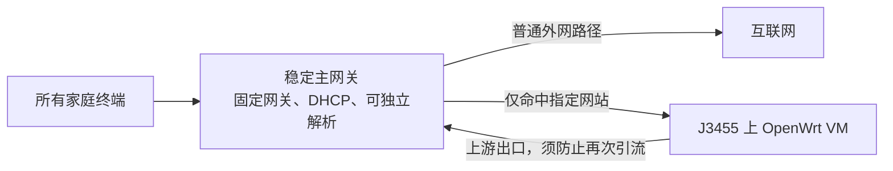

# Fusion 按站点分流与 J3455 故障隔离：修订设计

日期：2026-11-05。状态：**需求已确认；官方手册核验完成，优先试验定向 DNS 与静态路由组合，尚未部署或验收**。

最新结论：用户允许指定网站在 J3455故障时不可用，因此优先设计为**普通流量一直直接经过 Fusion，只有指定网站交给 J3455**。Fusion 专用手册已确认域名策略规则，但其出口选择与静态路由的 LAN 下一跳属于不同配置，未提供“域名规则直接填写任意 LAN 下一跳”的界面。另已确认 Local DNS / FORWARD；优先试验**指定域名定向 DNS + 专用合成地址段静态路由 → J3455**。各组件有官方依据，组合及故障表现未实测。详见[完整调研及手册页码](../../fusion-domain-routing-capability-research.md)。

本补充覆盖[原设计](2026-11-05-home-rule-routing-design.md)中“全屋默认网关、唯一 DHCP 和 DNS 均交给 J3455”的推广决定。原文仍可用于隔离 VM 和单设备试验；[原实施计划](../plans/2026-11-05-home-rule-routing.md)的全屋 DHCP 切换暂停，不应按旧步骤投入全屋使用。

## 1. 用户已经明确的目标

- 可以在 J3455 现有 Proxmox 上新增 OpenWrt，优先完整虚拟机；保留现有宿主和存储。
- 全屋设备正常时使用网站规则。
- J3455 故障后，**普通上网继续可用，不需要家人改网关、续租或重启设备**；普通流量一直不经过 J3455也满足这个要求。
- 原本依赖指定出口的网站，故障时可以暂时无法访问；不要求它们通过普通出口也能打开。
- 用户对树莓派自身稳定性提出疑问；不把它默认为备用设备，也不把全屋 DHCP 移给未经核验的树莓派。

“自动恢复普通上网”与“所有会话一帧不丢”不同。故障检测、邻居更新、路由/NAT变化可能造成短暂停顿和已有连接重建。需要给出实测恢复时间，不能把自动切换写成绝对零中断。

## 2. 对前版方案的修正

前版单台 OpenWrt 是全屋默认网关、唯一地址服务和 DNS；它掉线后靠人工切回 Fusion。该方案能够做全屋规则，**不能满足现在明确的自动恢复要求**。

在同一 J3455 上再开一个容器或第二台 VM，只能分离应用，不能覆盖宿主掉电、宿主崩溃、网口或存储故障。改容器为 VM不会凭空带来宿主故障时的备用路径。完整 VM仍因内核与防火墙隔离更适合首期规则服务。

树莓派不是必然比 J3455可靠或不可靠：型号、供电、存储介质、散热和负载都影响稳定性。第二台机器的价值在于不与 J3455共用宿主故障，并非单机必须更强；但如果把全屋唯一 DHCP/DNS放在它上面，它又成为另一处关键依赖。此轮不把这个复杂度作为默认方案。

## 3. 优先验证的架构：Fusion 只把指定网站交给 J3455

推荐保持主网关、DHCP和普通 DNS在 J3455之外。客户端的默认网关、DNS不因 J3455状态而变化，由 Fusion只把指定网站流量交给 J3455，普通网站直接走宽带。指定网站故障时可继续匹配到不可用的 J3455；用户允许这部分失败，普通网站路径无需变化。不能把所有终端或全部流量都匹配到 J3455，再称作“仅指定网站”。

优先候选的具体机制是：Fusion 仅把指定域名的 DNS 查询转给 J3455；规则引擎为这些域名返回专用合成地址，Fusion 再按该地址段的静态路由将连接交给 J3455。普通域名独立解析为真实地址，继续走 Fusion。不要把网站直接解析为 J3455 的管理 IP，也不要把全部查询转给 J3455。

这仍是**组件能力已确认、组合行为待验证**的设计。实施需核对以下项目；自动切换只在后来选择“所有流量先经 J3455”时才是必要条件：

| 能力 | 要验证的具体结果 |
|---|---|
| 下一跳与匹配 | 验证专用合成地址段静态路由指向 VM 的 LAN IP；域名匹配由定向 DNS 与引擎映射衔接，普通出口保持独立 |
| 服务健康检测（可选增强） | 可提示指定网站服务故障；只按指定网站引流时，普通路径的可用性不依赖这个检测 |
| 自动撤销故障路径（本需求不强制） | 用户允许指定网站暂时不可用，因此无需为这部分强行安排普通出口后备；若全流量经 J3455，才必须另做检测和撤销 |
| 返回路径与防回环 | OpenWrt转交回主网关的流量不会再次被交回 OpenWrt；按源地址/接口/传输网段明确排除 |
| 解析独立可用 | DNS不能唯一依赖故障 VM；普通域名解析在 VM停机后仍可完成 |
| 域名规则正确 | Fusion FORWARD 清单与引擎合成地址清单一致；分别核验子域、CNAME、应用自身解析和实际作用范围 |
| 真实地址与缓存 | 普通站点始终使用独立解析的真实地址；仅指定站点使用合成地址。验证引擎重启后的映射及多级缓存，避免普通流量依赖 VM |
| 恢复防抖 | 服务恢复后充分验证，再延迟或手工恢复规则；不要立即抢回造成反复掉线 |
| IPv6 | 与 IPv4同样验证旁路路径和故障行为，保留本地 IPv6/Thread能力 |

只有静态 IP路由并不等于具备自动维护的网站域名规则。网站可能使用多个 IPv4/IPv6地址、共享 CDN并随时间变化；手工查一次 IP填静态路由容易漏流量，也可能把共用同一 IP的普通站点一并引向故障 J3455。域名过滤/封锁功能也不能直接当成域名路由功能。仅把终端网关改回 Fusion，规则服务不会自动接管流量；同样不能把 DNS随意设成两个地址，期待终端严格按主备顺序工作。

## 4. Fusion 当前核验结果

主要依据更新为 [Fusion Gateway 专用手册 REV1.0.1](https://support.omadanetworks.com/us/document/123305/)，而非早期其他网关的通用教程。手册共 576 个 PDF 页面，官网标注更新于 2026-10-19。

| 功能 | 手册印刷页 / PDF 页 | 核验结论 |
|---|---|---|
| 域名策略匹配 | 221–222 / 256–257；272 / 307 | 支持 Domain-Port Group，域名组支持通配符，每组最多 16 个域名 |
| 策略出口 | 221 / 256 | Interface 说明选择 WAN；没有任意 LAN 下一跳 IP 字段 |
| 静态路由 | 219–220 / 254–255 | 目的 IP/网段匹配，支持 Next Hop IP |
| Local DNS | 118–119 / 153–154 | FORWARD 可将指定域名查询交给指定 DNS 服务器 |

[Omada LAN DNS 官方说明](https://support.omadanetworks.com/us/document/40077/)进一步确认终端必须使用网关作为 DNS；应用自带 DNS 不自动受该功能控制。[Mihomo DNS 文档](https://wiki.metacubex.one/config/dns/)确认合成地址与仅匹配域名返回合成地址的模式。**三者结合值得试验，但文档没有证明整套组合已经兼容或覆盖全屋应用。** FORWARD 的通配匹配、作用 LAN、响应过滤、缓存、IPv6 和普通解析在指定上游故障时的表现都需实测。

已读 Fusion 2.5G(UN) V1 / V2 发行说明，分别包含内置控制器 6.3.14 / 6.3.14.2；具体固件与来源见[调研报告](../../fusion-domain-routing-capability-research.md)。[Fusion 软件架构说明](https://support.omadanetworks.com/us/document/137773/)要求区分 OS 与 Network Application。现场还须记录地区、硬件版和实际软件版本，不能把公开版本当作已安装版本。

当前可以继续准备隔离 VM 和受控试验。不能宣称原厂存在直接“域名 → LAN 网关”的一条配置，也不能宣称合成地址组合已通过故障隔离验收。无须据此先增加树莓派或备用 VM。

## 5. 条件不满足时的选择

| 方案 | J3455 故障影响 | 代价与结论 |
|---|---|---|
| 原版单 OpenWrt VM作为全屋网关 | 全屋外网中断，需要人工恢复 | 不满足新要求，暂停全屋推广 |
| **Fusion保持主网关，定向 DNS + 合成地址段静态路由交给 J3455** | 目标是普通流量和解析独立，指定网站可暂时失败 | **最先验证**；组件有官方依据，组合与故障影响未实测 |
| 独立主网关把全部流量交给 J3455，并具备健康检测和退回 | 普通外网短暂停顿后恢复；指定网站可暂时不可用 | 比仅站点分流多故障切换复杂度，不是默认选择 |
| **独立网络设备承担 OpenWrt和网站规则** | J3455不在网络服务路径内，正常网络不因它停机而切换 | 增加或调整一台网络设备；功能集中、故障关系清晰。若只担忧 J3455稳定性，这是更简单的结构性解决方式，尚未决定采购 |
| 独立可编程网关负责普通路径，J3455只负责规则数据处理 | 独立网关自动撤销规则路径，普通外网恢复 | 需额外网关和明确的引流/传输网段设计，不在 Fusion上盲目套配置；只在确需保留 J3455规则引擎时比较 |
| 第二台独立 OpenWrt与虚拟网关地址接替 | 备用可接管普通路径；会话可能重建 | 需要额外独立常开设备、DNS/地址服务安排及接替演练；本轮不默认选树莓派，不展开购买或部署 |

独立设备也会有自己的硬件故障；采用独立规则网关解决的是“J3455停机牵连全屋上网”，不等于单设备网络获得全面双机冗余。无需为故障时继续使用指定网站复制一整套节点系统，因为用户已明确允许这部分暂时不可用。

## 6. 故障隔离验收门槛

先按[调研报告的小范围试验顺序](../../fusion-domain-routing-capability-research.md#6-小范围试验与退出条件)验证，再制定全屋部署步骤。先确认 FORWARD 的作用范围，不能假定全局 DNS 规则只影响一台试点设备。原计划第1–3任务的盘点、离线资料与隔离 VM 准备可复用；第4–5任务的旧网关接管方式须重写，第6–8任务仍不得按原全屋迁移方式实施。优先结构的预期是普通流量完全不改路径；若采用全流量故障退回变体，则另记录恢复时间：

1. 正常状态：有线、无线各一台终端验证规则；普通站点经 Fusion直接访问，指定站点才经 J3455。
2. 只停规则引擎而保留 VM：指定网站可以失败，普通 DNS 缓存命中与未命中、已有普通会话及新连接仍正常；指定查询超时不拖累普通解析服务。
3. 正常关闭 OpenWrt VM：不用修改终端网关、DNS或租约，普通站点路径不变。
4. 正常关闭 J3455宿主：验证和第3项相同；保全存储，不以硬拔电代替正常演练。
5. 断开 J3455单根数据线：其他房间仍能自动使用普通外网；电竞房交换机和上联本身完整时，本房其他终端也应如此。
6. 检查缓存：普通站点不能因残留合成地址持续失败；指定网站故障单独记录，符合用户允许范围。
7. 重新上线：规则服务健康后稳定观察，按计划恢复，不反复切换；已有会话的重建范围和时间如实记录。
8. 区分上游故障：光猫、Fusion、宽带或整个交换机故障不能由 J3455备用路径解决，不能混成已覆盖的故障。

上述全部为 `not_run`。优先结构要求普通网站不因 J3455故障改变路径。只有选择全流量故障退回变体时，才另外提出恢复时间指标；不能把这个指标混入“不经过 J3455”的普通路径，也不能承诺所有场景绝对零丢包。

## 7. 下一步与不变项

OpenWrt完整 VM选择保留；初始资源2vCPU/2GiB/8GiB仍需现场资源盘点。J3455位置、现有线缆、三 AP和交换机采购基线不变。Fusion 保留普通上网、默认网关、DHCP 与普通 DNS，下一步验证定向解析与专用地址段转发组合；尚未更改家庭网络，也未决定购买独立设备。

原方案的独立备份、管理 IP、DNS启动依赖和本地家庭设备发现检查仍适用。自动恢复不能只靠一句“旁路由断了主路由还在”，必须有以上实际转发与解析证据。
