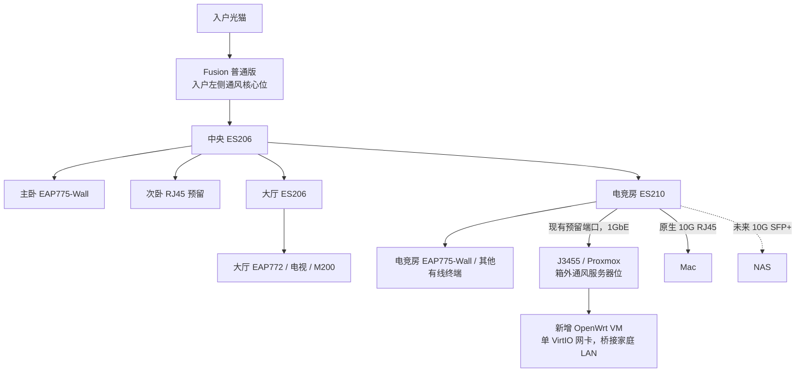
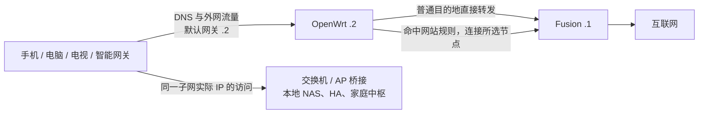

# 全屋规则分流与 J3455 旁路由设计

> **同日需求修订，以[故障隔离与 Fusion 规则核验](2026-11-05-home-rule-routing-availability.md)为准。** 用户要求 J3455掉线时普通上网继续可用，允许指定网站暂时不可用。最新[官方手册调研](../../fusion-domain-routing-capability-research.md)已确认域名策略、静态下一跳及 Local DNS FORWARD；域名策略界面没有任意 LAN 下一跳字段。优先试验定向 DNS + 专用合成地址段静态路由，Fusion 保留默认网关、DHCP 和普通 DNS，组合未实测。本文下方“OpenWrt作为全屋网关和唯一DHCP”的旧主案只保留作历史试验参考，不再作为全屋实施决定；原全屋切换步骤暂停。

日期：2026-11-05。状态：**设计与实施建议；尚未部署、未做实机兼容和性能验收**。

配套：[实施计划](../plans/2026-11-05-home-rule-routing.md)、[验收与应急操作单](../../validation/home-rule-routing.md)、[现行物理拓扑](../../network-topology.md)、[基础设施台账](../../home-infrastructure-register.md)。本文使用中性名称记录设备与出口规则，真实节点地址、口令、订阅地址不入库。

## 1. 结论与范围

推荐沿用现有 **J3455 → 电竞房 ES210XPP-M2** 的一根网线，在现有 Proxmox 上新建一台 **OpenWrt x86-64 完整虚拟机**，使用 **OpenClash 管理界面 + Mihomo 规则引擎**。Fusion 继续负责宽带接入、上游路由、边界防护及 Omada 控制器。首期不加爱快、不重装 J3455、不增加物理回线、不购买第二台交换机。

用户已选旁路由方案，并确认**所有联网设备都要覆盖**。因此，本案采用全屋终端的默认网关和 DNS 指向 OpenWrt，由 OpenWrt 统一按域名和设备执行规则；普通网站默认直接访问，指定网站选择指定出口。无线、有线、AP 下联终端使用同一套规则，不需要为不同网站切换无线名称。

“旁路由”描述的是接线方式。全屋终端把它设为网关后，它就在全屋互联网访问的关键路径上：**J3455、虚拟机、单根接入线或电竞房交换机停机，都可能造成全屋无法上网**。本案提供经过演练的人工恢复方法，不承诺无人干预的故障切换。

全屋覆盖包括本家庭 LAN 的手机、电脑、电视、网关、摄像机及各独立虚拟机。Zigbee 传感器等没有独立家庭 IP 的设备，经其网关联网，不逐个分配地址。Fusion、OpenWrt 自身、Proxmox 管理面是必要的上游与恢复例外：它们的启动、解析和管理不依赖规则服务。访客网络、未来独立 VLAN 如启用，必须另做网关与地址服务设计，不能默认已被本单网段方案覆盖。

## 2. 已知事实、建议与部署前输入

| 项目 | 当前事实 | 本案处理 |
|---|---|---|
| 核心设备 | 普通 Fusion + 中央 ES206；网络设备仍为规划、未部署 | 沿用当前采购主案，不把设备当成已经到货 |
| 主干与房间 | 四条 Cat6A；大厅 ES206、电竞房 ES210；主卧 775、电竞房 775、大厅 772 | 保持数量、端口和施工路线 |
| J3455 | 已有，16GB 内存、10TB 存储、现 1GbE、Proxmox；运行存储 VM 和转发容器 | 新增独立 VM，保留原存储服务；旧规则容器仅在迁移成功后停用重叠功能 |
| 主机资源 | 现有内存占用、SSD、数据存储布局及 PVE 版本未知 | 实施计划第一阶段现场读取，不按 10TB 推定有可用 SSD |
| J3455 网卡 | PCIe 2.0 x1；2.5G TX201 只是待验候选 | 首期用现有 1G，确认瓶颈后再决定；不同时迁移宿主桥接 |
| HA | 已决定未来独立 HAOS VM，尚未实施 | 不把 OpenWrt、HA、存储合装成一个系统 |
| 当前地址 | 未读取实际子网、网关、租约或静态地址 | 本文 `.50` 网段仅示例，优先沿用现场实际子网 |
| 宽带 | 计划 1000/30Mbps，不是实测速率 | 先测普通接入基线，再测规则效果 |
| 公网 IPv6 | 当前需求及 Fusion 配置未核实 | 首期建议家庭外网先用 IPv4；保留本地 IPv6，详见第 8 节 |

实施前必须得到的实测输入：PVE 版本、实际 LAN/桥名、宿主及各来宾地址/路由、可用 VMID、可用内存和本地数据存储、所有固定地址设备、Fusion 实际固件及 DHCP 设置能力、实际节点 TCP/UDP 能力。各输入在验收表登记；未知值不能套用示例替代。

## 3. 系统和部署形态选择

| 候选 | 适合之处 | 放进本案的代价 | 选择 |
|---|---|---|---|
| **OpenWrt 完整 KVM VM** | 独立内核、网络栈、防火墙和服务；可单独备份、恢复；域名规则生态较合适 | 要维护一台小 VM，配置必须验证 | **主案** |
| J3455 裸机 OpenWrt | 没有宿主虚拟化层，网络系统直接用硬件 | 需要重装宿主、迁移存储及未来 HA；存储和家庭网关恢复边界被合并 | 不选 |
| 爱快完整 VM | 多线路接入、带宽和设备管理集中；适合需要其网关功能的场景 | 当前只有一条宽带；与 Fusion 职责重叠，本案仍需验证域名规则组件接法；增加维护层 | 本轮不用，不把“不采用”等同于产品完全没有相关能力 |
| OpenWrt LXC / Docker | 较省虚拟化开销 | 共用宿主内核，网络权限、TUN、内核模块和防火墙耦合；恢复时要同时理解宿主网络 | 不作全屋网关主案 |
| 单独 Mihomo 容器 | 适合已有容器服务、单机显式接入或独立规则引擎 | 它本身不替代完整的全屋网关、DHCP、DNS 和防火墙安排；补齐后复杂度上升 | 旧环境可保留供回看，不与新网关争抢流量 |

不选裸机 OpenWrt：J3455 已承担存储及后续 HA，重装宿主会扩大迁移范围。也不采用 Fusion → 爱快 → OpenWrt 三层叠加；当前需求不需要三套网关系统。

候选版本如下，查阅日期为 2026-11-05；**已核对发行文件存在，不表示这组组合已实测通过**。正式安装前复查维护公告和相互兼容性，试点通过后冻结版本；不追随每日构建自动更新。

同日爱快官方下载页显示 x64 版本 `iKuai8_3.7.26_Build202609111743`，页面标注最低 4GB 内存和 1GB 磁盘。J3455 虽有 16GB总内存，但还需保留现有来宾、宿主及后续 HAOS预算；更重要的是本案没有多线路接入需求，故不额外给爱快分配资源、也不叠三套网关。若以后把 Fusion 改为透明桥接且由 J3455统一承担宽带拨号/线路管理，才重新比较爱快与 OpenWrt，而不是先买硬件。

| 组件 | 候选 | 说明 |
|---|---|---|
| Proxmox | 保留现场现有版本 | 先盘点，首期不为此升级宿主大版本 |
| OpenWrt | `25.12.6`，x86/64，ext4 combined 非 EFI 镜像 | 与 SeaBIOS 配套；本代使用 `apk` 包管理 |
| OpenClash | `v0.48.002`，`luci-app-openclash-0.48.002.apk` | 安装前核对发行页及依赖；不装本代不匹配的 ipk |
| Mihomo | `v1.19.33`，`mihomo-linux-amd64-v1-v1.19.33.gz` | J3455 使用 amd64 v1；不选需要 AVX/AVX2 的 v3 构建 |

## 4. 设备位置、接线与无线频段



J3455 放在**电竞房交换机附近的箱外通风服务器位**，与现有存储一起考虑温度、硬盘震动和可维护电源。不要塞入密闭弱电箱，也不必为了旁路由搬到大厅。它是普通网口取数和独立市电供电，不使用交换机 PoE 取电。

ES210 的 J3455 端口已经在现行端口表内分配；宿主、存储 VM、HAOS VM 与新增 OpenWrt VM 复用宿主桥接和这一根物理线。它们各有自己的 MAC/IP，**不等于再占四个物理端口**。电竞房八个 2.5G 铜口仍按原分配，不把新增 VM 算成可免费增加一台实体设备。

别人把主路由放大厅，再拉回线到弱电箱，通常是因为主路由自带无线，需要放在信号好的位置：去线连接光猫与路由 WAN，回线把路由 LAN 送回交换机。你的 Fusion **没有 Wi-Fi**，无线覆盖由分散的 AP 完成，留在核心位即可，因此没有这个搬机和回线需求。PoE 只是交换机给 AP/网关供电的能力，不决定主路由必须放在哪里。

AP 的三频是 **2.4GHz、5GHz、6GHz** 三组无线频段；它们既不是三个外网出口，也不要求三个路由器。设备通过任一实际启用的频段入网，随后按相同网关规则访问。6GHz 的当地可用性沿用项目已有核验边界，不计入本案保证能力。AP 使用有线回程，保持桥接接入，不另开 DHCP 或二次路由。

## 5. 逻辑角色、地址与地址服务

### 5.1 示例参数

现场如果已经使用别的私有子网，**保留原子网并统一替换整张表**。不得仅把 OpenWrt 改成示例地址，导致它与家中设备不在一个网段。

| 名称 | 示例值 | 职责 |
|---|---|---|
| `LAN_CIDR` | `192.168.50.0/24` | 首期单家庭网段 |
| `FUSION_IP` | `192.168.50.1` | 上游出口；基础设施恢复网关；独立上游解析 |
| `RULE_IP` | `192.168.50.2` | OpenWrt 管理地址；全屋终端默认网关、DNS、唯一 DHCP 服务 |
| `PVE_IP` | `192.168.50.3` | 宿主固定管理地址；自己的网关/DNS 指向 Fusion |
| `ADMIN_IP` | `192.168.50.10` | 仅应急笔记本手工使用；必须确认未占用 |
| 固定/保留范围 | `.20–.99` | AP、交换机、网关、存储、HA 等按清单分配；网关/DNS仍按本案 |
| 动态范围 | `.100–.199` | 普通终端；正常租期 `12h`，迁移期短租期 `10min` |

`.1/.2/.3/.10` 均在动态池之外。基础设施可以使用 DHCP 保留或终端静态地址，但要记清配置实际存在哪里。手机随机 MAC 会影响按 MAC 保留和设备规则；家庭 SSID 上固定该设备的私有地址模式，或把变化记录进台账，不根据临时地址永久识别设备。

### 5.2 为什么主案把 DHCP 也交给 OpenWrt

不能未经核验就假定 Fusion 固件可以通过 DHCP 下发“另一个默认网关”。主案因此使用 **OpenWrt 作为该 LAN 唯一 DHCP 服务器**，同时下发自己的网关和 DNS；Fusion 的该 LAN DHCP 在正式切换时关闭。Fusion 的宽带接入、路由及控制器继续工作。

| 阶段 | Fusion DHCP | OpenWrt DHCP | 终端使用方式 |
|---|---|---|---|
| 原网络/盘点 | 开 | 关 | 网关/DNS使用原网络 |
| 单设备试点 | 开 | 关 | 只有试点设备手填 `.2` 网关/DNS |
| 全屋正式切换 | **关** | **开** | 所有普通终端网关/DNS为 `.2` |
| 应急恢复 | **开** | **关或虚拟机已停止** | 所有普通终端网关/DNS恢复 `.1` |

切换过程中允许地址服务短暂停顿，禁止两台服务器同时向同一 LAN 发租约。修改 DHCP 不会立即更改已有租约，手工写死的地址也不会自动更新：需要主动续租、重连，必要时逐台改静态网关/DNS。所有硬编码设备、存储 VM、未来 HAOS 都纳入清单。

只有在到货固件明确支持、现场验证实际下发正确网关和 DNS 后，才可以另选 Fusion 保留 DHCP 的变体；那时 OpenWrt DHCP 必须一直关闭，验收表也需改为唯一服务端 Fusion。它不是本案依赖条件，也不与主案混用。

### 5.3 数据包实际经过哪里



上图是逻辑顺序，数据仍沿现有交换机和主干传输。同网段设备先判断目标在本地，再通过交换机或 AP 互通；Mac ↔ 同 VLAN 的未来 NAS 本地 10G 不绕 J3455。跨网段、未来访客网络和外网访问另算，不能把“所有访问都走网关”误套到本地二层交换。

Fusion 看到经过旁路由转换后的外网源地址可能主要是 `.2`，因此其按终端统计、终端带宽策略及自动映射能力可能受限。Omada 的 AP/交换机管理仍保留，外网逐终端排障应结合 OpenWrt 日志；应用对 NAT 类型、UPnP、入站映射的要求必须单独验收，不能承诺原有自动映射原样有效。

除 Fusion 自身上游功能、OpenWrt自身启动解析、PVE 宿主管理外，AP、交换机、存储 VM、HAOS、网关和其他有家庭 IP 的终端都按 `.2` 设置默认网关与 DNS；它们对同一 LAN 管理地址的访问仍直接交换，不经过规则引擎。要把 PVE 宿主本身的普通更新流量也纳入策略，可以把其默认网关改为 `.2`，但这会让宿主管理的跨网段可达性依赖 J3455 VM；首期保留宿主恢复例外，实际需求另行确认。

## 6. 虚拟机参数及隔离

| 设置 | 首期建议 | 原因与限制 |
|---|---|---|
| CPU | 2 vCPU，类型 `host` | J3455 核心性能有限；不能据此保证千兆规则处理 |
| 内存 | 固定 2GiB，初期不启用动态回收 | 先留出确定预算；大规则表增加占用，需按峰值观察调整 |
| 磁盘 | 8GiB，位于已核验的宿主本地可靠存储，优先 SSD | 不依赖需先启动存储 VM 才能挂载的共享路径；不改动 10TB 数据盘 |
| 固件/镜像 | SeaBIOS + 非 EFI ext4 combined | 不混用 OVMF/EFI 配置 |
| 网络 | 1×VirtIO，桥到现有家庭 LAN 桥，固定 MAC | 不直通网卡，不重建宿主桥，不新增 VLAN |
| 初次开机 | 网卡链路先断开，用 PVE 控制台设置 | 默认地址和默认 DHCP 不能直接带入家庭 LAN |
| 启停 | OpenWrt 先启动，预留约 30–60s，再起依赖来宾；关机顺序相反 | 具体 PVE `order/up/down` 现场核对，顺序不等于健康检查 |
| 服务范围 | OpenWrt 只做网络服务 | 不在这台 VM 里装存储、HA、下载和模型服务 |

**8GiB 虚拟盘不等于已经有 8GiB 可写根分区。** 官方镜像导入后要核实 guest 的根分区与文件系统实际大小。主案采用新 VM 离线挂载 GParted Live，在确认只有新虚拟盘可见后扩展其根分区/文件系统；完成后卸载 ISO、恢复磁盘启动，再以 `df -h` 核验。绝不能对宿主磁盘或存储数据盘照抄分区操作。

16GB 是总量，不是可全分配给新 VM 的空闲量。盘点后应同时为已有存储 VM、PVE 本身和计划中的 HAOS 留预算；若不足，先减少规则规模或调整已确认可调整的负载，不能以持续交换内存换取全屋网关勉强启动。规则引擎、DNS 服务和宿主一起监测内存、CPU、温度及磁盘等待。

## 7. 单臂转发、防火墙与解析

### 7.1 同一网口收发需要对称回程

示例电脑 `.100` 把外网包发给 `.2`，`.2` 再从同一 LAN 接口交给 `.1`。如果 `.2` 原样保留 `.100` 源地址，Fusion 可能直接把回包交给 `.100`，绕过 OpenWrt 的会话处理。网关还可能发送 ICMP redirect，提示终端直接改走 Fusion。两者都会让规则效果不稳定。

本案选定的基线是：**标准 fw4 防火墙负责单臂转发和 SNAT；OpenClash 不再额外开启旁路兼容地址转换**。LAN 区域允许必要的同区转发，对源于家庭子网、目的地址不在家庭子网的 IPv4 出口流量做 masquerade；实际规则在实施计划中给出。IPv4 `send_redirects` 和 `accept_redirects` 在实际 LAN、`all`、`default` 上关闭，并持久化核验。软件和硬件 flow offload 在首期关闭，防止规则会话绕过处理链。

OpenClash 的 `bypass_gateway_compatible` 是另一个可用的 SNAT 实现，已从发行源码确认其会建立选择性 masquerade 链。**本案不同时开启两个实现**。若后续版本要求改用插件兼容模式，必须先移除本案标准 LAN masquerade，重新完成普通转发、规则访问、停止服务和重启四组验收，再更新本设计。不得停掉整个防火墙来“解决”通信。

验收必须同时看请求和回包：Fusion 方向应看到源为 `.2`，回包经过 `.2`；本地 NAS 流量仍以本地终端原地址直接互通。真实规则效果依赖具体固件与插件交互，静态配置审核不能替代抓包。

### 7.2 DNS 分工和启动顺序

正常解析链为：**终端 → `.2:53` 的 dnsmasq → OpenClash 接管的规则解析 → 独立上游解析服务**。本地域名、固定映射和租约名称由 OpenWrt 保存，家庭域建议使用 `home.arpa`；`.local` 继续由 mDNS 处理，不当作公共 DNS 后缀。

Fusion 自身的解析使用运营商或现场验证的独立上游，**不能反过来依赖 `.2`**。OpenWrt 系统和规则节点域名的启动解析也必须有不依赖规则节点的路径；规则引擎不能为了查到自己节点地址先去连接那个节点。PVE 管理面保持固定 `.1` 网关及独立解析。

首期候选采用 OpenClash 的 **`fake-ip-mix`**：TCP 使用重定向处理，UDP 使用 TUN；优先 `system` 协议栈。插件接管所需路由/标记，**不另叠加一套手工 TUN 自动路由脚本**。`home.arpa`、实际本地服务域及需要真实局域网 IP 的发现域必须排除合成地址处理；修改后用实际返回值验证，不能只看“已勾选”。

DNS 不可用会表现为“有地址但打不开网站”，所以普通转发、普通 DNS、规则 DNS 分别测试。首次装包时先保留普通上游 DNS，待单设备验证后才启用规则接管。关闭规则服务后需恢复普通上游 DNS、移除失效重定向并清理客户端缓存；停止进程本身不保证自动恢复。

对于写死普通 DNS 的终端，可以在确认插件接管范围后，在 LAN 内接管 IPv4 UDP/TCP 53；OpenWrt 自身、Fusion 和必要基础设施须排除，避免回环。应用内加密解析、系统私有中继、客户端独立规则服务或缓存可能影响域名判断；需要逐设备验证及设置配合，不能靠接管 53 保证识别所有域名。IP 直连仍可按 IP 规则处理，但通常无法还原它原本对应哪个网站。

首期不额外安装第二套解析过滤系统，以免同时维护多条解析链。后续要加广告过滤，应在当前基线验收后单独变更。

### 7.3 规则次序与维护边界

规则是**按域名/站点或目的 IP**决定出口，不能直接按加密网页地址里的某一个路径决定。例如同一站点的 `/news` 与 `/video` 通常不能仅靠路由器域名规则分开；不同子域名可以分别匹配。

建议从上至下使用以下次序：

1. 本机、家庭实际网段、其他已登记内网段及本地域名直接访问。
2. 确有需要的设备专用规则，例如电视相关服务直接访问；记录为什么设置，避免把设备整台设为直接访问后仍期望它命中网站规则。
3. 用户指定网站的域名、所需子域和服务依赖域 → `RULE-OUT` 节点组。
4. 其他没有命中的流量 → `DIRECT`。

以下只是放入插件“用户规则”的**无凭据片段**，不是可独立启动的完整配置。`example.com` 为说明域名，正式试点时换成用户选定的真实测试站点，并保留原有必要的网络保留地址规则。

```yaml
rules:
  - DOMAIN-SUFFIX,home.arpa,DIRECT
  - IP-CIDR,192.168.50.0/24,DIRECT,no-resolve
  - IP-CIDR,10.0.0.0/8,DIRECT,no-resolve
  - IP-CIDR,172.16.0.0/12,DIRECT,no-resolve
  - IP-CIDR,192.168.0.0/16,DIRECT,no-resolve
  - DOMAIN-SUFFIX,example.com,RULE-OUT
  - MATCH,DIRECT
```

示例中的私有网段必须与现场路由核对；这里只展示次序，不声明已穷举所有系统保留地址。`RULE-OUT` 组由凭据保管区内的实际节点建立，组内可以换备用节点，**不把 DIRECT 填作指定站点的静默后备**。这样节点不可用时，该站点报错；普通网站仍能直接访问。若用户手工进入应急普通模式，则明确暂停网站规则，而不是假装规则仍生效。

订阅/节点数据只更新节点列表，由本地持有规则次序、默认行为和设备例外；不得导入一个完整外部配置后悄悄覆盖所有者规则。节点连通探测地址不能用于证明每个网站都可用。日志只保留必要诊断时间，截图和导出文件移除订阅、密钥、完整访问记录。

### 7.4 UDP、游戏和本地发现

TCP 可用不等于节点支持 UDP。分别试游戏、语音、QUIC、流媒体，记录它们走直接出口还是指定出口；不默认全局禁止 UDP 443 来掩盖 UDP 不通。必要时为具体服务设例外，并重新验证域名依赖。

mDNS、广播和本地多播应在 LAN 本地正常传递，不把 UDP 5353 转交规则引擎。首期所有家庭设备在同一 VLAN，通常无需加 mDNS 中继。Apple Home、AirPlay、HA、M200 的发现和控制必须做实机测试；发现能看到设备不等于所有控制链路已通过。

## 8. IPv6：全屋覆盖的部署条件

如果 Fusion 同时向家庭终端发布外网 IPv6 默认路由，终端可能直接走 Fusion；只修改 IPv4 网关无法覆盖这些连接，DNS 不返回 AAAA 也不能堵住缓存地址和应用直连。

为减少首期复杂度，**建议该家庭 LAN 的外网访问先使用 IPv4，不由 Fusion 发布公网 IPv6 默认路由**。这是本次设计建议，尚未确认现场已经如此设置。试点前检查当前是否依赖公网 IPv6；如果已有远程接入或服务依赖，保持原网络，暂缓全屋切换，改做完整双栈设计，不能在实施中擅自删除现用能力。

需要保留的是：终端 IPv6 协议栈、本地 link-local、家庭使用的 ULA、必要 ICMPv6 和 Thread 边界路由器通向本地 Thread 网段的路由。**不要在终端、AP 或交换机全局禁 IPv6，也不要一刀切过滤所有 RA**；Matter/Thread 的本地通信会用到这些能力。iPhone/Apple TV 也没有供本案依赖的通用“关闭 IPv6”开关。

验收同时满足两件事：没有绕过规则的公网 IPv6 默认出口，本地 Matter/Thread 与家庭设备 IPv6 通信仍可用。未来如需公网 IPv6，应单独设计前缀、RA、IPv6 网关和规则数据面；不在现有单臂 IPv4 方案上勾一个选项就宣称双栈完成。

## 9. 性能、资源和局域网影响

J3455 首期千兆接口收发所有经它的外网流量。单臂收发可使用网卡全双工能力，不能机械地算成“速率必然减半”，但并发上传、下载、存储与规则处理共用网口和 CPU。普通千兆以太网可用吞吐也小于标称 1000Mbps，规则引擎吞吐更不能凭 CPU 型号保证跑满。

测试要比较：原网络普通外网、经 OpenWrt 普通外网、指定出口网站，以及同时进行 J3455 存储传输时的结果。记录单核占用、内存、温度、磁盘等待、丢包及尾部延迟。如果规则引擎单核满载，换 2.5G 网卡未必改善；如果接口满而 CPU 有余量，再考虑已记录的兼容网卡方案。

Mac ↔ 独立高速 NAS 在同一 ES210、同 VLAN 的本地 10G 路径不通过 J3455；访问 J3455 自己的存储仍受它的 1G 网卡和磁盘性能限制。跨区域普通外网流量会在区域上联去返共享，按 2.5G 主干并发核验，而不是为旁路由临时加长回线。

性能门槛采用第一个试点阶段的实际普通接入基线：经 OpenWrt 的直接访问在相同条件下连续三次测量，下载中位数至少达到基线的 85%，空闲外网延迟中位数增加不超过 5ms，30 分钟无持续丢包、热降频、内存耗尽。节点路径另按用户所选站点体验判定，不套用宽带标称保证。此为首期验收建议，可因实际服务需求收紧，但不能把失败写成通过。

## 10. 故障、普通模式与全屋回退

| 故障 | 预期影响 | 处置 |
|---|---|---|
| 单个节点失效 | 命中它的站点不可用；其他流量应正常 | 节点组切换已验证备用；不自动改成 DIRECT |
| 规则引擎失效，OpenWrt 还活着 | 接管/DNS 残留可能影响全屋 | 进入已演练的普通模式：停规则接管、恢复标准转发/SNAT及普通 DNS，清缓存 |
| OpenWrt VM 或 J3455 失效 | 全屋网关、DNS、DHCP不可用；已有本地连接可能暂时继续 | 应急电脑固定地址进入 Fusion；确认 OpenWrt DHCP 不会重返后，恢复 Fusion DHCP，逐设备续租 |
| 电竞房交换机/主干/电源失效 | J3455 从其他房间不可达，全屋外网可能中断 | 核心位恢复 Fusion 地址服务；电竞房受损区域本身仍需修复 |
| Fusion/光猫/宽带失效 | 家庭外网中断 | 修复上游；J3455 不提供第二条宽带 |
| 新设备拿不到地址 | 地址服务、池或链路异常 | 先核唯一 DHCP、池容量及网关/DNS；不要临时同时开启第二台服务 |

应急笔记本预先保存静态方案：`.10/24`，网关和 DNS 为 `.1`。同子网可通过 IP 到达 `.1`、`.2`、`.3`，不依赖规则 DNS；PVE 可以用 `https://192.168.50.3:8006`。如果电竞房链路故障，笔记本接核心/大厅的可用端口，不能仍依赖故障路径。

全屋回退遵守顺序：**先确保 OpenWrt DHCP 已停止或该 VM 已停止且不会自动拉起 → 恢复 Fusion 唯一 DHCP，网关/DNS均 `.1` → 终端续租/重连 → 静态设备逐一恢复 → 清理合成解析缓存并验收**。没有人操作的设备可能仍保留旧网关；不能说“Fusion 开 DHCP 后全屋立即恢复”。

停机期间，同网段按真实 IP 的本地访问、部分 mDNS/已建立会话可能继续；依赖 DNS、地址续租、云服务或同一 J3455 上 HA 的功能未必可用。不要将本案描述成主机停机对智能家居完全无影响。

自动故障切换需要独立于 J3455 的监测/执行设备，以及已确认的 Fusion 接口、地址服务切换机制或冗余网关支持；还要解决既有租约、DNS和双服务竞态。本案**不安排同宿主脚本来宣称解决宿主断电**。完成基础演练并测量恢复时间后，再决定是否值得追加独立设备。

## 11. 备份、离线资料与维护

部署前导出 Fusion 配置、现有 PVE 来宾配置/备份和地址清单。验收后备份 OpenWrt VM、本地用户规则、DHCP 保留、DNS 本地映射和版本清单，至少一份放在 **J3455 以外**、断网时也可读取的介质；宿主内快照不算独立备份。

离线资料包包含：本文、实施计划、应急操作单、地址表、PVE VM 配置、已验证版本的安装文件及校验记录。真实节点资料和管理员凭据另放个人密码管理/加密备份，不放 Git，也不放公开共享的交底文档。手机中保存应急操作单和管理 IP，避免断网时只能在线查教程。

升级每次只动一层：先备份，再单设备验证，演练重启和普通模式后切回全屋；宿主、OpenWrt、插件、内核、网卡驱动不在同一个维护窗口集中升级。自动节点数据刷新与软件版本升级分开；后者需要人工检查和回退文件。

旧规则容器不在试点开始就删除：先记录配置、端口、启动行为，防止它拦截宿主/来宾流量；迁移成功后停用重叠的接管功能并禁用相应自启动，保留可恢复备份。存储服务保持独立，不因规则容器迁移一起停用。

## 12. 分阶段交付与完成条件

| 阶段 | 成果 | 进入下一阶段条件 |
|---|---|---|
| 盘点与普通网络 | 实际参数表、现网性能、备份、管理 IP可达 | 资源够用；不影响现存储；上游普通访问稳定 |
| 隔离建 VM | 新 VM、扩容后的文件系统、固定地址、关闭 DHCP/RA | 不冲突；宿主可直接管理；新 VM 可独立备份 |
| 单设备试点 | 手填网关/DNS，普通流量与指定网站分别验证 | 回包对称、DNS不回环、本地访问正常；版本组合兼容 |
| 故障演练 | 规则停机和 VM 停机的实际恢复记录 | 普通模式可用；能在规则服务不可用时管理上游 |
| 全屋切换 | 唯一 DHCP，静态设备迁移，全设备盘点 | 每台联网终端网关/DNS正确；IPv6无外网绕行；本地发现可用 |
| 72h观察 | 吞吐、温度、日志、游戏/影音、睡眠唤醒、断电启动顺序 | 无持续异常；人工恢复时间已记录；独立备份已读回 |

全部现场检查目前为 `not_run`。任何阶段失败，都停留在已验证的上一阶段；这不是交付文件后自动开始改动家庭设备的授权。具体操作按配套计划执行，实际完成情况只写入验收记录。

## 13. 来源与证据范围

以下为本次方案查阅的公开来源，查阅日期 2026-11-05。源码说明某个功能存在，不代表特定家中设备、固件、节点和终端组合已通过验收。OpenWrt 部分 wiki 受访问验证限制，未把未读正文当证据。

- [OpenWrt 发行目录](https://downloads.openwrt.org/releases/)、[25.12.6 发行说明](https://github.com/openwrt/openwrt/releases/tag/v25.12.6)、[x86/64 文件目录](https://downloads.openwrt.org/releases/25.12.6/targets/x86/64/)、[SHA256 清单](https://downloads.openwrt.org/releases/25.12.6/targets/x86/64/sha256sums)：版本、镜像文件和校验值。
- [OpenClash v0.48.002](https://github.com/vernesong/OpenClash/releases/tag/v0.48.002)：APK/IPK 发行文件、fw4 依赖说明。
- [OpenClash 该版设置源码](https://github.com/vernesong/OpenClash/blob/v0.48.002/luci-app-openclash/luasrc/model/cbi/openclash/settings.lua)、[启动与防火墙源码](https://github.com/vernesong/OpenClash/blob/v0.48.002/luci-app-openclash/root/etc/init.d/openclash)：混合模式、协议栈和旁路兼容 SNAT 实现；本案选标准 fw4 SNAT，关闭插件重复实现。
- [Mihomo v1.19.33](https://github.com/MetaCubeX/mihomo/releases/tag/v1.19.33)、[DNS 配置](https://wiki.metacubex.one/config/dns/)、[TUN 配置](https://wiki.metacubex.one/config/inbound/tun/)、[规则配置](https://wiki.metacubex.one/config/rules/)：amd64 v1 文件、解析、流量接入和规则语义。
- [Proxmox 管理指南](https://pve.proxmox.com/pve-docs/pve-admin-guide.html)、[qm 手册](https://pve.proxmox.com/pve-docs/qm.1.html)：Linux 桥接、VM 固件/网卡和启停顺序；执行前按现场 PVE 版本复核。
- [爱快官方下载页](https://www.ikuai8.com/component/download)：查阅时显示 `iKuai8_3.7.26_Build202609111743`，更新日期 2026-09-16，x64 系统标注最低 4GB 内存。本案比较范围不等于对爱快全部版本或功能的测试。
