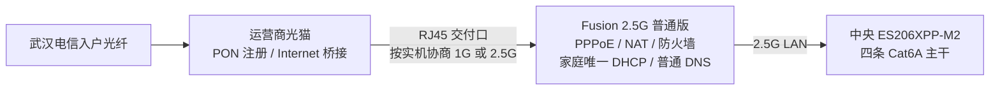

# 当前宽带接入：运营商光猫桥接 + Fusion PPPoE

**2026-11-18 用户决定：暂时保留运营商光猫，Internet 业务桥接，由 Omada Fusion 2.5G 普通版拨号。** 这是当前方案决定，不代表已配置或已测速。替换光猫的设备、案例和视频保存在[备用研究](ont-replacement-backup-research.md)，不进入当前采购。

## 已知信息与待确认项

| 项目 | 当前记录 |
|---|---|
| 地点 / 运营商 | 武汉 / 中国电信，用户已确认；取代早期“电信或联通未定” |
| 宽带 | 用户说明 1,000 Mbps；上行 30 Mbps 沿用旧规划，实际套餐/测速待核 |
| PON 制式 | **暂按 XG-PON 研究，未实机确认**；从原光猫设备/PON状态或装维记录核对 |
| 光猫 | 保留运营商现有设备；型号、硬件/固件、光头及交付网口未知 |
| 主路由 | Fusion 2.5G 普通版×1，仍计划采购、购买未确认；不在已下单的 7 台 Omada 订单内 |
| 待私下记录 | PPPoE 账号/密码、业务 VLAN、IPv6 PD、IPTV/固话需求、原配置备份、光猫管理地址、局端/登记条件 |
| 当前实际操作 | 本轮只研究与更新文件，未登录/修改光猫、Fusion 或家中网络 |

## 接线与职责

[Fusion 官方规格](https://www.omadanetworks.com/us/business-networking/omada-fusion-gateway-series/fusion-2.5g/)明确支持 PPPoE，提供 1×2.5G WAN 与 4×2.5G LAN/WAN；普通版没有 SFP/SFP+。光纤仍接光猫，电口接 Fusion WAN，Fusion LAN 再接中央交换机。光猫交付口只有 1G 时，全屋 2.5G 内网仍可按计划建设，但互联网不能因此越过该 1G 接口瓶颈。

现有[同一 LAN 按设备选用 OpenWrt](superpowers/specs/2026-11-05-home-device-rule-routing-design.md)方案继续有效：Fusion 保留主网关、唯一 DHCP 和独立普通 DNS；J3455 的 OpenWrt 只服务指定终端。运营商 WAN 业务 VLAN 与家庭 LAN 分区是不同概念；需要 WAN 标签不意味着要给全屋划分 VLAN。

## 实施交底

1. **配置前保存基线。** 记录原光猫型号、固件、实际 PON 制式、可用 LAN 口/协商速率、业务连接、管理地址、IPv4/IPv6 与有线测速；配置/认证信息只保存在私人备份中。保留原接线以便恢复。
2. **与电信确认 Internet 桥接和参数。** 取得 PPPoE 凭据、桥接口绑定、实际 VLAN/优先级及 IPv6 要求；不预填他人案例中的 VLAN。先确认 IPTV/固话是否在用。
3. **只调整需要桥接的 Internet 业务。** 不一键删除 IPTV、语音、TR-069/ITMS 管理连接，不把“关闭全部远程管理”当作桥接必要步骤。IPTV/固话按运营商实际方案保留并独立验收。
4. **Fusion 使用 PPPoE。** 若光猫已处理运营商标签、向电口交付无标签以太网，Fusion 不再重复打同一标签；只有明确要求透传标签时才在 Fusion WAN 配置对应 VLAN。MTU 按 PPPoE 默认/运营商要求，常见为 1492，不为追求数值强行设 1500。
5. **检查家庭地址服务。** 光猫不能向家庭 LAN 再提供冲突的 DHCP/RA；管理网段避免与家庭 LAN 重叠。按具体设备能力保留安全的光猫维护入口，不把 WAN 与家庭 LAN 混接，也不开放公网管理。
6. **先做有线 Internet 与双栈验收，再验 AP、智能家居和可选 OpenWrt。** 分开定位 WAN 与内网故障。带宽/IPv6/公网 IPv4 以实际结果记录，桥接不会自动解除 CGNAT 或提高套餐上行。

## 验收记录

以下全部为 `not_run`，施工/到货后填写实测值和日期。

| ID | 项目 | 通过标准 | 状态 |
|---|---|---|---|
| WAN-01 | 型号与 PON | 原光猫、硬件/固件、PON制式和交付口有记录；不再只靠 XG-PON 假设 | not_run |
| WAN-02 | 接线/协商 | 光猫交付口 → Fusion WAN，记录 1G/2.5G；Fusion LAN → ES206 为预期 2.5G | not_run |
| WAN-03 | PPPoE/路由职责 | Fusion 拨号成功，光猫 Internet 为桥接；家庭设备通过 Fusion 路由，无光猫造成的重复 NAT | not_run |
| WAN-04 | 地址与 VLAN | 家庭唯一 DHCP/普通 DNS 为 Fusion；WAN 标签只按交付要求处理，未重复标记 | not_run |
| WAN-05 | IPv4/IPv6 | 记录公网/CGNAT状态；IPv6 PD、终端地址、DNS、网页/大文件正常 | not_run |
| WAN-06 | 性能/稳定 | 有线速度、延迟、丢包和并发符合实际套餐/接口；开启所需安全功能后复测，不拿规格页 NAT 值代替 PPPoE 实测 | not_run |
| WAN-07 | IPTV/固话 | 若在用，直播/回看/组播与通话正常；若不用，记录不适用及确认依据 | not_run |
| WAN-08 | 重启与恢复 | Fusion 重拨、光猫与 Fusion 冷启动、断电恢复正常；有可执行原配置回退 | not_run |
| WAN-09 | 既有 LAN 分工 | 普通终端不依赖 J3455 在线；可选 OpenWrt 的终端恢复路径另按既有验收单测试 | not_run |

## 采购与备用边界

当前新增光猫、猫棒、MC420L **均为 0 台**；不改变 [Omada 已下单 7 台](network-order-20261118.md)、[完整网络计划 8 台](purchase-bom.md)或订单总额 $901.49。光猫继续占中央设备位的供电/散热空间；更换方案日后启用时再核外形、光头、额外电源和退换条件。

备用研究中新找到中兴 F7015TV3/F7005TV3、Nokia XG-040G-MD 和 PRX126 猫棒案例，也记录 VSOL 官方规格与湖北业务下发限制线索。它们均未在本户验收，不能据此删除现有光猫或下单实验设备。历史报价工作簿维持历史快照，现行方案以本文、BOM、拓扑和结构化采购数据为准。
